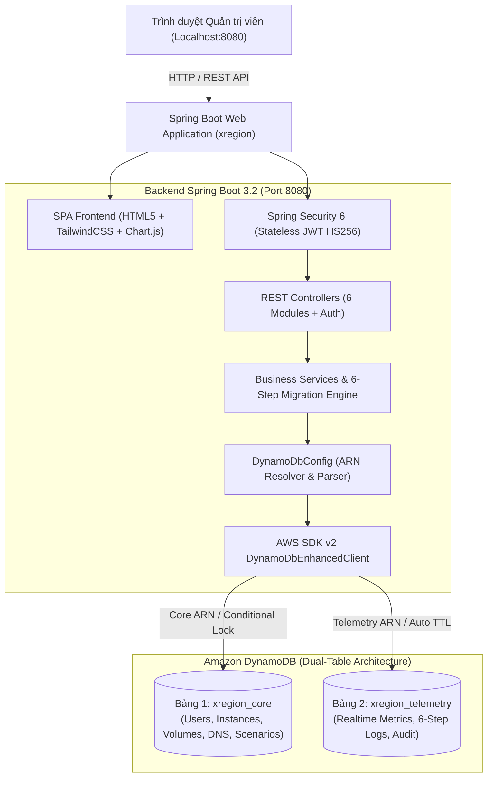

# XRegion - IaaS Multi-Region Control Plane Dashboard

> **Ứng dụng Web Dashboard điều khiển và quản trị hạ tầng IaaS đa vùng (Sydney `ap-southeast-2` & N. Virginia `us-east-1`)**, được xây dựng trên nền tảng **Spring Boot 3**, giao tiếp trực tiếp với **Amazon DynamoDB qua Table ARN**, và giao diện điều khiển **Single Page Application (SPA) Dark Theme**.

---

## 📌 1. Tổng Quan Kiến Trúc

Dự án hiện thực hóa đầy đủ kiến trúc chức năng trong **Chương 2, Phần I của Báo cáo Nhóm 5**, phục vụ quản trị toàn diện tài nguyên ảo hóa (Compute, Storage, Image, Network, Migration, Monitoring).



---

## ⚡ 2. Thiết Kế CSDL: Mô Hình 2 Bảng DynamoDB (Dual-Table via ARN)

Hệ thống kết nối trực tiếp với DynamoDB bằng **Table ARN**, tự động bóc tách AWS Region và Table Name mà không cần cấu hình thủ công:

| Bảng | Định Dạng Table ARN | Partition Key (PK) | Sort Key (SK) | Đặc Tính Kỹ Thuật |
| :--- | :--- | :--- | :--- | :--- |
| **`xregion_core`** | `arn:aws:dynamodb:<region>:<account-id>:table/xregion_core` | `PK` (String, e.g. `INSTANCE#vm-1`) | `SK` (`METADATA`) | • GSI1: `GSI1_PK` (query theo Region/Status)<br>• **Atomic Conditional Writes**: Khóa an toàn chống xung đột di trú (`409 Conflict`) |
| **`xregion_telemetry`** | `arn:aws:dynamodb:<region>:<account-id>:table/xregion_telemetry` | `PK` (String, e.g. `METRIC#vm-1`) | `SK` (`TS#<timestamp>#<uuid>`) | • Time-series append-only<br>• **DynamoDB TTL**: Tự động dọn dẹp sau 30 ngày (miễn phí I/O) |

---

## 🖥️ 3. 6 Module Chức Năng Cốt Lõi

1. **Compute - Quản lý máy ảo (NovaVM)**:
   - Khởi tạo máy ảo đa vùng (`ap-southeast-2` Sydney / `us-east-1` N. Virginia), chọn Flavor (m1.small, m1.medium, c5.large), OS Image, dung lượng EBS gp3.
   - Điều khiển vòng đời: **Khởi động (Start)**, **Dừng (Stop)**, **Khởi động lại (Reboot)**, **Xóa (Terminate)**, và mở Web Terminal Console.
2. **Storage - Quản lý lưu trữ (EBS gp3 & Cinder)**:
   - Cấp phát ổ đĩa độc lập (tùy biến IOPS, Throughput), gắn (Attach) / tháo (Detach) vào máy ảo.
   - **Sao chép Snapshot xuyên vùng (Cross-Region Snapshot Copy)** giữa Sydney và Virginia.
3. **Quản lý Image (Glance)**:
   - Kho ảnh hệ điều hành chuẩn: Ubuntu 22.04 LTS, Debian 12, Rocky Linux 9, Alpine 3.19.
   - Chụp ảnh snapshot từ máy ảo đang hoạt động thành Image tùy biến.
4. **Quản lý mạng & định tuyến tự động (Route 53 DNS)**:
   - Sơ đồ mạng VPC đa vùng (Sydney VPC: `10.0.0.0/16`, Virginia VPC: `10.1.0.0/16`).
   - Quản lý Floating IP / Elastic IP.
   - **Tự động định tuyến (Automated Cutover)**: Cập nhật bản ghi DNS Route 53 (A-Record) trỏ đến IP mới khi máy ảo di chuyển vùng.
5. **Kịch bản chuyển vùng (Migration Scenarios)**:
   - Thiết lập kịch bản di trú định kỳ (Cron Syntax) hoặc thủ công (Manual Run), kèm khóa an toàn Cooldown.
   - **Visual 6-Step Migration Pipeline Tracker**: Giao diện trực quan hóa 6 bước chuyển vùng kèm đèn trạng thái:
     - *Bước 1: Stop Source VM & Flush Cache*
     - *Bước 2: Create EBS Snapshot (gp3)*
     - *Bước 3: Cross-Region Snapshot Transfer*
     - *Bước 4: Provision Target Volume*
     - *Bước 5: Boot NovaVM in Target Region*
     - *Bước 6: Route 53 DNS Switchover*
   - Cửa sổ dòng lệnh Terminal stream log thời gian thực và cơ chế **Auto-Rollback** khi gặp sự cố.
6. **Giám sát chi phí, hiệu năng & nhật ký**:
   - Biểu đồ thời gian thực (Chart.js) đo lường CPU Usage %, RAM Usage %, Network I/O.
   - Thẻ phân tích chi phí đa vùng (Sydney Compute + Storage vs Virginia Standby + Cross-Region Transfer).
   - Bảng **System Audit Logs** truy vết mọi thao tác người dùng.

---

## 📁 4. Cấu Trúc Thư Mục Dự Án

```text
xregion/
├── pom.xml                            # Khai báo Spring Boot 3.2, Security, JWT, DynamoDB Enhanced Client
├── Dockerfile                         # Build image đa tầng (Maven 3.9 -> Eclipse Temurin 17 JRE Alpine)
├── docker-compose.yml                 # Khởi chạy toàn bộ hệ thống tại Local (App + DynamoDB Local)
├── .env.example                       # File mẫu biến môi trường (JWT, Table ARNs)
├── README.md                          # Tài liệu hướng dẫn dự án
└── src/main/
    ├── java/com/iaas/xregion/
    │   ├── XRegionApplication.java   # Main Class (@SpringBootApplication, @EnableScheduling)
    │   ├── Config/
    │   │   ├── DynamoDbConfig.java            # Parse ARN -> trích xuất Region, TableName & khởi tạo Client
    │   │   └── DynamoDbTableInitializer.java  # Khởi tạo bảng & nạp tài khoản admin mặc định
    │   ├── Controllers/               # REST Endpoints (/api/auth, /api/instances, /api/volumes, v.v.)
    │   ├── Services/                  # Nghiệp vụ 6 module, điều phối 6 bước di trú, conditional locks
    │   ├── Repositories/              # CoreEntityRepository, TelemetryRepository
    │   ├── Entity/                    # CoreEntity, TelemetryEntity, Enums
    │   ├── Model/                     # DTOs Request & Response
    │   ├── Security/                  # SecurityConfig, JwtTokenProvider, JwtAuthenticationFilter
    │   └── Exceptions/                # GlobalExceptionHandler (Xử lý 400, 401, 404, 409 Conflict)
    └── resources/
        ├── application.yaml           # Cấu hình Spring Boot, Port 8080, DynamoDB Table ARNs
        └── static/                    # Frontend SPA Dark Theme
            ├── index.html             # Layout 6 tab theo đúng mockup hình ảnh, Modals, Pipeline Visualizer
            ├── css/dashboard.css      # Dark mode styling (#0a0f1d, #162032, neon blue/emerald)
            └── js/app.js              # Router SPA, Fetch API với JWT, vẽ Chart.js, polling di trú
```

---

## 🚀 5. Hướng Dẫn Cài Đặt & Khởi Chạy Local

### Cách 1: Khởi chạy bằng Docker Compose (Khuyên dùng - Nhanh nhất)
Yêu cầu: Đã cài đặt **Docker** và **Docker Compose**. Ứng dụng chạy độc lập trên mọi máy (Windows, Linux, macOS) mà không cần cài đặt AWS CLI hay tài khoản AWS.

```bash
cd xregion

# Khởi chạy container App và DynamoDB Local
docker compose up -d
```

- **Web Dashboard**: Mở trình duyệt truy cập `http://localhost:8080`
- **DynamoDB Local Endpoint**: `http://localhost:8000`
- **Tài khoản quản trị mặc định**:
  - **Username**: `admin`
  - **Password**: `admin123`

### Cách 2: Khởi chạy trực tiếp bằng Maven (Chạy trên máy Host)
Yêu cầu: **Java 17+** và **Maven 3.9+**.

```bash
cd xregion

# Biên dịch và chạy ứng dụng
mvn spring-boot:run
```

---

## 📡 6. Danh Mục REST API Tham Chiếu

| Nhóm API | Method | Endpoint | Mô Tả |
| :--- | :--- | :--- | :--- |
| **Auth** | `POST` | `/api/auth/login` | Đăng nhập hệ thống, nhận Bearer JWT Token |
| | `GET` | `/api/auth/me` | Lấy thông tin tài khoản hiện tại |
| | `GET` | `/api/auth/health` | Kiểm tra trạng thái sức khỏe service |
| **Compute** | `GET` | `/api/instances` | Lấy danh sách máy ảo NovaVM đa vùng |
| | `POST` | `/api/instances` | Khởi tạo máy ảo mới (Launch Instance) |
| | `GET` | `/api/instances/{id}` | Lấy chi tiết thông tin máy ảo |
| | `POST` | `/api/instances/{id}/actions` | Thao tác vòng đời (`START`, `STOP`, `REBOOT`, `TERMINATE`) |
| **Storage** | `GET` | `/api/volumes` | Lấy danh sách ổ đĩa EBS gp3 |
| | `POST` | `/api/volumes` | Tạo mới ổ đĩa EBS gp3 độc lập |
| | `POST` | `/api/volumes/{id}/attach` | Đính kèm ổ đĩa vào máy ảo |
| | `POST` | `/api/volumes/{id}/detach` | Tháo ổ đĩa khỏi máy ảo |
| | `POST` | `/api/volumes/cross-region-copy`| **Sao chép Snapshot liên vùng (Cross-Region Copy)** |
| | `DELETE`| `/api/volumes/{id}` | Xóa ổ đĩa |
| **Images** | `GET` | `/api/images` | Lấy danh mục ảnh hệ điều hành Glance |
| | `POST` | `/api/images/snapshot` | Tạo ảnh Glance từ Snapshot máy ảo |
| **Network** | `GET` | `/api/network` | Lấy topology VPC, Subnets, Floating IPs, DNS Records |
| | `POST` | `/api/network/dns` | Cắt chuyển bản ghi Route 53 DNS (Automated Cutover) |
| **Migration**| `GET` | `/api/migrations/scenarios` | Lấy danh sách kịch bản chuyển vùng |
| | `POST` | `/api/migrations/scenarios` | Tạo kịch bản chuyển vùng mới |
| | `POST` | `/api/migrations/trigger` | **Kích hoạt quy trình di trú 6 bước (Conditional Lock)** |
| | `GET` | `/api/migrations/progress/{id}` | Polling tiến độ chuyển vùng (0 - 100%) & logs |
| **Monitoring**| `GET` | `/api/metrics/instances/{id}` | Lấy dữ liệu CPU, RAM, Network I/O và bảng chi phí đa vùng |
| | `GET` | `/api/logs` | Lấy danh sách System Audit Logs |

---

## 🔒 7. Cơ Chế Chống Xung Đột Di Trú (Concurrency Control)

Khi tiến trình di trú được kích hoạt, hệ thống áp dụng cơ chế **DynamoDB Atomic Conditional Writes**:
```java
UpdateItemEnhancedRequest<CoreEntity> request = UpdateItemEnhancedRequest.builder(CoreEntity.class)
    .item(instanceEntity)
    .conditionExpression(Expression.builder()
        .expression("attribute_exists(PK) AND (#st = :active OR #st = :shutoff)")
        .putExpressionName("#st", "Status")
        .putExpressionValue(":active", AttributeValue.fromS("ACTIVE"))
        .putExpressionValue(":shutoff", AttributeValue.fromS("SHUTOFF"))
        .build())
    .build();
```
👉 Nếu có 2 yêu cầu di trú cùng gửi tới một máy ảo hoặc máy ảo đang ở trạng thái `MIGRATING`, giao dịch thứ hai lập tức nhận mã lỗi `HTTP 409 Conflict`, ngăn ngừa hoàn toàn tình trạng xung đột dữ liệu hay deadlock.
