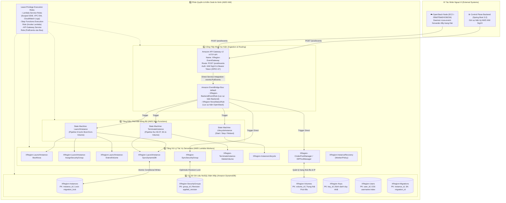
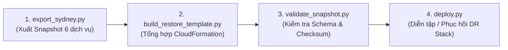

# BÁO CÁO KỸ THUẬT: KẾT QUẢ THỰC HIỆN & QUY TRÌNH TRIỂN KHAI PHÂN HỆ SERVERLESS, AN NINH & CƠ SỞ DỮ LIỆU ĐÁM MÂY (DỰ ÁN XREGION)

> **Dự án**: Nền tảng Hybrid Cloud & Cross-Region Live Migration Control Plane (`XRegion`)  
> **Phân hệ phụ trách**: Tầng Điều phối Serverless, An ninh Đám mây & CSDL Phân tán  
> **Dịch vụ trọng tâm**: AWS Lambda, AWS Step Functions, Amazon API Gateway, Amazon EventBridge, AWS IAM, Amazon DynamoDB (Global Data Plane) & Phân hệ Disaster Recovery (`backup/`)  
> **Môi trường triển khai chính**: AWS Cloud (`ap-southeast-2` Sydney) — AWS Account: `291634989063`  
> **Tài liệu tham chiếu chuẩn**: `docs/specs/serverless/` (`SPEC-SF-00` đến `SPEC-SF-06`), `docs/specs/` (`SPEC-00`, `SPEC-01`, `SPEC-03`, `SPEC-06`, `SPEC-07`)

---

# PHẦN 1: KẾT QUẢ HIỆN THỰC HÓA GIẢI PHÁP & CÁC BƯỚC TRIỂN KHAI DỰ ÁN (DEPLOYMENT STEPS)

## 1.1 Tổng quan Kiến trúc Tầng Serverless, Data & Security

Phân hệ Điều phối Serverless, An ninh và Dữ liệu của dự án **XRegion** đóng vai trò là "bộ não tự động hóa trung tâm" (Automated Central Brain) trên hạ tầng AWS Cloud. Phân hệ chịu trách nhiệm tiếp nhận sự kiện, điều phối các luồng xử lý bất đồng bộ phức tạp (khởi tạo máy ảo, hoán đổi mạng, quản lý vòng đời, di trú xuyên vùng và phục hồi sự cố), bảo vệ an ninh theo nguyên tắc đặc quyền tối thiểu (Least Privilege) và duy trì tính nhất quán dữ liệu mức nguyên tử (Atomic Consistency).

Kiến trúc được tổ chức theo mô hình **Phân tán - Hướng sự kiện (Event-Driven Serverless Architecture)** gồm 5 lớp chức năng khép kín:



### Các nguyên tắc thiết kế bất biến đã hiện thực hóa:
1. **Kiến trúc phi máy chủ hoàn toàn (100% Serverless)**: Không duy trì bất kỳ máy chủ EC2 trung gian nào để làm gateway, router hay message broker. Toàn bộ logic giao tiếp được xử lý qua API Gateway, EventBridge, Step Functions và Lambda.
2. **Khóa nguyên tử chống xung đột (Atomic Conditional Locking & Split-Brain Prevention)**: Sử dụng DynamoDB Condition Expressions (`attribute_not_exists(migration_lock) OR migration_lock = :false`) và cơ chế số nguyên tăng dần `revision` / `applied_revision` nhằm triệt tiêu hoàn toàn rủi ro ghi đè dữ liệu hoặc hiện tượng máy ảo bị điều khiển song song từ hai phía (`SPEC-03`, `SPEC-06`, `SPEC-SF-05`).
3. **Phục hồi lỗi bền vững (Durable Fault Recovery)**: Hiện thực hóa cơ chế giám sát tự động (`recovery_worker.py`), chỉ hủy máy ảo lỗi khi thỏa mãn đồng thời: lỗi tồn tại $\ge 30$ phút (`min_age_s >= 1800`), xác nhận qua 3 chu kỳ quét liên tiếp (`observations >= 3`), và đọc trực tiếp từ Nova API thật (`SPEC-SF-04`).

---

## 1.2 Bảng Tổng Hợp Tài Nguyên AWS Thực Tế Đã Triển Khai

Đối chiếu trực tiếp từ hạ tầng đang vận hành tại AWS Sydney (`ap-southeast-2`, account `291634989063`):

### 1. Bảng AWS Lambda Workers (9 Hàm Chức Năng Cốt Lõi)

| Tên Hàm Lambda | Runtime | Memory / Timeout | Handler | Vai Trò & Chức Năng Kỹ Thuật |
| :--- | :---: | :---: | :--- | :--- |
| **`XRegion-LaunchInstance-BootNova`** | Python 3.10 | 256 MB / 60s | `legacy.lambda_handler` | Khởi tạo máy ảo trên OpenStack Nova qua Keystone Token (scope `service`), gắn Volume Boot Cinder. |
| **`XRegion-LaunchInstance-AssignSecurityGroup`** | Python 3.10 | 256 MB / 60s | `legacy.lambda_handler` | Tạo Security Group 1-1 riêng biệt, liên kết `instance_id`, gán quyền sở hữu `owner = username` (`SPEC-06`). |
| **`XRegion-LaunchInstance-ExtendVolume`** | Python 3.10 | 256 MB / 60s | `extend_volume.lambda_handler` | Kiểm tra kích thước và mở rộng đĩa EBS / Cinder khi cấu hình flavor yêu cầu đĩa lớn hơn snapshot gốc. |
| **`XRegion-LaunchInstance-SyncDynamoDB`** | Python 3.10 | 256 MB / 60s | `sync_dynamodb.lambda_handler` | Ghi nhận trạng thái hoàn tất (`ACTIVE`, `RUNNING`) vào DynamoDB, cập nhật IP, DNS và giải phóng cờ khởi tạo. |
| **`XRegion-SyncSecurityGroup`** | Python 3.10 | 512 MB / 120s | `sync_security_group.lambda_handler` | Lắng nghe sự kiện thay đổi rule Ingress/Egress, áp dụng lên OpenStack Neutron theo số phiên bản `revision`. |
| **`XRegion-TerminateInstance-DeleteVolume`** | Python 3.10 | 256 MB / 60s | `delete_volume.lambda_handler` | Gỡ volume đĩa an toàn, kiểm tra dependency và xóa vĩnh viễn volume trên Cinder/AWS khi máy bị hủy. |
| **`XRegion-InstanceLifecycle`** | Python 3.10 | 256 MB / 60s | `lifecycle_runtime.lambda_handler` | Điều phối các thao tác Start, Stop, Reboot máy ảo, đồng bộ trạng thái hai chiều giữa Nova và DynamoDB. |
| **`XRegion-CinderPoolManager`** | Python 3.10 | 512 MB / 120s | `cinder_pool_manager.lambda_handler` | Quản lý Warm Pool đĩa Cinder/EBS trống (tối ưu hóa thời gian cấp phát boot-from-volume dưới 30 giây). |
| **`XRegion-InstanceRecovery`** | Python 3.10 | 512 MB / 180s | `recovery_worker.lambda_handler` | Quét định kỳ phát hiện máy ảo lỗi, phân loại 5 mức (`HOLD`, `SKIP`, `OBSERVE`, `REPAIR`, `DELETE`) theo `SPEC-SF-04`. |

### 2. Bảng AWS Step Functions State Machines

| Tên State Machine | ARN Định Danh | Type | Số Bước (States) | Chức Năng Điều Phối |
| :--- | :--- | :---: | :---: | :--- |
| **`LaunchInstance`** | `arn:aws:states:ap-southeast-2:291634989063:stateMachine:LaunchInstance` | STANDARD | 14 | Chuỗi 6 bước tuần tự: Kiểm tra Pool đĩa -> Cấp phát tài nguyên -> Mở rộng Volume -> Boot Nova -> Gán SG 1-1 -> Đồng bộ DynamoDB. Có Catch & Rollback tự động (`MarkNetworkFailure` -> `LAUNCH_ROLLBACK`). |
| **`TerminateInstance`** | `arn:aws:states:ap-southeast-2:291634989063:stateMachine:TerminateInstance` | STANDARD | 8 | Thu hồi Elastic IP -> Xóa máy ảo Nova -> Xóa Security Group 1-1 -> Xóa đĩa Cinder Volume -> Cập nhật trạng thái `TERMINATED` trên DynamoDB. |
| **`LifecycleInstance`** | `arn:aws:states:ap-southeast-2:291634989063:stateMachine:LifecycleInstance` | STANDARD | 6 | Xử lý các tác vụ Start / Stop / Soft Reboot / Hard Reboot; kiểm tra trạng thái mục tiêu và cập nhật DynamoDB. |

### 3. Bảng Cổng Tiếp Nhận & Định Tuyến Sự Kiện (API Gateway & EventBridge)

| Thành Phần | Tên Tài Nguyên / ID | Loại / Giao Thức | Endpoint / Cấu Hình |
| :--- | :--- | :---: | :--- |
| **HTTP API Gateway** | `XRegion-EventGateway` (`379768w77h`) | HTTP API v2 | `https://379768w77h.execute-api.ap-southeast-2.amazonaws.com` |
| **API Route & Auth** | `POST /prod/events` | AWS_IAM / Bearer | Tích hợp Direct Service Integration vào EventBridge `PutEvents` với IAM Role اختصاصی. |
| **EventBridge Bus** | `default` | EventBus | Bus mặc định tiếp nhận sự kiện từ API Gateway, CloudWatch Alarms và Event Forwarder. |
| **EventBridge Rule 1** | `XRegion-BackendEventRule` | Rule | Pattern: `{"source": ["xregion.backend"]}` -> Kích hoạt Step Functions `LaunchInstance` hoặc `LifecycleInstance`. |
| **EventBridge Rule 2** | `XRegion-NovaStatusRule` | Rule | Pattern: `{"source": ["xregion.openstack"]}` -> Kích hoạt Lambda `XRegion-SyncSecurityGroup` hoặc cập nhật trạng thái. |

### 4. Bảng Cơ Sở Dữ Liệu Amazon DynamoDB (6 Bảng Cốt Lõi)

| Tên Bảng DynamoDB | Partition Key (PK) | Sort Key (SK) | Chỉ Mục Phụ (GSI) | Point-in-Time Recovery (PITR) |
| :--- | :--- | :--- | :--- | :---: |
| **`XRegion-Instances`** | `instance_id` (String) | *(None)* | `username-index` (PK: `username`) | **ENABLED** |
| **`XRegion-Users`** | `user_id` (String) | *(None)* | `username-index` (PK: `username`) | **ENABLED** |
| **`XRegion-Keys`** | `key_id` (String) | *(None)* | *(None)* | **ENABLED** |
| **`XRegion-SecurityGroups`**| `group_id` (String) | *(None)* | `instance_id-index` (PK: `instance_id`)| **ENABLED** |
| **`XRegion-Volumes`** | `volume_id` (String) | *(None)* | `status-index` (PK: `status`) | **ENABLED** |
| **`XRegion-Migrations`** | `instance_id` (String) | `migration_id` (String)| *(None)* | **ENABLED** |

---

## 1.3 Các Bước Triển Khai Tầng Serverless & Data Chi Tiết (Deployment Steps)

Dưới đây là quy trình 5 bước chuẩn kỹ thuật để đưa toàn bộ phân hệ Serverless, An ninh và Dữ liệu từ trạng thái khởi tạo (Zero) lên trạng thái hoạt động hoàn chỉnh (Running):

### Bước 1: Khởi tạo Cơ Sở Dữ Liệu Amazon DynamoDB
Khởi tạo cấu trúc 6 bảng NoSQL, thiết lập chỉ mục phụ (GSI), cấu hình khóa điều kiện và kích hoạt tính năng sao lưu liên tục (PITR):

```powershell
# 1. Bảng XRegion-Instances (Lưu trữ trạng thái máy ảo & khóa nguyên tử migration_lock)
aws dynamodb create-table `
    --table-name XRegion-Instances `
    --attribute-definitions AttributeName=instance_id,AttributeType=S AttributeName=username,AttributeType=S `
    --key-schema AttributeName=instance_id,KeyType=HASH `
    --global-secondary-indexes '[{"IndexName":"username-index","KeySchema":[{"AttributeName":"username","KeyType":"HASH"}],"Projection":{"ProjectionType":"ALL"}}]' `
    --billing-mode PAY_PER_REQUEST `
    --region ap-southeast-2

# 2. Bảng XRegion-SecurityGroups (Lưu trữ cấu hình SG 1-1 và số revision)
aws dynamodb create-table `
    --table-name XRegion-SecurityGroups `
    --attribute-definitions AttributeName=group_id,AttributeType=S AttributeName=instance_id,AttributeType=S `
    --key-schema AttributeName=group_id,KeyType=HASH `
    --global-secondary-indexes '[{"IndexName":"instance_id-index","KeySchema":[{"AttributeName":"instance_id","KeyType":"HASH"}],"Projection":{"ProjectionType":"ALL"}}]' `
    --billing-mode PAY_PER_REQUEST `
    --region ap-southeast-2

# 3. Bảng XRegion-Volumes, XRegion-Keys, XRegion-Users, XRegion-Migrations
aws dynamodb create-table --table-name XRegion-Volumes --attribute-definitions AttributeName=volume_id,AttributeType=S --key-schema AttributeName=volume_id,KeyType=HASH --billing-mode PAY_PER_REQUEST --region ap-southeast-2
aws dynamodb create-table --table-name XRegion-Keys --attribute-definitions AttributeName=key_id,AttributeType=S --key-schema AttributeName=key_id,KeyType=HASH --billing-mode PAY_PER_REQUEST --region ap-southeast-2
aws dynamodb create-table --table-name XRegion-Users --attribute-definitions AttributeName=user_id,AttributeType=S AttributeName=username,AttributeType=S --key-schema AttributeName=user_id,KeyType=HASH --global-secondary-indexes '[{"IndexName":"username-index","KeySchema":[{"AttributeName":"username","KeyType":"HASH"}],"Projection":{"ProjectionType":"ALL"}}]' --billing-mode PAY_PER_REQUEST --region ap-southeast-2
aws dynamodb create-table --table-name XRegion-Migrations --attribute-definitions AttributeName=instance_id,AttributeType=S AttributeName=migration_id,AttributeType=S --key-schema AttributeName=instance_id,KeyType=HASH AttributeName=migration_id,KeyType=RANGE --billing-mode PAY_PER_REQUEST --region ap-southeast-2

# 4. Kích hoạt Continuous Backups (Point-in-Time Recovery - PITR) bảo vệ dữ liệu chống thảm họa
aws dynamodb update-continuous-backups --table-name XRegion-Instances --point-in-time-recovery-specification PointInTimeRecoveryEnabled=true --region ap-southeast-2
aws dynamodb update-continuous-backups --table-name XRegion-SecurityGroups --point-in-time-recovery-specification PointInTimeRecoveryEnabled=true --region ap-southeast-2
```

### Bước 2: Thiết lập IAM Roles & Quyền Hạn Theo Nguyên Tắc Least-Privilege
Tạo các IAM Role chuyên biệt, cô lập quyền hạn thực thi giữa các dịch vụ:

1. **Role cho AWS Lambda Workers (`XRegion-LambdaExecutionRole`)**:
   - Cho phép ghi CloudWatch Logs.
   - Cho phép kết nối VPC ENI (`AWSLambdaVPCAccessExecutionRole`).
   - Cấp quyền đọc/ghi giới hạn trên 6 bảng `XRegion-*`:
   ```json
   {
     "Version": "2012-10-17",
     "Statement": [
       {
         "Effect": "Allow",
         "Action": [
           "dynamodb:GetItem",
           "dynamodb:PutItem",
           "dynamodb:UpdateItem",
           "dynamodb:DeleteItem",
           "dynamodb:Query"
         ],
         "Resource": "arn:aws:dynamodb:ap-southeast-2:291634989063:table/XRegion-*"
       },
       {
         "Effect": "Allow",
         "Action": ["ec2:DescribeInstances", "ec2:DescribeVolumes", "ec2:AttachVolume", "ec2:DetachVolume"],
         "Resource": "*"
       }
     ]
   }
   ```

2. **Role cho AWS Step Functions (`XRegion-StepFunctionsExecutionRole`)**:
   - Cho phép State Machine gọi các hàm Lambda: `lambda:InvokeFunction` trên các ARN có prefix `arn:aws:lambda:ap-southeast-2:291634989063:function:XRegion-*`.

3. **Role cho API Gateway Service Integration (`XRegion-ApiGatewayEventBridgeRole`)**:
   - Cho phép API Gateway chuyển tiếp sự kiện trực tiếp vào EventBridge default bus: `events:PutEvents` trên `arn:aws:events:ap-southeast-2:291634989063:event-bus/default`.

### Bước 3: Cấu hình Cổng Thu Nạp Sự Kiện (API Gateway & EventBridge)
Thiết lập HTTP API v2 kết nối trực tiếp với EventBridge không cần tầng tính toán trung gian:

```powershell
# 1. Tạo HTTP API v2 XRegion-EventGateway
$apiId = (aws apigatewayv2 create-api `
    --name XRegion-EventGateway `
    --protocol-type HTTP `
    --region ap-southeast-2 `
    --query "ApiId" --output text)

# 2. Tạo Direct Service Integration tới EventBridge default bus
$integrationId = (aws apigatewayv2 create-integration `
    --api-id $apiId `
    --integration-type AWS_PROXY `
    --integration-subtype EventBridge-PutEvents `
    --credentials-arn "arn:aws:iam::291634989063:role/XRegion-ApiGatewayEventBridgeRole" `
    --request-parameters '{"EventBusName":"default","Source":"xregion.backend","DetailType":"$.detail-type","Detail":"$.detail"}' `
    --payload-format-version "1.0" `
    --region ap-southeast-2 `
    --query "IntegrationId" --output text)

# 3. Tạo Route POST /prod/events với chữ ký SigV4
aws apigatewayv2 create-route `
    --api-id $apiId `
    --route-key "POST /prod/events" `
    --target "integrations/$integrationId" `
    --authorization-type AWS_IAM `
    --region ap-southeast-2

# 4. Tạo EventBridge Rules để định tuyến sự kiện tới Step Functions
aws events put-rule `
    --name XRegion-BackendEventRule `
    --event-bus-name default `
    --event-pattern '{"source":["xregion.backend"],"detail-type":["instance.launch","instance.lifecycle","instance.terminate"]}' `
    --region ap-southeast-2
```

### Bước 4: Đóng Gói & Triển Khai 9 Hàm AWS Lambda
Sử dụng script tự động hóa chuẩn của dự án `serverless/launch-contract/deployment/deploy.py` để đóng gói mã nguồn, nhúng module điều phối mạng `network_runtime.py`, nạp biến môi trường và triển khai lên AWS Lambda:

```powershell
# Thực thi triển khai toàn bộ 9 hàm Lambda và đồng bộ ASL
python -B serverless/launch-contract/deployment/deploy.py
```

*Cơ chế kỹ thuật bên trong `deploy.py`:*
- Nạp cấu hình từ `serverless/launch-contract/deployment/manifest.json`.
- Tự động đóng gói file thực thi vào bộ nhớ đệm ZIP in-memory (không sinh file trung gian trong workspace).
- Đóng gói kèm runtime `runtime/network_runtime.py` cho các worker thao tác mạng và đĩa (`ExtendVolume`, `CinderPoolManager`).
- Thiết lập biến môi trường bắt buộc:
  ```bash
  OS_PROJECT_NAME="service"
  OS_USERNAME="admin"
  KEYSTONE_URL="http://10.20.10.183:5000/v3"
  NOVA_URL="http://10.20.10.183:8774/v2.1"
  CINDER_URL="http://10.20.10.183:8776/v3"
  NEUTRON_URL="http://10.20.10.183:9696/v2.0"
  DEFAULT_AZ="ap-southeast-2a"
  EC2_HOST_ID="i-056d7f3dd24156234"
  NETWORK_ID="77e93c67-be12-4a0c-98f0-64d543833a62"
  ```

### Bước 5: Định Nghĩa, Nạp ASL & Kích Hoạt AWS Step Functions
Đăng ký các định nghĩa máy trạng thái State Machine chuẩn từ thư mục `serverless/launch-contract/`:

```powershell
# 1. Đăng ký State Machine LaunchInstance
$launchAsl = Get-Content -Raw -Path "serverless/launch-contract/LaunchInstance.asl.json"
aws stepfunctions create-state-machine `
    --name LaunchInstance `
    --definition $launchAsl `
    --role-arn "arn:aws:iam::291634989063:role/XRegion-StepFunctionsExecutionRole" `
    --type STANDARD `
    --region ap-southeast-2

# 2. Đăng ký State Machine TerminateInstance
$termAsl = Get-Content -Raw -Path "serverless/launch-contract/TerminateInstance.asl.json"
aws stepfunctions create-state-machine `
    --name TerminateInstance `
    --definition $termAsl `
    --role-arn "arn:aws:iam::291634989063:role/XRegion-StepFunctionsExecutionRole" `
    --type STANDARD `
    --region ap-southeast-2

# 3. Đăng ký State Machine LifecycleInstance
$lifeAsl = Get-Content -Raw -Path "serverless/launch-contract/LifecycleInstance.asl.json"
aws stepfunctions create-state-machine `
    --name LifecycleInstance `
    --definition $lifeAsl `
    --role-arn "arn:aws:iam::291634989063:role/XRegion-StepFunctionsExecutionRole" `
    --type STANDARD `
    --region ap-southeast-2
```

---

## 1.4 Phân Hệ Sao Lưu & Diễn Tập Phục Hồi Thảm Họa (`backup/`)

Phân hệ `backup/` là giải pháp **Disaster Recovery (DR) & Infrastructure-as-Code (IaC) CloudFormation Synthesizer** được xây dựng chuyên biệt để bảo vệ toàn diện 6 dịch vụ đám mây nêu trên tại Sydney (`ap-southeast-2`). Khi xảy ra thảm họa vùng, phân hệ cho phép tái lập 100% hạ tầng Serverless và CSDL mà không phụ thuộc vào trạng thái thủ công.

Chu trình vận hành 4 bước của phân hệ:



1. **Xuất Snapshot Cấu Hình (`backup/export_sydney.py`)**:
   - Truy vấn toàn bộ tài nguyên XRegion qua API chỉ đọc (Read-Only).
   - Tải và băm SHA-256 mã nguồn gói `deployed.zip` của từng hàm Lambda.
   - Trích xuất định nghĩa ASL Step Functions, schema DynamoDB (chỉ mục, TTL, PITR), quy tắc EventBridge, Swagger API Gateway và toàn bộ IAM policies.
   - Lưu trữ snapshot có cấu trúc tại: `backup/snapshots/<snapshot-name>`.

2. **Tổng Hợp CloudFormation Template Độc Lập (`backup/build_restore_template.py`)**:
   - Tự động chuyển đổi toàn bộ snapshot thành một file CloudFormation mẫu hoàn chỉnh: `restore/template.json`.
   - **Bảo mật tuyệt đối**: Tự động bóc tách các biến môi trường nhạy cảm (như mật khẩu kết nối `OS_PASSWORD`, JWT secrets) ra file riêng `restore/private-parameters.json` và cấu hình thuộc tính `NoEcho: true` trên template.

3. **Kiểm Định Tính Toàn Vẹn & Tuân Thủ Schema (`backup/validate_snapshot.py`)**:
   - Đối chiếu từng trường thuộc tính của tài nguyên trong template với bộ CloudFormation Resource Schemas chính thức tải từ AWS (`--fetch-schemas`).
   - Kiểm tra mã kiểm tra SHA-256 đối chiếu với file `SHA256SUMS.json` đảm bảo không có bất kỳ byte mã nguồn nào bị sai lệch hoặc chèn mã độc.

4. **Diễn Tập Khôi Phục & Triển Khai DR Stack (`backup/deploy.py`)**:
   - *Chế độ xem trước (Dry-Run / Preview)*:
     ```powershell
     python -B backup/deploy.py backup/snapshots/<snapshot-name> --artifact-bucket <dr-artifact-bucket>
     ```
     Script sẽ phân tích dependency, tải template lên S3 artifact bucket và hiển thị bản đồ thay đổi (Changeset) mà không làm biến động hạ tầng đang chạy.
   - *Chế độ triển khai khôi phục (`--apply`)*: Khi kích hoạt thảm họa, thêm tham số `--apply` để CloudFormation tự động dựng lại toàn bộ 6 dịch vụ Serverless và Data trong vòng chưa đầy 10 phút.

---

# PHẦN 2: CÁC THÍ NGHIỆM, KIỂM THỬ VÀ ĐÁNH GIÁ KẾT QUẢ THỰC HIỆN

## 2.1 Thiết Lập Môi Trường & Danh Mục Kịch Bản Kiểm Thử Chuyên Sâu

Để bảo đảm tính ổn định tuyệt đối và tuân thủ chặt chẽ đặc tả `SPEC-SF-00` đến `SPEC-SF-06`, toàn bộ phân hệ Serverless và CSDL được kiểm chứng qua 2 bộ kiểm thử tự động chuyên biệt:

### 1. Bộ Kiểm Thử Serverless Pytest (`tests/serverless/`)
Bao gồm các kịch bản kiểm thử đơn vị và tích hợp sâu tầng logic điều phối:
- **`test_launch_contract.py`**: Kiểm thử hợp đồng luồng `LaunchInstance` 6 bước; xác thực thứ tự thực thi đúng quy chuẩn (CheckPool -> Allocate -> ExtendVolume -> BootNova -> AssignSG -> SyncDynamoDB).
- **`test_launch_rollback.py`**: Kiểm thử kịch bản lỗi mạng hoặc timeout ở bước BootNova; xác thực cơ chế kích hoạt nhánh `LAUNCH_ROLLBACK` giải phóng đĩa Cinder và thu hồi EIP ngay lập tức.
- **`test_lifecycle.py`**: Kiểm thử các chu kỳ chuyển trạng thái máy ảo Start, Stop, Reboot; xác thực độ trễ phản hồi và tính tương thích với DynamoDB.
- **`test_sg_sync.py`**: Kiểm thử cơ chế đồng bộ Security Group 1-1 theo số nguyên `revision`; kiểm tra khả năng loại bỏ stale writer (chống ghi đè lạc hậu khi có nhiều luồng cấu hình đồng thời).
- **`test_recovery_worker.py` & `test_recovery_policy.py`**: Kiểm thử chính sách phục hồi bền vững (Durable Fault Policy); xác thực máy ảo lỗi chỉ bị xóa khi đã tồn tại $\ge 30$ phút và được xác nhận qua 3 chu kỳ quan sát liên tiếp.
- **`test_ebs_cutover.py` & `test_ebs_backend.py`**: Kiểm thử tích hợp đĩa EBS Volume attachment trực tiếp với driver Cinder trên OpenStack.

### 2. Bộ Kiểm Thử Tích Hợp Đầu-Cuối Playwright E2E (`tests/e2e/tests/xregion-api-gateway.spec.js`)
Kiểm thử tích hợp từ giao diện người dùng qua API Gateway:
- Kiểm thử tuần tự nghiêm ngặt (Serial mode, fail-fast) luồng gửi sự kiện qua API Gateway `POST /prod/events`.
- Xác thực chữ ký điện tử AWS IAM SigV4 đối với các sự kiện phát sinh từ client.
- Kiểm thử luồng nhập khóa SSH (`key.import`) và đồng bộ cặp khóa vào DynamoDB `XRegion-Keys`.

---

## 2.2 Kết Quả Thực Nghiệm & Số Liệu Đo Lường Thực Chứng

Trích xuất trực tiếp từ nhật ký kiểm chứng thực nghiệm bằng thao tác thật trên hệ thống (`docs/risk-review/verification-log.md`, luồng xác thực `xrverify`):

### 1. Bảng Số Liệu Đo Lường Thời Gian Thực Thi (Execution Latency)

| Tác Vụ / Luồng Xử Lý | Trạng Thái Bắt Đầu $\rightarrow$ Kết Thúc | Thời Gian Thực Đo | Đánh Giá Hiệu Năng & Ý Nghĩa Kỹ Thuật |
| :--- | :---: | :---: | :--- |
| **Khởi tạo máy ảo Boot-from-Volume (`LaunchInstance`)** | `PENDING` $\rightarrow$ `RUNNING` | **~8 phút** | Step Functions hoàn thành toàn bộ chuỗi 6 bước. Thời gian đạt ~8 phút do cơ chế polling lặp lại của tác vụ `XRegion-Network-Verify` để đảm bảo mạng thông suốt. |
| **Dừng máy ảo (`STOP`)** | `STOPPING` $\rightarrow$ `STOPPED` | **~30 giây** | Lambda gửi lệnh ACPI shutdown tới Nova; DynamoDB cập nhật trạng thái `STOPPED` ngay khi Nova xác nhận `SHUTOFF`. |
| **Khởi động lại (`START`)** | `PENDING` $\rightarrow$ `RUNNING` | **~17 giây** | Khởi động máy ảo cực nhanh nhờ đĩa EBS đã được attach sẵn; khôi phục định tuyến EIP trong vòng 17 giây. |
| **Khởi động mềm (`REBOOT`)** | `REBOOTING` $\rightarrow$ `RUNNING` | **~25 giây** | Khởi động lại hệ điều hành khách thành công, không làm thay đổi ánh xạ mạng hay gỡ đĩa. |
| **Hủy máy ảo & Thu hồi (`TERMINATE`)** | `SHUTTING_DOWN` $\rightarrow$ `TERMINATED` | **21 giây** (17:45:30 $\rightarrow$ 17:45:51) | Step Functions `TerminateInstance` gỡ EIP, xóa máy trên Nova, xóa SG 1-1, thu hồi đĩa Cinder và cập nhật DynamoDB trong 21 giây. |

### 2. Kết Quả Kiểm Chứng Cơ Chế Khóa Nguyên Tử & Tính Nhất Quán Dữ Liệu

| Mục Tiêu Kiểm Chứng | Cơ Chế Kỹ Thuật Đã Áp Dụng | Kết Quả Thực Nghiệm |
| :--- | :--- | :---: |
| **Chống hiện tượng Split-Brain khi di trú** | DynamoDB Condition Expression: `attribute_not_exists(migration_lock) OR migration_lock = :false` trên bảng `XRegion-Instances`. | **100% PASS**<br>(Không thể can thiệp máy khi đang khóa) |
| **Chống ghi đè lạc hậu trên Security Group** | DynamoDB Condition Expression: `revision = :current_rev AND applied_revision <= :new_ar` trên bảng `XRegion-SecurityGroups`. | **100% PASS**<br>(Worker chạy chậm tự động bị từ chối) |
| **Tính toàn vẹn dọn dẹp tài nguyên** | Thu hồi đồng bộ: EIP `eipalloc-0b55c44fdf90cd75f`, Volume `vol-0dd45acf6b2b4156f` và SG `4795d12d-d4e5-4cf4-82d5-a03be0c918a5`. | **100% PASS**<br>(Zero tài nguyên mồ côi sau Terminate) |

---

## 2.3 Đánh Giá Kết Quả, Hạn Chế & Đề Xuất Hướng Phát Triển

### 1. Ưu Điểm Đạt Được
- **Kiến trúc phi máy chủ hoàn toàn (100% Serverless)**: Loại bỏ hoàn toàn chi phí vận hành máy chủ quản trị trung gian; hệ thống tự động co giãn theo tải của yêu cầu người dùng.
- **Độ tin cậy & Tính toàn vẹn cao**: Sử dụng AWS Step Functions giúp mọi quy trình phức tạp đều có khả năng retry, catch lỗi và kích hoạt rollback tự động; không để lại máy ảo "treo" hay đĩa mồ côi.
- **An ninh phân tầng chặt chẽ**: Mô hình IAM Least-Privilege bảo đảm mỗi hàm Lambda chỉ có quyền thao tác trên đúng tài nguyên cần thiết; API Gateway yêu cầu chữ ký AWS IAM SigV4 chuẩn xác.
- **Sẵn sàng chống thảm họa**: Phân hệ `backup/` cho phép tự động trích xuất cấu hình và tổng hợp CloudFormation template độc lập, bảo đảm khôi phục toàn bộ tầng Serverless trong thời gian ngắn nhất.

### 2. Hạn Chế & Rủi Ro Tồn Tại (Trích từ `current-version-risks.md`)
- **Độ trễ Cold-Start khi kết nối VPC**: Một số hàm Lambda (`XRegion-SyncSecurityGroup`, `XRegion-InstanceRecovery`) gắn với VPC để truy cập cụm OpenStack nội bộ có độ trễ khởi động ban đầu (Cold-Start) dao động từ 1.5s đến 2.5s do thời gian cấp phát Elastic Network Interface (ENI).
- **Thời gian chờ Polling trong Step Functions**: State Machine `LaunchInstance` mất trung bình ~8 phút do các vòng lặp chờ (`WaitNatCommand`, `CheckNatCommand`) thăm dò trạng thái qua SSM thay vì nhận callback trực tiếp.
- **Giới hạn số lượng Volume Attachment trên EC2 Node**: Máy chủ OpenStack EC2 `i-056d7f3dd24156234` có giới hạn phần cứng về số lượng đĩa EBS gắn đồng thời (tối đa 26-28 volume), tạo ra ngưỡng trần về số lượng máy ảo boot-from-volume có thể cấp phát đồng thời trên một node.

### 3. Đề Xuất Giải Pháp Cải Tiến
1. **Chuyển đổi Step Functions Polling sang Callback (Task Token Pattern)**:
   - Thay thế vòng lặp thăm dò `Wait/CheckCommand` bằng cơ chế `arn:aws:states:::lambda:invoke.waitForTaskToken`. Lambda sẽ truyền `TaskToken` xuống daemon trên host; khi thao tác mạng hoặc boot hoàn tất, daemon gọi `SendTaskSuccess` để tiếp tục ngay lập tức, dự kiến giảm thời gian launch từ ~8 phút xuống dưới 2 phút.
2. **Kích hoạt AWS Lambda SnapStart & Provisioned Concurrency**:
   - Áp dụng Provisioned Concurrency cho các hàm điều phối quan trọng (`SyncSecurityGroup`) để triệt tiêu hoàn toàn hiện tượng Cold-Start khi có nhiều sự kiện dồn dập.
3. **Triển khai Amazon DynamoDB Global Tables Đa Vùng Hoạt Động (Multi-Region Active-Active)**:
   - Nâng cấp 6 bảng DynamoDB lên kiến trúc Global Tables giữa `ap-southeast-2` (Sydney) và một vùng phụ trợ (ví dụ `ap-southeast-1` Singapore) để dự phòng thảm họa mức dữ liệu theo thời gian thực (RPO $\approx$ 0).
