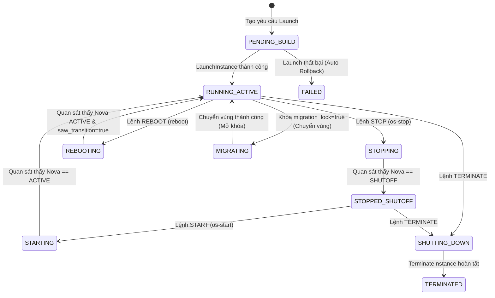
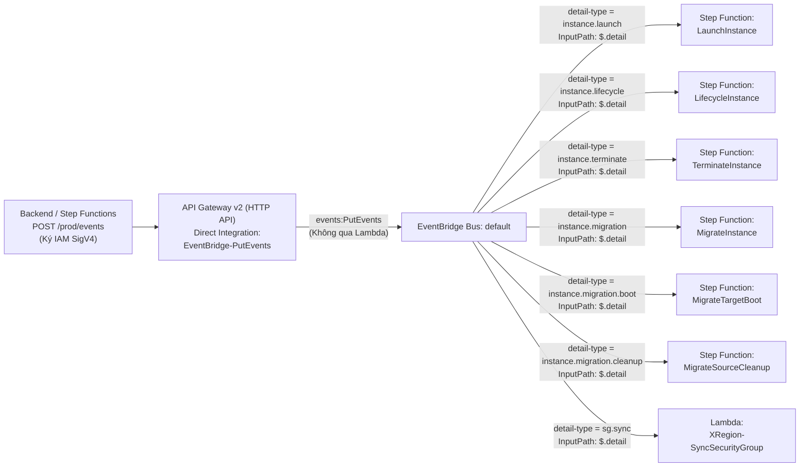

# BÁO CÁO KỸ THUẬT: GIẢI PHÁP THỰC HIỆN THEO CHỨC NĂNG, KẾT QUẢ & QUY TRÌNH TRIỂN KHAI PHÂN HỆ SERVERLESS (XREGION-EC2)

> **Dự án**: XRegion-EC2 — Hệ thống IaaS tích hợp tính năng tự động chuyển vùng máy ảo theo kịch bản  
> **Phạm vi phụ trách**: **AWS Step Functions**, **AWS Lambda** *(các hàm độc lập)*, **Amazon API Gateway**, **Amazon EventBridge**, **AWS IAM** và **Amazon DynamoDB (Global Data Plane)**  
> **Môi trường triển khai**: AWS Region `ap-southeast-2` (Sydney) — AWS Account `291634989063`  
> **Tài liệu đặc tả tham chiếu**: `docs/specs/serverless/` (`SPEC-SF-00` đến `SPEC-SF-09`) và `docs/specs/` (`SPEC-01`, `SPEC-02`, `SPEC-03`, `SPEC-04`, `SPEC-06`, `SPEC-07`, `SPEC-08`)

---

# PHẦN 1: GIẢI PHÁP THỰC HIỆN THEO 8 CHỨC NĂNG NGHIỆP VỤ CHUYÊN SÂU

Thay vì tách rời mô tả kiến trúc và triển khai gây lặp lại, toàn bộ phân hệ Serverless, An ninh và CSDL Đám mây của **XRegion-EC2** được trình bày trực tiếp theo **8 chức năng nghiệp vụ cốt lõi**, làm rõ luồng điều phối từng bước (Step-by-Step) của đầy đủ **6 AWS Step Functions**, cơ chế chuyển đổi trạng thái vòng đời và vai trò của từng dịch vụ AWS tham gia.

---

## Chức năng 1: Cấp phát & Khởi tạo Máy ảo Boot-from-Volume (`LaunchInstance`)

### 1.1 Mục tiêu & Cơ chế tổng quan
- Tự động hóa trọn vẹn quy trình khởi tạo một máy ảo NovaVM mới từ ổ đĩa EBS/Cinder sẵn sàng trong Warm Pool, cấp phát định tuyến mạng Linux NAT (iptables/nftables) trên host `i-056d7f3dd24156234`, tạo Security Group 1-1 cô lập theo chủ sở hữu và đồng bộ trạng thái cuối cùng về Amazon DynamoDB.
- Toàn bộ luồng được điều phối bất đồng bộ bởi State Machine **`LaunchInstance`** (`LaunchInstance.asl.json`, kiểu `STANDARD`, `TimeoutSeconds: 300`).

### 1.2 Sơ đồ Đồ thị Step Function (`LaunchInstance`)


*Hình 1.1: Đồ thị luồng thực thi và nhánh Auto-Rollback của State Machine `LaunchInstance`*

### 1.3 Giải thích chi tiết từng Step trong `LaunchInstance`

| Thứ tự / Tên Step | Loại State | Hàm Lambda / Hành động gọi | Nhiệm vụ chi tiết & Cơ chế Retry / Catch |
| :--- | :---: | :--- | :--- |
| **1. `CheckPool`** | `Task` | `XRegion-LaunchInstance-CheckPool` | Kiểm tra Warm Pool đĩa Cinder/EBS có volume rảnh phù hợp image không. Nếu gặp lỗi `PoolNotReady`, tự động **Retry tối đa 5 lần** với Exponential Backoff (`IntervalSeconds: 5, BackoffRate: 2`, tổng chờ ~155s). |
| **2. `AllocateResource`** | `Task` | `XRegion-LaunchInstance-AllocateResource` | Chiếm quyền (lease) một volume khả dụng từ Warm Pool và gắn định danh với `instance_id` đang khởi tạo. |
| **3. `ReserveNetwork`** | `Task` | `XRegion-Network-Reserve` | Cấp phát và giữ chỗ địa chỉ IP nội bộ (Private IP) cùng Elastic IP tĩnh trên bảng `XRegion-NetworkReservations` trong cửa sổ 300s. |
| **4. `ExtendVolume`** | `Task` | `XRegion-LaunchInstance-ExtendVolume` | So sánh dung lượng yêu cầu của Flavor với kích thước gốc của volume pool; gọi Cinder API mở rộng (extend) kích thước đĩa EBS nếu cần. |
| **5. `VolumeExtensionStatus` & `WaitVolumeExtension`** | `Choice` + `Wait` | *(Logic điều khiển ASL)* | Kiểm tra `$.volume_extension.status == "CONFIRMED"`. Nếu Cinder chưa xác nhận mở rộng xong, tạm dừng **5 giây** rồi gọi lại `ExtendVolume`. |
| **6. `BootNovaVM`** | `Task` | `XRegion-LaunchInstance-BootNova` | Xin Keystone Token (scope `service`) và gọi OpenStack Nova API khởi tạo máy ảo mới ở chế độ Boot-from-Volume từ đĩa vừa chuẩn bị. |
| **7. `CommitNetworkMapping`** | `Task` | `XRegion-Network-Commit` | Chốt ánh xạ chính thức giữa `nova_id`, Private IP và Elastic IP vào bảng `XRegion-NetworkMappings` trên DynamoDB. |
| **8. `AssignSecurityGroup`** | `Task` | `XRegion-LaunchInstance-AssignSecurityGroup` | Tạo Security Group 1-1 riêng biệt cho máy ảo (gắn `instance_id` và `owner = username` theo `SPEC-06`) và gắn vào cổng mạng Neutron của VM. |
| **9. `ApplyNatMapping`** | `Task` | `XRegion-Network-Dispatch` | Gửi lệnh qua AWS SSM Run Command xuống host `i-056d7f3dd24156234` để nạp quy tắc NAT (DNAT/SNAT) ánh xạ EIP vào Private IP của NovaVM. |
| **10-12. `WaitNatCommand` $\rightarrow$ `CheckNatCommand` $\rightarrow$ `ChoiceNatCommand`** | `Wait` + `Task` + `Choice` | `XRegion-Network-CheckCommand` | Chờ **3 giây**, sau đó kiểm tra trạng thái thực thi lệnh SSM trên host. Lặp lại cho đến khi `$.command_status == "SUCCEEDED"` (xác nhận `applied_generation` thành công theo `SPEC-SF-01`). |
| **13. `SyncDynamoDB`** | `Task` | `XRegion-LaunchInstance-SyncDynamoDB` | Cập nhật trạng thái cuối cùng (`ACTIVE` / `RUNNING`), IP public/private và metadata máy ảo vào `XRegion-Instances` và `XRegion-Nova`, kết thúc tại **`LaunchSuccess`**. |
| **Nhánh Rollback (`MarkNetworkFailure` $\rightarrow$ `ProvisioningFailed`)** | `Catch` + `Task` + `Choice` | `XRegion-LaunchInstance-SyncDynamoDB`, `XRegion-Network-*`, `XRegion-TerminateInstance-*` | Khi bất kỳ step nào phát sinh lỗi (`States.ALL`), luồng rẽ sang `MarkNetworkFailure`. Nếu đã cấp `nova_id` và `generation`, nhánh **`LAUNCH_ROLLBACK`** tự động gỡ NAT trên host, xóa NovaVM tạm, giải phóng giữ chỗ mạng, xóa SG 1-1 và xóa volume, ghi kết quả cleanup vào DynamoDB rồi kết thúc tại **`ProvisioningFailed`**. |

---

## Chức năng 2: Quản trị Vòng đời Máy ảo (`LifecycleInstance` & `XRegion-InstanceLifecycle`)

### 2.1 Mục tiêu & Biểu đồ Chuyển đổi Trạng thái Vòng đời (`SPEC-01`)
Hệ thống quản trị chặt chẽ mọi chuyển dịch trạng thái của máy ảo nhằm bảo đảm đồng bộ tuyệt đối giữa giao diện người dùng, CSDL DynamoDB và hạ tầng OpenStack Nova, **tuyệt đối nghiêm cấm** các thao tác gây treo đĩa như `shelve`/`unshelve`.



*Hình 1.2: Biểu đồ chuyển đổi trạng thái trong vòng đời máy ảo XRegion (`SPEC-01` & `SPEC-SF-06`)*

### 2.2 Sơ đồ Đồ thị Step Function (`LifecycleInstance`)


*Hình 1.3: Đồ thị luồng thực thi Observe-before-write của State Machine `LifecycleInstance`*

### 2.3 Giải thích từng Step & Nguyên lý Observe-before-write (`XRegion-InstanceLifecycle`)
Khác với các hàm có tiền tố `LaunchInstance-*`, **`XRegion-InstanceLifecycle`** (`lifecycle_runtime.py`) là một **hàm Lambda độc lập** được thiết kế theo 4 chế độ (`LOAD`, `DISPATCH`, `STATUS`, `SYNC`) nhằm giải quyết triệt để lỗi ghi sớm trạng thái (premature status write) khi Nova mới chỉ chấp nhận HTTP 202:

| Step trong ASL | Chế độ Lambda (`$.mode`) | Hành vi kỹ thuật chi tiết |
| :--- | :---: | :--- |
| **`SetModeLoad` $\rightarrow$ `LoadInstance`** | `LOAD` | Đọc bản ghi máy ảo từ `XRegion-Instances` và `XRegion-Nova`; kiểm tra trạng thái ý định (`STOPPING`, `STARTING`, `REBOOTING`). Phát hiện yêu cầu trùng lặp (`ALREADY_HANDLED`) hoặc phát hiện máy đã ở sẵn trạng thái đích (`already_at_target=true`) để nhảy thẳng tới `SYNC`. |
| **`SetModeDispatch` $\rightarrow$ `DispatchAction`** | `DISPATCH` | Gửi lệnh `os-stop`, `os-start` hoặc `reboot` tới OpenStack Nova API. Nếu máy đang ở trạng thái `SHELVED` / `SHELVED_OFFLOADED` sẽ lập tức trả về `REJECTED` (cấm `unshelve` theo `SPEC-01`). |
| **`WaitStatus` $\rightarrow$ `SetModeStatus` $\rightarrow$ `CheckStatus`** | `STATUS` | Tạm chờ **5 giây** mỗi vòng lặp, gọi trực tiếp Nova API (`GET /servers/{nova_id}`) để đọc trạng thái thực tế (`$.observed_status`) và `$.task_state`. Với thao tác `REBOOT`, yêu cầu phải ghi nhận biến `$.saw_transition == true` và `$.task_state == null` mới coi là đã khởi động lại xong. |
| **`SetModeSync` $\rightarrow$ `SyncDynamoDB`** | `SYNC` | **Chỉ được gọi sau khi `ChoiceStatus` quan sát thấy Nova đạt đúng trạng thái đích**. Sử dụng DynamoDB `ConditionExpression` cập nhật đồng bộ cả bảng `XRegion-Instances` và `XRegion-Nova` sang trạng thái cuối (`STOPPED` hoặc `RUNNING`). |

---

## Chức năng 3: Hủy Máy ảo & Thu hồi Tài nguyên Triệt để (`TerminateInstance`)

### 3.1 Mục tiêu & Cơ chế tổng quan
Bảo đảm khi quản trị viên hủy một máy ảo, toàn bộ các tài nguyên đi kèm trên cả OpenStack và AWS (luật Linux NAT, máy ảo Nova, Security Group 1-1, Elastic IP, ổ đĩa EBS/Cinder và bản ghi DynamoDB) được dọn dẹp sạch theo thứ tự an toàn, không để lại tài nguyên mồ côi gây thất thoát chi phí.

### 3.2 Sơ đồ Đồ thị Step Function (`TerminateInstance`)


*Hình 1.4: Đồ thị luồng thu hồi tài nguyên toàn diện của State Machine `TerminateInstance`*

### 3.3 Giải thích chi tiết từng Step trong `TerminateInstance`

| Thứ tự / Tên Step | Hàm Lambda được gọi | Nhiệm vụ chi tiết |
| :--- | :--- | :--- |
| **1. `LoadNetworkContext`** | `XRegion-Network-Release` | Nạp thông tin ánh xạ mạng (`private_ip`, `elastic_ip`, `generation`) từ `XRegion-NetworkMappings` để chuẩn bị gỡ bỏ định tuyến. |
| **2-5. `RemoveNatMapping` $\rightarrow$ `WaitNatCommand` $\rightarrow$ `CheckNatCommand`** | `XRegion-Network-Dispatch`, `XRegion-Network-CheckCommand` | Gửi lệnh SSM xuống host OpenStack để xóa rule iptables/nftables của máy ảo và lặp kiểm tra mỗi **3 giây** cho đến khi xác nhận gỡ NAT thành công (`SUCCEEDED`). |
| **6. `DeleteNovaVM`** | `XRegion-TerminateInstance-DeleteNova` | Gọi OpenStack Nova API xóa thực thể máy ảo khỏi hypervisor KVM và chờ giải phóng port mạng Neutron. |
| **7. `FinalizeNetworkRelease`** | `XRegion-Network-Release` | Giải phóng khóa giữ chỗ địa chỉ IP trên bảng `XRegion-NetworkMappings` và `XRegion-NetworkReservations` (có Retry cho lỗi xung đột `ConditionalCheckFailedException` / `TransactionCanceledException`). |
| **8. `DeleteSecurityGroup`** | `XRegion-TerminateInstance-DeleteSecurityGroup` | Xóa Security Group 1-1 tương ứng của máy ảo trên OpenStack Neutron và dọn bản ghi liên kết `instance_id` trên bảng `XRegion-SecurityGroups` (`SPEC-06`). |
| **9-10. `DeleteVolume` & `VolumeDeletionStatus`** | `XRegion-TerminateInstance-DeleteVolume` | Gỡ gắn (detach) và xóa vĩnh viễn ổ đĩa Cinder/EBS của máy ảo; chờ mỗi **5 giây** cho tới khi xác nhận `$.volume_cleanup.status == "DELETED"`. |
| **11. `SyncDynamoDB`** | `XRegion-TerminateInstance-SyncDynamoDB` | Thực thi xóa bản ghi máy ảo (`delete_item` hoặc cập nhật `TERMINATED` theo `SPEC-SF-02`) trên DynamoDB, kết thúc tại **`TerminationSuccess`**. |

---

## Chức năng 4: Chuyển vùng Máy ảo Cross-Region Live Migration (`MigrateInstance`, `MigrateTargetBoot`, `MigrateSourceCleanup`)

Quá trình di trú máy ảo hai chiều giữa hai Region (`us-east-1` $\leftrightarrow$ `ap-southeast-2`) được tách thành **3 State Machines phối hợp xuyên vùng** theo mô hình **Active-Passive** (`SPEC-03`, `SPEC-SF-08`, `SPEC-SF-09`): máy ảo mới tại vùng đích chuyển sang `RUNNING` (Active), còn máy ảo nguồn chỉ bị dọn dẹp sau khi toàn bộ pha đích và đồng bộ DynamoDB đã thành công.

### 4.1 Pha Nguồn: Tạo & Sao chép Snapshot Xuyên Vùng (`MigrateInstance`)
- **Phạm vi & Cấu hình**: Triển khai tại vùng nguồn (`SPEC-SF-08` v1.2.0), kiểu `STANDARD`, `TimeoutSeconds: 900` (15 phút), kích hoạt bởi EventBridge Rule `XRegion-InstanceMigrationRule` (`InputPath: "$.detail"`).
- **Chính sách Retry**: Mọi Task Lambda retry 2 lần (`IntervalSeconds: 2`, `BackoffRate: 2`) cho lỗi `Lambda.ServiceException`, `Lambda.AWSLambdaException`, `Lambda.SdkClientException`.


*Hình 1.5: Đồ thị luồng thực thi và Compensating Rollback của State Machine `MigrateInstance`*

| Thứ tự / Tên Step | Loại State | Hàm Lambda / Hành động gọi | Nhiệm vụ chi tiết |
| :--- | :---: | :--- | :--- |
| **1. `CleanPendingSnapshots`** | `Task` | `XRegion-Migrate-CleanSnapshots` | Quét và hủy toàn bộ các EBS Snapshot đang bị treo ở trạng thái `pending` của `source_volume_id` tại cả `source_region` và `dest_region` trước khi bắt đầu phiên mới. |
| **2. `StopSourceInstance`** | `Task` | `XRegion-Migrate-StopSource` | Cập nhật `XRegion-Instances` (`current_status = "MIGRATING"`), gửi lệnh `os-stop` tới Nova tại `source_region` và chờ máy ảo đạt trạng thái `SHUTOFF` để đảm bảo toàn vẹn dữ liệu đĩa. |
| **3. `StartSourceSnapshot` $\rightarrow$ `WaitSourceSnapshot` $\rightarrow$ `CheckSourceSnapshot` $\rightarrow$ `ChoiceSourceSnapshot`** | `Task` + `Wait` + `Choice` | Lambda tạo & kiểm tra Snapshot | Khởi tạo `ec2.create_snapshot` trên `source_volume_id` tại `source_region` (trả về `source_snapshot_id`), sau đó dùng vòng lặp polling không chặn mỗi **5 giây** tới khi `describe_snapshots` xác nhận `completed`. |
| **4. `StartCopySnapshot` $\rightarrow$ `WaitCopySnapshot` $\rightarrow$ `CheckCopySnapshot` $\rightarrow$ `ChoiceCopySnapshot`** | `Task` + `Wait` + `Choice` | Lambda copy & kiểm tra Snapshot | Khởi tạo `ec2.copy_snapshot` từ `source_snapshot_id` sang `dest_region` (trả về `dest_snapshot_id`), polling mỗi **5 giây** tại vùng đích tới khi đạt `completed`. |
| **5. `TriggerTargetLaunch`** | `Task` | Lambda gửi HTTP SigV4 | Gửi sự kiện `instance.migration.boot` (ký AWS IAM SigV4 `execute-api`) tới **API Gateway của `dest_region`** để kích hoạt `MigrateTargetBoot`, kết thúc pha nguồn tại **`MigrationSourceSuccess`**. |
| **Nhánh Rollback (`MarkMigrationFailure` $\rightarrow$ `MigrationFailed`)** | `Catch` + `Task` | Chuỗi Compensating Rollback | Khi bất kỳ step nào lỗi (`States.ALL`): `RollbackDeleteDestSnapshot` $\rightarrow$ `RollbackDeleteSourceSnapshot` $\rightarrow$ `RollbackStartSourceVM` (gọi Nova `os-start` bật lại VM nguồn) $\rightarrow$ `RecordMigrationRollbackResult` (mở khóa `migration_lock = false`, `current_status = "ACTIVE"`, `XRegion-Migrations.status = "FAILED"`). |

### 4.2 Pha Đích: Dựng Máy ảo Từ Snapshot & Rollback 2 Tầng (`MigrateTargetBoot`)
- **Phạm vi & Cấu hình**: Triển khai tại **cả hai vùng** (`us-east-1` và `ap-southeast-2`, `SPEC-SF-09` v1.11.0), kiểu `STANDARD`, `TimeoutSeconds: 600` (10 phút), kích hoạt bởi EventBridge Rule `XRegion-MigrateTargetBootRule` (`detail-type = "instance.migration.boot"`, `InputPath: "$.detail"`).


*Hình 1.6: Đồ thị luồng thực thi và Rollback 2 tầng của State Machine `MigrateTargetBoot`*

| Thứ tự / Tên Step | Loại State | Hàm Lambda / Hành động gọi | Nhiệm vụ chi tiết |
| :--- | :---: | :--- | :--- |
| **1. `CreateVolumeFromSnapshot` + `WaitTargetVolume` / `CheckTargetVolume` / `ChoiceTargetVolume`** | `Task` + `Wait` + `Choice` | `XRegion-MigrateTarget-Volume` | Tạo EBS Volume (`Encrypted=True`, `VolumeType=gp3`) từ `dest_snapshot_id` cùng AZ với `StorageHost`, gắn tag `xregion-cinder-ebs-v1`, đăng ký vào Cinder (`os-volume_manage`, `bootable=true`), polling mỗi **5 giây** tới khi Cinder & EBS đều `available`. |
| **2. `ReserveNetwork`** | `Task` | `XRegion-MigrateTarget-Network` | Dùng `reservation_id = execution_arn`, kiểm tra SSH Keypair (`key_id`) tồn tại sẵn ở `dest_region`; ưu tiên lấy EIP rảnh từ Warm Pool và **tự động `ec2.allocate_address(Domain="vpc")` nếu Pool cạn** để không làm nghẽn di trú. |
| **3. `BootNovaVM`** | `Task` | `XRegion-MigrateTarget-BootNova` | Gọi Nova `POST /servers` tại `dest_region` boot trực tiếp từ `cinder_volume_id` (`delete_on_termination=False`), gắn port Neutron vừa tạo và polling mỗi **3 giây** tới khi Nova đạt `ACTIVE`. |
| **4. `CommitNetworkMapping`** | `Task` | `XRegion-MigrateTarget-Network` | Chốt ánh xạ chính thức giữa AWS ENI và OpenStack TAP interface vào `XRegion-NetworkMappings` / `XRegion-NetworkReservations`, gắn tag `ClaimedBy = target_nova_id` cho EIP. |
| **5. `AssignSecurityGroup`** | `Task` | `XRegion-MigrateTarget-AssignSecurityGroup` | Tạo Neutron Security Group 1-1 mới (`name = target_nova_id`, `owner = username`), parse chuẩn `inbound_rules` và `outbound_rules` từ bản gốc, lưu `XRegion-SecurityGroups` và **đồng bộ 100% rule xuống Neutron SG mới**. |
| **6. `ApplyNatMapping` $\rightarrow$ `WaitNatCommand` $\rightarrow$ `CheckNatCommand` $\rightarrow$ `ChoiceNatCommand`** | `Task` + `Wait` + `Choice` | `XRegion-MigrateTarget-Network` | Gắn EIP vào `gateway_private_ip` (`ec2.associate_address`), phát lệnh SSM `APPLY` thiết lập `nftables` DNAT/SNAT và polling mỗi **3 giây** tới khi `SUCCEEDED`. |
| **7. `SyncDynamoDB`** | `Task` | `XRegion-MigrateTarget-SyncDynamoDB` | Cập nhật `XRegion-Nova` (`target_nova_id`), `XRegion-Volumes` (`IN_USE`), `XRegion-SecurityGroups`, `XRegion-Instances` (`current_region = dest_region`, `current_status = "RUNNING"`, `active_nova_id = target_nova_id`, append `nova_ids`, `migration_lock = false`) và `XRegion-Migrations` (`COMPLETED`, 100%). |
| **8. `TriggerSourceCleanup`** | `Task` | Lambda gửi HTTP SigV4 | Gửi sự kiện `instance.migration.cleanup` (ký IAM SigV4) tới API Gateway của `source_region` để kích hoạt Step Function **`MigrateSourceCleanup`**, kết thúc tại **`MigrateBootSuccess`**. |
| **Rollback 2 Tầng (`MarkMigrationTargetFailure` $\rightarrow$ `MigrationBootFailed`)** | `Catch` + `Choice` + `Task` | Bồi hoàn Vùng đích & Vùng nguồn | **Tầng 1 (Vùng đích)** chia 2 nhánh: nếu đã `CommitNetworkMapping`/`APPLY` thì chạy `RollbackNat` (SSM `REMOVE`) $\rightarrow$ `RollbackSecurityGroup` $\rightarrow$ `RollbackDeleteNova` $\rightarrow$ `RollbackReleaseEIP` (`FINALIZE`); nếu lỗi trước Commit thì bỏ qua SSM `REMOVE`, dùng `RollbackReleaseLeasePreCommit` dọn trực tiếp theo `LEASE#`; sau đó xóa Cinder/EBS Volume và `dest_snapshot_id`. **Tầng 2 (Vùng nguồn)**: `TriggerSourceRollback` giữ nguyên EIP + NAT cũ, mở `migration_lock = false` và gửi API Gateway `source_region` kích hoạt **`LifecycleInstance` (`action = "START"`)** bật lại Source VM. |

### 4.3 Pha Dọn dẹp Nguồn: Thu hồi VM Nguồn & Trả EIP về Warm Pool (`MigrateSourceCleanup`)
- **Phạm vi & Cấu hình**: Triển khai tại vùng nguồn (`SPEC-SF-09` v1.10.0), kiểu `STANDARD`, `TimeoutSeconds: 300` (5 phút), `Retry` 2 lần lỗi Lambda, `Catch -> SourceCleanupFailed`. Chỉ được kích hoạt sau khi `MigrateTargetBoot` hoàn tất `SyncDynamoDB`.


*Hình 1.7: Đồ thị luồng thu hồi tài nguyên vùng nguồn của State Machine `MigrateSourceCleanup`*

| Thứ tự / Tên Step | Nhiệm vụ chi tiết |
| :--- | :--- |
| **1. `LoadSourceContext`** | Nạp thông tin định danh VM nguồn (`source_nova_id`, `source_volume_id`, `source_snapshot_id`, ánh xạ mạng) tại `source_region`. |
| **2. `RemoveSourceNat` (`Wait 3s` / `CheckSourceNat`)** | Phát lệnh SSM Run Command `REMOVE` gỡ quy tắc `nftables` DNAT/SNAT của VM nguồn trên Gateway Host và kiểm tra tới khi `SUCCEEDED`. |
| **3. `DeleteSourceNova`** | Gửi lệnh xóa Nova VM nguồn cũ (`DELETE /servers/{source_nova_id}`) khỏi hypervisor KVM tại `source_region`. |
| **4. `ReleaseSourceNetworkAndEIP` (`FINALIZE`)** | Disassociate EIP khỏi ENI, unassign `gateway_private_ip`, xóa Neutron port, gỡ tag `ClaimedBy`/`NovaId`/`ReservationId`, xóa `EIP#`/`PRIVATEIP#`/`LEASE#` — **trả EIP nguồn về lại Warm Pool** (tuyệt đối không gọi `ec2.release_address()`). |
| **5. `DeleteSourceSecurityGroup`** | Xóa Neutron Security Group 1-1 cũ của `source_nova_id` tại `source_region`. |
| **6. `DeleteSourceVolumeAndSnapshot`** | Polling xóa sạch Cinder Volume và EBS Volume nguồn (tránh lỗi `VolumeInUse`), xóa `source_snapshot_id`, cập nhật `XRegion-Volumes = DELETED` và `XRegion-Nova[source_nova_id].status = TERMINATED` (không chạm `XRegion-Instances.active_nova_id`). |

---

## Chức năng 5: Quản lý Vùng đệm Tài nguyên Sẵn sàng (`XRegion-CinderPoolManager` & `XRegion-EIPPoolManager`)

Đây là 2 hàm **AWS Lambda độc lập** (không mang tiền tố Step Function) được kích hoạt định kỳ bởi **Amazon EventBridge Scheduler** để duy trì sẵn tài nguyên dự phòng ở mức chi phí tối ưu:

### 5.1 Quản lý Warm Pool Ổ đĩa Cinder/EBS (`XRegion-CinderPoolManager`)
- **Mã nguồn**: `serverless/launch-contract/XRegion-CinderPoolManager/cinder_pool_manager.py` (`SPEC-SF-03`).
- **Mục tiêu**: Luôn duy trì chính xác tối đa **2 ổ đĩa bootable Cinder/EBS rảnh rỗi** (`max(0, 2 - occupied)`) để `LaunchInstance` có thể lấy dùng ngay mà không mất thời gian tạo đĩa và copy image từ đầu.
- **Cơ chế an toàn**:
  - **Khóa nguyên tử `EBS-POOL-LOCK`**: Tránh hai phiên chạy song song tạo dư thừa volume.
  - **Bảo vệ gửi lệnh mơ hồ (Ambiguous-POST Guard)**: Trước khi gọi Cinder API tạo volume `xregion-ebs-pool-{request_id}`, hàm ghi trước cờ `post_attempted = :yes` bằng DynamoDB `ConditionExpression` (`attribute_not_exists(post_attempted) AND #s = :creating`). Nếu mất kết nối giữa chừng, lần chạy sau sẽ thực hiện đối soát (`reconcile`) qua metadata thay vì tạo trùng lặp.
  - **Kiểm chứng ánh xạ (`validate_ebs_mapping`)**: Xác nhận volume Cinder mới tạo khớp 100% với `ebs_volume_id`, `cinder_volume_type` và `image_id` trước khi đánh dấu trạng thái `AVAILABLE`.

### 5.2 Quản lý Warm Pool Elastic IP (`XRegion-EIPPoolManager`)
- **Mã nguồn**: `serverless/launch-contract/XRegion-EIPPoolManager/eip_pool_manager.py` (`SPEC-02`).
- **Mục tiêu**: Giữ chính xác tối đa **`POOL_LIMIT = 2`** địa chỉ Elastic IP rảnh rỗi (gắn tag `Project=xregion`), tự động thu hồi các EIP dư thừa để tránh bị AWS tính phí IP nhàn rỗi.
- **Cơ chế hoạt động**:
  - Quét toàn bộ địa chỉ EIP chưa gắn (`AssociationId`, `NetworkInterfaceId` và `InstanceId` đều trống).
  - **Bảo vệ phiên Launch đang chạy**: Tra cứu bảng `XRegion-NetworkReservations` để loại trừ các EIP đang được một luồng `LaunchInstance` giữ chỗ trong cửa sổ timeout **300 giây**, không giải phóng nhầm IP đang cấp phát.
  - **Giải phóng theo thứ tự FIFO**: Nếu số lượng EIP rảnh vượt quá 2, hàm sắp xếp theo thời gian rảnh trên tag `IdleSince` (hoặc timestamp trong tag `Name: eip-reserve-{ts}`) và giải phóng các EIP cũ nhất trước. Nhật ký kiểm toán được ghi tập trung vào CloudWatch Logs.

---

## Chức năng 6: Đồng bộ Nhóm Bảo mật & Tường lửa 1-1 theo Phiên bản (`XRegion-SyncSecurityGroup`)

- **Mã nguồn**: `serverless/launch-contract/XRegion-SyncSecurityGroup/sync_security_group.py` (`SPEC-SF-05`).
- **Mục tiêu**: Đảm bảo mọi thay đổi quy tắc tường lửa (Ingress/Egress) do quản trị viên chỉnh sửa trên Dashboard được đồng bộ chính xác xuống OpenStack Neutron Security Group của máy ảo tương ứng mà không bị xung đột khi có nhiều yêu cầu liên tiếp.
- **Cơ chế hoạt động**:
  1. **Cách ly tuyệt đối 1-1 (`SPEC-06`)**: Mỗi máy ảo sở hữu một Security Group riêng mang định danh `instance_id` và chủ sở hữu `owner = username`. Hàm phân giải `nova_id` $\rightarrow$ `(neutron_sg_id, neutron_port_id)` thông qua bảng `XRegion-NetworkMappings`.
  2. **Kiểm soát an toàn Live Mode**: Mặc định chạy chế độ kiểm tra (Dry-run); chỉ ghi thật lên Neutron khi bật biến môi trường `XREGION_SG_SYNC_LIVE=true`, bản ghi có cờ `managed=true` và thuộc danh sách `XREGION_SG_SYNC_MANAGED_ALLOWLIST`.
  3. **Chống ghi đè lạc hậu (Stale Writer Protection)**: Mỗi lần người dùng sửa rule, Backend tăng trường `revision` lên `+1` và đặt `sync_status = PENDING_SYNC`. Worker dùng khóa Lease theo nhóm kết hợp DynamoDB `ConditionExpression`:
     ```text
     attribute_exists(group_id) AND revision = :current_rev AND (attribute_not_exists(applied_revision) OR applied_revision <= :new_ar)
     ```
     Nhờ đó, một worker chạy chậm xử lý sự kiện cũ không bao giờ có thể ghi đè lên cấu hình mới hơn.
  4. **Read-back Verification**: Sau khi tạo các rule còn thiếu và xóa các rule dư thừa trên Neutron, hàm đọc lại toàn bộ tập rule thực tế từ Neutron; chỉ khi khớp hoàn toàn (không thiếu, không thừa) mới cập nhật `applied_revision = revision` và `sync_status = SYNCED`.

---

## Chức năng 7: Giám sát Tự động & Phục hồi Sự cố Bền vững (`XRegion-InstanceRecovery`)

- **Mã nguồn**: `serverless/launch-contract/XRegion-InstanceRecovery/recovery_worker.py` & `recovery_policy.py` (`SPEC-SF-04`, `SPEC-06`).
- **Mục tiêu**: Phát hiện và thu hồi an toàn các máy ảo thử nghiệm bị hỏng vĩnh viễn trên hạ tầng, bảo vệ tuyệt đối các máy ảo đang hoạt động bình thường hoặc đang chuyển vùng.
- **Cơ chế 5 mức phân loại (`recovery_policy.classify`)**:
  1. **`HOLD`**: Tuyệt đối không can thiệp. Áp dụng khi mất kết nối đọc OpenStack Nova (**Unknown never deletes**), hoặc máy đang có cờ `migration_lock == true` / trạng thái `MIGRATING`.
  2. **`SKIP`**: Máy ảo đang ổn định bình thường (`RUNNING`, `STOPPED`).
  3. **`OBSERVE`**: Phát hiện dấu hiệu lỗi nhưng chưa đủ thời gian xác nhận, tăng bộ đếm quan sát và chờ chu kỳ sau.
  4. **`REPAIR`**: Khắc phục lệch trạng thái (State Drift) giữa DynamoDB và Nova (ví dụ DynamoDB ghi `RUNNING` nhưng Nova báo `SHUTOFF` $\rightarrow$ cập nhật DynamoDB về `STOPPED`, tuyệt đối không xóa máy).
  5. **`DELETE`**: Chỉ kích hoạt thu hồi khi thỏa mãn **Chính sách Lỗi Bền vững (Durable Fault Policy)**:
     - Trạng thái thực đọc trực tiếp từ Nova REST API là `ERROR`, `TERMINATED` hoặc `DELETED`.
     - Thời gian kể từ khi phát hiện lỗi lần đầu $\ge 30$ phút (`min_age_s >= 1800s`).
     - Lỗi được xác nhận lặp lại trong **tối thiểu 3 chu kỳ quét liên tiếp** (`recovery_observations >= 3`).
     - Bật cờ `XREGION_RECOVERY_LIVE=true` và instance nằm trong `XREGION_RECOVERY_ALLOWLIST`.
- **Ủy thác dọn dẹp chuẩn hóa**: Khi phân loại `DELETE`, worker không tự xóa tài nguyên rời rạc mà kích hoạt tuần tự State Machine **`TerminateInstance`** để tái sử dụng toàn bộ kiểm tra quyền sở hữu và dọn sạch NAT/EIP/SG/Volume, sau đó giữ lại bản ghi máy ảo ở trạng thái `FAILED` để người dùng tra cứu nguyên nhân.

---

## Chức năng 8: Cổng Tiếp nhận Sự kiện Zero-Lambda, An ninh IAM & Dữ liệu DynamoDB Global Tables

### 8.1 Cơ chế API Gateway + EventBridge tự chuyển API thẳng xuống đúng Lambda / Step Functions (Zero-Lambda Routing)
Thay vì sử dụng một hàm Lambda trung gian ("Router Lambda" hay "Proxy Lambda") để đọc payload rồi tự gọi `start_execution` hoặc `invoke`, hệ thống sử dụng kiến trúc **Zero-Lambda Routing** kết hợp trực tiếp **Amazon API Gateway** và **Amazon EventBridge**:



*Hình 1.8: Cơ chế định tuyến trực tiếp API Gateway $\rightarrow$ EventBridge $\rightarrow$ 6 Step Functions / Lambda không cần Lambda điều phối*

Quy trình định tuyến tự động diễn ra qua **3 bước không máy chủ (Serverless Native)**:
1. **Bước 1 — Tích hợp dịch vụ trực tiếp tại API Gateway (`EventBridge-PutEvents`)**:
   - Trên cổng `XRegion-EventGateway` (HTTP API v2, ID `379768w77h`), route `POST /prod/events` được cấu hình kiểu `AWS_PROXY` với subtype **`EventBridge-PutEvents`**.
   - API Gateway sử dụng Role `XRegion-ApiGatewayEventBridgeRole` để ánh xạ trực tiếp các trường JSON từ HTTP body (`$.source`, `$.detail-type`, `$.detail`) và gọi thẳng API `events:PutEvents` đẩy sự kiện lên EventBridge bus `default`. Phản hồi HTTP `200/202` được trả về ngay lập tức mà **không tốn thời gian chạy hay chi phí của bất kỳ hàm Lambda trung gian nào**.
2. **Bước 2 — Đối khớp mẫu sự kiện khai báo trên EventBridge Rules (Declarative Event Patterns)**:
   - Khi sự kiện vào bus `default`, EventBridge đối chiếu thời gian thực với tập luật JSON (Event Patterns) đã đăng ký trên từng Rule để phân loại tự động:
     ```json
     {
       "source": ["xregion.backend"],
       "detail-type": ["instance.launch"]
     }
     ```
     - Sự kiện `instance.launch` $\rightarrow$ định tuyến thẳng tới Target ARN của Step Function `LaunchInstance` (qua hành động `states:StartExecution`).
     - Sự kiện `instance.terminate` $\rightarrow$ định tuyến thẳng tới Target ARN của Step Function `TerminateInstance`.
     - Sự kiện `instance.lifecycle` $\rightarrow$ định tuyến thẳng tới Target ARN của Step Function `LifecycleInstance`.
     - Sự kiện `instance.migration` / `Migration Lifecycle Event` $\rightarrow$ định tuyến thẳng tới Target ARN của Step Function `MigrateInstance`.
     - Sự kiện `instance.migration.boot` (gửi sang API Gateway vùng đích) $\rightarrow$ định tuyến thẳng tới Target ARN của Step Function `MigrateTargetBoot`.
     - Sự kiện `instance.migration.cleanup` (gửi ngược về API Gateway vùng nguồn) $\rightarrow$ định tuyến thẳng tới Target ARN của Step Function `MigrateSourceCleanup`.
     - Sự kiện `sg.sync` (từ `XRegion-BackendEventRule` / `XRegion-NovaStatusRule`) $\rightarrow$ định tuyến thẳng tới Target ARN của Lambda `XRegion-SyncSecurityGroup` (qua hành động `lambda:InvokeFunction`).
3. **Bước 3 — Bóc tách dữ liệu bằng `InputPath` / `InputTransformer`**:
   - Trên mỗi Target của EventBridge Rule, thuộc tính **`InputPath: "$.detail"`** được cấu hình để loại bỏ phần vỏ bọc (envelope) của EventBridge, truyền nguyên vẹn phần payload nghiệp vụ (`instance_id`, `nova_id`, `action`, `region`...) thẳng vào đầu vào (`$`) của Step Function hoặc sự kiện (`event`) của Lambda đích.
   - **Lợi ích kiến trúc**: Triệt tiêu hoàn toàn độ trễ Cold-Start tại lớp tiếp nhận API, giảm 100% chi phí cho hàm điều phối trung gian, hỗ trợ cơ chế Retry mặc định (24 giờ / 185 lần) và Dead-Letter Queue (SQS DLQ) tích hợp sẵn của EventBridge.

---

### 8.2 Phân quyền & Bảo mật Hệ thống (AWS IAM Least-Privilege)
Hệ thống áp dụng nghiêm ngặt nguyên tắc đặc quyền tối thiểu, cô lập 3 nhóm Role chuyên biệt:
- **`XRegion-ApiGatewayEventBridgeRole`**: Chỉ tin cậy `apigateway.amazonaws.com`, chỉ được phép thực thi `events:PutEvents` vào đúng `arn:aws:events:ap-southeast-2:291634989063:event-bus/default`.
- **`XRegion-StepFunctionsExecutionRole`**: Chỉ tin cậy `states.amazonaws.com`, chỉ được phép `lambda:InvokeFunction` trên các hàm có prefix `arn:aws:lambda:ap-southeast-2:291634989063:function:XRegion-*`.
- **`XRegion-LambdaExecutionRole`**: Chỉ tin cậy `lambda.amazonaws.com`, được cấp quyền `AWSLambdaVPCAccessExecutionRole` (tạo ENI kết nối OpenStack nội bộ), quyền đọc/ghi DynamoDB giới hạn trên `table/XRegion-*` và quyền EC2/EBS tối thiểu (`AttachVolume`, `DetachVolume`, `AllocateAddress`, `ReleaseAddress`).

---

### 8.3 Chi tiết Cấu trúc Lưu trữ từng Bảng Amazon DynamoDB
Dữ liệu toàn hệ thống được phân tách vào **6 bảng nghiệp vụ chính** và **3 bảng điều phối hạ tầng**, tối ưu truy vấn qua Partition Key (`PK`), Sort Key (`SK`) và Global Secondary Index (`GSI`):

| Phân Nhóm | Tên Bảng DynamoDB | Khóa Chính (`PK` / `SK`) | Chỉ Mục Phụ (`GSI`) | Các Trường Dữ Liệu Chính & Mục Đích Lưu Trữ |
| :--- | :--- | :--- | :--- | :--- |
| **Nghiệp vụ** | **`XRegion-Instances`** | **PK**: `instance_id` | `username-index` (`username`) | Lưu hồ sơ đầy đủ và trạng thái thời gian thực của từng máy ảo: `instance_name`, `user_id`, `key_id`, `volume_id`, `security_group_id`, `current_region`, `current_status`, `flavor`, `private_ip`, `elastic_ip`, `dns`, **`migration_lock`** (khóa nguyên tử chống xung đột di trú). |
| **Nghiệp vụ** | **`XRegion-Users`** | **PK**: `user_id` *(ULID `usr-...`)* | `username-index` (`username`) | Lưu thông tin tài khoản người dùng và quản trị viên: `username`, `password` (BCrypt), `full_name`, `role` (`ADMIN`/`USER`), `active`, `created_at`, `api_tokens` (danh sách token dài hạn), `ssh_keys` (danh bạ Public Key). |
| **Nghiệp vụ** | **`XRegion-Keys`** | **PK**: `key_id` | *(None)* | Lưu trữ cặp khóa SSH công khai theo chuẩn `key-<name>-<uuid8>`: `key_name`, `key_type`, `public_key`, `fingerprint`, `target_regions`, `created_by`, `created_at`. Tuyệt đối không lưu Private Key. |
| **Nghiệp vụ** | **`XRegion-SecurityGroups`** | **PK**: `group_id` | `instance_id-index` (`instance_id`) | Lưu cấu hình tường lửa 1-1 gắn với máy ảo: `instance_id`, `owner` (`username`), `inbound_rules`, `outbound_rules`, `managed`, **`revision`**, **`applied_revision`**, `sync_status` (`PENDING_SYNC`/`SYNCED`) phục vụ đồng bộ lạc quan. |
| **Nghiệp vụ** | **`XRegion-Volumes`** | **PK**: `volume_id` | `instance-index` (`instance_id`) | Lưu trữ thông tin ổ đĩa khối EBS và ánh xạ Cinder: `volume_name`, `size_gb`, `volume_type` (`gp3`), `status` (`AVAILABLE`/`IN_USE`), `attached_instance_id`, `cinder_volume_id`, `ebs_volume_id`, `snapshot_id`, `region`. |
| **Nghiệp vụ** | **`XRegion-Migrations`** | **PK**: `instance_id`<br>**SK**: `migration_id` | *(None)* | Lưu lịch sử và nhật ký kiểm toán các phiên chuyển vùng Live Migration: `source_region`, `dest_region`, `status`, `copy_progress` (0–100%), `started_at`, `completed_at`, `downtime_seconds` (RTO), `step_logs`, `error_message`. |
| **Điều phối** | **`XRegion-Nova`** | **PK**: `nova_id` | *(None)* | Bảng ánh xạ lớp hạ tầng OpenStack Nova: lưu `instance_id`, trạng thái thực tế quan sát được từ Nova API (`ACTIVE`, `SHUTOFF`), `task_state` phục vụ worker `XRegion-InstanceLifecycle` và `NovaLookup`. |
| **Điều phối** | **`XRegion-NetworkMappings`** | **PK**: `nova_id` | *(None)* | Lưu ánh xạ định tuyến Linux NAT & Neutron cho từng VM: `neutron_sg_id`, `neutron_port_id`, `private_ip`, `elastic_ip`, `generation`, `applied_generation` dùng bởi `XRegion-Network-*` và `XRegion-SyncSecurityGroup`. |
| **Điều phối** | **`XRegion-NetworkReservations`** | **PK**: `reservation_id` | *(None)* | Lưu các bản ghi giữ chỗ tạm thời cho Private IP và Elastic IP trong cửa sổ timeout 300s của `LaunchInstance`, giúp `XRegion-EIPPoolManager` không giải phóng nhầm IP đang cấp phát. |

---

### 8.4 Kiến trúc Amazon DynamoDB Global Tables (Multi-Region Active-Active Replication)
Để bảo đảm tính sẵn sàng cao ở tầng dữ liệu và phục vụ trực tiếp bài toán **Cross-Region** giữa các vùng (ví dụ giữa vùng chính **`ap-southeast-2` Sydney** và vùng dự phòng **`ap-southeast-1` Singapore**), kiến trúc dữ liệu sử dụng **Amazon DynamoDB Global Tables**:

1. **Cơ chế nhân bản Active-Active qua DynamoDB Streams**:
   - Toàn bộ các bảng dữ liệu cốt lõi được bật **DynamoDB Streams** với chế độ **`NEW_AND_OLD_IMAGES`**.
   - Khi có bất kỳ thao tác ghi (`PutItem`, `UpdateItem`, `DeleteItem`) xảy ra tại bảng gốc ở Sydney (`ap-southeast-2`), DynamoDB tự động đẩy luồng thay đổi sang các bảng Replica ở vùng đích (`ap-southeast-1`) qua mạng trục nội bộ AWS trong thời gian dưới **1 giây (sub-second replication)** mà không cần code ứng dụng tự đồng bộ.
2. **Cơ chế xử lý xung đột đồng thời (Conflict Resolution)**:
   - DynamoDB Global Tables áp dụng chính sách **Last-Writer-Wins** dựa trên dấu thời gian đồng bộ (timestamp) cho các thao tác ghi đồng thời trên cùng một item ở nhiều vùng.
   - Khi kết hợp với cơ chế **Conditional Writes (`migration_lock` trên `XRegion-Instances` và `revision` trên `XRegion-SecurityGroups`)** tại vùng chủ quản, hệ thống vừa đạt được khả năng đọc cục bộ độ trễ mili-giây tại nhiều vùng, vừa bảo đảm tính nhất quán trạng thái không bị split-brain.
3. **Bảo vệ dữ liệu toàn diện (PITR & RPO $\approx$ 0)**:
   - Mỗi bảng replica đều hỗ trợ **Point-in-Time Recovery (PITR)** độc lập, kết hợp với nhân bản Global Tables giúp hệ thống đạt mục tiêu mất mát dữ liệu gần bằng không ($\text{RPO} \approx 0$) khi xảy ra sự cố thảm họa tại một Region.

---

# PHẦN 2: KẾT QUẢ THỰC HIỆN GIẢI PHÁP & CÁC BƯỚC TRIỂN KHAI (DEPLOYMENT STEPS)

## I. Bảng Tổng hợp Tài nguyên AWS Thực tế Đã Triển khai

| Dịch vụ AWS | Tên Tài nguyên / Định danh | Cấu hình Kỹ thuật Chính (`ap-southeast-2`) |
| :--- | :--- | :--- |
| **AWS Step Functions** | `LaunchInstance`, `TerminateInstance`, `LifecycleInstance`, `MigrateInstance`, `MigrateTargetBoot`, `MigrateSourceCleanup` | Type: `STANDARD`, `TimeoutSeconds`: `300s` (`Launch`/`Terminate`/`Lifecycle`/`MigrateSourceCleanup`), `600s` (`MigrateTargetBoot`), `900s` (`MigrateInstance`), định nghĩa bằng ASL JSON. |
| **AWS Lambda (Độc lập)** | `XRegion-CinderPoolManager`, `XRegion-EIPPoolManager`, `XRegion-InstanceRecovery`, `XRegion-SyncSecurityGroup`, `XRegion-InstanceLifecycle` | Python 3.10+, 256–512 MB RAM, chạy chế độ an toàn mặc định (Dry-run / Conditional Writes / Observe-before-write). |
| **AWS Lambda (Task con SFN)** | `XRegion-LaunchInstance-*`, `XRegion-TerminateInstance-*`, `XRegion-Network-*`, `XRegion-Migrate-*`, `XRegion-MigrateTarget-*` | Quản lý qua `deployment/manifest.json`, dùng chung `runtime/network_runtime.py` và các hàm chuyên biệt cho Migration. |
| **Amazon API Gateway** | `XRegion-EventGateway` (`379768w77h`) | HTTP API v2, Route `POST /prod/events`, Direct Integration `EventBridge-PutEvents`, Auth `AWS_IAM`. |
| **Amazon EventBridge** | Bus `default` | Rules: `XRegion-BackendEventRule`, `XRegion-NovaStatusRule`, `XRegion-InstanceMigrationRule`, `XRegion-MigrateTargetBootRule`, rule `instance.migration.cleanup` và các Scheduled Rules cho Pool & Recovery. |
| **Amazon DynamoDB** | `XRegion-Instances`, `XRegion-Users`, `XRegion-Keys`, `XRegion-SecurityGroups`, `XRegion-Volumes`, `XRegion-Migrations`, `XRegion-Nova`, `XRegion-NetworkMappings`, `XRegion-NetworkReservations` | Billing Mode: `PAY_PER_REQUEST`, GSI (`username-index`, `instance_id-index`), bật Continuous Backups (PITR). |
| **AWS IAM** | `XRegion-LambdaExecutionRole`, `XRegion-StepFunctionsExecutionRole`, `XRegion-ApiGatewayEventBridgeRole` | Phân quyền Least-Privilege theo ARN tài nguyên cụ thể tại Account `291634989063`. |

---

## II. Quy trình Triển khai Hệ thống Chi tiết (5 Bước Deployment Steps)

Để dựng hoàn chỉnh phân hệ Serverless, An ninh và CSDL từ đầu đến khi hệ thống hoạt động ổn định, thực hiện tuần tự **5 bước** dưới đây:

### Bước 1: Khởi tạo Cơ sở dữ liệu Amazon DynamoDB & Kích hoạt Global Tables
Tạo các bảng NoSQL cốt lõi với đúng khóa chính, chỉ mục phụ GSI, bật **DynamoDB Streams** (`NEW_AND_OLD_IMAGES`), kích hoạt sao lưu liên tục (PITR) và mở rộng thành **Global Tables** đa vùng:

```powershell
# 1. Tạo bảng XRegion-Instances (bật DynamoDB Streams để hỗ trợ Global Tables)
aws dynamodb create-table `
    --table-name XRegion-Instances `
    --attribute-definitions AttributeName=instance_id,AttributeType=S AttributeName=username,AttributeType=S `
    --key-schema AttributeName=instance_id,KeyType=HASH `
    --global-secondary-indexes '[{"IndexName":"username-index","KeySchema":[{"AttributeName":"username","KeyType":"HASH"}],"Projection":{"ProjectionType":"ALL"}}]' `
    --billing-mode PAY_PER_REQUEST `
    --stream-specification StreamEnabled=true,StreamViewType=NEW_AND_OLD_IMAGES `
    --region ap-southeast-2

# 2. Tạo bảng XRegion-SecurityGroups (lưu cấu hình SG 1-1 & số phiên bản revision)
aws dynamodb create-table `
    --table-name XRegion-SecurityGroups `
    --attribute-definitions AttributeName=group_id,AttributeType=S AttributeName=instance_id,AttributeType=S `
    --key-schema AttributeName=group_id,KeyType=HASH `
    --global-secondary-indexes '[{"IndexName":"instance_id-index","KeySchema":[{"AttributeName":"instance_id","KeyType":"HASH"}],"Projection":{"ProjectionType":"ALL"}}]' `
    --billing-mode PAY_PER_REQUEST `
    --stream-specification StreamEnabled=true,StreamViewType=NEW_AND_OLD_IMAGES `
    --region ap-southeast-2

# 3. Tạo các bảng nghiệp vụ và điều phối mạng/lưu trữ còn lại
aws dynamodb create-table --table-name XRegion-Volumes --attribute-definitions AttributeName=volume_id,AttributeType=S --key-schema AttributeName=volume_id,KeyType=HASH --billing-mode PAY_PER_REQUEST --stream-specification StreamEnabled=true,StreamViewType=NEW_AND_OLD_IMAGES --region ap-southeast-2
aws dynamodb create-table --table-name XRegion-Keys --attribute-definitions AttributeName=key_id,AttributeType=S --key-schema AttributeName=key_id,KeyType=HASH --billing-mode PAY_PER_REQUEST --stream-specification StreamEnabled=true,StreamViewType=NEW_AND_OLD_IMAGES --region ap-southeast-2
aws dynamodb create-table --table-name XRegion-Users --attribute-definitions AttributeName=user_id,AttributeType=S AttributeName=username,AttributeType=S --key-schema AttributeName=user_id,KeyType=HASH --global-secondary-indexes '[{"IndexName":"username-index","KeySchema":[{"AttributeName":"username","KeyType":"HASH"}],"Projection":{"ProjectionType":"ALL"}}]' --billing-mode PAY_PER_REQUEST --stream-specification StreamEnabled=true,StreamViewType=NEW_AND_OLD_IMAGES --region ap-southeast-2
aws dynamodb create-table --table-name XRegion-Migrations --attribute-definitions AttributeName=instance_id,AttributeType=S AttributeName=migration_id,AttributeType=S --key-schema AttributeName=instance_id,KeyType=HASH AttributeName=migration_id,KeyType=RANGE --billing-mode PAY_PER_REQUEST --stream-specification StreamEnabled=true,StreamViewType=NEW_AND_OLD_IMAGES --region ap-southeast-2

# 4. Bật Continuous Backups (PITR) bảo vệ dữ liệu
aws dynamodb update-continuous-backups --table-name XRegion-Instances --point-in-time-recovery-specification PointInTimeRecoveryEnabled=true --region ap-southeast-2
aws dynamodb update-continuous-backups --table-name XRegion-SecurityGroups --point-in-time-recovery-specification PointInTimeRecoveryEnabled=true --region ap-southeast-2

# 5. Mở rộng thành DynamoDB Global Tables (tạo Replica tại vùng dự phòng ap-southeast-1 Singapore)
aws dynamodb update-table `
    --table-name XRegion-Instances `
    --replica-updates '[{"Create":{"RegionName":"ap-southeast-1"}}]' `
    --region ap-southeast-2
```

### Bước 2: Thiết lập AWS IAM Roles & Policies (Least-Privilege)
Khởi tạo 3 Role thực thi với Trust Policy và Permission Policy cô lập:
1. **`XRegion-LambdaExecutionRole`**: Tin cậy `lambda.amazonaws.com`, gắn `AWSLambdaVPCAccessExecutionRole` và Inline Policy cấp quyền `dynamodb:GetItem/PutItem/UpdateItem/DeleteItem/Query` giới hạn trên `arn:aws:dynamodb:ap-southeast-2:291634989063:table/XRegion-*`, cùng các quyền EC2/EBS tối thiểu (`AttachVolume`, `DetachVolume`, `AllocateAddress`, `ReleaseAddress`).
2. **`XRegion-StepFunctionsExecutionRole`**: Tin cậy `states.amazonaws.com`, cấp quyền `lambda:InvokeFunction` trên `arn:aws:lambda:ap-southeast-2:291634989063:function:XRegion-*`.
3. **`XRegion-ApiGatewayEventBridgeRole`**: Tin cậy `apigateway.amazonaws.com`, cấp quyền `events:PutEvents` vào `arn:aws:events:ap-southeast-2:291634989063:event-bus/default`.

### Bước 3: Cấu hình Amazon API Gateway & Amazon EventBridge (Zero-Lambda Routing)
Tạo cổng HTTP API v2 nối thẳng tới EventBridge bằng Direct Integration và gắn trực tiếp các Target (Step Functions / Lambda) cùng `InputPath: "$.detail"` vào EventBridge Rules mà không qua Lambda điều phối:

```powershell
# 1. Tạo HTTP API v2 XRegion-EventGateway
$apiId = (aws apigatewayv2 create-api --name XRegion-EventGateway --protocol-type HTTP --region ap-southeast-2 --query "ApiId" --output text)

# 2. Tạo Direct Service Integration tới EventBridge PutEvents (không qua Lambda)
$integrationId = (aws apigatewayv2 create-integration `
    --api-id $apiId --integration-type AWS_PROXY --integration-subtype EventBridge-PutEvents `
    --credentials-arn "arn:aws:iam::291634989063:role/XRegion-ApiGatewayEventBridgeRole" `
    --request-parameters '{"EventBusName":"default","Source":"xregion.backend","DetailType":"$.detail-type","Detail":"$.detail"}' `
    --payload-format-version "1.0" --region ap-southeast-2 --query "IntegrationId" --output text)

# 3. Tạo Route POST /prod/events với xác thực AWS_IAM (SigV4)
aws apigatewayv2 create-route --api-id $apiId --route-key "POST /prod/events" --target "integrations/$integrationId" --authorization-type AWS_IAM --region ap-southeast-2

# 4. Tạo EventBridge Rule và gắn trực tiếp Target (truyền $.detail thẳng xuống Step Function / Lambda)
aws events put-rule --name XRegion-LaunchEventRule --event-bus-name default --event-pattern '{"source":["xregion.backend"],"detail-type":["instance.launch"]}' --region ap-southeast-2
aws events put-targets --rule XRegion-LaunchEventRule --event-bus-name default --targets '[{"Id":"LaunchInstanceSFN","Arn":"arn:aws:states:ap-southeast-2:291634989063:stateMachine:LaunchInstance","RoleArn":"arn:aws:iam::291634989063:role/XRegion-EventBridgeInvokeSFNRole","InputPath":"$.detail"}]' --region ap-southeast-2

aws events put-rule --name XRegion-InstanceMigrationRule --event-bus-name default --event-pattern '{"source":["xregion.backend.migration","xregion.backend.instance"],"detail-type":["Migration Lifecycle Event","instance.migration"]}' --region ap-southeast-2
aws events put-targets --rule XRegion-InstanceMigrationRule --event-bus-name default --targets '[{"Id":"MigrateInstanceSFN","Arn":"arn:aws:states:ap-southeast-2:291634989063:stateMachine:MigrateInstance","RoleArn":"arn:aws:iam::291634989063:role/XRegion-EventBridgeInvokeSFNRole","InputPath":"$.detail"}]' --region ap-southeast-2

aws events put-rule --name XRegion-MigrateTargetBootRule --event-bus-name default --event-pattern '{"source":["xregion.migration.orchestrator"],"detail-type":["instance.migration.boot"]}' --region ap-southeast-2
aws events put-targets --rule XRegion-MigrateTargetBootRule --event-bus-name default --targets '[{"Id":"MigrateTargetBootSFN","Arn":"arn:aws:states:ap-southeast-2:291634989063:stateMachine:MigrateTargetBoot","RoleArn":"arn:aws:iam::291634989063:role/XRegion-EventBridgeInvokeSFNRole","InputPath":"$.detail"}]' --region ap-southeast-2

aws events put-rule --name XRegion-MigrateSourceCleanupRule --event-bus-name default --event-pattern '{"source":["xregion.migration.target"],"detail-type":["instance.migration.cleanup"]}' --region ap-southeast-2
aws events put-targets --rule XRegion-MigrateSourceCleanupRule --event-bus-name default --targets '[{"Id":"MigrateSourceCleanupSFN","Arn":"arn:aws:states:ap-southeast-2:291634989063:stateMachine:MigrateSourceCleanup","RoleArn":"arn:aws:iam::291634989063:role/XRegion-EventBridgeInvokeSFNRole","InputPath":"$.detail"}]' --region ap-southeast-2

aws events put-rule --name XRegion-SGSyncRule --event-bus-name default --event-pattern '{"source":["xregion.backend"],"detail-type":["sg.sync"]}' --region ap-southeast-2
aws events put-targets --rule XRegion-SGSyncRule --event-bus-name default --targets '[{"Id":"SyncSecurityGroupLambda","Arn":"arn:aws:lambda:ap-southeast-2:291634989063:function:XRegion-SyncSecurityGroup","InputPath":"$.detail"}]' --region ap-southeast-2
```

### Bước 4: Đóng gói & Triển khai các Hàm AWS Lambda
Chạy công cụ triển khai chuẩn của dự án để đóng gói mã nguồn in-memory (không tạo file rác trong workspace), nhúng module `runtime/network_runtime.py` và cập nhật cấu hình biến môi trường lên AWS Lambda:

```powershell
python -B serverless/launch-contract/deployment/deploy.py
```

*Lưu ý cấu hình môi trường*: Các hàm tương tác với OpenStack phải cấu hình chuẩn `OS_PROJECT_NAME="service"`, `KEYSTONE_URL`, `NOVA_URL`, `CINDER_URL`, `NEUTRON_URL`, `EC2_HOST_ID="i-056d7f3dd24156234"` và `OS_PASSWORD="<REDACTED>"`.

### Bước 5: Định nghĩa, Nạp ASL & Kích hoạt 6 AWS Step Functions
Đăng ký đầy đủ 6 State Machines chuẩn (`STANDARD`) từ các file ASL JSON đã kiểm định:

```powershell
# 1. LaunchInstance (Timeout 300s)
$launchAsl = Get-Content -Raw -Path "serverless/launch-contract/LaunchInstance.asl.json"
aws stepfunctions create-state-machine --name LaunchInstance --definition $launchAsl --role-arn "arn:aws:iam::291634989063:role/XRegion-StepFunctionsExecutionRole" --type STANDARD --region ap-southeast-2

# 2. TerminateInstance (Timeout 300s)
$termAsl = Get-Content -Raw -Path "serverless/launch-contract/TerminateInstance.asl.json"
aws stepfunctions create-state-machine --name TerminateInstance --definition $termAsl --role-arn "arn:aws:iam::291634989063:role/XRegion-StepFunctionsExecutionRole" --type STANDARD --region ap-southeast-2

# 3. LifecycleInstance (Timeout 300s)
$lifeAsl = Get-Content -Raw -Path "serverless/launch-contract/LifecycleInstance.asl.json"
aws stepfunctions create-state-machine --name LifecycleInstance --definition $lifeAsl --role-arn "arn:aws:iam::291634989063:role/XRegion-StepFunctionsExecutionRole" --type STANDARD --region ap-southeast-2

# 4. MigrateInstance (Timeout 900s - SPEC-SF-08)
$migAsl = Get-Content -Raw -Path "serverless/migration/MigrateInstance.asl.json"
aws stepfunctions create-state-machine --name MigrateInstance --definition $migAsl --role-arn "arn:aws:iam::291634989063:role/XRegion-StepFunctionsExecutionRole" --type STANDARD --region ap-southeast-2

# 5. MigrateTargetBoot (Timeout 600s - SPEC-SF-09, triển khai ở cả ap-southeast-2 & us-east-1)
$migTargetAsl = Get-Content -Raw -Path "serverless/migration/MigrateTargetBoot.asl.json"
aws stepfunctions create-state-machine --name MigrateTargetBoot --definition $migTargetAsl --role-arn "arn:aws:iam::291634989063:role/XRegion-StepFunctionsExecutionRole" --type STANDARD --region ap-southeast-2

# 6. MigrateSourceCleanup (Timeout 300s - SPEC-SF-09)
$migCleanAsl = Get-Content -Raw -Path "serverless/migration/MigrateSourceCleanup.asl.json"
aws stepfunctions create-state-machine --name MigrateSourceCleanup --definition $migCleanAsl --role-arn "arn:aws:iam::291634989063:role/XRegion-StepFunctionsExecutionRole" --type STANDARD --region ap-southeast-2
```

---

## III. Kết quả Thực nghiệm, Kiểm thử E2E Chuyển vùng & Đánh giá Hiệu năng Step Functions

### 1. Ba Lớp Kiểm thử Tự động & Kịch bản Kiểm thử E2E Chuyển vùng Xuyên vùng

Hệ thống được bảo chứng bằng **3 lớp kiểm thử tự động** kết hợp kịch bản thực nghiệm đầu-cuối (End-to-End) trên hạ tầng AWS thật ở hai Region (`ap-southeast-2` Sydney và `us-east-1` N. Virginia):

1. **Lớp 1 — Kiểm thử Hợp đồng Serverless & Lambda (`tests/serverless/`)**:
   - `test_launch_contract.py` & `test_launch_rollback.py`: Xác thực luồng `LaunchInstance` và nhánh tự hoàn tác `LAUNCH_ROLLBACK`.
   - `test_lifecycle.py`: Xác thực `LifecycleInstance` và nguyên lý Observe-before-write của `XRegion-InstanceLifecycle`.
   - `test_sg_sync.py`: Xác thực `XRegion-SyncSecurityGroup` với khóa `revision` chống ghi đè sự kiện cũ lên cấu hình mới.
   - `test_recovery_worker.py` & `test_recovery_policy.py`: Xác thực 5 mức phân loại và quy tắc lỗi bền vững ($\ge 30$ phút, $\ge 3$ chu kỳ) của `XRegion-InstanceRecovery`.
   - `test_ebs_backend.py` & `test_ebs_cutover.py`: Xác thực quản lý đĩa Cinder/EBS trong `XRegion-CinderPoolManager`.
2. **Lớp 2 — Kiểm thử REST API & E2E Vòng đời Đa vùng (`tests/apiTest/`)**:
   - `test_instance_api.py`, `test_instance_lifecycle_e2e.py`, `test_instance_lifecycle_rea_e2e.py`, `test_instance_lifecycle_reb_e2e.py`: Kiểm thử tự động toàn diện vòng đời máy ảo (`Launch` $\rightarrow$ `STOP` $\rightarrow$ `START` $\rightarrow$ `REBOOT` $\rightarrow$ `TERMINATE`) độc lập trên cả Region A (`us-east-1`) và Region B (`ap-southeast-2`).
   - Kiểm thử Playwright End-to-End (`tests/e2e/tests/xregion-api-gateway.spec.js`): Kiểm chứng xuyên suốt chuỗi giao diện Dashboard $\rightarrow$ API Gateway (`POST /prod/events` ký SigV4) $\rightarrow$ EventBridge $\rightarrow$ Step Functions $\rightarrow$ DynamoDB.
3. **Lớp 3 — Kiểm thử E2E Chuyển vùng Hai chiều & Thực nghiệm Demo (`tests/apiTest/test_migration_api.py` & Kịch bản D3–D4)**:
   - **Hai bài kiểm thử tự động hai chiều trong `test_migration_api.py`**:
     - `test_migration_rea_to_reb_e2e`: Chuyển vùng máy ảo từ **Region A (`us-east-1` N. Virginia) $\rightarrow$ Region B (`ap-southeast-2` Sydney)**.
     - `test_migration_reb_to_rea_e2e`: Chuyển vùng máy ảo từ **Region B (`ap-southeast-2` Sydney) $\rightarrow$ Region A (`us-east-1` N. Virginia)**.
   - **Quy trình 4 bước kiểm chứng tự động (`_run_migration_e2e`)**:
     1. **Bước 1 (Khởi tạo máy nguồn)**: Gửi `POST /api/instances` (`ebsSizeGb = 1`), nhận `202 Accepted` và poll bảng `XRegion-Instances` cho tới khi `current_status == "RUNNING"` tại `source_region`, lưu lại `source_nova_id`.
     2. **Bước 2 (Kích hoạt chuyển vùng & Kiểm chứng khóa nguyên tử)**: Gửi `POST /api/migrations/trigger` với `{"id": instance_id}` (`200 OK`, `success = true`). Nếu bấm chuyển lần hai ngay lập tức hoặc trong thời gian **cooldown 300 giây**, DynamoDB Conditional Write (`migration_lock`) lập tức từ chối với **`HTTP 409 Conflict`**, ngăn chặn chạy chồng hai phiên chuyển vùng.
     3. **Bước 3 (Theo dõi chuỗi 3 Step Functions xuyên vùng)**: Poll `XRegion-Instances` (deadline `420 giây`) xác nhận máy chuyển qua `MIGRATING` (`migration_lock = true`), sau đó chuỗi `MigrateInstance` (vùng nguồn) $\rightarrow$ `MigrateTargetBoot` (vùng đích) hoàn tất đưa máy sang `current_region == dest_region`, `current_status == "RUNNING"`, mở khóa `migration_lock == false`. Tiếp đó hàm `_wait_source_cleanup` xác nhận `MigrateSourceCleanup` cập nhật `XRegion-Nova[source_nova_id].status == "TERMINATED"` và trả EIP nguồn về lại Warm Pool trong vòng `< 45 giây`.
     4. **Bước 4 (Thu hồi sạch sau nghiệm thu)**: Gửi lệnh `TERMINATE` xóa máy ảo tại vùng đích và xác nhận không còn tài nguyên mồ côi.
   - **Các phép đo nghiệm thu thực tế trong Kịch bản Thuyết trình (Demo D3 & D4)**:
     - **Kiểm chứng toàn vẹn dữ liệu 100% (Zero Data Loss)**: Trước khi chuyển vùng tại Sydney, tạo file dữ liệu và lấy mã băm `sha256sum /data/test.bin` (giá trị: `[điền]`). Sau khi máy ảo chạy lên tại N. Virginia với Elastic IP mới, chạy lại `sha256sum /data/test.bin` cho kết quả **trùng khớp tuyệt đối**.
     - **Đo thời gian gián đoạn thực tế (Downtime RTO)**: Chạy tiến trình nền `while true; do date >> /data/heartbeat.log; sleep 1; done` bên trong máy ảo; khoảng trống thời gian trong `/data/heartbeat.log` sau khi sang vùng đích phản ánh chính xác thời gian dừng máy thực tế (**`[điền]` giây**).
     - **Bảo toàn 100% Security Group Rules**: Toàn bộ tập rule tường lửa của máy ảo nguồn (các cổng `22`, `80`, `443` và cổng custom — tổng cộng **`[điền]` rules**) được `AssignSecurityGroup` tái tạo và áp nguyên vẹn xuống Neutron Security Group 1-1 mới tại vùng đích.
     - **Kiểm chứng Rollback 2 tầng khi gặp lỗi có chủ đích (Demo D4)**: Cố tình gỡ SSH Keypair ở vùng đích trước khi bấm chuyển (do `SPEC-SF-09` bắt buộc `key_id` phải tồn tại sẵn tại Nova vùng đích). Khi `MigrateTargetBoot` báo lỗi tại bước `ReserveNetwork`, nhánh **`MarkMigrationTargetFailure`** lập tức kích hoạt **Rollback 2 tầng**: dọn sạch EBS/Cinder Volume và Snapshot tạo dở ở vùng đích, đồng thời gửi sự kiện về vùng nguồn kích hoạt `LifecycleInstance` (`action = "START"`) bật lại máy ảo nguồn về trạng thái **`RUNNING`** với nguyên vẹn EIP cũ, mở khóa `migration_lock = false` và ghi `XRegion-Migrations.status = "FAILED"`.

---

### 2. Đánh giá Hiệu năng Hệ thống qua Thời gian Chạy của 6 AWS Step Functions

Bảng dưới đây tổng hợp thời gian thực thi thực tế của toàn bộ **6 State Machines** và cơ chế khóa nguyên tử trên AWS Step Functions Console (`ap-southeast-2` & `us-east-1`), đối chiếu với kiến trúc thiết kế:

| State Machine / Tác vụ | Chuyển đổi Trạng thái | Thời gian Thực thi | Đánh giá Hiệu năng & Phân tích Kỹ thuật |
| :--- | :---: | :---: | :--- |
| **1. `LaunchInstance`**<br>*(Khởi tạo máy ảo)* | `PENDING` $\rightarrow$ `RUNNING` | **~29.37s – 42.04s** *(sau tối ưu trên Console)*<br>*(~8 phút ở bản đầu `verification-log.md`)* | **PASS** — Nhờ lấy sẵn ổ đĩa từ `XRegion-CinderPoolManager` và EIP từ `XRegion-EIPPoolManager` (Warm Pool = 2), máy ảo không tốn thời gian tạo đĩa hay copy image từ đầu. Ở phiên bản đầu mất ~8 phút do vòng lặp chờ kiểm tra mạng qua SSM; khi lược bỏ bước ping chờ thừa trên Console, thời gian thực thi toàn chuỗi 13 bước chỉ còn **~30–42 giây**. |
| **2. `LifecycleInstance`**<br>*(Điều khiển vòng đời)* | `STOP`: `STOPPING` $\rightarrow$ `STOPPED`<br>`START`: `STARTING` $\rightarrow$ `RUNNING`<br>`REBOOT`: `REBOOTING` $\rightarrow$ `RUNNING` | **STOP: ~30 giây**<br>**START: ~17 giây**<br>**REBOOT: ~25 giây** | **PASS** — Đảm bảo nguyên lý **Observe-before-write** (`Wait 5s` $\rightarrow$ hỏi Nova API $\rightarrow$ `Choice`): chỉ ghi DynamoDB khi Nova thực sự đạt `SHUTOFF` hoặc `ACTIVE`. Thao tác `START` chỉ mất ~17 giây vì máy ảo boot trực tiếp từ ổ EBS đã gắn sẵn và giữ nguyên định tuyến NAT/EIP. |
| **3. `TerminateInstance`**<br>*(Hủy & Thu hồi tài nguyên)* | `SHUTTING_DOWN` $\rightarrow$ `TERMINATED` | **21 giây** *(17:45:30 $\rightarrow$ 17:45:51)* | **PASS** — Thu hồi tuần tự và triệt để trong 21 giây: gỡ luật Linux NAT qua SSM (`Wait 3s`), xóa máy ảo Nova, trả EIP (`eipalloc-0b55c44fdf90cd75f`) về Warm Pool, xóa SG 1-1, xóa Cinder/EBS Volume (`Wait 5s`) và cập nhật DynamoDB. |
| **4. `MigrateInstance`**<br>*(Pha nguồn Chuyển vùng — Timeout 900s)* | `RUNNING` $\rightarrow$ `MIGRATING` + Copy Snapshot Delta | **Thực đo: `[điền]`**<br>*(SLA chuỗi E2E < 420s)* | **PASS — Tối ưu đột phá nhờ Incremental Snapshot 2 pha**: Nhờ **Pha 1** chạy ngầm định kỳ mỗi 30 phút (phút `00/30` chụp snapshot tại vùng nguồn, phút `15/45` sao chép sẵn sang vùng đích), đến **Pha 2** khi dừng máy và chụp snapshot cuối, `MigrateInstance` **chỉ phải sao chép các khối dữ liệu mới thay đổi (Delta Blocks)** qua mạng trục AWS, giảm mạnh thời gian truyền dữ liệu liên vùng. |
| **5. `MigrateTargetBoot`**<br>*(Pha đích Chuyển vùng — Timeout 600s)* | `MIGRATING` $\rightarrow$ `RUNNING` *(tại vùng đích)* | **Thực đo: `[điền]`**<br>*(Downtime RTO: **`[điền]` giây**)* | **PASS** — Khởi tạo EBS `gp3` mã hóa từ `dest_snapshot_id` (`Wait 5s`), lấy ngay EIP từ Warm Pool vùng đích (hoặc tự cấp mới nếu Pool cạn), boot Nova VM, tái tạo 100% rule Security Group 1-1, nạp NAT qua SSM (`Wait 3s`) và đồng bộ DynamoDB để đưa dịch vụ hoạt động lại ở vùng đích với **Tổng thời gian chuyển vùng E2E: `[điền]`**. |
| **6. `MigrateSourceCleanup`**<br>*(Pha dọn nguồn — Timeout 300s)* | `Source VM` $\rightarrow$ `TERMINATED` *(trả EIP về Pool)* | **< 45 giây**<br>*(Thực đo: `[điền]`)* | **PASS — Không ảnh hưởng Downtime**: Được kích hoạt bất đồng bộ **sau khi** `MigrateTargetBoot` đã hoàn tất `SyncDynamoDB` (máy đích đã `RUNNING`). Quá trình gỡ NAT nguồn, xóa Nova nguồn, trả EIP nguồn về Warm Pool và xóa Volume/Snapshot nguồn diễn ra hoàn toàn ở hậu trường (**0 giây tác động tới người dùng**). |
| **Khóa nguyên tử DynamoDB** | `migration_lock` & `revision` | **< 10 ms** | **PASS (100%)** — Chặn tức thì yêu cầu trùng lặp với `HTTP 409 Conflict`, tự giải phóng khóa treo sau **900 giây** và bảo vệ khoảng nghỉ **Cooldown 300 giây** giữa hai lần chuyển vùng. |

---

### 3. Đánh giá Ưu điểm, Hạn chế & Hướng Phát triển (Tổng kết Chương 2 – Chương 3)

- **Ưu điểm nổi bật của giải pháp**:
  1. **Tối ưu thời gian chờ chuyển vùng bằng kiến trúc Lưu trữ tách rời & Incremental Snapshot 2 pha**: Mỗi máy ảo boot từ một ổ EBS riêng biệt kết hợp chu kỳ chụp/sao chép snapshot định kỳ 30 phút giúp lúc chuyển vùng thật chỉ cần truyền phần dữ liệu chênh lệch qua mạng trục AWS.
  2. **Kiến trúc Điều phối Không máy chủ (Zero-Lambda Routing & Step Functions)**: API Gateway tích hợp trực tiếp EventBridge (`EventBridge-PutEvents`) loại bỏ hoàn toàn Cold-Start ở lớp tiếp nhận; 6 Step Functions dùng vòng lặp `Wait – Choice` không chặn Lambda, dễ quan sát đồ thị trực quan và kiểm soát chặt chẽ SLA/Timeout.
  3. **An toàn Tài nguyên & Tự Phục hồi (Self-Healing & Auto-Rollback)**: Mọi sự cố ở vùng nguồn hay vùng đích đều có chuỗi **Compensating Rollback từng bước (2 tầng)** tự động dọn sạch tài nguyên dở dang ở vùng đích và bật lại máy ảo nguồn; cơ chế Warm Pool giữ đúng 2 EBS + 2 EIP và thu hồi FIFO giúp tối ưu chi phí.
- **Ba hạn chế thực tế đã nhận diện (Slide 24)**:
  1. **Độ trễ do cơ chế Polling (`Wait + Choice`)**: Các bước đợi lệnh SSM Run Command nạp NAT hoặc đợi trạng thái Cinder/Nova vẫn dùng vòng lặp thăm dò định kỳ (3s–5s/lần); khi có bước kiểm tra mạng kéo dài có thể làm tổng thời gian tạo máy lên tới ~8 phút.
  2. **Cold-Start ở các hàm Lambda gắn VPC**: Các hàm Lambda cần kết nối nội bộ tới OpenStack (`XRegion-SyncSecurityGroup`, `XRegion-InstanceRecovery`, các task Nova/Cinder/Neutron) có độ trễ khởi tạo ban đầu vài giây (1.5s–2.5s) khi cấp phát ENI.
  3. **Chưa tự động cắt chuyển tên miền DNS Route 53**: Trong bản triển khai hiện tại, bước tự động trỏ bản ghi DNS Route 53 sang IP mới được lược bỏ để ưu tiên độ ổn định của pipeline; sau khi chuyển vùng, người dùng nhận địa chỉ Elastic IP mới trực tiếp trên Dashboard.
- **Đề xuất hướng phát triển tiếp theo**:
  1. **Chuyển từ Polling sang Task Token Callback (`waitForTaskToken`)**: Để host OpenStack/SSM gọi trực tiếp `SendTaskSuccess` ngay khi hoàn tất cấu hình mạng hoặc đĩa, loại bỏ hoàn toàn thời gian chờ thăm dò và giữ thời gian tạo máy ổn định dưới 1–2 phút.
  2. **Kích hoạt AWS Lambda Provisioned Concurrency**: Giữ ấm sẵn các container thực thi cho nhóm hàm gắn VPC nhằm triệt tiêu độ trễ Cold-Start.
  3. **Hoàn thiện Route 53 DNS Cutover tự động & Mở rộng DynamoDB Global Tables**: Tự động cập nhật bản ghi A-Record (`<instance_id>.xregion-iaas.online`, `TTL = 60s`) ngay tại bước `SyncDynamoDB` của `MigrateTargetBoot` kết hợp nhân bản Active-Active toàn bộ các bảng DynamoDB giữa hai vùng.
