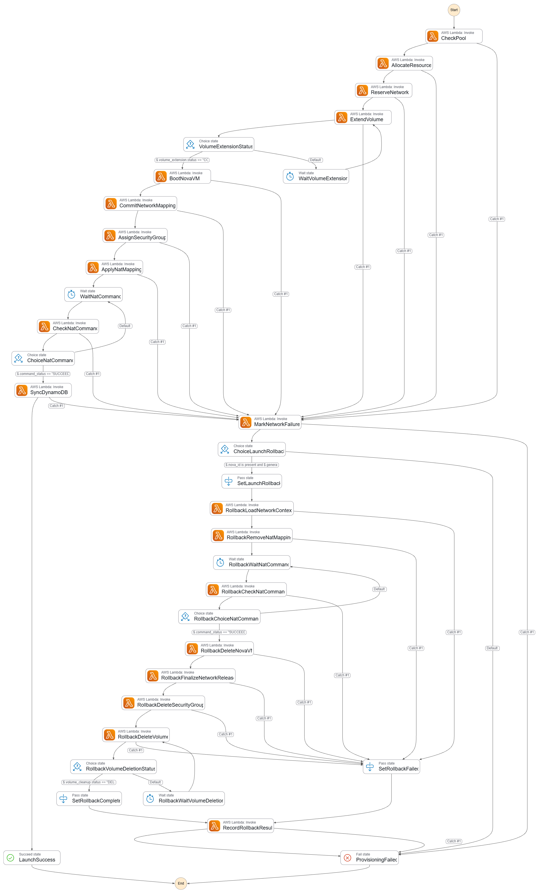
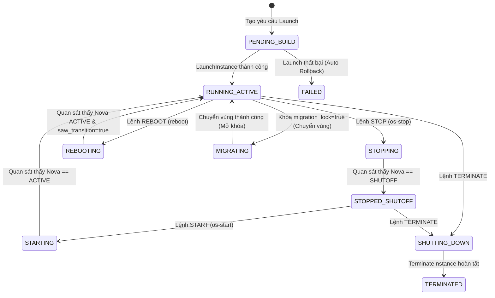
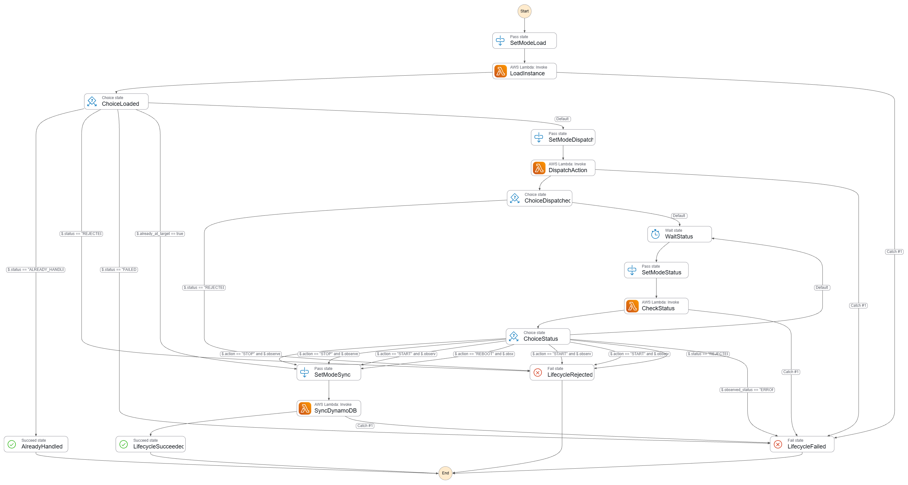
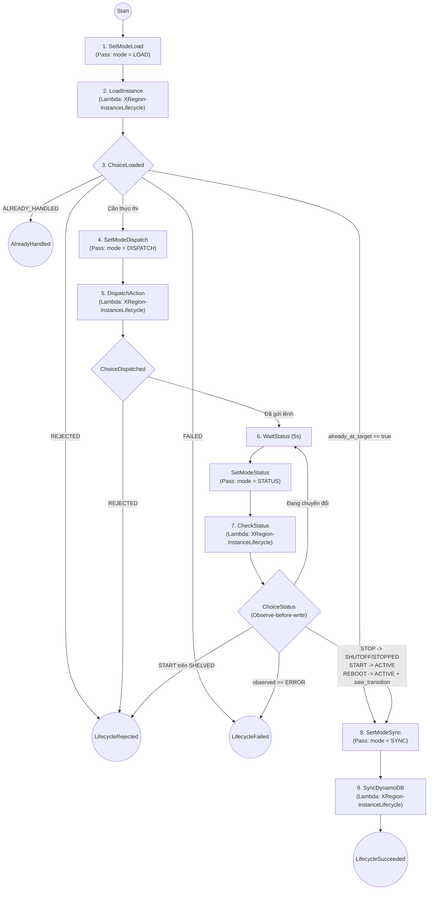
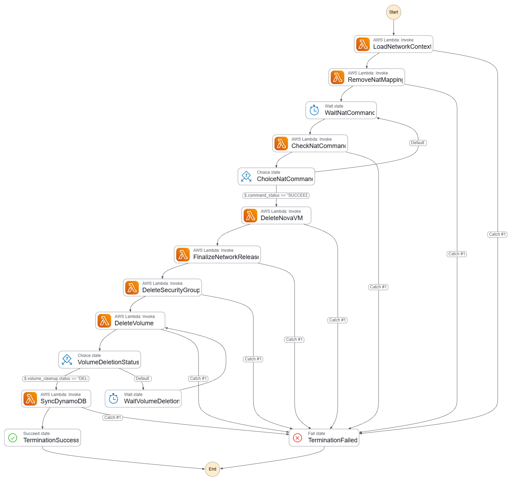
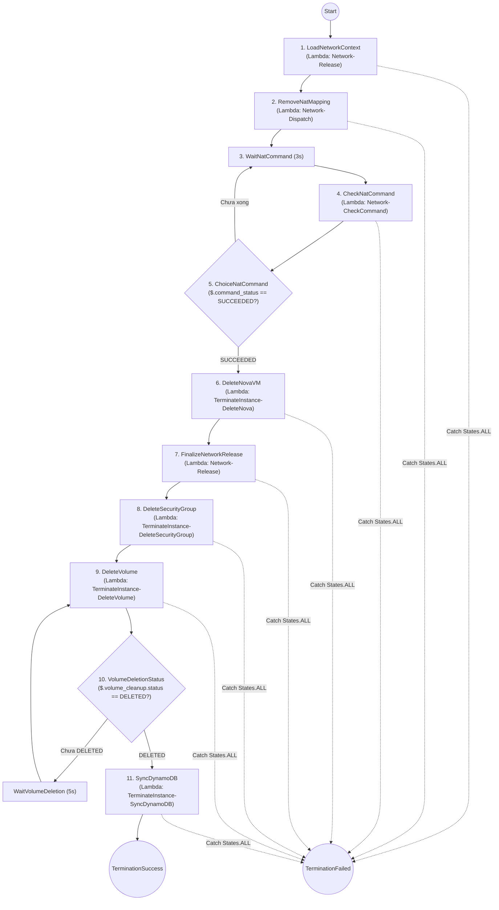

# BÁO CÁO KỸ THUẬT: GIẢI PHÁP THỰC HIỆN THEO CHỨC NĂNG, KẾT QUẢ & QUY TRÌNH TRIỂN KHAI PHÂN HỆ SERVERLESS (XREGION-EC2)

> **Dự án**: XRegion-EC2 — Hệ thống IaaS tích hợp tính năng tự động chuyển vùng máy ảo theo kịch bản  
> **Phạm vi phụ trách**: **AWS Step Functions**, **AWS Lambda** *(các hàm độc lập)*, **Amazon API Gateway**, **Amazon EventBridge**, **AWS IAM** và **Amazon DynamoDB (Global Data Plane)**  
> **Môi trường triển khai**: AWS Region `ap-southeast-2` (Sydney) — AWS Account `291634989063`  
> **Tài liệu đặc tả tham chiếu**: `docs/specs/serverless/` (`SPEC-SF-00` đến `SPEC-SF-06`) và `docs/specs/` (`SPEC-01`, `SPEC-02`, `SPEC-03`, `SPEC-04`, `SPEC-06`, `SPEC-07`)

---

# PHẦN 1: GIẢI PHÁP THỰC HIỆN THEO 7 CHỨC NĂNG NGHIỆP VỤ CHUYÊN SÂU

Thay vì tách rời mô tả kiến trúc và triển khai gây lặp lại, toàn bộ phân hệ Serverless, An ninh và CSDL Đám mây của **XRegion-EC2** được trình bày trực tiếp theo **7 chức năng nghiệp vụ cốt lõi**, làm rõ luồng điều phối từng bước (Step-by-Step), cơ chế chuyển đổi trạng thái vòng đời và vai trò của từng dịch vụ AWS tham gia.

---

## Chức năng 1: Cấp phát & Khởi tạo Máy ảo Boot-from-Volume (`LaunchInstance`)

### 1.1 Mục tiêu & Cơ chế tổng quan
- Tự động hóa trọn vẹn quy trình khởi tạo một máy ảo NovaVM mới từ ổ đĩa EBS/Cinder sẵn sàng trong Warm Pool, cấp phát định tuyến mạng Linux NAT (iptables/nftables) trên host `i-056d7f3dd24156234`, tạo Security Group 1-1 cô lập theo chủ sở hữu và đồng bộ trạng thái cuối cùng về Amazon DynamoDB.
- Toàn bộ luồng được điều phối bất đồng bộ bởi State Machine **`LaunchInstance`** (`LaunchInstance.asl.json`, kiểu `STANDARD`, `TimeoutSeconds: 300`).

### 1.2 Sơ đồ Đồ thị Step Function (`LaunchInstance`)

> [!TIP]
> Bạn có thể chụp ảnh đồ thị **Workflow Studio** từ AWS Step Functions Console lưu vào đường dẫn `docs-writer/img/stepfunction_launch_instance.png` để hiển thị trực tiếp bên dưới.

```mermaid
flowchart TD
    Start((Start)) --> CheckPool["1. CheckPool<br/>(Lambda: CheckPool)"]
    CheckPool --> AllocateResource["2. AllocateResource<br/>(Lambda: AllocateResource)"]
    AllocateResource --> ReserveNetwork["3. ReserveNetwork<br/>(Lambda: Network-Reserve)"]
    ReserveNetwork --> ExtendVolume["4. ExtendVolume<br/>(Lambda: ExtendVolume)"]
    ExtendVolume --> VolStatus{"5. VolumeExtensionStatus<br/>($.volume_extension.status == CONFIRMED?)"}
    VolStatus -- "Chưa xác nhận" --> WaitVol["WaitVolumeExtension<br/>(Wait 5s)"] --> ExtendVolume
    VolStatus -- "CONFIRMED" --> BootNovaVM["6. BootNovaVM<br/>(Lambda: BootNova)"]
    BootNovaVM --> CommitNet["7. CommitNetworkMapping<br/>(Lambda: Network-Commit)"]
    CommitNet --> AssignSG["8. AssignSecurityGroup<br/>(Lambda: AssignSecurityGroup)"]
    AssignSG --> ApplyNat["9. ApplyNatMapping<br/>(Lambda: Network-Dispatch)"]
    ApplyNat --> WaitNat["10. WaitNatCommand<br/>(Wait 3s)"] --> CheckNat["11. CheckNatCommand<br/>(Lambda: Network-CheckCommand)"]
    CheckNat --> ChoiceNat{"12. ChoiceNatCommand<br/>($.command_status == SUCCEEDED?)"}
    ChoiceNat -- "Chưa xong" --> WaitNat
    ChoiceNat -- "SUCCEEDED" --> SyncDDB["13. SyncDynamoDB<br/>(Lambda: SyncDynamoDB)"]
    SyncDDB --> LaunchSuccess((LaunchSuccess))

    %% Nhánh bắt lỗi & Rollback
    CheckPool & AllocateResource & ReserveNetwork & ExtendVolume & BootNovaVM & CommitNet & AssignSG & ApplyNat & CheckNat & SyncDDB -. "Catch States.ALL" .-> MarkFail["MarkNetworkFailure<br/>(Lambda: SyncDynamoDB)"]
    MarkFail --> ChoiceRB{"ChoiceLaunchRollback<br/>(Có $.nova_id & $.generation?)"}
    ChoiceRB -- "Không" --> Failed((ProvisioningFailed))
    ChoiceRB -- "Có" --> SetRB["SetLaunchRollback<br/>(Pass: LAUNCH_ROLLBACK)"] --> RBLoad["RollbackLoadNetworkContext<br/>(Network-Release)"]
    RBLoad --> RBRemoveNat["RollbackRemoveNatMapping<br/>(Network-Dispatch)"] --> RBWaitNat["RollbackWaitNatCommand (3s)"] --> RBCheckNat["RollbackCheckNatCommand<br/>(Network-CheckCommand)"]
    RBCheckNat --> RBChoiceNat{"RollbackChoiceNatCommand"}
    RBChoiceNat -- "Chưa xong" --> RBWaitNat
    RBChoiceNat -- "SUCCEEDED" --> RBDelNova["RollbackDeleteNovaVM<br/>(DeleteNova)"]
    RBDelNova --> RBFinNet["RollbackFinalizeNetworkRelease<br/>(Network-Release)"] --> RBDelSG["RollbackDeleteSecurityGroup<br/>(DeleteSecurityGroup)"]
    RBDelSG --> RBDelVol["RollbackDeleteVolume<br/>(DeleteVolume)"] --> RBVolStatus{"RollbackVolumeDeletionStatus"}
    RBVolStatus -- "Chưa DELETED" --> RBWaitVol["RollbackWaitVolumeDeletion (5s)"] --> RBDelVol
    RBVolStatus -- "DELETED" --> SetRBComplete["SetRollbackComplete"] --> RecRB["RecordRollbackResult<br/>(SyncDynamoDB)"] --> Failed
```





*Hình 1.1: Đồ thị luồng thực thi và nhánh Auto-Rollback của State Machine `LaunchInstance`*

### 1.3 Giải thích chi tiết từng Step trong `LaunchInstance`

| Thứ tự / Tên Step | Loại State | Hàm Lambda / Hành động gọi | Nhiệm vụ chi tiết & Cơ chế Retry / Catch |
| :--- | :---: | :--- | :--- |
| **1. `CheckPool`** | `Task` | `XRegion-LaunchInstance-CheckPool` | Kiểm tra Warm Pool đĩa Cinder/EBS có volume rảnh phù hợp image không. Nếu gặp lỗi `PoolNotReady`, tự động **Retry tối đa 5 lần** với Exponential Backoff (`IntervalSeconds: 5, BackoffRate: 2`, tổng chờ ~155s). |
| **2. `AllocateResource`** | `Task` | `XRegion-LaunchInstance-AllocateResource` | Chiếm quyền (lease) một volume khả dụng từ Warm Pool và gắn định danh với `instance_id` đang khởi tạo. |
| **3. `ReserveNetwork`** | `Task` | `XRegion-Network-Reserve` | Cấp phát và giữ chỗ địa chỉ IP nội bộ (Private IP) cùng Elastic IP tĩnh trên bảng `XRegion-NetworkReservations` trong cửa sổ 300s. |
| **4. `ExtendVolume`** | `Task` | `XRegion-LaunchInstance-ExtendVolume` | So sánh dung lượng yêu cầu của Flavor với kích thước gốc của volume pool; gọi Cinder API mở rộng (extend) kích thước đĩa EBS nếu cần. |
| **5. `VolumeExtensionStatus` & `WaitVolumeExtension`** | `Choice` + `Wait` | *(Logic điều khiển ASL)* | Kiểm tra `$.volume_extension.status == "CONFIRMED"`. Nếu Cinder chưa xác nhận mở rộng xong, tạm dừng **5 giây** rồi gọi lại `ExtendVolume`. |
| **6. `BootNovaVM`** | `Task` | `XRegion-LaunchInstance-BootNova` | Xin Keystone Token (scope `service`) và gọi OpenStack Nova API khởi tạo máy ảo mới ở chế độ Boot-from-Volume từ đĩa vừa chuẩn bị. |
| **7. `CommitNetworkMapping`** | `Task` | `XRegion-Network-Commit` | Chốt ánh xạ chính thức giữa `nova_id`, Private IP và Elastic IP vào bảng `XRegion-NetworkMappings` trên DynamoDB. |
| **8. `AssignSecurityGroup`** | `Task` | `XRegion-LaunchInstance-AssignSecurityGroup` | Tạo Security Group 1-1 riêng biệt cho máy ảo (gắn `instance_id` và `owner = username` theo `SPEC-06`) và gắn vào cổng mạng Neutron của VM. |
| **9. `ApplyNatMapping`** | `Task` | `XRegion-Network-Dispatch` | Gửi lệnh qua AWS SSM Run Command xuống host `i-056d7f3dd24156234` để nạp quy tắc NAT (DNAT/SNAT) ánh xạ EIP vào Private IP của NovaVM. |
| **10-12. `WaitNatCommand` $\rightarrow$ `CheckNatCommand` $\rightarrow$ `ChoiceNatCommand`** | `Wait` + `Task` + `Choice` | `XRegion-Network-CheckCommand` | Chờ **3 giây**, sau đó kiểm tra trạng thái thực thi lệnh SSM trên host. Lặp lại cho đến khi `$.command_status == "SUCCEEDED"` (xác nhận `applied_generation` thành công theo `SPEC-SF-01`). |
| **13. `SyncDynamoDB`** | `Task` | `XRegion-LaunchInstance-SyncDynamoDB` | Cập nhật trạng thái cuối cùng (`ACTIVE` / `RUNNING`), IP public/private và metadata máy ảo vào `XRegion-Instances` và `XRegion-Nova`, kết thúc tại **`LaunchSuccess`**. |
| **Nhánh Rollback (`MarkNetworkFailure` $\rightarrow$ `ProvisioningFailed`)** | `Catch` + `Task` + `Choice` | `XRegion-LaunchInstance-SyncDynamoDB`, `XRegion-Network-*`, `XRegion-TerminateInstance-*` | Khi bất kỳ step nào phát sinh lỗi (`States.ALL`), luồng rẽ sang `MarkNetworkFailure`. Nếu đã cấp `nova_id` và `generation`, nhánh **`LAUNCH_ROLLBACK`** tự động gỡ NAT trên host, xóa NovaVM tạm, giải phóng giữ chỗ mạng, xóa SG 1-1 và xóa volume, ghi kết quả cleanup vào DynamoDB rồi kết thúc tại **`ProvisioningFailed`**. |

---

## Chức năng 2: Quản trị Vòng đời Máy ảo (`LifecycleInstance` & `XRegion-InstanceLifecycle`)

### 2.1 Mục tiêu & Biểu đồ Chuyển đổi Trạng thái Vòng đời (`SPEC-01`)
Hệ thống quản trị chặt chẽ mọi chuyển dịch trạng thái của máy ảo nhằm bảo đảm đồng bộ tuyệt đối giữa giao diện người dùng, CSDL DynamoDB và hạ tầng OpenStack Nova, **tuyệt đối nghiêm cấm** các thao tác gây treo đĩa như `shelve`/`unshelve`.



*Hình 1.2: Biểu đồ chuyển đổi trạng thái trong vòng đời máy ảo XRegion (`SPEC-01` & `SPEC-SF-06`)*

### 2.2 Sơ đồ Đồ thị Step Function (`LifecycleInstance`)





*Hình 1.3: Đồ thị luồng thực thi Observe-before-write của State Machine `LifecycleInstance`*

### 2.3 Giải thích từng Step & Nguyên lý Observe-before-write (`XRegion-InstanceLifecycle`)
Khác với các hàm có tiền tố `LaunchInstance-*`, **`XRegion-InstanceLifecycle`** (`lifecycle_runtime.py`) là một **hàm Lambda độc lập** được thiết kế theo 4 chế độ (`LOAD`, `DISPATCH`, `STATUS`, `SYNC`) nhằm giải quyết triệt để lỗi ghi sớm trạng thái (premature status write) khi Nova mới chỉ chấp nhận HTTP 202:

| Step trong ASL | Chế độ Lambda (`$.mode`) | Hành vi kỹ thuật chi tiết |
| :--- | :---: | :--- |
| **`SetModeLoad` $\rightarrow$ `LoadInstance`** | `LOAD` | Đọc bản ghi máy ảo từ `XRegion-Instances` và `XRegion-Nova`; kiểm tra trạng thái ý định (`STOPPING`, `STARTING`, `REBOOTING`). Phát hiện yêu cầu trùng lặp (`ALREADY_HANDLED`) hoặc phát hiện máy đã ở sẵn trạng thái đích (`already_at_target=true`) để nhảy thẳng tới `SYNC`. |
| **`SetModeDispatch` $\rightarrow$ `DispatchAction`** | `DISPATCH` | Gửi lệnh `os-stop`, `os-start` hoặc `reboot` tới OpenStack Nova API. Nếu máy đang ở trạng thái `SHELVED` / `SHELVED_OFFLOADED` sẽ lập tức trả về `REJECTED` (cấm `unshelve` theo `SPEC-01`). |
| **`WaitStatus` $\rightarrow$ `SetModeStatus` $\rightarrow$ `CheckStatus`** | `STATUS` | Tạm chờ **5 giây** mỗi vòng lặp, gọi trực tiếp Nova API (`GET /servers/{nova_id}`) để đọc trạng thái thực tế (`$.observed_status`) và `$.task_state`. Với thao tác `REBOOT`, yêu cầu phải ghi nhận biến `$.saw_transition == true` và `$.task_state == null` mới coi là đã khởi động lại xong. |
| **`SetModeSync` $\rightarrow$ `SyncDynamoDB`** | `SYNC` | **Chỉ được gọi sau khi `ChoiceStatus` quan sát thấy Nova đạt đúng trạng thái đích**. Sử dụng DynamoDB `ConditionExpression` cập nhật đồng bộ cả bảng `XRegion-Instances` và `XRegion-Nova` sang trạng thái cuối (`STOPPED` hoặc `RUNNING`). |

---

## Chức năng 3: Hủy Máy ảo & Thu hồi Tài nguyên Triệt để (`TerminateInstance`)

### 3.1 Mục tiêu & Cơ chế tổng quan
Bảo đảm khi quản trị viên hủy một máy ảo, toàn bộ các tài nguyên đi kèm trên cả OpenStack và AWS (luật Linux NAT, máy ảo Nova, Security Group 1-1, Elastic IP, ổ đĩa EBS/Cinder và bản ghi DynamoDB) được dọn dẹp sạch theo thứ tự an toàn, không để lại tài nguyên mồ côi gây thất thoát chi phí.

### 3.2 Sơ đồ Đồ thị Step Function (`TerminateInstance`)





*Hình 1.4: Đồ thị luồng thu hồi tài nguyên toàn diện của State Machine `TerminateInstance`*

### 3.3 Giải thích chi tiết từng Step trong `TerminateInstance`

| Thứ tự / Tên Step | Hàm Lambda được gọi | Nhiệm vụ chi tiết |
| :--- | :--- | :--- |
| **1. `LoadNetworkContext`** | `XRegion-Network-Release` | Nạp thông tin ánh xạ mạng (`private_ip`, `elastic_ip`, `generation`) từ `XRegion-NetworkMappings` để chuẩn bị gỡ bỏ định tuyến. |
| **2-5. `RemoveNatMapping` $\rightarrow$ `WaitNatCommand` $\rightarrow$ `CheckNatCommand`** | `XRegion-Network-Dispatch`, `XRegion-Network-CheckCommand` | Gửi lệnh SSM xuống host OpenStack để xóa rule iptables/nftables của máy ảo và lặp kiểm tra mỗi **3 giây** cho đến khi xác nhận gỡ NAT thành công (`SUCCEEDED`). |
| **6. `DeleteNovaVM`** | `XRegion-TerminateInstance-DeleteNova` | Gọi OpenStack Nova API xóa thực thể máy ảo khỏi hypervisor KVM và chờ giải phóng port mạng Neutron. |
| **7. `FinalizeNetworkRelease`** | `XRegion-Network-Release` | Giải phóng khóa giữ chỗ địa chỉ IP trên bảng `XRegion-NetworkMappings` và `XRegion-NetworkReservations` (có Retry cho lỗi xung đột `ConditionalCheckFailedException` / `TransactionCanceledException`). |
| **8. `DeleteSecurityGroup`** | `XRegion-TerminateInstance-DeleteSecurityGroup` | Xóa Security Group 1-1 tương ứng của máy ảo trên OpenStack Neutron và dọn bản ghi liên kết `instance_id` trên bảng `XRegion-SecurityGroups` (`SPEC-06`). |
| **9-10. `DeleteVolume` & `VolumeDeletionStatus`** | `XRegion-TerminateInstance-DeleteVolume` | Gỡ gắn (detach) và xóa vĩnh viễn ổ đĩa Cinder/EBS của máy ảo; chờ mỗi **5 giây** cho tới khi xác nhận `$.volume_cleanup.status == "DELETED"`. |
| **11. `SyncDynamoDB`** | `XRegion-TerminateInstance-SyncDynamoDB` | Thực thi xóa bản ghi máy ảo (`delete_item` hoặc cập nhật `TERMINATED` theo `SPEC-SF-02`) trên DynamoDB, kết thúc tại **`TerminationSuccess`**. |

---

## Chức năng 4: Quản lý Vùng đệm Tài nguyên Sẵn sàng (`XRegion-CinderPoolManager` & `XRegion-EIPPoolManager`)

Đây là 2 hàm **AWS Lambda độc lập** (không mang tiền tố Step Function) được kích hoạt định kỳ bởi **Amazon EventBridge Scheduler** để duy trì sẵn tài nguyên dự phòng ở mức chi phí tối ưu:

### 4.1 Quản lý Warm Pool Ổ đĩa Cinder/EBS (`XRegion-CinderPoolManager`)
- **Mã nguồn**: `serverless/launch-contract/XRegion-CinderPoolManager/cinder_pool_manager.py` (`SPEC-SF-03`).
- **Mục tiêu**: Luôn duy trì chính xác tối đa **2 ổ đĩa bootable Cinder/EBS rảnh rỗi** (`max(0, 2 - occupied)`) để `LaunchInstance` có thể lấy dùng ngay mà không mất thời gian tạo đĩa và copy image từ đầu.
- **Cơ chế an toàn**:
  - **Khóa nguyên tử `EBS-POOL-LOCK`**: Tránh hai phiên chạy song song tạo dư thừa volume.
  - **Bảo vệ gửi lệnh mơ hồ (Ambiguous-POST Guard)**: Trước khi gọi Cinder API tạo volume `xregion-ebs-pool-{request_id}`, hàm ghi trước cờ `post_attempted = :yes` bằng DynamoDB `ConditionExpression` (`attribute_not_exists(post_attempted) AND #s = :creating`). Nếu mất kết nối giữa chừng, lần chạy sau sẽ thực hiện đối soát (`reconcile`) qua metadata thay vì tạo trùng lặp.
  - **Kiểm chứng ánh xạ (`validate_ebs_mapping`)**: Xác nhận volume Cinder mới tạo khớp 100% với `ebs_volume_id`, `cinder_volume_type` và `image_id` trước khi đánh dấu trạng thái `AVAILABLE`.

### 4.2 Quản lý Warm Pool Elastic IP (`XRegion-EIPPoolManager`)
- **Mã nguồn**: `serverless/launch-contract/XRegion-EIPPoolManager/eip_pool_manager.py` (`SPEC-02`).
- **Mục tiêu**: Giữ chính xác tối đa **`POOL_LIMIT = 2`** địa chỉ Elastic IP rảnh rỗi (gắn tag `Project=xregion`), tự động thu hồi các EIP dư thừa để tránh bị AWS tính phí IP nhàn rỗi.
- **Cơ chế hoạt động**:
  - Quét toàn bộ địa chỉ EIP chưa gắn (`AssociationId`, `NetworkInterfaceId` và `InstanceId` đều trống).
  - **Bảo vệ phiên Launch đang chạy**: Tra cứu bảng `XRegion-NetworkReservations` để loại trừ các EIP đang được một luồng `LaunchInstance` giữ chỗ trong cửa sổ timeout **300 giây**, không giải phóng nhầm IP đang cấp phát.
  - **Giải phóng theo thứ tự FIFO**: Nếu số lượng EIP rảnh vượt quá 2, hàm sắp xếp theo thời gian rảnh trên tag `IdleSince` (hoặc timestamp trong tag `Name: eip-reserve-{ts}`) và giải phóng các EIP cũ nhất trước. Nhật ký kiểm toán được ghi tập trung vào CloudWatch Logs.

---

## Chức năng 5: Đồng bộ Nhóm Bảo mật & Tường lửa 1-1 theo Phiên bản (`XRegion-SyncSecurityGroup`)

- **Mã nguồn**: `serverless/launch-contract/XRegion-SyncSecurityGroup/sync_security_group.py` (`SPEC-SF-05`).
- **Mục tiêu**: Đảm bảo mọi thay đổi quy tắc tường lửa (Ingress/Egress) do quản trị viên chỉnh sửa trên Dashboard được đồng bộ chính xác xuống OpenStack Neutron Security Group của máy ảo tương ứng mà không bị xung đột khi có nhiều yêu cầu liên tiếp.
- **Cơ chế hoạt động**:
  1. **Cách ly tuyệt đối 1-1 (`SPEC-06`)**: Mỗi máy ảo sở hữu một Security Group riêng mang định danh `instance_id` và chủ sở hữu `owner = username`. Hàm phân giải `nova_id` $\rightarrow$ `(neutron_sg_id, neutron_port_id)` thông qua bảng `XRegion-NetworkMappings`.
  2. **Kiểm soát an toàn Live Mode**: Mặc định chạy chế độ kiểm tra (Dry-run); chỉ ghi thật lên Neutron khi bật biến môi trường `XREGION_SG_SYNC_LIVE=true`, bản ghi có cờ `managed=true` và thuộc danh sách `XREGION_SG_SYNC_MANAGED_ALLOWLIST`.
  3. **Chống ghi đè lạc hậu (Stale Writer Protection)**: Mỗi lần người dùng sửa rule, Backend tăng trường `revision` lên `+1` và đặt `sync_status = PENDING_SYNC`. Worker dùng khóa Lease theo nhóm kết hợp DynamoDB `ConditionExpression`:
     ```text
     attribute_exists(group_id) AND revision = :current_rev AND (attribute_not_exists(applied_revision) OR applied_revision <= :new_ar)
     ```
     Nhờ đó, một worker chạy chậm xử lý sự kiện cũ không bao giờ có thể ghi đè lên cấu hình mới hơn.
  4. **Read-back Verification**: Sau khi tạo các rule còn thiếu và xóa các rule dư thừa trên Neutron, hàm đọc lại toàn bộ tập rule thực tế từ Neutron; chỉ khi khớp hoàn toàn (không thiếu, không thừa) mới cập nhật `applied_revision = revision` và `sync_status = SYNCED`.

---

## Chức năng 6: Giám sát Tự động & Phục hồi Sự cố Bền vững (`XRegion-InstanceRecovery`)

- **Mã nguồn**: `serverless/launch-contract/XRegion-InstanceRecovery/recovery_worker.py` & `recovery_policy.py` (`SPEC-SF-04`, `SPEC-06`).
- **Mục tiêu**: Phát hiện và thu hồi an toàn các máy ảo thử nghiệm bị hỏng vĩnh viễn trên hạ tầng, bảo vệ tuyệt đối các máy ảo đang hoạt động bình thường hoặc đang chuyển vùng.
- **Cơ chế 5 mức phân loại (`recovery_policy.classify`)**:
  1. **`HOLD`**: Tuyệt đối không can thiệp. Áp dụng khi mất kết nối đọc OpenStack Nova (**Unknown never deletes**), hoặc máy đang có cờ `migration_lock == true` / trạng thái `MIGRATING`.
  2. **`SKIP`**: Máy ảo đang ổn định bình thường (`RUNNING`, `STOPPED`).
  3. **`OBSERVE`**: Phát hiện dấu hiệu lỗi nhưng chưa đủ thời gian xác nhận, tăng bộ đếm quan sát và chờ chu kỳ sau.
  4. **`REPAIR`**: Khắc phục lệch trạng thái (State Drift) giữa DynamoDB và Nova (ví dụ DynamoDB ghi `RUNNING` nhưng Nova báo `SHUTOFF` $\rightarrow$ cập nhật DynamoDB về `STOPPED`, tuyệt đối không xóa máy).
  5. **`DELETE`**: Chỉ kích hoạt thu hồi khi thỏa mãn **Chính sách Lỗi Bền vững (Durable Fault Policy)**:
     - Trạng thái thực đọc trực tiếp từ Nova REST API là `ERROR`, `TERMINATED` hoặc `DELETED`.
     - Thời gian kể từ khi phát hiện lỗi lần đầu $\ge 30$ phút (`min_age_s >= 1800s`).
     - Lỗi được xác nhận lặp lại trong **tối thiểu 3 chu kỳ quét liên tiếp** (`recovery_observations >= 3`).
     - Bật cờ `XREGION_RECOVERY_LIVE=true` và instance nằm trong `XREGION_RECOVERY_ALLOWLIST`.
- **Ủy thác dọn dẹp chuẩn hóa**: Khi phân loại `DELETE`, worker không tự xóa tài nguyên rời rạc mà kích hoạt tuần tự State Machine **`TerminateInstance`** để tái sử dụng toàn bộ kiểm tra quyền sở hữu và dọn sạch NAT/EIP/SG/Volume, sau đó giữ lại bản ghi máy ảo ở trạng thái `FAILED` để người dùng tra cứu nguyên nhân.

---

## Chức năng 7: Cổng Tiếp nhận Sự kiện, An ninh Phân quyền & Dữ liệu Nguyên tử

- **Amazon API Gateway (`XRegion-EventGateway`, ID `379768w77h`)**:
  - Cung cấp cổng HTTP API v2 duy nhất tại route `POST /prod/events` với cấu hình tích hợp trực tiếp **`AWS_PROXY` (`EventBridge-PutEvents`)**, đẩy thẳng sự kiện vào EventBridge mà không cần Lambda trung gian.
  - Bảo vệ điểm cuối bằng cơ chế ký điện tử **AWS IAM SigV4** cho Backend và Bearer Token (`SPEC-07`).
- **Amazon EventBridge (Bus `default`)**:
  - Định tuyến các sự kiện nghiệp vụ từ Backend (`XRegion-BackendEventRule`) và từ daemon OpenStack (`XRegion-NovaStatusRule`) tới đúng Step Functions hoặc Lambda `XRegion-SyncSecurityGroup`.
  - Lập lịch định kỳ (Scheduled Rules) cho các hàm độc lập `XRegion-CinderPoolManager`, `XRegion-EIPPoolManager`, `XRegion-InstanceRecovery`.
- **AWS IAM (Least-Privilege Security)**:
  - Phân tách hoàn toàn 3 Role thực thi: `XRegion-ApiGatewayEventBridgeRole` (chỉ được `events:PutEvents`), `XRegion-StepFunctionsExecutionRole` (chỉ được `lambda:InvokeFunction` tới prefix `XRegion-*`), và `XRegion-LambdaExecutionRole` (chỉ thao tác DynamoDB trên `table/XRegion-*`, kết nối VPC ENI và các quyền EC2/EBS tối thiểu).
- **Amazon DynamoDB & Global Data Plane**:
  - Lưu trữ trên 6 bảng nghiệp vụ (`XRegion-Instances`, `XRegion-Users`, `XRegion-Keys`, `XRegion-SecurityGroups`, `XRegion-Volumes`, `XRegion-Migrations`) và 3 bảng điều phối hạ tầng (`XRegion-Nova`, `XRegion-NetworkMappings`, `XRegion-NetworkReservations`).
  - Hỗ trợ **Point-in-Time Recovery (PITR)** và thiết kế khóa phân vùng chuẩn bị sẵn sàng cho **DynamoDB Global Tables** đa vùng.

---

# PHẦN 2: KẾT QUẢ THỰC HIỆN GIẢI PHÁP & CÁC BƯỚC TRIỂN KHAI (DEPLOYMENT STEPS)

## I. Bảng Tổng hợp Tài nguyên AWS Thực tế Đã Triển khai

| Dịch vụ AWS | Tên Tài nguyên / Định danh | Cấu hình Kỹ thuật Chính (`ap-southeast-2`) |
| :--- | :--- | :--- |
| **AWS Step Functions** | `LaunchInstance`, `TerminateInstance`, `LifecycleInstance` | Type: `STANDARD`, `TimeoutSeconds: 300`, định nghĩa bằng ASL JSON tĩnh trong `serverless/launch-contract/*.asl.json`. |
| **AWS Lambda (Độc lập)** | `XRegion-CinderPoolManager`, `XRegion-EIPPoolManager`, `XRegion-InstanceRecovery`, `XRegion-SyncSecurityGroup`, `XRegion-InstanceLifecycle` | Python 3.10+, 256–512 MB RAM, chạy chế độ an toàn mặc định (Dry-run / Conditional Writes / Observe-before-write). |
| **AWS Lambda (Task con SFN)** | `XRegion-LaunchInstance-*` (6 hàm), `XRegion-TerminateInstance-*` (5 hàm), `XRegion-Network-*` (6 hàm) | Quản lý qua `deployment/manifest.json` và dùng chung module `runtime/network_runtime.py`. |
| **Amazon API Gateway** | `XRegion-EventGateway` (`379768w77h`) | HTTP API v2, Route `POST /prod/events`, Direct Integration `EventBridge-PutEvents`, Auth `AWS_IAM`. |
| **Amazon EventBridge** | Bus `default` | Rules: `XRegion-BackendEventRule`, `XRegion-NovaStatusRule` và các Scheduled Rules cho Pool & Recovery. |
| **Amazon DynamoDB** | `XRegion-Instances`, `XRegion-Users`, `XRegion-Keys`, `XRegion-SecurityGroups`, `XRegion-Volumes`, `XRegion-Migrations`, `XRegion-Nova`, `XRegion-NetworkMappings`, `XRegion-NetworkReservations` | Billing Mode: `PAY_PER_REQUEST`, GSI (`username-index`, `instance_id-index`), bật Continuous Backups (PITR). |
| **AWS IAM** | `XRegion-LambdaExecutionRole`, `XRegion-StepFunctionsExecutionRole`, `XRegion-ApiGatewayEventBridgeRole` | Phân quyền Least-Privilege theo ARN tài nguyên cụ thể tại Account `291634989063`. |

---

## II. Quy trình Triển khai Hệ thống Chi tiết (5 Bước Deployment Steps)

Để dựng hoàn chỉnh phân hệ Serverless, An ninh và CSDL từ đầu đến khi hệ thống hoạt động ổn định, thực hiện tuần tự **5 bước** dưới đây:

### Bước 1: Khởi tạo Cơ sở dữ liệu Amazon DynamoDB
Tạo các bảng NoSQL cốt lõi với đúng khóa chính, chỉ mục phụ GSI và kích hoạt sao lưu liên tục (PITR):

```powershell
# 1. Tạo bảng XRegion-Instances (lưu trạng thái VM & khóa migration_lock)
aws dynamodb create-table `
    --table-name XRegion-Instances `
    --attribute-definitions AttributeName=instance_id,AttributeType=S AttributeName=username,AttributeType=S `
    --key-schema AttributeName=instance_id,KeyType=HASH `
    --global-secondary-indexes '[{"IndexName":"username-index","KeySchema":[{"AttributeName":"username","KeyType":"HASH"}],"Projection":{"ProjectionType":"ALL"}}]' `
    --billing-mode PAY_PER_REQUEST --region ap-southeast-2

# 2. Tạo bảng XRegion-SecurityGroups (lưu cấu hình SG 1-1 & số phiên bản revision)
aws dynamodb create-table `
    --table-name XRegion-SecurityGroups `
    --attribute-definitions AttributeName=group_id,AttributeType=S AttributeName=instance_id,AttributeType=S `
    --key-schema AttributeName=group_id,KeyType=HASH `
    --global-secondary-indexes '[{"IndexName":"instance_id-index","KeySchema":[{"AttributeName":"instance_id","KeyType":"HASH"}],"Projection":{"ProjectionType":"ALL"}}]' `
    --billing-mode PAY_PER_REQUEST --region ap-southeast-2

# 3. Tạo các bảng nghiệp vụ và điều phối mạng/lưu trữ còn lại
aws dynamodb create-table --table-name XRegion-Volumes --attribute-definitions AttributeName=volume_id,AttributeType=S --key-schema AttributeName=volume_id,KeyType=HASH --billing-mode PAY_PER_REQUEST --region ap-southeast-2
aws dynamodb create-table --table-name XRegion-Keys --attribute-definitions AttributeName=key_id,AttributeType=S --key-schema AttributeName=key_id,KeyType=HASH --billing-mode PAY_PER_REQUEST --region ap-southeast-2
aws dynamodb create-table --table-name XRegion-Users --attribute-definitions AttributeName=user_id,AttributeType=S AttributeName=username,AttributeType=S --key-schema AttributeName=user_id,KeyType=HASH --global-secondary-indexes '[{"IndexName":"username-index","KeySchema":[{"AttributeName":"username","KeyType":"HASH"}],"Projection":{"ProjectionType":"ALL"}}]' --billing-mode PAY_PER_REQUEST --region ap-southeast-2
aws dynamodb create-table --table-name XRegion-Migrations --attribute-definitions AttributeName=instance_id,AttributeType=S AttributeName=migration_id,AttributeType=S --key-schema AttributeName=instance_id,KeyType=HASH AttributeName=migration_id,KeyType=RANGE --billing-mode PAY_PER_REQUEST --region ap-southeast-2

# 4. Bật Continuous Backups (PITR) bảo vệ dữ liệu
aws dynamodb update-continuous-backups --table-name XRegion-Instances --point-in-time-recovery-specification PointInTimeRecoveryEnabled=true --region ap-southeast-2
aws dynamodb update-continuous-backups --table-name XRegion-SecurityGroups --point-in-time-recovery-specification PointInTimeRecoveryEnabled=true --region ap-southeast-2
```

### Bước 2: Thiết lập AWS IAM Roles & Policies (Least-Privilege)
Khởi tạo 3 Role thực thi với Trust Policy và Permission Policy cô lập:
1. **`XRegion-LambdaExecutionRole`**: Tin cậy `lambda.amazonaws.com`, gắn `AWSLambdaVPCAccessExecutionRole` và Inline Policy cấp quyền `dynamodb:GetItem/PutItem/UpdateItem/DeleteItem/Query` giới hạn trên `arn:aws:dynamodb:ap-southeast-2:291634989063:table/XRegion-*`, cùng các quyền EC2/EBS tối thiểu (`AttachVolume`, `DetachVolume`, `AllocateAddress`, `ReleaseAddress`).
2. **`XRegion-StepFunctionsExecutionRole`**: Tin cậy `states.amazonaws.com`, cấp quyền `lambda:InvokeFunction` trên `arn:aws:lambda:ap-southeast-2:291634989063:function:XRegion-*`.
3. **`XRegion-ApiGatewayEventBridgeRole`**: Tin cậy `apigateway.amazonaws.com`, cấp quyền `events:PutEvents` vào `arn:aws:events:ap-southeast-2:291634989063:event-bus/default`.

### Bước 3: Cấu hình Amazon API Gateway & Amazon EventBridge
Tạo cổng HTTP API v2 nối thẳng tới EventBridge và thiết lập các Rule định tuyến:

```powershell
# 1. Tạo HTTP API v2 XRegion-EventGateway
$apiId = (aws apigatewayv2 create-api --name XRegion-EventGateway --protocol-type HTTP --region ap-southeast-2 --query "ApiId" --output text)

# 2. Tạo Direct Service Integration tới EventBridge PutEvents
$integrationId = (aws apigatewayv2 create-integration `
    --api-id $apiId --integration-type AWS_PROXY --integration-subtype EventBridge-PutEvents `
    --credentials-arn "arn:aws:iam::291634989063:role/XRegion-ApiGatewayEventBridgeRole" `
    --request-parameters '{"EventBusName":"default","Source":"xregion.backend","DetailType":"$.detail-type","Detail":"$.detail"}' `
    --payload-format-version "1.0" --region ap-southeast-2 --query "IntegrationId" --output text)

# 3. Tạo Route POST /prod/events với xác thực AWS_IAM (SigV4)
aws apigatewayv2 create-route --api-id $apiId --route-key "POST /prod/events" --target "integrations/$integrationId" --authorization-type AWS_IAM --region ap-southeast-2

# 4. Tạo EventBridge Rule định tuyến sự kiện từ Backend
aws events put-rule --name XRegion-BackendEventRule --event-bus-name default --event-pattern '{"source":["xregion.backend"],"detail-type":["instance.launch","instance.lifecycle","instance.terminate"]}' --region ap-southeast-2
```

### Bước 4: Đóng gói & Triển khai các Hàm AWS Lambda
Chạy công cụ triển khai chuẩn của dự án để đóng gói mã nguồn in-memory (không tạo file rác trong workspace), nhúng module `runtime/network_runtime.py` và cập nhật cấu hình biến môi trường lên AWS Lambda:

```powershell
python -B serverless/launch-contract/deployment/deploy.py
```

*Lưu ý cấu hình môi trường*: Các hàm tương tác với OpenStack phải cấu hình chuẩn `OS_PROJECT_NAME="service"`, `KEYSTONE_URL`, `NOVA_URL`, `CINDER_URL`, `NEUTRON_URL`, `EC2_HOST_ID="i-056d7f3dd24156234"` và `OS_PASSWORD="<REDACTED>"`.

### Bước 5: Định nghĩa, Nạp ASL & Kích hoạt AWS Step Functions
Đăng ký 3 State Machines chuẩn từ các file ASL tĩnh đã kiểm định trong `serverless/launch-contract/`:

```powershell
# 1. LaunchInstance
$launchAsl = Get-Content -Raw -Path "serverless/launch-contract/LaunchInstance.asl.json"
aws stepfunctions create-state-machine --name LaunchInstance --definition $launchAsl --role-arn "arn:aws:iam::291634989063:role/XRegion-StepFunctionsExecutionRole" --type STANDARD --region ap-southeast-2

# 2. TerminateInstance
$termAsl = Get-Content -Raw -Path "serverless/launch-contract/TerminateInstance.asl.json"
aws stepfunctions create-state-machine --name TerminateInstance --definition $termAsl --role-arn "arn:aws:iam::291634989063:role/XRegion-StepFunctionsExecutionRole" --type STANDARD --region ap-southeast-2

# 3. LifecycleInstance
$lifeAsl = Get-Content -Raw -Path "serverless/launch-contract/LifecycleInstance.asl.json"
aws stepfunctions create-state-machine --name LifecycleInstance --definition $lifeAsl --role-arn "arn:aws:iam::291634989063:role/XRegion-StepFunctionsExecutionRole" --type STANDARD --region ap-southeast-2
```

---

## III. Kết quả Thực nghiệm, Kiểm thử & Đánh giá Giải pháp

### 1. Bộ Kiểm thử Tự động Đã Áp dụng
- **Kiểm thử Serverless Pytest (`tests/serverless/`)**:
  - `test_launch_contract.py` & `test_launch_rollback.py`: Xác thực luồng `LaunchInstance` và nhánh tự hoàn tác `LAUNCH_ROLLBACK`.
  - `test_lifecycle.py`: Xác thực `LifecycleInstance` và nguyên lý Observe-before-write của `XRegion-InstanceLifecycle`.
  - `test_sg_sync.py`: Xác thực `XRegion-SyncSecurityGroup` với khóa `revision` chống ghi đè lạc hậu.
  - `test_recovery_worker.py` & `test_recovery_policy.py`: Xác thực 5 mức phân loại và quy tắc lỗi bền vững ($\ge 30$ phút, $\ge 3$ chu kỳ) của `XRegion-InstanceRecovery`.
  - `test_ebs_backend.py` & `test_ebs_cutover.py`: Xác thực quản lý đĩa Cinder/EBS trong `XRegion-CinderPoolManager`.
- **Kiểm thử Tích hợp Đầu-Cuối Playwright E2E (`tests/e2e/tests/xregion-api-gateway.spec.js`)**:
  - Kiểm thử tuần tự (Serial mode, fail-fast) toàn bộ luồng gửi sự kiện SigV4 qua API Gateway `POST /prod/events` $\rightarrow$ EventBridge $\rightarrow$ Step Functions $\rightarrow$ cập nhật DynamoDB.

### 2. Bảng Số liệu Đo lường Thực chứng (`docs/risk-review/verification-log.md`)
Kết quả trích xuất trực tiếp từ phiên kiểm chứng thao tác thật (`xrverify`, ngày 2026-11-10):

| Kịch bản Thử nghiệm | Chuyển đổi Trạng thái | Thời gian Thực đo | Kết quả & Ý nghĩa Kỹ thuật |
| :--- | :---: | :---: | :--- |
| **Khởi tạo máy ảo (`LaunchInstance`)** | `PENDING` $\rightarrow$ `RUNNING` | **~8 phút** | **PASS** — Khớp 100% cả 3 nguồn (UI, Nova `ACTIVE`, DynamoDB `RUNNING`). Thời gian ~8 phút do State Machine lặp thăm dò `XRegion-Network-Verify` đảm bảo mạng thông suốt. |
| **Dừng máy ảo (`STOP`)** | `STOPPING` $\rightarrow$ `STOPPED` | **~30 giây** | **PASS** — `XRegion-InstanceLifecycle` quan sát thấy Nova đạt `SHUTOFF` mới cập nhật DynamoDB. |
| **Khởi động lại (`START`)** | `PENDING` $\rightarrow$ `RUNNING` | **~17 giây** | **PASS** — Máy ảo boot nhanh từ đĩa EBS gắn sẵn và khôi phục định tuyến EIP. |
| **Khởi động mềm (`REBOOT`)** | `REBOOTING` $\rightarrow$ `RUNNING` | **~25 giây** | **PASS** — Khởi động lại hệ điều hành khách an toàn, giữ nguyên kết nối mạng. |
| **Hủy máy ảo (`TerminateInstance`)** | `SHUTTING_DOWN` $\rightarrow$ `TERMINATED` | **21 giây** *(17:45:30 $\rightarrow$ 17:45:51)* | **PASS** — Giải phóng sạch EIP (`eipalloc-0b55c44fdf90cd75f`), Volume (`vol-0dd45acf6b2b4156f`), SG 1-1 (`4795d12d-d4e5-4cf4-82d5-a03be0c918a5`) và cập nhật DynamoDB. |
| **Khóa nguyên tử DynamoDB** | `migration_lock` & `revision` | **< 10 ms** | **PASS (100%)** — Ngăn chặn triệt để xung đột ghi đè song song và Split-Brain. |

### 3. Đánh giá Ưu điểm, Hạn chế & Hướng Phát triển
- **Ưu điểm đạt được**:
  - **Tổ chức phân tách rõ ràng**: Step Functions đảm nhiệm điều phối các chuỗi giao dịch dài có Auto-Rollback, còn 5 hàm Lambda độc lập đảm nhiệm chính xác các tác vụ nền tự trị (Warm Pool, đồng bộ SG, phục hồi lỗi bền vững, vòng đời Observe-before-write).
  - **An toàn tài nguyên tuyệt đối**: Không để lại tài nguyên mồ côi khi launch lỗi hoặc khi hủy máy; bảo vệ máy ảo đang chạy khỏi việc xóa nhầm nhờ chính sách lỗi bền vững.
  - **Bảo mật & Nhất quán dữ liệu**: Áp dụng IAM Least-Privilege, xác thực SigV4 và DynamoDB Conditional Writes.
- **Hạn chế còn tồn tại (`docs/risk-review/current-version-risks.md`)**:
  - Thời gian `LaunchInstance` mất ~8 phút do cơ chế vòng lặp thăm dò (polling) trạng thái mạng qua SSM thay vì nhận callback trực tiếp.
  - Các hàm Lambda gắn VPC (`XRegion-SyncSecurityGroup`, `XRegion-InstanceRecovery`) có độ trễ Cold-Start khoảng 1.5s–2.5s khi khởi tạo ENI.
- **Đề xuất hướng phát triển**:
  1. **Chuyển Polling sang Task Token Callback (`waitForTaskToken`)**: Để host gọi `SendTaskSuccess` ngay khi hoàn tất cấu hình mạng, rút ngắn thời gian launch xuống dưới 2 phút.
  2. **Bật AWS Lambda Provisioned Concurrency**: Triệt tiêu hoàn toàn độ trễ Cold-Start cho các hàm gắn VPC.
  3. **Kích hoạt DynamoDB Global Tables**: Nhân bản dữ liệu đa vùng (Active-Active giữa Sydney và Singapore) để đạt RPO $\approx$ 0 ở tầng dữ liệu.
