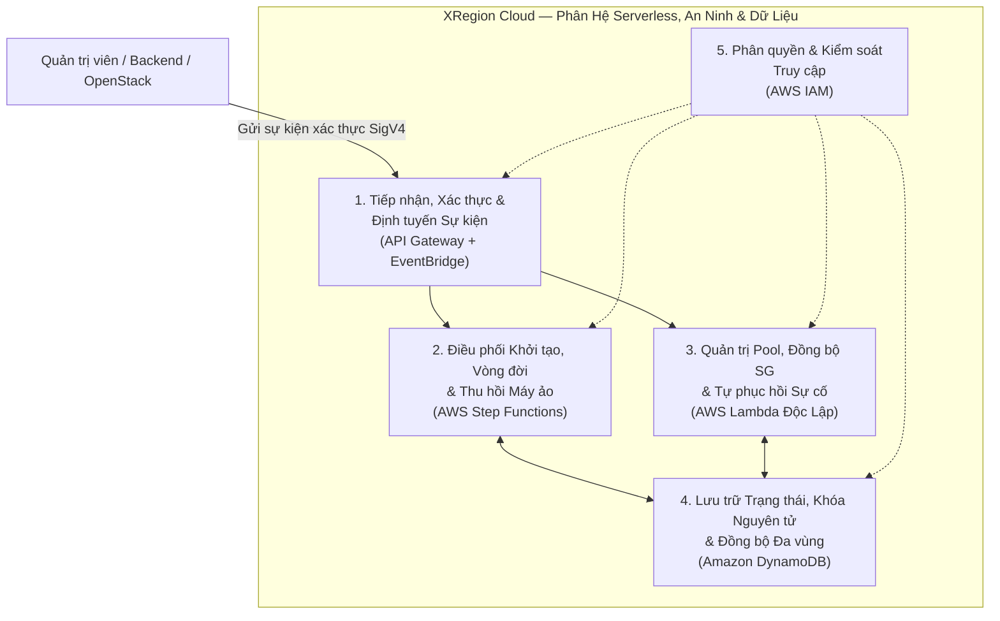

# BÁO CÁO KỸ THUẬT: GIẢI PHÁP THỰC HIỆN, KẾT QUẢ & QUY TRÌNH TRIỂN KHAI PHÂN HỆ SERVERLESS, AN NINH VÀ DỮ LIỆU ĐÁM MÂY (XREGION-EC2)

> **Dự án**: XRegion-EC2 — Hệ thống IaaS tích hợp tính năng tự động chuyển vùng máy ảo theo kịch bản  
> **Phạm vi báo cáo**: Phân hệ Điều phối Serverless, An ninh & CSDL Đám mây gồm 6 dịch vụ AWS cốt lõi: **AWS Step Functions, AWS Lambda (các hàm độc lập), Amazon API Gateway, Amazon EventBridge, AWS IAM và Amazon DynamoDB (Global Data Plane)**  
> **Môi trường triển khai**: AWS Region `ap-southeast-2` (Sydney) — AWS Account `291634989063`  
> **Tài liệu đặc tả tham chiếu**: `docs/specs/serverless/` (`SPEC-SF-00` đến `SPEC-SF-06`) và `docs/specs/` (`SPEC-01`, `SPEC-02`, `SPEC-03`, `SPEC-04`, `SPEC-06`, `SPEC-07`)

---

# PHẦN 1: GIẢI PHÁP THỰC HIỆN

## I. Kiến trúc về chức năng

Phân hệ Serverless, An ninh và Dữ liệu của **XRegion-EC2** hoạt động theo mô hình **hướng sự kiện (Event-Driven Architecture)**, đóng vai trò tiếp nhận yêu cầu điều khiển từ các tác nhân ngoại vi (Control Plane Backend và Daemon OpenStack), thực thi điều phối bất đồng bộ các luồng nghiệp vụ hạ tầng, quản trị tự động tài nguyên dự phòng và bảo vệ tính nhất quán dữ liệu toàn hệ thống.



*Hình 1.1: Kiến trúc về chức năng của phân hệ Serverless, An ninh & Dữ liệu*

---

### 1. Chức năng tiếp nhận, xác thực và định tuyến sự kiện (API Gateway & EventBridge)
- Tiếp nhận toàn bộ yêu cầu điều khiển bất đồng bộ từ Backend Control Plane (`xregion.backend`) và tín hiệu trạng thái từ máy chủ OpenStack (`xregion.openstack`) thông qua điểm cuối tập trung `POST /prod/events`.
- Thực hiện kiểm tra chữ ký điện tử **AWS IAM SigV4** hoặc **Bearer Token** ngay tại cổng biên trước khi đẩy sự kiện vào bus sự kiện trung tâm.
- Tách rời hoàn toàn luồng tiếp nhận và luồng xử lý nghiệp vụ: cổng API phản hồi tức thời cho phía gọi và định tuyến sự kiện qua bộ lọc mẫu (Event Pattern) tới đúng State Machine Step Functions hoặc hàm Lambda tương ứng.

| Loại thông tin | Nội dung chi tiết |
| :--- | :--- |
| **Thông tin hệ thống nhận vào** | - Payload JSON mô tả sự kiện (`source`, `detail-type`, `detail` chứa `instance_id`, `user_id`, `action`, `region`).<br>- Chữ ký xác thực AWS IAM SigV4 hoặc Bearer Token trong Header yêu cầu. |
| **Thông tin hệ thống cung cấp** | - Mã phản hồi HTTP (`200/202` kèm `EventId` nếu hợp lệ; `401/403` nếu sai chữ ký/thiếu quyền).<br>- Sự kiện đã được chuẩn hóa chuyển tiếp đúng đích (Step Functions hoặc Lambda). |

---

### 2. Chức năng điều phối khởi tạo, vòng đời và thu hồi máy ảo (AWS Step Functions)
- Đóng vai trò bộ máy điều phối quy trình đa bước (Workflow Orchestrator) cho toàn bộ vòng đời máy ảo thông qua 3 State Machines: `LaunchInstance`, `TerminateInstance` và `LifecycleInstance`.
- Tự động hóa chuỗi tác vụ tuần tự, kiểm tra điều kiện rẽ nhánh (`Choice`), chờ đợi trạng thái (`Wait`) và thử lại có kiểm soát (`Retry` với Exponential Backoff).
- Đảm bảo tính an toàn giao dịch phân tán thông qua cơ chế bắt lỗi tập trung (`Catch`) và tự động hoàn tác (`LAUNCH_ROLLBACK`), giải phóng triệt để đĩa Cinder, Elastic IP và Security Group nếu quá trình cấp phát gặp sự cố giữa chừng.

| Loại thông tin | Nội dung chi tiết |
| :--- | :--- |
| **Thông tin hệ thống nhận vào** | - Sự kiện kích hoạt từ EventBridge (`instance.launch`, `instance.terminate`, `instance.lifecycle`).<br>- Thông số cấu hình máy ảo (`instance_id`, `nova_id`, `image_id`, `flavor`, `volume_size`, `key_id`, `owner`). |
| **Thông tin hệ thống cung cấp** | - Trạng thái thực thi từng bước của State Machine (`RUNNING`, `SUCCEEDED`, `FAILED`).<br>- Máy ảo hoàn chỉnh đã gắn IP/SG/EBS khi thành công, hoặc trạng thái `FAILED` kèm dọn dẹp sạch tài nguyên khi lỗi. |

---

### 3. Chức năng quản trị tài nguyên Warm Pool, đồng bộ bảo mật và tự phục hồi (Các hàm AWS Lambda độc lập)
- Duy trì vùng đệm tài nguyên sẵn sàng (Warm Pool) gồm tối đa **2 ổ đĩa Cinder/EBS** và **2 Elastic IP** rảnh rỗi nhằm rút ngắn thời gian khởi tạo máy ảo mới và kiểm soát chi phí.
- Tự động hóa đồng bộ quy tắc tường lửa (Security Group 1-1) từ cấu hình mong muốn trên DynamoDB xuống OpenStack Neutron theo số phiên bản (`revision`).
- Giám sát định kỳ phát hiện máy ảo lỗi bền vững (`>= 30 phút` và `>= 3 lần quét liên tiếp`) để phân loại xử lý an toàn, tránh xóa nhầm máy ảo đang hoạt động bình thường.

| Loại thông tin | Nội dung chi tiết |
| :--- | :--- |
| **Thông tin hệ thống nhận vào** | - Tín hiệu định kỳ theo lịch từ EventBridge Scheduler hoặc sự kiện thay đổi cấu hình SG (`revision`).<br>- Trạng thái thực tế đọc trực tiếp từ AWS EC2, Cinder, Nova và Neutron API. |
| **Thông tin hệ thống cung cấp** | - Danh sách tài nguyên Warm Pool được bù đắp hoặc giải phóng đúng ngưỡng (`<= 2`).<br>- Trạng thái đồng bộ tường lửa (`SYNCED`) và kết quả phân loại phục hồi (`HOLD`, `SKIP`, `OBSERVE`, `REPAIR`, `DELETE`). |

---

### 4. Chức năng lưu trữ trạng thái, khóa nguyên tử và đồng bộ dữ liệu đa vùng (Amazon DynamoDB)
- Lưu trữ tập trung toàn bộ siêu dữ liệu máy ảo, người dùng, khóa SSH, nhóm bảo mật, ổ đĩa và lịch sử chuyển vùng trên hệ thống các bảng NoSQL độ trễ mili-giây.
- Thực thi cơ chế **Khóa nguyên tử có điều kiện (Conditional Writes)** thông qua cờ `migration_lock` (chống xung đột hai luồng di trú/điều khiển song song) và `revision` (chống ghi đè lạc hậu).
- Bảo vệ tính toàn vẹn dữ liệu bằng tính năng sao lưu liên tục theo thời điểm (**Point-in-Time Recovery - PITR**) và kiến trúc sẵn sàng mở rộng **DynamoDB Global Tables** giữa các vùng.

| Loại thông tin | Nội dung chi tiết |
| :--- | :--- |
| **Thông tin hệ thống nhận vào** | - Yêu cầu truy vấn theo khóa chính (`PK`/`SK`) hoặc chỉ mục phụ toàn cục (`GSI`).<br>- Lệnh ghi/cập nhật kèm biểu thức điều kiện (`ConditionExpression`). |
| **Thông tin hệ thống cung cấp** | - Bản ghi trạng thái thời gian thực nhất quán trên toàn hệ thống.<br>- Lỗi `ConditionalCheckFailedException` để chặn tức thời các tác vụ xung đột hoặc lạc hậu. |

---

### 5. Chức năng phân quyền, bảo mật kết nối và kiểm soát truy cập (AWS IAM)
- Thiết lập ranh giới bảo mật giữa tất cả các dịch vụ theo nguyên tắc **đặc quyền tối thiểu (Least Privilege)**: mỗi thành phần chỉ được cấp quyền thao tác trên đúng bảng DynamoDB, hàm Lambda hoặc bus EventBridge thuộc phạm vi nhiệm vụ.
- Quản lý định danh thực thi cho API Gateway (`PutEvents`), Step Functions (`InvokeFunction`) và từng hàm Lambda (`Execution Role`), loại bỏ hoàn toàn việc nhúng thông tin xác thực tĩnh (hardcoded credentials) trong mã nguồn.

| Loại thông tin | Nội dung chi tiết |
| :--- | :--- |
| **Thông tin hệ thống nhận vào** | - Chính sách tin cậy (Trust Policy) giữa các dịch vụ AWS.<br>- Tập quyền hành động (Action) và tài nguyên đích (ARN Resource) được phê duyệt. |
| **Thông tin hệ thống cung cấp** | - Token phiên tạm thời (STS) cấp cho Lambda, Step Functions và API Gateway khi thực thi.<br>- Chặn triệt để các truy vấn hoặc lời gọi API vượt quá phạm vi cho phép. |

---

## II. Kiến trúc triển khai

Hệ thống Serverless, An ninh và Dữ liệu của **XRegion-EC2** được triển khai trên nền tảng AWS (`ap-southeast-2`) theo **3 Lớp kiến trúc** tách biệt rõ ràng, bảo đảm tính mô-đun hóa, khả năng mở rộng tự động và độ tin cậy cao:

```mermaid
flowchart TB
    subgraph Ext ["Tác nhân ngoại vi"]
        BE["Control Plane Backend<br/>(Spring Boot)"]
        OS["OpenStack Node<br/>(EC2 i-056d7f3dd24156234)"]
    end

    subgraph L1 ["1. Lớp Điều khiển & Tiếp nhận sự kiện"]
        APIGW["a) Amazon API Gateway<br/>(XRegion-EventGateway HTTP API v2)"]
        EB["b) Amazon EventBridge<br/>(default bus + Scheduled/Custom Rules)"]
        APIGW -->|events:PutEvents| EB
    end

    subgraph L2 ["2. Lớp Điều phối & Xử lý nghiệp vụ"]
        subgraph SFN ["a) AWS Step Functions (Đưa lên đầu)"]
            Launch["LaunchInstance.asl.json<br/>(Task nội bộ: CheckPool, AllocateResource, ExtendVolume,<br/>BootNova, AssignSecurityGroup, SyncDynamoDB, Network-*)"]
            Term["TerminateInstance.asl.json<br/>(Task nội bộ: DeleteNova, DeleteSecurityGroup,<br/>DeleteVolume, ReleaseEIP, TerminateSync, Network-Release)"]
            Life["LifecycleInstance.asl.json<br/>(Điều phối STOP / START / REBOOT)"]
        end

        subgraph LMB ["b) Các hàm AWS Lambda độc lập (Không tiền tố Step Function)"]
            L_Cinder["XRegion-CinderPoolManager"]
            L_EIP["XRegion-EIPPoolManager"]
            L_Rec["XRegion-InstanceRecovery"]
            L_SG["XRegion-SyncSecurityGroup"]
            L_Life["XRegion-InstanceLifecycle"]
        end

        EB -->|Trigger State Machine| SFN
        EB -->|Trigger Scheduled / Event| L_Cinder & L_EIP & L_Rec & L_SG
        Life -->|Invoke Modes: LOAD/DISPATCH/STATUS/SYNC| L_Life
    end

    subgraph L3 ["3. Lớp Lưu trữ Dữ liệu & An ninh"]
        DDB[("a) Amazon DynamoDB<br/>(6+ Bảng NoSQL + PITR + Global Ready)")]
        IAM["b) AWS IAM<br/>(Least-Privilege Roles & SigV4)"]
        L2 <--> DDB
        IAM -.-> L1 & L2 & L3
    end

    BE -->|HTTPS POST /prod/events| APIGW
    OS -->|Forwarder Event| APIGW
    L2 -.->|Keystone/Nova/Cinder/Neutron API| OS
```

*Hình 1.2: Kiến trúc triển khai 3 lớp của phân hệ Serverless, An ninh & Dữ liệu*

---

### 1. Lớp điều khiển và tiếp nhận sự kiện (Ingestion & Event Routing)

Lớp này đóng vai trò cửa ngõ tiếp nhận toàn bộ tín hiệu điều khiển và trạng thái từ bên ngoài vào hệ sinh thái Serverless AWS.

#### a) Amazon API Gateway (`XRegion-EventGateway`)
- **Vai trò**: Cổng API tập trung (HTTP API v2, API ID `379768w77h`) chịu trách nhiệm tiếp nhận, xác thực và chuẩn hóa toàn bộ sự kiện gửi từ Control Plane Backend và dịch vụ forwarder trên OpenStack.
- **Cơ chế**:
  - **Tích hợp dịch vụ trực tiếp (Direct AWS Integration)**: Route `POST /prod/events` được cấu hình kiểu `AWS_PROXY` với subtype `EventBridge-PutEvents`, cho phép API Gateway đẩy thẳng payload JSON vào Amazon EventBridge mà không cần qua hàm Lambda trung gian, giảm độ trễ và chi phí gọi hàm.
  - **Xác thực bảo mật tầng biên**: Áp dụng cơ chế xác thực chữ ký **AWS IAM SigV4** cho luồng nội bộ Backend và Bearer Token cho luồng tích hợp (`SPEC-07`).

#### b) Amazon EventBridge
- **Vai trò**: Bộ định tuyến sự kiện trung tâm theo kiến trúc hướng sự kiện (Event-Driven) và bộ lập lịch thực thi định kỳ cho toàn bộ phân hệ.
- **Cơ chế**:
  - **Custom Event Routing (Định tuyến sự kiện)**: Trên event bus `default`, hệ thống thiết lập các Rule lọc theo mẫu JSON (`XRegion-BackendEventRule`, `XRegion-NovaStatusRule`) để kích hoạt chính xác Step Functions (`LaunchInstance`, `TerminateInstance`, `LifecycleInstance`) hoặc Lambda độc lập (`XRegion-SyncSecurityGroup`).
  - **Scheduled Rules (Lập lịch định kỳ)**: Kích hoạt tự động các hàm bảo trì hệ thống chạy ngầm theo chu kỳ gồm `XRegion-CinderPoolManager`, `XRegion-EIPPoolManager` và `XRegion-InstanceRecovery`.

---

### 2. Lớp điều phối và xử lý nghiệp vụ (Orchestration & Compute)

Lớp xử lý nghiệp vụ được thiết kế phân tách rõ ràng giữa **tầng điều phối luồng đa bước (AWS Step Functions)** và **tầng các hàm xử lý độc lập (Standalone AWS Lambda)** nhằm tối ưu khả năng kiểm soát lỗi và tái sử dụng mã nguồn.

#### a) AWS Step Functions *(Thành phần điều phối lõi)*
- **Vai trò**: Điều phối trọn vẹn các quy trình có nhiều bước phụ thuộc tuần tự, quản lý trạng thái giao dịch dài hạn, tự động thử lại khi lỗi mạng tạm thời và kích hoạt hoàn tác (Rollback) khi thất bại.
- **Cơ chế**:
  - Sử dụng 3 State Machines chuẩn `STANDARD` (với `TimeoutSeconds = 300s` theo `SPEC-SF-00` và `SPEC-SF-06`), điều phối các hàm Lambda nội bộ mang tiền tố chuyên biệt của từng quy trình (`XRegion-LaunchInstance-*`, `XRegion-TerminateInstance-*`, `XRegion-Network-*`):
  1. **`LaunchInstance.asl.json`** *(Quy trình khởi tạo máy ảo Boot-from-Volume)*:
     - Thực thi chuỗi các Task nội bộ: `CheckPool` (`XRegion-LaunchInstance-CheckPool` với Exponential Backoff 5 lần ~155s) $\rightarrow$ `AllocateResource` (`XRegion-LaunchInstance-AllocateResource`) $\rightarrow$ `ReserveNetwork` (`XRegion-Network-Reserve`) $\rightarrow$ `ExtendVolume` (`XRegion-LaunchInstance-ExtendVolume` kèm vòng lặp `WaitVolumeExtension`) $\rightarrow$ `BootNovaVM` (`XRegion-LaunchInstance-BootNova`) $\rightarrow$ `CommitNetworkMapping` (`XRegion-Network-Commit`) $\rightarrow$ `AssignSecurityGroup` (`XRegion-LaunchInstance-AssignSecurityGroup`) $\rightarrow$ `ApplyNatMapping` (`XRegion-Network-Dispatch` + vòng lặp `WaitNatCommand`/`CheckNatCommand`) $\rightarrow$ `SyncDynamoDB` (`XRegion-LaunchInstance-SyncDynamoDB`).
     - Cơ chế **Auto-Rollback**: Mọi lỗi phát sinh trong các Task trên đều bị bắt bởi khối `Catch` chuyển sang `MarkNetworkFailure` và kích hoạt nhánh `LAUNCH_ROLLBACK` để thu hồi mạng (`XRegion-Network-Release`), xóa SG/VM tạm và trả lại trạng thái sạch.
  2. **`TerminateInstance.asl.json`** *(Quy trình hủy máy ảo và thu hồi tài nguyên)*:
     - Điều phối các Task nội bộ: Gỡ ánh xạ mạng (`XRegion-Network-Release`) $\rightarrow$ Xóa máy ảo Nova (`XRegion-TerminateInstance-DeleteNova`) $\rightarrow$ Xóa Security Group 1-1 (`XRegion-TerminateInstance-DeleteSecurityGroup`) $\rightarrow$ Giải phóng Elastic IP (`XRegion-TerminateInstance-ReleaseEIP`) $\rightarrow$ Xóa ổ đĩa Cinder/EBS (`XRegion-TerminateInstance-DeleteVolume`) $\rightarrow$ Xóa cứng bản ghi trên DynamoDB (`XRegion-TerminateInstance-SyncDynamoDB`).
  3. **`LifecycleInstance.asl.json`** *(Quy trình điều khiển vòng đời `STOP`, `START`, `REBOOT`)*:
     - Điều phối vòng lặp kiểm tra trạng thái theo nguyên tắc **Observe-before-write** (`SPEC-SF-06`), gọi tới worker `XRegion-InstanceLifecycle` qua 4 chế độ (`LOAD` $\rightarrow$ `DISPATCH` $\rightarrow$ vòng lặp `STATUS` $\rightarrow$ `SYNC`).

#### b) Các hàm AWS Lambda độc lập *(Các hàm không mang tiền tố Step Function)*
- **Vai trò**: Đảm nhiệm các tác vụ nền tự trị (quản lý Warm Pool, tự phục hồi máy ảo lỗi), đồng bộ hóa bảo mật bất đồng bộ và thực thi nghiệp vụ vòng đời tách rời khỏi các Step Function con.
- **Cơ chế hoạt động chi tiết của 5 hàm thực tế trong mã nguồn (`serverless/launch-contract/`)**:

  1. **`XRegion-CinderPoolManager`** (`XRegion-CinderPoolManager/cinder_pool_manager.py` — `SPEC-SF-03`):
     - **Mục đích**: Duy trì chính xác ngưỡng tối đa **2 ổ đĩa Cinder/EBS rảnh rỗi** (`max(0, 2 - occupied)`) trong Warm Pool để máy ảo mới có thể boot ngay mà không phải chờ tạo đĩa từ đầu.
     - **Cơ chế**: Sử dụng khóa nguyên tử `EBS-POOL-LOCK` và cờ bảo vệ `post_attempted` với DynamoDB `ConditionExpression` trước khi gọi Cinder API tạo đĩa `xregion-ebs-pool-*`. Kiểm tra chéo `validate_ebs_mapping` đảm bảo đĩa Cinder khớp đúng `ebs_volume_id` và `image_id` trước khi đánh dấu `AVAILABLE`.

  2. **`XRegion-EIPPoolManager`** (`XRegion-EIPPoolManager/eip_pool_manager.py` — `SPEC-02`):
     - **Mục đích**: Quản lý vùng đệm Elastic IP với giới hạn bất biến `POOL_LIMIT = 2` (gắn tag `Project=xregion`), tự động giải phóng IP dư thừa để tránh lãng phí chi phí AWS.
     - **Cơ chế**: Quét các EIP chưa gắn (`AssociationId`/`InstanceId` rỗng), loại trừ các EIP đang được `LaunchInstance` giữ chỗ trong cửa sổ timeout 300s (tra cứu bảng `XRegion-NetworkReservations`). Nếu vượt quá 2 EIP rảnh rỗi, thực hiện giải phóng theo thứ tự **FIFO** dựa trên tag `IdleSince` (hoặc timestamp trên tag `Name`). Toàn bộ nhật ký kiểm toán chỉ ghi vào CloudWatch Logs.

  3. **`XRegion-InstanceRecovery`** (`XRegion-InstanceRecovery/recovery_worker.py` & `recovery_policy.py` — `SPEC-SF-04`):
     - **Mục đích**: Tự động phát hiện và dọn dẹp các máy ảo thử nghiệm bị hỏng bền vững mà không làm ảnh hưởng đến máy ảo đang vận hành hợp lệ.
     - **Cơ chế**:
       - Chạy chế độ chỉ đọc (Dry-run) mặc định; chỉ thực thi hủy khi `XREGION_RECOVERY_LIVE=true` và instance thuộc `XREGION_RECOVERY_ALLOWLIST`.
       - Áp dụng 5 mức phân loại (`HOLD`, `SKIP`, `OBSERVE`, `REPAIR`, `DELETE`): **Unknown never deletes** (nếu không đọc được Nova API sẽ trả về `HOLD`). Chỉ phân loại `DELETE` khi lỗi tồn tại $\ge 30$ phút (`min_age_s >= 1800`) và lặp lại qua $\ge 3$ chu kỳ quét liên tiếp.
       - Khi thu hồi, hàm xử lý tuần tự từng máy (không dùng circuit breaker) và ủy thác việc xóa cho Step Function `TerminateInstance` (`XREGION_TERMINATE_STATE_MACHINE`) để tái sử dụng toàn bộ kiểm tra quyền sở hữu tài nguyên.

  4. **`XRegion-SyncSecurityGroup`** (`XRegion-SyncSecurityGroup/sync_security_group.py` — `SPEC-SF-05`):
     - **Mục đích**: Đồng bộ tập quy tắc tường lửa (Ingress/Egress) đầy đủ từ bảng `XRegion-SecurityGroups` xuống đúng Neutron Security Group gắn trên cổng mạng của máy ảo OpenStack.
     - **Cơ chế**:
       - Phân giải ánh xạ từ `XRegion-NetworkMappings` (`nova_id` $\rightarrow$ `neutron_sg_id`, `neutron_port_id`).
       - Thực thi cơ chế **Revision Guard + Per-group Lease**: Chỉ áp dụng thay đổi khi `XREGION_SG_SYNC_LIVE=true`, nhóm có cờ `managed=true`, và sử dụng `ConditionExpression` kiểm tra số `revision` trên DynamoDB để ngăn sự kiện cũ/trùng lặp ghi đè lên cấu hình mới. Sau khi áp dụng lên Neutron, hàm đọc kiểm tra lại toàn bộ rule (Read-back verification) rồi mới cập nhật trạng thái `SYNCED`.

  5. **`XRegion-InstanceLifecycle`** (`XRegion-InstanceLifecycle/lifecycle_runtime.py` — `SPEC-SF-06`):
     - **Mục đích**: Thực thi lệnh điều khiển vòng đời (`STOP`, `START`, `REBOOT`) tương tác trực tiếp với OpenStack Nova API (sử dụng duy nhất `os-stop`, `os-start`, `reboot`; nghiêm cấm `shelve`/`unshelve` theo `SPEC-01`).
     - **Cơ chế**: Hoạt động theo 4 mode (`LOAD`, `DISPATCH`, `STATUS`, `SYNC`). Đặc biệt tuân thủ nguyên tắc **Observe-before-write**: không ghi trạng thái cuối (`STOPPED`/`RUNNING`) ngay khi Nova vừa trả về HTTP 202, mà chỉ ghi vào `XRegion-Instances` và `XRegion-Nova` thông qua Conditional Expression sau khi đã quan sát thấy Nova đạt đúng trạng thái đích (`SHUTOFF` hoặc `ACTIVE`).

---

### 3. Lớp lưu trữ dữ liệu và an ninh (Data & Security)

#### a) Amazon DynamoDB & Global Data Plane
- **Vai trò**: Cơ sở dữ liệu NoSQL hiệu năng cao lưu trữ toàn bộ trạng thái thời gian thực, thông tin cấu hình, bảng ánh xạ mạng/tài nguyên và hàng đợi khóa điều khiển.
- **Cơ chế**:
  - **Mô hình đa bảng chuyên biệt**: Gồm 6 bảng nghiệp vụ chính (`XRegion-Instances`, `XRegion-Users`, `XRegion-Keys`, `XRegion-SecurityGroups`, `XRegion-Volumes`, `XRegion-Migrations`) cùng các bảng điều phối hạ tầng (`XRegion-Nova`, `XRegion-NetworkMappings`, `XRegion-NetworkReservations`).
  - **Khóa điều kiện nguyên tử (Atomic Conditional Writes)**: Tận dụng thuộc tính `ConditionExpression` ở mức lưu trữ để thực thi khóa `migration_lock` (ngăn chặn hai luồng chuyển vùng cùng chạy trên một máy) và khóa lạc quan `revision` (bảo vệ cấu hình tường lửa).
  - **Bảo vệ dữ liệu & Mở rộng đa vùng**: Kích hoạt **Point-in-Time Recovery (PITR)** cho phép khôi phục dữ liệu về bất kỳ giây nào trong 35 ngày gần nhất, đồng thời hỗ trợ cấu trúc Partition Key phân tán sẵn sàng bật **DynamoDB Global Tables** để đồng bộ dữ liệu đa vùng (Active-Active Replication).

#### b) AWS IAM (Identity and Access Management)
- **Vai trò**: Lớp kiểm soát danh tính và phân quyền trung tâm cho toàn bộ hệ sinh thái Serverless.
- **Cơ chế**:
  - **Cô lập quyền hạn theo vai trò (Role-based Least Privilege)**:
    - `XRegion-ApiGatewayEventBridgeRole`: Chỉ cho phép hành động `events:PutEvents` vào bus `default`.
    - `XRegion-StepFunctionsExecutionRole`: Chỉ cho phép `lambda:InvokeFunction` tới các hàm `XRegion-*`.
    - `XRegion-LambdaExecutionRole`: Cấp quyền đọc/ghi DynamoDB giới hạn trên prefix `table/XRegion-*`, quyền quản lý EC2/EBS (`AttachVolume`, `DetachVolume`, `AllocateAddress`) và quyền tạo ENI trong VPC (`AWSLambdaVPCAccessExecutionRole`).
  - **Xác thực không mật khẩu tĩnh**: Sử dụng IAM Role và STS Temporary Credentials nội bộ giữa các dịch vụ AWS, kết hợp chuẩn ký **AWS IAM SigV4** cho các yêu cầu gọi từ bên ngoài vào API Gateway.

---

# PHẦN 2: KẾT QUẢ THỰC HIỆN GIẢI PHÁP & CÁC BƯỚC TRIỂN KHAI (DEPLOYMENT STEPS)

## I. Kết quả Thực hiện Giải pháp & Tổng hợp Tài nguyên Triển khai

Hệ thống phân hệ Serverless, An ninh & CSDL Đám mây đã được hiện thực hóa và triển khai hoàn chỉnh tại vùng AWS **Sydney (`ap-southeast-2`)**, tài khoản **`291634989063`**:

### 1. Bảng AWS Step Functions State Machines

| Tên State Machine | File Định nghĩa ASL | Kiểu | Timeout | Chức năng chính |
| :--- | :--- | :---: | :---: | :--- |
| **`LaunchInstance`** | `serverless/launch-contract/LaunchInstance.asl.json` | STANDARD | 300s | Điều phối 9 bước cấp phát máy ảo Boot-from-Volume, cấu hình Linux NAT và Auto-Rollback khi lỗi. |
| **`TerminateInstance`** | `serverless/launch-contract/TerminateInstance.asl.json` | STANDARD | 300s | Gỡ ánh xạ mạng, xóa Nova VM, xóa SG 1-1, trả EIP, xóa Cinder Volume và Hard Delete trên DynamoDB. |
| **`LifecycleInstance`** | `serverless/launch-contract/LifecycleInstance.asl.json` | STANDARD | 300s | Điều phối vòng lặp Observe-before-write cho `STOP`, `START`, `REBOOT` thông qua `XRegion-InstanceLifecycle`. |

### 2. Bảng Các Hàm AWS Lambda Độc Lập & Task Nội Bộ

| Nhóm Hàm | Tên Hàm Lambda | Handler / Mã Nguồn | Chế độ Kích hoạt |
| :--- | :--- | :--- | :--- |
| **Lambda Độc Lập** *(Không tiền tố SFN)* | **`XRegion-CinderPoolManager`** | `cinder_pool_manager.lambda_handler` | EventBridge Scheduler (duy trì Pool $\le 2$ volume) |
| **Lambda Độc Lập** *(Không tiền tố SFN)* | **`XRegion-EIPPoolManager`** | `eip_pool_manager.lambda_handler` | EventBridge Scheduler (duy trì Pool $\le 2$ EIP, purge FIFO) |
| **Lambda Độc Lập** *(Không tiền tố SFN)* | **`XRegion-InstanceRecovery`** | `recovery_worker.lambda_handler` | EventBridge Scheduler (quét lỗi $\ge 30m$, $\ge 3$ sweeps) |
| **Lambda Độc Lập** *(Không tiền tố SFN)* | **`XRegion-SyncSecurityGroup`** | `sync_security_group.lambda_handler` | EventBridge Rule (đồng bộ Neutron SG theo `revision`) |
| **Lambda Độc Lập** *(Không tiền tố SFN)* | **`XRegion-InstanceLifecycle`** | `lifecycle_runtime.lambda_handler` | Được gọi từ Step Function `LifecycleInstance` |
| **Task Con của Step Functions** | `XRegion-LaunchInstance-*` (6 hàm), `XRegion-TerminateInstance-*` (5 hàm), `XRegion-Network-*` (6 hàm) | `deployment/manifest.json` & `runtime/network_runtime.py` | Chỉ được gọi nội bộ bên trong các State Machine tương ứng |

### 3. Bảng Cổng Tiếp nhận, Định tuyến & CSDL DynamoDB

| Dịch vụ | Tên Tài nguyên | Thông số Cấu hình Thực tế |
| :--- | :--- | :--- |
| **API Gateway v2** | `XRegion-EventGateway` (`379768w77h`) | Route `POST /prod/events`, Direct Integration `EventBridge-PutEvents`, Auth: `AWS_IAM` (SigV4). |
| **EventBridge** | Bus `default` | Rules: `XRegion-BackendEventRule`, `XRegion-NovaStatusRule`, cùng các Scheduled Rules cho Pool & Recovery. |
| **Amazon DynamoDB** | `XRegion-Instances`, `XRegion-Users`, `XRegion-Keys`, `XRegion-SecurityGroups`, `XRegion-Volumes`, `XRegion-Migrations`, `XRegion-Nova`, `XRegion-NetworkMappings`, `XRegion-NetworkReservations` | Billing Mode: `PAY_PER_REQUEST`, hỗ trợ GSI (`username-index`, `instance_id-index`), bật Continuous Backups (PITR). |
| **AWS IAM** | `XRegion-LambdaExecutionRole`, `XRegion-StepFunctionsExecutionRole`, `XRegion-ApiGatewayEventBridgeRole` | Phân quyền Least-Privilege theo ARN tài nguyên cụ thể tại `ap-southeast-2`. |

---

## II. Các Bước Triển khai Hệ thống (Deployment Steps)

Để dựng hoàn chỉnh phân hệ Serverless, An ninh và CSDL từ đầu đến khi hệ thống chạy được, thực hiện tuần tự **5 bước** sau:

### Bước 1: Khởi tạo Cơ sở dữ liệu Amazon DynamoDB
Tạo các bảng dữ liệu cốt lõi với đúng khóa chính, chỉ mục phụ GSI và bật chế độ sao lưu liên tục (PITR):

```powershell
# 1. Tạo bảng XRegion-Instances (lưu trạng thái VM & migration_lock)
aws dynamodb create-table `
    --table-name XRegion-Instances `
    --attribute-definitions AttributeName=instance_id,AttributeType=S AttributeName=username,AttributeType=S `
    --key-schema AttributeName=instance_id,KeyType=HASH `
    --global-secondary-indexes '[{"IndexName":"username-index","KeySchema":[{"AttributeName":"username","KeyType":"HASH"}],"Projection":{"ProjectionType":"ALL"}}]' `
    --billing-mode PAY_PER_REQUEST --region ap-southeast-2

# 2. Tạo bảng XRegion-SecurityGroups (lưu cấu hình SG 1-1 & số phiên bản revision)
aws dynamodb create-table `
    --table-name XRegion-SecurityGroups `
    --attribute-definitions AttributeName=group_id,AttributeType=S AttributeName=instance_id,AttributeType=S `
    --key-schema AttributeName=group_id,KeyType=HASH `
    --global-secondary-indexes '[{"IndexName":"instance_id-index","KeySchema":[{"AttributeName":"instance_id","KeyType":"HASH"}],"Projection":{"ProjectionType":"ALL"}}]' `
    --billing-mode PAY_PER_REQUEST --region ap-southeast-2

# 3. Tạo các bảng phụ trợ và điều phối mạng/lưu trữ
aws dynamodb create-table --table-name XRegion-Volumes --attribute-definitions AttributeName=volume_id,AttributeType=S --key-schema AttributeName=volume_id,KeyType=HASH --billing-mode PAY_PER_REQUEST --region ap-southeast-2
aws dynamodb create-table --table-name XRegion-Keys --attribute-definitions AttributeName=key_id,AttributeType=S --key-schema AttributeName=key_id,KeyType=HASH --billing-mode PAY_PER_REQUEST --region ap-southeast-2
aws dynamodb create-table --table-name XRegion-Users --attribute-definitions AttributeName=user_id,AttributeType=S AttributeName=username,AttributeType=S --key-schema AttributeName=user_id,KeyType=HASH --global-secondary-indexes '[{"IndexName":"username-index","KeySchema":[{"AttributeName":"username","KeyType":"HASH"}],"Projection":{"ProjectionType":"ALL"}}]' --billing-mode PAY_PER_REQUEST --region ap-southeast-2
aws dynamodb create-table --table-name XRegion-Migrations --attribute-definitions AttributeName=instance_id,AttributeType=S AttributeName=migration_id,AttributeType=S --key-schema AttributeName=instance_id,KeyType=HASH AttributeName=migration_id,KeyType=RANGE --billing-mode PAY_PER_REQUEST --region ap-southeast-2

# 4. Bật Continuous Backups (PITR) bảo vệ dữ liệu
aws dynamodb update-continuous-backups --table-name XRegion-Instances --point-in-time-recovery-specification PointInTimeRecoveryEnabled=true --region ap-southeast-2
aws dynamodb update-continuous-backups --table-name XRegion-SecurityGroups --point-in-time-recovery-specification PointInTimeRecoveryEnabled=true --region ap-southeast-2
```

### Bước 2: Thiết lập AWS IAM Roles & Policies (Least-Privilege)
Khởi tạo 3 nhóm Role chuyên biệt nhằm tách biệt quyền thực thi:
1. **`XRegion-LambdaExecutionRole`**: Gắn Trust Policy cho `lambda.amazonaws.com`, cấp quyền `AWSLambdaVPCAccessExecutionRole` (để kết nối OpenStack nội bộ trong VPC) và Inline Policy cho phép `dynamodb:GetItem/PutItem/UpdateItem/DeleteItem/Query` giới hạn trên `arn:aws:dynamodb:ap-southeast-2:291634989063:table/XRegion-*`, cùng các quyền `ec2:*` tối thiểu cho Volume/EIP.
2. **`XRegion-StepFunctionsExecutionRole`**: Gắn Trust Policy cho `states.amazonaws.com`, cấp quyền `lambda:InvokeFunction` trên `arn:aws:lambda:ap-southeast-2:291634989063:function:XRegion-*`.
3. **`XRegion-ApiGatewayEventBridgeRole`**: Gắn Trust Policy cho `apigateway.amazonaws.com`, cấp quyền `events:PutEvents` vào `arn:aws:events:ap-southeast-2:291634989063:event-bus/default`.

### Bước 3: Cấu hình Amazon API Gateway & Amazon EventBridge
Thiết lập kênh thu nạp sự kiện trực tiếp từ HTTP API sang EventBridge:

```powershell
# 1. Tạo HTTP API v2 XRegion-EventGateway
$apiId = (aws apigatewayv2 create-api --name XRegion-EventGateway --protocol-type HTTP --region ap-southeast-2 --query "ApiId" --output text)

# 2. Tạo Direct Service Integration tới EventBridge PutEvents
$integrationId = (aws apigatewayv2 create-integration `
    --api-id $apiId --integration-type AWS_PROXY --integration-subtype EventBridge-PutEvents `
    --credentials-arn "arn:aws:iam::291634989063:role/XRegion-ApiGatewayEventBridgeRole" `
    --request-parameters '{"EventBusName":"default","Source":"xregion.backend","DetailType":"$.detail-type","Detail":"$.detail"}' `
    --payload-format-version "1.0" --region ap-southeast-2 --query "IntegrationId" --output text)

# 3. Tạo Route POST /prod/events với xác thực AWS_IAM (SigV4)
aws apigatewayv2 create-route --api-id $apiId --route-key "POST /prod/events" --target "integrations/$integrationId" --authorization-type AWS_IAM --region ap-southeast-2

# 4. Tạo EventBridge Rules định tuyến sự kiện
aws events put-rule --name XRegion-BackendEventRule --event-bus-name default --event-pattern '{"source":["xregion.backend"],"detail-type":["instance.launch","instance.lifecycle","instance.terminate"]}' --region ap-southeast-2
```

### Bước 4: Đóng gói & Triển khai các Hàm AWS Lambda
Sử dụng công cụ triển khai tự động `serverless/launch-contract/deployment/deploy.py` để đóng gói mã nguồn in-memory, tích hợp module `runtime/network_runtime.py`, kiểm tra biến môi trường và cập nhật lên AWS Lambda:

```powershell
# Chạy script triển khai từ manifest.json (đảm bảo giữ OS_PROJECT_NAME="service")
python -B serverless/launch-contract/deployment/deploy.py
```

*Lưu ý*: Các hàm kết nối OpenStack phải được cấu hình đầy đủ biến môi trường `OS_PROJECT_NAME="service"`, `KEYSTONE_URL`, `NOVA_URL`, `CINDER_URL`, `NEUTRON_URL`, `EC2_HOST_ID="i-056d7f3dd24156234"`, và `OS_PASSWORD="<REDACTED>"`.

### Bước 5: Định nghĩa, Nạp ASL & Kích hoạt AWS Step Functions
Đăng ký 3 State Machines từ các file ASL tĩnh đã được kiểm chứng hợp đồng:

```powershell
# 1. LaunchInstance
$launchAsl = Get-Content -Raw -Path "serverless/launch-contract/LaunchInstance.asl.json"
aws stepfunctions create-state-machine --name LaunchInstance --definition $launchAsl --role-arn "arn:aws:iam::291634989063:role/XRegion-StepFunctionsExecutionRole" --type STANDARD --region ap-southeast-2

# 2. TerminateInstance
$termAsl = Get-Content -Raw -Path "serverless/launch-contract/TerminateInstance.asl.json"
aws stepfunctions create-state-machine --name TerminateInstance --definition $termAsl --role-arn "arn:aws:iam::291634989063:role/XRegion-StepFunctionsExecutionRole" --type STANDARD --region ap-southeast-2

# 3. LifecycleInstance
$lifeAsl = Get-Content -Raw -Path "serverless/launch-contract/LifecycleInstance.asl.json"
aws stepfunctions create-state-machine --name LifecycleInstance --definition $lifeAsl --role-arn "arn:aws:iam::291634989063:role/XRegion-StepFunctionsExecutionRole" --type STANDARD --region ap-southeast-2
```

---

## III. Thí nghiệm, Kiểm thử & Đánh giá Kết quả Thực nghiệm

### 1. Danh mục Kịch bản Kiểm thử Đã Thực Hiện
Hệ thống được kiểm chứng bằng hai bộ kiểm thử tự động bám sát đặc tả `SPEC-SF-00` đến `SPEC-SF-06`:
- **Bộ kiểm thử Serverless Pytest (`tests/serverless/`)**:
  - `test_launch_contract.py` & `test_launch_rollback.py`: Kiểm chứng hợp đồng luồng 6 bước của `LaunchInstance`, cơ chế Retry/Catch và nhánh hoàn tác `LAUNCH_ROLLBACK` khi gặp lỗi.
  - `test_lifecycle.py`: Kiểm chứng luồng `LifecycleInstance` và worker `XRegion-InstanceLifecycle` (cơ chế Observe-before-write, cấm shelve/unshelve).
  - `test_sg_sync.py`: Kiểm chứng worker `XRegion-SyncSecurityGroup` với khóa phiên bản `revision` chống ghi đè lạc hậu.
  - `test_recovery_worker.py` & `test_recovery_policy.py`: Kiểm chứng `XRegion-InstanceRecovery` với ngưỡng bền vững $\ge 30$ phút và $\ge 3$ chu kỳ quét.
  - `test_ebs_backend.py` & `test_ebs_cutover.py`: Kiểm chứng ánh xạ ổ đĩa Cinder/EBS trong Warm Pool.
- **Bộ kiểm thử Tích hợp API Gateway Playwright E2E (`tests/e2e/tests/xregion-api-gateway.spec.js`)**:
  - Kiểm thử tuần tự (Serial mode, fail-fast) việc gửi sự kiện có chữ ký IAM SigV4 qua API Gateway `POST /prod/events` $\rightarrow$ EventBridge $\rightarrow$ Step Functions $\rightarrow$ cập nhật trạng thái vào DynamoDB.

### 2. Kết quả Thực nghiệm & Số liệu Đo lường Thực chứng
Số liệu trích xuất trực tiếp từ nhật ký kiểm chứng thao tác thật (`docs/risk-review/verification-log.md`, luồng xác thực `xrverify` trên môi trường thật ngày 2026-11-10):

| Kịch Bản Kiểm Chứng | Chuyển Đổi Trạng Thái | Thời Gian Thực Đo | Kết Quả & Ghi Nhận Kỹ Thuật |
| :--- | :---: | :---: | :--- |
| **Khởi tạo máy ảo (`LaunchInstance`)** | `PENDING` $\rightarrow$ `RUNNING` | **~8 phút** | **PASS** — Khớp 100% cả 3 nguồn (UI, Nova `ACTIVE`, DynamoDB `RUNNING`). Thời gian ~8 phút do State Machine thực hiện vòng lặp thăm dò `XRegion-Network-Verify`. |
| **Dừng máy ảo (`STOP`)** | `STOPPING` $\rightarrow$ `STOPPED` | **~30 giây** | **PASS** — `XRegion-InstanceLifecycle` đợi Nova báo `SHUTOFF` trước khi ghi `STOPPED` vào DynamoDB. |
| **Khởi động máy ảo (`START`)** | `PENDING` $\rightarrow$ `RUNNING` | **~17 giây** | **PASS** — Máy ảo khởi động lại nhanh từ ổ EBS gắn sẵn và khôi phục định tuyến EIP. |
| **Khởi động lại (`REBOOT`)** | `REBOOTING` $\rightarrow$ `RUNNING` | **~25 giây** | **PASS** — Hệ điều hành khách khởi động lại an toàn, giữ nguyên kết nối mạng. |
| **Hủy máy ảo (`TerminateInstance`)** | `SHUTTING_DOWN` $\rightarrow$ `TERMINATED` | **21 giây** *(17:45:30 $\rightarrow$ 17:45:51)* | **PASS** — Giải phóng sạch EIP (`eipalloc-0b55c44fdf90cd75f`), Volume (`vol-0dd45acf6b2b4156f`), SG 1-1 và cập nhật DynamoDB. |
| **Khóa nguyên tử DynamoDB** | `migration_lock` & `revision` | **< 10 ms** | **PASS (100%)** — Ngăn chặn triệt để xung đột ghi đè song song và Split-Brain. |

### 3. Đánh giá Kết quả, Hạn chế & Hướng Phát triển

- **Ưu điểm đạt được**:
  - **Tự động hóa và ổn định cao**: Toàn bộ vòng đời phức tạp được đóng gói vào các State Machine Step Functions có khả năng tự phục hồi (Auto-Rollback), không để lại tài nguyên mồ côi.
  - **Tách bạch rạch ròi**: Tách biệt rõ ràng giữa các bước điều phối bên trong Step Functions và 5 hàm Lambda độc lập quản trị Warm Pool / Bảo mật / Phục hồi, giúp mã nguồn dễ bảo trì và mở rộng.
  - **Nhất quán và bảo mật**: Mô hình IAM Least-Privilege kết hợp DynamoDB Conditional Writes bảo đảm dữ liệu đồng bộ chính xác tuyệt đối giữa AWS Cloud và OpenStack Private Cloud.

- **Hạn chế còn tồn tại (`docs/risk-review/current-version-risks.md`)**:
  - **Độ trễ vòng lặp Polling trên Step Functions**: Quá trình `LaunchInstance` mất ~8 phút do phải chờ các chu kỳ thăm dò trạng thái mạng thay vì nhận tín hiệu callback trực tiếp.
  - **Độ trễ Cold-Start của Lambda trong VPC**: Các hàm Lambda gắn VPC (`XRegion-SyncSecurityGroup`, `XRegion-InstanceRecovery`) có độ trễ khởi động lạnh khoảng 1.5s–2.5s khi tạo ENI.

- **Đề xuất hướng phát triển**:
  1. **Chuyển Polling sang Task Token Callback**: Áp dụng cơ chế `waitForTaskToken` trong Step Functions để host báo trực tiếp kết quả qua `SendTaskSuccess`, rút ngắn thời gian `LaunchInstance` từ ~8 phút xuống dưới 2 phút.
  2. **Kích hoạt DynamoDB Global Tables**: Bật đồng bộ đa vùng Active-Active cho 6 bảng cốt lõi giữa `ap-southeast-2` (Sydney) và vùng dự phòng (`ap-southeast-1` Singapore) để đạt RPO $\approx$ 0 ở tầng dữ liệu.
  3. **Áp dụng Provisioned Concurrency**: Bật cho các hàm Lambda quan trọng chạy trong VPC để loại bỏ hoàn toàn độ trễ Cold-Start.
