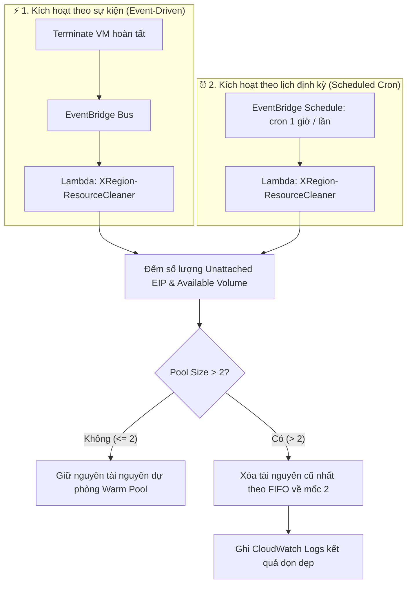

# SPEC-02: Quản Lý Pool Tài Nguyên & Dọn Dẹp Mồ Côi (Resource Pool Cleaner)

> **Phiên bản**: `1.0.0`  
> **Trạng thái**: `APPROVED (CHÍNH THỨC)`  
> **Ngày phê duyệt**: `2026-11-10`  
> **Tài liệu cha**: [SPEC-00: Agent Scope Guard](SPEC-00-AGENT-SCOPE-GUARD.md)

---

## 1. Mục Đích & Định Nghĩa Nghiệp Vụ

Tài liệu này xác định quy chuẩn vận hành, quản trị dung lượng bộ đệm dự phòng (**Warm Pool**) và cơ chế dọn dẹp tài nguyên rảnh rỗi (**Orphan Cleaner**) nhằm:
- Đảm bảo luôn có sẵn tài nguyên để cấp phát nhanh khi có yêu cầu tạo máy ảo hoặc chuyển vùng.
- Ngăn chặn lãng phí chi phí phát sinh do các tài nguyên không sử dụng (EIP không gắn instance bị tính phí theo giờ trên AWS, EBS volume rảnh rỗi chiếm dụng chi phí lưu trữ).

### Định nghĩa Tài nguyên Rảnh rỗi (Unattached / Orphan Resource)
Tài nguyên được xác định là nằm trong Pool rảnh rỗi khi thỏa mãn:
1. **Đối với Elastic IP (EIP)**: Đang ở trạng thái chưa liên kết (`AssociationId == null` hoặc không gắn vào bất kỳ ENI / Nova port nào).
2. **Đối với EBS Volume & Cinder Volume**: Đang ở trạng thái `available` (chưa gắn vào bất kỳ máy ảo nào, `attached_instance_id == null` hoặc `status == "available"`).

---

## 2. Quy Tắc Dung Lượng Pool & Tiêu Chuẩn Dọn Dẹp (Pool Retention Limit)

> [!IMPORTANT]
> ### QUY TẮC BẤT BIẾN VỀ POOL: GIỚI HẠN TỐI ĐA 2 TÀI NGUYÊN RẢNH RỖI
> - **Dung lượng tối đa cho phép của Warm Pool**: **2 tài nguyên rảnh rỗi** (áp dụng độc lập cho Pool EIP và Pool Volume).
> - **Quy định về thời gian an toàn (Grace Period)**: **KHÔNG ÁP DỤNG GRACE PERIOD**. Cứ tài nguyên ở trạng thái `available` / `unattached` là được tính ngay vào tổng số lượng của Pool.
> - **Nguyên tắc xử lý khi vượt ngưỡng (Pool Size > 2)**:
>   - Nếu tổng số tài nguyên rảnh rỗi trong Pool **lớn hơn 2** (`PoolCount > 2`), hệ thống **BẮT BUỘC PHẢI XÓA VĨNH VIỄN** các tài nguyên thừa trên hạ tầng AWS/OpenStack.
>   - **Tiêu chí lựa chọn để xóa**: Áp dụng nguyên tắc **FIFO (First In - First Out)**: Tài nguyên nào có thời gian nhàn rỗi lâu nhất (dựa trên timestamp disassociate / detach) sẽ bị giải phóng/xóa trước, cho đến khi số lượng tài nguyên rảnh rỗi trong Pool còn lại **chính xác 2 tài nguyên**.

---

## 3. Cơ Chế Kích Hoạt Dọn Dẹp (Trigger Mechanism)

Hệ thống triển khai cơ chế kích hoạt **Kép (Dual-Trigger Mechanism)** để đảm bảo không tài nguyên mồ côi nào bị bỏ sót:

### 3.1. Kích hoạt theo sự kiện (Event-Driven Execution)
- Ngay sau khi một máy ảo hoàn tất chuỗi hủy diệt (`instance.terminate`), Step Function giải phóng EIP và Volume về trạng thái unattached.
- Sự kiện kết thúc sẽ gọi ngay Lambda `XRegion-ResourceCleaner` để kiểm tra kích thước Pool và thực thi dọn dẹp tức thì.

### 3.2. Kích hoạt theo định kỳ (Scheduled Audit Cron)
- Quy tắc EventBridge Scheduler kích hoạt Lambda `XRegion-ResourceCleaner` định kỳ **mỗi 1 giờ một lần** (`cron(0 * * * ? *)`).
- Tác vụ quét toàn bộ hạ tầng AWS (ap-southeast-2) và OpenStack để phát hiện các tài nguyên rảnh rỗi phát sinh ngoài luồng (ví dụ: tạo dở, rò rỉ sau sự cố mạng).

---

## 4. Hành Vi Hạ Tầng & Quy Định Nhật Ký (Execution & Audit Logging)

- **Thao tác hạ tầng thực tế**:
  - Đối với EIP thừa: Gọi AWS EC2 API `ReleaseAddress(AllocationId)`.
  - Đối với AWS EBS Volume thừa: Gọi AWS EC2 API `DeleteVolume(VolumeId)`.
  - Đối với OpenStack Cinder Volume thừa: Gọi OpenStack Cinder REST API `DELETE /v3/{project_id}/volumes/{volume_id}`.
- **Quy chuẩn ghi nhật ký (Audit Logging)**:
  - Chỉ ghi nhật ký chi tiết vào **AWS CloudWatch Logs** của Lambda `XRegion-ResourceCleaner` (in rõ ID tài nguyên, thời gian rảnh rỗi, lý do giải phóng do Pool > 2).
  - **Không ghi thêm bản ghi vào DynamoDB** nhằm tối ưu chi phí Read/Write Capacity Unit và giữ cấu trúc NoSQL tinh gọn.

---

## 5. Ràng Buộc Kiểm Thử & Chống Sai Lệch Cho Agent (Testing Constraints)

> [!WARNING]
> Khi Agent sinh mã nguồn hoặc viết Unit / Integration Test cho chức năng này:
> 1. **Test Cases BẮT BUỘC phải bao quát 3 kịch bản cốt lõi**:
>    - `test_pool_size_under_limit`: Pool có 1 hoặc 2 tài nguyên -> Đảm bảo KHÔNG bị xóa.
>    - `test_pool_size_exceeded_fifo_purge`: Pool có 5 tài nguyên -> Đảm bảo xóa đúng 3 tài nguyên cũ nhất theo FIFO, giữ lại đúng 2 tài nguyên mới nhất.
>    - `test_attached_resources_ignored`: Tài nguyên đang được gắn vào Instance (`IN_USE`) -> Tuyệt đối không được tính vào Pool và không được phép xóa.
> 2. **CẤM Agent tự thêm cờ Grace Period** (như chờ 15 phút, 24 giờ) vào mã nguồn hoặc logic kiểm thử.

---

## 6. Lịch Sử Phiên Bản (Changelog)

| Ngày | Phiên Bản | Người Thay Đổi | Nội Dung |
| :--- | :--- | :--- | :--- |
| `2026-11-10` | `1.0.0` | Lead Architect / Product Owner | Ban hành tài liệu chuẩn hóa quy tắc quản trị Pool và dọn dẹp mồ côi. |
