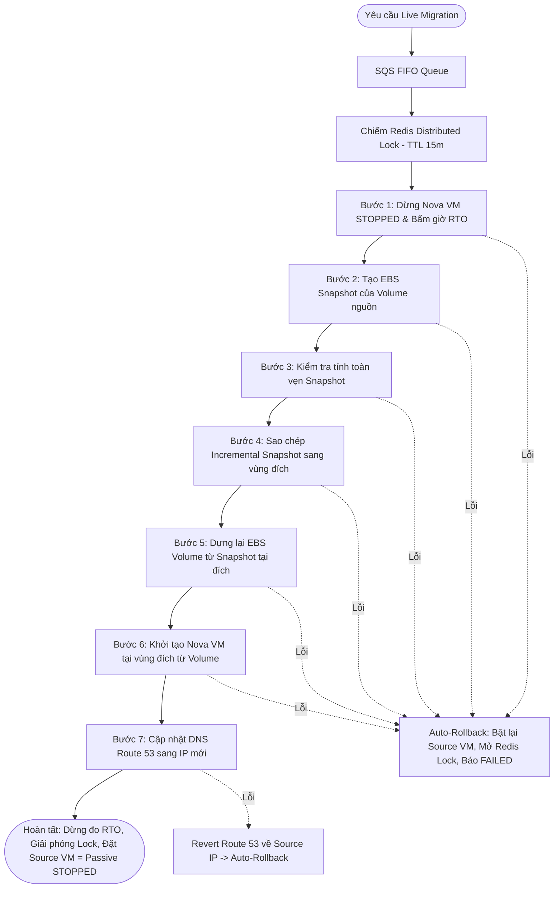

# SPEC-03: Chuyển Vùng Xuyên Vùng Trực Tiếp (Cross-Region Live Migration)

> **Phiên bản**: `1.2.0`  
> **Trạng thái**: `APPROVED (CHÍNH THỨC)`  
> **Ngày phê duyệt**: `2026-11-13`  
> **Tài liệu cha**: [SPEC-00: Agent Scope Guard](SPEC-00-AGENT-SCOPE-GUARD.md)

---

## 1. Tổng Quan Kiến Trúc & Mô Hình Active-Passive

Hệ thống XRegion cung cấp giải pháp chuyển vùng máy ảo an toàn giữa môi trường **Private Cloud OpenStack** (chạy trên EC2 node Sydney) và **AWS Public Cloud** (`ap-southeast-2`).

> [!IMPORTANT]
> ### NGUYÊN TẮC MÔ HÌNH: CUTOVER & DỌN DẸP SOURCE VM SAU KHI ĐỒNG BỘ ĐÍCH (SPEC-SF-09 v1.5.0)
> - Sau khi quá trình di trú chuyển vùng hoàn tất thành công tại vùng đích (`SyncDynamoDB` chuyển `current_region = dest_region`, `current_status = RUNNING`, `migration_lock = false`):
>   - **Máy ảo đích (Target VM)**: Trở thành máy ảo chính (**Active**), gắn Elastic IP mới và cập nhật trên `XRegion-Instances` / `XRegion-Nova` (không sử dụng Route 53 DNS Cutover).
>   - **Máy ảo nguồn (Source VM)**: `MigrateTargetBoot` kích hoạt bước `TriggerSourceCleanup` gửi sự kiện qua API Gateway về `source_region` để chạy Step Function **`MigrateSourceCleanup`** terminate Nova VM nguồn cũ và giải phóng tài nguyên vùng nguồn (EIP, NAT, SG, Volume, Snapshot) mà không ảnh hưởng bản ghi `XRegion-Instances` đang `RUNNING` tại vùng đích.
> - **Khi di trú thất bại trước khi hoàn tất**: Source VM được giữ nguyên và phục hồi qua `TriggerSourceRollback` (gửi API Gateway về `source_region` kích hoạt Step Function `LifecycleInstance` với `action = START`).

### Phân Định Lộ Trình Kiến Trúc (Architecture Transition Note)
- **Hiện trạng Chuẩn Hóa (`MigrationService.java` -> `SPEC-SF-08`)**: Backend Spring Boot không còn chạy luồng giả lập `Thread.sleep` trong RAM. `MigrationService.triggerMigration()` thực hiện khóa nguyên tử trên DynamoDB, ghi nhận bản ghi khởi đầu vào `XRegion-Migrations`, và phát sự kiện thật qua API Gateway (`EventBridgeGatewayClient`) theo `sourceRegion` để kích hoạt Step Function `MigrateInstance` (`SPEC-SF-08`). Hỗ trợ đầy đủ cho cả máy ảo dùng `linux_nat_v1`.
- **Theo dõi tiến độ (`getProgress`)**: `MigrationService.getProgress(instanceId)` đọc trực tiếp bản ghi mới nhất từ bảng DynamoDB `XRegion-Migrations` (`status`, `copy_progress`, `step_logs`, `started_at`, `completed_at`) để đồng bộ thời gian thực với Step Function/Lambda trên AWS.

---

## 2. Cơ Chế Điều Phối & Khóa Nguyên Tử (DynamoDB Conditional Lock)

Nhằm đảm bảo tính tuần tự và ngăn chặn xung đột dữ liệu (Race Conditions) khi nhiều yêu cầu di trú được gửi tới cùng lúc:

1. **Khóa nguyên tử qua DynamoDB Conditional Write (`XRegion-Instances`)**:
   - Trước khi phát sự kiện kích hoạt Step Function `MigrateInstance`, Backend thực hiện `UpdateItem` có điều kiện trên `XRegion-Instances`:
     - `ConditionExpression`: `attribute_exists(instance_id) AND (migration_lock = :unlocked OR attribute_not_exists(migration_lock))`
     - Thiết lập `migration_lock = true`, `current_status = "MIGRATING"`, và cập nhật mốc thời gian giữ khóa (`last_migration_timestamp = nowEpochSeconds`).
   - Bất kỳ yêu cầu đồng thời nào không chiếm được khóa sẽ bị từ chối với lỗi **`HTTP 409 Conflict`**.
2. **Thu hồi khóa treo (Stale Lock Recovery - `STALE_LOCK_SECONDS = 900`)**:
   - Thời gian tối đa giữ khóa là **900 giây (15 phút)** — khớp với `TimeoutSeconds: 900` của Step Function `MigrateInstance` (`SPEC-SF-08`).
   - Nếu `migration_lock = true` và thời gian giữ khóa (`now - lockSince`) vượt quá `900s`, lần gọi tiếp theo tự động giải phóng khóa treo (`migration_lock = false`), chuyển các bản ghi `IN_PROGRESS` dở dang sang `FAILED` và cho phép kích hoạt lại.
   - Nếu bước gửi sự kiện qua API Gateway gặp lỗi ngay lúc kích hoạt, hệ thống giữ nguyên `migration_lock = true` để cơ chế Stale Lock `900s` tự thu hồi sau (tránh chồng chéo nếu sự kiện đã vào EventBridge).
3. **Thời gian bảo vệ Cooldown (`DEFAULT_COOLDOWN_SECONDS = 300`)**:
   - Sau khi một lần di trú đạt `COMPLETED`, trong vòng **300 giây (5 phút)** tính từ `completed_at` gần nhất trên `XRegion-Migrations`, mọi yêu cầu di trú tiếp theo trên máy ảo đó đều bị chặn với **`HTTP 409 Conflict`**.

---

## 3. Chuỗi Pipeline 7 Bước Thực Thi Chuẩn Hóa

### Chi tiết hành động tại từng bước:
- **Bước 1: Dừng Nova VM an toàn (`STOP_SOURCE_VM`)**:
  - Gửi lệnh tắt máy ảo nguồn, chờ trạng thái chuyển hẳn sang `STOPPED` (`SHUTOFF`).
  - Bấm giờ đo Downtime RTO (`sourceStoppedMs = currentTimeMillis()`).
  - Cập nhật trạng thái `MIGRATING` trên DynamoDB `XRegion-Instances`.
- **Bước 2: Tạo EBS Snapshot (`CREATE_EBS_SNAPSHOT`)**:
  - Gọi AWS EC2 API `CreateSnapshot` trên EBS volume gắn với máy ảo nguồn.
  - Tiến độ ghi nhận: 20%.
- **Bước 3: Kiểm tra tính toàn vẹn Snapshot (`VERIFY_SNAPSHOT`)**:
  - Polling kiểm tra trạng thái snapshot cho đến khi đạt `completed`.
  - Xác thực kích cỡ và mã checksum đảm bảo dữ liệu không bị hỏng.
  - Tiến độ ghi nhận: 40%.
- **Bước 4: Sao chép Snapshot lũy tiến (`COPY_INCREMENTAL_SNAPSHOT`)**:
  - Truyền tải dữ liệu snapshot sang vùng đích.
  - Sử dụng cơ chế sao chép lũy tiến (Incremental Copy) dựa trên parent snapshot để tối ưu thời gian truyền và chỉ copy phần dữ liệu delta thay đổi.
  - Tiến độ ghi nhận: 65%.
- **Bước 5: Dựng lại EBS Volume tại vùng đích (`PROVISION_TARGET_VOLUME`)**:
  - Khởi tạo EBS Volume mới (chuẩn `gp3`, cấu hình IOPS và Throughput tối ưu) từ Snapshot vừa chuyển giao.
  - Chờ volume chuyển sang trạng thái `available`.
  - Tiến độ ghi nhận: 80%.
- **Bước 6: Khởi tạo Nova VM tại vùng đích (`BOOT_TARGET_VM`)**:
  - Gọi Nova API khởi tạo máy ảo mới từ boot volume tại vùng đích.
  - Cấp phát và gắn Elastic IP mới, đồng bộ SSH Keypair và Security Group 1-1 tương ứng.
  - Kiểm tra trạng thái máy ảo chuyển sang `RUNNING` và thực hiện TCP ping/port 22 healthcheck.
  - Tiến độ ghi nhận: 90%.
- **Bước 7: Chuyển đổi DNS Route 53 Cutover (`ROUTE53_DNS_CUTOVER`)**:
  - Cập nhật bản ghi DNS A-Record trên AWS Route 53 (TTL 60s) trỏ về Elastic IP mới của máy ảo đích.
  - Dừng đồng hồ đo Downtime RTO, tính toán và lưu `downtime_seconds` vào `XRegion-Migrations`.
  - Cập nhật DynamoDB: `current_region = target_region`, `current_status = RUNNING`.
  - Đặt Source VM ở trạng thái **Passive (`STOPPED`)** (không xóa).
  - Giải phóng Redis Distributed Lock và kích hoạt thời gian Cooldown 10 phút.
  - Tiến độ ghi nhận: 100%.

---

## 4. Kịch Bản Rollback & Phục Hồi Khi Phát Sinh Sự Cố

- **Lỗi ở Bước 1 đến Bước 6 (Trước thời điểm DNS Cutover)**:
  1. Hủy bỏ máy ảo đích và xóa EBS volume dở dang tại vùng đích.
  2. Xóa snapshot tạm thời nếu đang sao chép dở.
  3. Khởi động lại máy ảo nguồn (`START`) về trạng thái `RUNNING`.
  4. Giải phóng Redis Lock.
  5. Cập nhật DynamoDB trạng thái `FAILED`, ghi rõ chi tiết bước gặp sự cố.
- **Lỗi ở Bước 7 (Trong hoặc sau thời điểm DNS Cutover)**:
  1. Lập tức gọi Route 53 API hoàn nguyên (Revert) bản ghi DNS A-Record trỏ ngược lại Elastic IP của máy ảo nguồn.
  2. Bật lại máy ảo nguồn (`START`).
  3. Giải phóng Redis Lock và báo lỗi `FAILED`.

---

## 5. Ràng Buộc Kiểm Thử & Chống Sai Lệch Cho Agent (Testing Constraints)

> [!WARNING]
> Khi Agent lập trình hoặc viết Test Suite cho tính năng Live Migration:
> 1. **CẤM TUYỆT ĐỐI**:
>    - Không được tự ý rút gọn còn 4-5 bước hoặc hoán đổi vị trí của Bước 3 (Verify Snapshot).
>    - Không được tự thêm các bước phụ như backup S3 ngoài phạm vi đã định.
>    - Không được sinh code tự động xóa Source VM sau khi di trú thành công (vi phạm mô hình Active-Passive).
> 2. **Bộ Test Suite BẮT BUỘC phải bao quát tối thiểu 4 kịch bản**:
>    - `test_migration_happy_path_7_steps`: Di trú thành công qua đủ 7 bước, đo đúng RTO, Source VM chuyển Passive `STOPPED`.
>    - `test_redis_lock_contention`: Hai yêu cầu di trú cùng 1 instance -> Yêu cầu thứ 2 nhận lỗi `HTTP 409 Conflict`.
>    - `test_rollback_on_snapshot_copy_failure`: Bước 4 sao chép snapshot lỗi -> Dọn tài nguyên đích dở dang, bật lại Source VM.
>    - `test_rollback_dns_revert_on_step7_failure`: Bước 7 lỗi -> Hoàn nguyên DNS Route 53 về IP cũ.

---

## 6. Lịch Sử Phiên Bản (Changelog)

| Ngày | Phiên Bản | Người Thay Đổi | Nội Dung |
| :--- | :--- | :--- | :--- |
| `2026-11-10` | `1.0.0` | Lead Architect / Product Owner | Ban hành tài liệu chuẩn hóa quy trình Live Migration 7 bước Active-Passive và Redis Distributed Lock. |
| `2026-11-10` | `1.1.0` | Lead Architect / Product Owner | Phân định lộ trình kiến trúc chuyển tiếp: MigrationService.java hiện tại là Mock UI giai đoạn 1, SPEC-03 là kiến trúc đích bắt buộc. Đồng bộ enum RUNNING/STOPPED. |
| `2026-11-13` | `1.2.0` | Chủ dự án (`xacnhan-skill`) | Chuẩn hóa kích hoạt thật qua API Gateway (`SPEC-SF-08`), mở chặn `linux_nat_v1`, thay Redis/SQS bằng DynamoDB Conditional Lock + Stale Lock `900s`, thống nhất Cooldown `300s`, và đọc `getProgress` trực tiếp từ `XRegion-Migrations`. |
