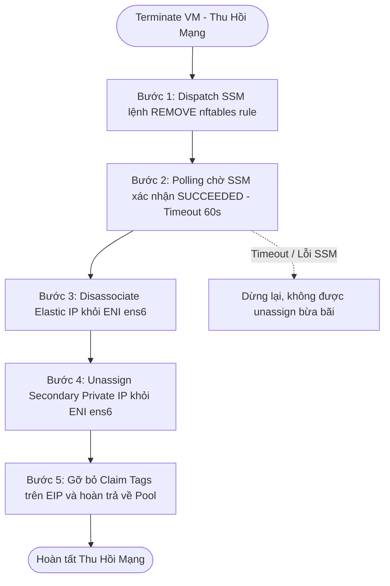

# SPEC-04: Hạ Tầng Mạng NAT & Điều Tuyến L2 (Network NAT & Routing)

> **Phiên bản**: `1.4.0`  
> **Trạng thái**: `APPROVED (CHÍNH THỨC)`  
> **Ngày phê duyệt**: `2026-11-13`  
> **Tài liệu cha**: [SPEC-00: Agent Scope Guard](SPEC-00-AGENT-SCOPE-GUARD.md)

---

## 1. Mô Hình Kiến Trúc Mạng Hai Tầng (Two-Tier Network Model)

Máy chủ OpenStack node `i-056d7f3dd24156234` chạy trên hạ tầng AWS EC2 (Sydney `ap-southeast-2`), sử dụng card mạng chuyên dụng ngoài `OPENSTACK_PUBLIC_ENI` (`ens6` / `eni-091eaee3e69e3f42d`). Để máy ảo bên trong OpenStack Neutron giao tiếp ra ngoài Internet với IP công khai Elastic IP, hệ thống áp dụng kiến trúc NAT 2 tầng:

```
[Internet Client]
       │
       ▼ (Elastic IP: 16.178.34.111)
[AWS ENI ens6 Subnet: 10.20.1.0/24]
       │ (gateway_private_ip: 10.20.1.226)
       ▼ (1-1 DNAT / SNAT qua nftables)
[OpenStack Neutron Overlay / TAP Port]
       │ (guest_private_ip: 192.168.100.x / 10.20.1.x)
       ▼
[Nova Guest VM: Port 22 SSH / ICMP Ping]
```

### Định nghĩa 2 dải địa chỉ IP cốt lõi:
1. **`gateway_private_ip`**: Địa chỉ IP phụ (Secondary Private IP) thuộc Subnet của AWS ENI `ens6` (dải `10.20.1.0/24`). Được gán trực tiếp vào ENI và liên kết 1-1 với Elastic IP qua `associate_address`.
2. **`guest_private_ip`**: Địa chỉ IP nội bộ của máy ảo Nova cấp phát từ OpenStack Neutron subnet.

---

## 2. Quy Trình Cấu Hình NAT Qua AWS SSM Run Command

Việc thiết lập và gỡ bỏ bảng quy tắc `nftables` trên máy chủ OpenStack được thực hiện tự động bởi AWS Step Functions thông qua dịch vụ AWS Systems Manager (SSM Run Command):

### 2.1. Quy tắc nftables 1-1 Ánh Xạ Hai Chiều
Hệ thống sử dụng bảng quy tắc `nftables` để chuyển đổi địa chỉ:
```nftables
# Ingress (DNAT): Đổi đích từ gateway_private_ip sang guest_private_ip
ip daddr <gateway_private_ip> dnat to <guest_private_ip>

# Egress (SNAT): Đổi nguồn từ guest_private_ip sang gateway_private_ip
ip saddr <guest_private_ip> snat to <gateway_private_ip>
```

**Chain `forward` của bảng lọc (bắt buộc):** luồng vào và luồng ra dùng chung một cặp địa chỉ NAT, nên bảng `xregion_filter` phải accept **cả hai loại trạng thái conntrack**:
```nftables
# Gói NEW của luồng inbound (đã DNAT)
iifname "br-ex" oifname "br-xregion" ct status dnat accept
# Gói hồi đáp của luồng inbound (DNAT) và của luồng máy ảo tự khởi tạo (SNAT)
iifname "br-ex" oifname "br-xregion" ct state established,related accept
iifname "br-ex" oifname "br-xregion" drop
```
Nếu thiếu rule `ct state established,related`, gói trả lời từ Internet của các kết nối do máy ảo khởi tạo bị rule `drop` cuối cùng loại bỏ: hiện tượng đặc trưng là **inbound thành công nhưng outbound mất toàn bộ gói trả lời** (máy ảo gửi DNS/TCP ra ngoài nhưng không nhận được phản hồi).

### 2.2. Tham số và Ràng Buộc Điều Phối SSM (`XRegion-Network-Dispatch`)
- **Tài nguyên đích**: Host EC2 `i-056d7f3dd24156234`.
- **Thao tác hỗ trợ**: `APPLY` (khi tạo máy) hoặc `REMOVE` (khi hủy máy).
- **Ràng buộc Chống Trùng Lệnh (Idempotent Guard)**:
  - Trường `command_generation`: Mỗi lần phát sinh yêu cầu thay đổi mạng phải tăng revision `generation`.
  - Nếu một lệnh SSM đang thực thi (`InProgress`), hàm dispatch **bắt buộc tái sử dụng `ssm_command_id` hiện tại**, tuyệt đối không phát hành lệnh SSM mới bừa bãi ("ambiguous dispatch is not reissued").
- **Thời gian chờ (Timeout)**:
  - Thời gian thực thi tối đa của lệnh SSM trên host: **60 giây**.
  - Hàm `XRegion-Network-CheckCommand` polling kiểm tra kết quả qua `get_command_invocation`. Nếu quá deadline 60s -> ném `TimeoutError`, chuyển ngay sang `MarkNetworkFailure`.

---

## 3. Xác Thực Kết Nối Mạng Thực Tế (không còn trong pipeline launch)

> [!IMPORTANT]
> ### `VerifyNetwork` ĐÃ BỊ LOẠI BỎ KHỎI LAUNCH (kể từ SPEC-04 `1.2.0`)
> - Step Functions `LaunchInstance` **không còn** chạy task `VerifyNetwork` và không còn gọi `XRegion-Network-Verify`.
> - Điều kiện thành công của launch chỉ là: lệnh SSM APPLY `SUCCEEDED` và `applied_generation` khớp `generation` trên `XRegion-NetworkMappings`.
> - Máy ảo **vẫn** được đánh dấu `RUNNING`/`ACTIVE` kể cả khi gateway chưa ping được ICMP hoặc chưa mở TCP 22 tới `guest_private_ip`. Việc kiểm tra reachability là trách nhiệm của người vận hành hoặc công cụ giám sát bên ngoài.
> - Không bỏ các kiểm tra khác: EIP phải gán đúng ENI/`gateway_private_ip`, NAT generation phải khớp, và mọi lỗi SSM vẫn chuyển `MarkNetworkFailure` → rollback.

### 3.1. Khi vẫn cần kiểm tra reachability
Có thể chạy thủ công trên host gateway `i-056d7f3dd24156234` để chẩn đoán:
```bash
ping -I br-xregion -c 1 -W 1 <guest_private_ip>
nc -z -w 2 <guest_private_ip> 22
```
Kết quả **không** phát động rollback tự động và không chặn launch.

---

## 4. Quy Trình Thu Hồi Mạng Khi Hủy Máy (Network Teardown)

Khi thực hiện Terminate máy ảo, chuỗi thu hồi mạng bắt buộc phải tuân thủ thứ tự tuần tự nghiêm ngặt sau:



1. **Bước 1**: Gọi SSM Run Command phát lệnh `REMOVE` gỡ bỏ các dòng quy tắc NAT tương ứng với IP của máy ảo trên `nftables`.
2. **Bước 2**: Chờ SSM xác nhận trạng thái lệnh là `SUCCEEDED`. Nếu lệnh chưa hoàn tất hoặc gặp lỗi, cấm gỡ IP trên AWS để tránh làm hỏng bảng routing của hệ điều hành host.
3. **Bước 3**: Gọi AWS EC2 API `DisassociateAddress(AssociationId)`.
4. **Bước 4**: Gọi AWS EC2 API `UnassignPrivateIpAddresses` để giải phóng `gateway_private_ip` khỏi card mạng `ens6`.
5. **Bước 5**: Gỡ bỏ các tag sở hữu (`ClaimedBy`, `ClaimedAt`) trên Elastic IP, hoàn trả địa chỉ IP về Pool dự phòng (tuân thủ giới hạn Pool <= 2 theo [SPEC-02](SPEC-02-RESOURCE-POOL-CLEANER.md)).

---

## 5. Loại Bỏ Endpoint Cũ getNetworkOverview (GET /api/network)

- **Nguyên nhân**: Hàm `NetworkService.getNetworkOverview()` và endpoint `GET /api/network` là tàn tích mock từ giai đoạn đầu phát triển. Dữ liệu trả về đang hardcode sai lệch (chứa VPC Virginia `us-east-1` và ENI giả lập), đồng thời toàn bộ giao diện Frontend (`src/main/resources/static/`) hoàn toàn không gọi endpoint này.
- **Quy định bắt buộc**:
  - Loại bỏ hoàn toàn endpoint `GET /api/network` khỏi `NetworkController.java`.
  - Loại bỏ hàm `getNetworkOverview()` khỏi `NetworkService.java`.
  - Tầng mạng Backend chỉ duy trì các endpoint phục vụ đúng luồng nghiệp vụ thực tế:
    - `GET /api/network/security-groups`: Đọc danh sách Security Group 1-1 của máy ảo.
    - `POST /api/network/dns`: Cập nhật bản ghi DNS Route 53.

---

## 5.1. Quy Chuẩn Public DNS Theo `instance_id` (Route 53 `xregion-iaas.online`)

- **Hosted Zone ID**: `Z06312743V4JPQHUPYQDW` (`xregion-iaas.online.`).
- **Quy tắc tên miền**: `<instance_id>.xregion-iaas.online` (`Type = A`, `TTL = 60` giây).
- **`XRegion-EIPPoolManager`**: Giữ nguyên vai trò quản lý Warm Pool EIP dự phòng (`<= 2` EIP/region), không tự tạo A record khi chưa gắn máy ảo.
- **Vòng đời cập nhật / xóa A Record (Fail-open sau 2 lần retry, log warning nếu Route 53 lỗi tạm thời)**:
  1. **`LaunchInstance` (`XRegion-LaunchInstance-SyncDynamoDB`)**: `UPSERT` A record `<instance_id>.xregion-iaas.online` trỏ về `public_ip` mới và lưu `public_dns = "<instance_id>.xregion-iaas.online"` vào `XRegion-Instances` (và `XRegion-Nova`).
  2. **`MigrateTargetBoot` (`XRegion-MigrateTarget-SyncDynamoDB`)**: `UPSERT` A record `<instance_id>.xregion-iaas.online` trỏ về Elastic IP mới tại vùng đích và cập nhật `public_dns` vào `XRegion-Instances` (và `XRegion-Nova`).
  3. **`TerminateInstance` (`XRegion-TerminateInstance-SyncDynamoDB`)**: `DELETE` A record `<instance_id>.xregion-iaas.online` khỏi Route 53 (bỏ qua nếu không tồn tại).
- **Hiển thị UI**: Chỉ hiển thị trường `Public DNS` trên trang chi tiết máy ảo (`instance-detail.html`) ngay cạnh/dưới `Public IPv4 (Elastic IP)` kèm nút Copy.

---

## 6. Ràng Buộc Kiểm Thử & Chống Sai Lệch Cho Agent (Testing Constraints)

> [!WARNING]
> Khi Agent lập trình hoặc viết test case cho phần mạng NAT:
> 1. **CẤM TUYỆT ĐỐI**:
>    - Không được giả định Floating IP của Neutron tự hoạt động mà bỏ qua lệnh SSM cấu hình nftables trên host.
>    - Không được dùng sự tồn tại của `VerifyNetwork`/`XRegion-Network-Verify` trong pipeline launch: bước này đã bị loại bỏ (xem mục 3).
>    - Không được phép đảo ngược thứ tự: Disassociate EIP trước khi gỡ bỏ nftables rule.
>    - Không được bỏ rule `ct state established,related accept` trên chain `forward` của `xregion_filter`; thiếu rule này thì mọi kết nối do máy ảo khởi tạo sẽ mất toàn bộ gói trả lời (xem mục 2.1).
> 2. **Bộ Test Suite BẮT BUỘC phải bao quát các kịch bản**:
>    - `test_launch_success_without_verify_network`: LaunchInstance không render state `VerifyNetwork`; APPLY `SUCCEEDED` đi thẳng `SyncDynamoDB`.
>    - `test_ssm_dispatch_idempotent_reuse_command_id`: Lệnh SSM đang chạy thì dispatch lần 2 phải tái sử dụng command_id cũ.
>    - `test_teardown_strict_sequential_order`: Kiểm tra thứ tự gọi API đúng chuẩn 5 bước.

---

## 7. Lịch Sử Phiên Bản (Changelog)

| Ngày | Phiên Bản | Người Thay Đổi | Nội Dung |
| :--- | :--- | :--- | :--- |
| `2026-11-10` | `1.0.0` | Lead Architect / Product Owner | Ban hành tài liệu đặc tả hạ tầng mạng NAT V1, điều phối SSM và quy chuẩn VerifyNetwork. |
| `2026-11-10` | `1.1.0` | Lead Architect / Product Owner | Loại bỏ hoàn toàn endpoint GET /api/network và hàm getNetworkOverview() khỏi Backend để triệt tiêu dead code và tham chiếu sai lệch Virginia. |
| `2026-11-10` | `1.2.0` | Chủ dự án (yêu cầu trực tiếp) | Loại bỏ `VerifyNetwork` khỏi pipeline launch theo cùng quyết định với SPEC-SF-01 `1.4.0`; cập nhật ràng buộc kiểm thử sang `test_launch_success_without_verify_network`. Lệnh kiểm tra reachability chỉ còn dùng để chẩn đoán thủ công. |
| `2026-11-11` | `1.3.0` | Chủ dự án (yêu cầu trực tiếp) | Bổ sung ràng buộc chain `forward` của `xregion_filter`: bắt buộc accept `ct status dnat` (gói NEW inbound) và `ct state established,related` (gói hồi đáp của DNAT và SNAT). Sửa lỗi outbound mất toàn bộ gói trả lời do rule `drop` cuối cùng. |
| `2026-11-13` | `1.4.0` | Chủ dự án (`xacnhan-skill`) | Chuẩn hóa Public DNS `<instance_id>.xregion-iaas.online` (`Z06312743V4JPQHUPYQDW`, `TTL = 60s`): `UPSERT` tại `SyncDynamoDB` của `LaunchInstance` & `MigrateTargetBoot`, lưu `public_dns` vào `XRegion-Instances`, `DELETE` khi `TerminateInstance` (fail-open sau 2 lần retry) và hiển thị trên `instance-detail.html`. |
