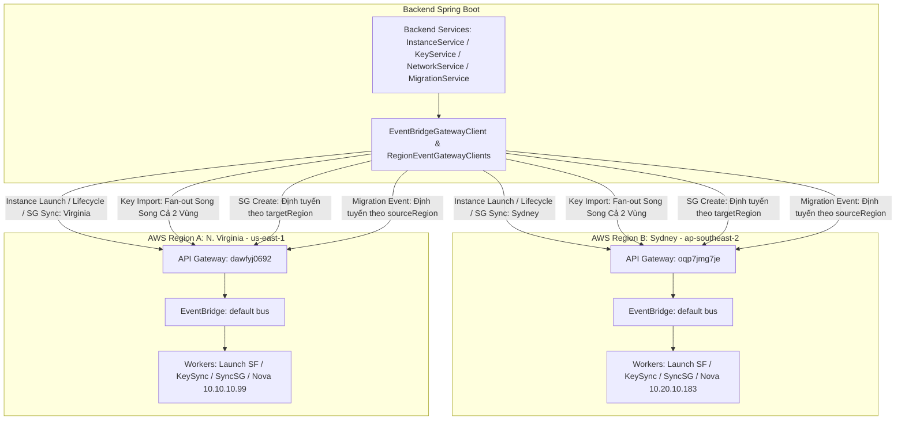

# SPEC-08: Định Tuyến Sự Kiện Qua API Gateway Đa Vùng (Multi-Region API Gateway & EventBridge Routing)

> **Phiên bản**: `1.3.0`  
> **Trạng thái**: `APPROVED (CHÍNH THỨC)`  
> **Ngày phê duyệt**: `2026-11-13`  
> **Tài liệu cha**: [SPEC-00: Agent Scope Guard](SPEC-00-AGENT-SCOPE-GUARD.md)

---

## 1. Mục Đích & Kiến Trúc Tổng Thể

Hệ thống IaaS XRegion vận hành theo mô hình phân tán đa vùng (Active-Active giữa Region A - N. Virginia và Region B - Sydney). Toàn bộ giao tiếp hạ tầng giữa Backend Spring Boot và hệ thống máy chủ OpenStack đều thông qua cơ chế hướng sự kiện (Event-Driven), trong đó Backend gửi sự kiện HTTP POST có chữ ký số **AWS IAM SigV4** sang dịch vụ **AWS API Gateway** của từng vùng để nạp sự kiện (`PutEvents`) vào Amazon EventBridge.

Tài liệu này chuẩn hóa quy tắc định tuyến, địa chỉ Endpoint, cơ chế xử lý lỗi Fail-closed và hợp đồng dữ liệu cho toàn bộ các sự kiện được phát ra từ Backend tới API Gateway.



---

## 2. Thông Số Kỹ Thuật API Gateway Theo Từng Vùng

| Thông số | Region B (Sydney) | Region A (N. Virginia) |
| :--- | :--- | :--- |
| **Mã Vùng AWS** | `ap-southeast-2` | `us-east-1` |
| **REST API ID** | `oqp7jmg7je` | `dawfyj0692` |
| **Tên Dịch Vụ** | `XRegion-EventGateway` | `XRegion-EventGateway` |
| **Endpoint URL** | `https://oqp7jmg7je.execute-api.ap-southeast-2.amazonaws.com/prod/events` | `https://dawfyj0692.execute-api.us-east-1.amazonaws.com/prod/events` |
| **Resource & Method** | `POST /events` | `POST /events` |
| **AWS Integration** | `AWSEvents.PutEvents` (EventBus: `default`) | `AWSEvents.PutEvents` (EventBus: `default`) |
| **Xác thực yêu cầu** | AWS IAM SigV4 (`service: execute-api`, `region: ap-southeast-2`) | AWS IAM SigV4 (`service: execute-api`, `region: us-east-1`) |

> [!IMPORTANT]
> **RÀNG BUỘC CHỮ KÝ AWS SIGV4**:  
> Mỗi API Gateway yêu cầu xác thực bằng chuẩn bảo mật `AWS_IAM`. Chữ ký SigV4 **bắt buộc phải sử dụng mã vùng của gateway đích**:
> - Gửi sang API Gateway Sydney (`ap-southeast-2`) phải ký với `Region = ap-southeast-2`.
> - Gửi sang API Gateway Virginia (`us-east-1`) phải ký với `Region = us-east-1`.
> - Gửi sự kiện vùng Virginia nhưng ký SigV4 vùng Sydney sẽ bị API Gateway trả về lỗi `HTTP 403 Forbidden` (`IncompleteSignature / Invalid Signature`).

---

## 3. Ma Trận Định Tuyến Sự Kiện Toàn Diện (Complete Event Routing Matrix)

| Nghiệp vụ | Source EventBridge | DetailType | Tham số quyết định vùng | Cơ chế định tuyến API Gateway | Hành động tại Worker đích |
| :--- | :--- | :--- | :--- | :--- | :--- |
| **1. Khởi tạo máy ảo** (`Launch`) | `xregion.backend.instance` | `instance.launch` | `request.getRegion()` | **Định tuyến đơn vùng (Fail-closed)**: Bắt buộc truyền `targetRegion` hợp lệ (`us-east-1` hoặc `ap-southeast-2`). Ném ngoại lệ nếu null/blank. | Kích hoạt Step Function `XRegion-LaunchInstance` của vùng đó. |
| **2. Vòng đời máy ảo** (`START`, `STOP`, `REBOOT`, `TERMINATE`) | `xregion.backend.instance` | `instance.lifecycle` | `entity.getCurrentRegion()` | **Định tuyến đơn vùng (Fail-closed)**: Đọc trực tiếp vùng cư trú của máy ảo từ DynamoDB và gửi tới API Gateway của vùng đó. Bắt buộc có region. | Kích hoạt Lambda/Step Function quản lý vòng đời trên cụm OpenStack tương ứng. |
| **3. Đồng bộ Khóa SSH** (`Import KeyPair`) | `xregion.backend.key` | `key.import` | Cố định: Toàn hệ thống | **Fan-out song song 2 vùng**: Backend gửi sự kiện `key.import` tới **CẢ HAI API Gateway** (`us-east-1` và `ap-southeast-2`). | Lambda `XRegion-KeySyncManager` ở cả Sydney (`10.20.10.183`) và Virginia (`10.10.10.99`) đều nhận được và nạp khóa công khai vào Nova Keypair. |
| **4. Cập nhật Security Group** (`Sync SG Rules`) | `xregion.backend.security` | `security-group.updated` | `inst.getCurrentRegion()` | **Định tuyến theo máy sở hữu**: Backend tra cứu `inst.getCurrentRegion()` của máy ảo sở hữu Security Group và gửi tới API Gateway của đúng vùng đó. | Lambda `XRegion-SyncSecurityGroup` của vùng tương ứng cập nhật rule vào Neutron Security Group. |
| **5. Tạo Security Group mẫu** | `xregion.backend.security` | `security.create` | `targetRegion` | **Định tuyến theo vùng chỉ định (Region-specific)**: Bổ sung tham số `targetRegion` khi tạo Security Group và gửi tới API Gateway của vùng đó. | Tạo nhóm bảo mật mẫu trong cơ sở dữ liệu và cụm Neutron tương ứng. |
| **6. Di trú máy ảo** (`Live Migration`) | `xregion.backend.migration` | `Migration Lifecycle Event` | `sourceRegion` | **Định tuyến theo vùng nguồn**: Gửi sự kiện di trú tới API Gateway của vùng nguồn nơi máy ảo đang cư trú để điều phối dọn dẹp và snapshot đĩa nguồn. | Kích hoạt worker/Step Function xử lý di trú tại vùng nguồn. |
| **7. Boot VM đích khi Di trú** (`Migrate Target Boot`) | `xregion.migration.orchestrator` | `instance.migration.boot` | `destRegion` | **Định tuyến theo vùng đích**: Step Function `MigrateInstance` gửi sự kiện tới API Gateway của `destRegion` để kích hoạt boot Nova VM từ `dest_snapshot_id`. | Kích hoạt Step Function `MigrateTargetBoot` (`SPEC-SF-09`) tại vùng đích. |
| **8. Rollback Di trú về Nguồn** (`Migrate Rollback`) | `xregion.migration.orchestrator` | `instance.migration.rollback` | `sourceRegion` | **Định tuyến về vùng nguồn**: Khi `MigrateTargetBoot` thất bại sau khi dọn tài nguyên đích, gửi sự kiện về API Gateway của `sourceRegion`. | Bật lại Source Nova VM (`os-start`), mở khóa `XRegion-Instances` và đánh dấu `XRegion-Migrations` `FAILED`. |

---

## 4. Hợp Đồng Triển Khai Trong Mã Nguồn (Code Contracts)

### 4.1. Chính Sách Khắt Khe Fail-Closed & Loại Bỏ Hàm Overload Thiếu Vùng
- **Kiểm tra vùng bắt buộc (`validateRegion`)**:
  Mọi phương thức gửi sự kiện tới API Gateway (ngoại trừ hàm Fan-out SSH Key tự động phát 2 vùng) đều bắt buộc kiểm tra tham số vùng đích:
  ```java
  public static final Set<String> SUPPORTED_REGIONS = Set.of("us-east-1", "ap-southeast-2");

  private void validateRegion(String region) {
      if (region == null || !SUPPORTED_REGIONS.contains(region.trim())) {
          throw new IllegalArgumentException("Target region is required and must be one of: " + SUPPORTED_REGIONS);
      }
  }
  ```
- **Loại bỏ / Khóa các hàm overload thiếu region**:
  Đánh dấu `@Deprecated` hoặc xóa bỏ hoàn toàn các overload cũ:
  - `sendInstanceLaunchEvent(..., username)` -> `@Deprecated`
  - `sendSecurityGroupSyncEvent(...)` -> Bắt buộc thêm tham số `String region` lên đầu:
    ```java
    public EventBridgeEventResponse sendSecurityGroupSyncEvent(String region, String groupId, String instanceId,
                                                               String novaId, long revision, int ruleCount, String requestedBy)
    ```
  - `sendSecurityGroupCreateEvent(...)` -> Bắt buộc thêm tham số `String region`:
    ```java
    public EventBridgeEventResponse sendSecurityGroupCreateEvent(String region, String name, String description,
                                                                 List<Map<String, Object>> inboundRules, String createdBy)
    ```
  - `sendMigrationEvent(...)` -> Định tuyến theo `sourceRegion`, truyền kèm `novaId` và `sourceVolumeId`:
    ```java
    public EventBridgeEventResponse sendMigrationEvent(String migrationId, String instanceId, String novaId,
                                                       String sourceVolumeId, String sourceRegion, String destRegion,
                                                       String phase, String status, int progressPercent)
    ```

### 4.2. Tầng Client (`EventBridgeGatewayClient.java`)
- **Xử lý Fan-out SSH Key**:
  Phương thức `sendKeySyncEvent` bắt buộc lặp qua danh sách các vùng hỗ trợ (`us-east-1` và `ap-southeast-2`) và gửi sự kiện đến từng API Gateway:
  ```java
  for (String region : List.of("ap-southeast-2", "us-east-1")) {
      sendEvent(region, "xregion.backend.key", "key.import", detail);
  }
  ```

### 4.3. Tầng Nghiệp Vụ (`NetworkService.java`)
- Khi người dùng cập nhật rule cho Security Group của máy ảo:
  1. Đọc bản ghi máy ảo từ `XRegion-Instances`: `inst = instancesTable.getItem(...)`.
  2. Xác định vùng của máy: `String targetRegion = inst.getCurrentRegion()`.
  3. Nếu `targetRegion == null`: Ném lỗi không xác định được vùng máy ảo.
  4. Truyền `targetRegion` vào `sendSecurityGroupSyncEvent(targetRegion, groupId, ...)`.

---

## 5. Ràng Buộc Cấm Tuyệt Đối (Anti-Speculation Mandate)

> [!CAUTION]
> 1. **CẤM TUYỆT ĐỐI** âm thầm fallback về API Gateway Sydney khi tham số vùng bị `null` hoặc rỗng. Bắt buộc ném ngoại lệ `IllegalArgumentException` (nguyên tắc Fail-closed).
> 2. **CẤM TUYỆT ĐỐI** chỉ phát sự kiện `key.import` vào một vùng duy nhất. Cả hai vùng Nova Compute đều phải được đồng bộ khóa công khai để người dùng có thể khởi tạo máy ảo tại cả hai vùng.
> 3. **CẤM TUYỆT ĐỐI** gửi sự kiện `security-group.updated` của máy ảo Virginia (`us-east-1`) sang API Gateway Sydney (`ap-southeast-2`), vì worker Sydney không quản lý cụm Neutron Virginia (`10.10.10.99`).
> 4. **CẤM TUYỆT ĐỐI** gọi các hàm overload không có tham số `region`. Toàn bộ lời gọi mới phải truyền vùng rõ ràng.
> 5. **CẤM TUYỆT ĐỐI** sửa đổi ARN hoặc URL của API Gateway trong mã nguồn khi chưa có sự chấp thuận từ cấu hình môi trường `application.yaml`.

---

## 6. Lịch Sử Phiên Bản (Changelog)

| Ngày | Phiên Bản | Người Thay Đổi | Nội Dung |
| :--- | :--- | :--- | :--- |
| `2026-11-12` | `1.0.0` | Lead Architect & Chủ dự án (`xacnhan-skill`) | Ban hành tài liệu đặc tả chuẩn hóa cơ chế định tuyến sự kiện qua API Gateway đa vùng: Fan-out song song SSH Key tới cả 2 vùng và định tuyến Security Group Sync theo vùng cư trú của máy ảo. |
| `2026-11-12` | `1.1.0` | Lead Architect & Chủ dự án (`xacnhan-skill`) | Chuẩn hóa toàn bộ 6 nhóm sự kiện API Gateway: Áp dụng cơ chế Fail-closed (cấm fallback ngầm khi thiếu region), định tuyến `security.create` theo `targetRegion`, định tuyến di trú theo `sourceRegion`, đánh dấu `@Deprecated` các overload cũ. |
| `2026-11-13` | `1.2.0` | Chủ dự án (`xacnhan-skill`) | Cập nhật chữ ký `sendMigrationEvent` gửi kèm `novaId` và `sourceVolumeId` theo chuẩn `SPEC-SF-08` v1.1.0. |
| `2026-11-13` | `1.3.0` | Chủ dự án (`xacnhan-skill`) | Bổ sung sự kiện `instance.migration.boot` (định tuyến tới `destRegion`) và `instance.migration.rollback` (định tuyến về `sourceRegion`) phục vụ `SPEC-SF-09`. |
