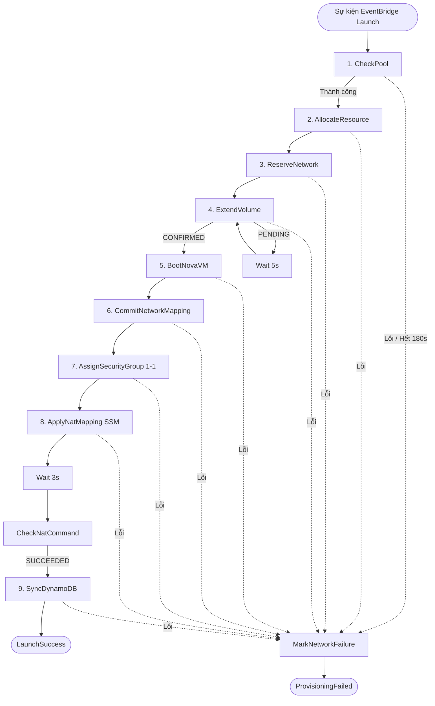

# SPEC-SF-01: Quy Trình Khởi Tạo Máy Ảo Step Function (Launch Pipeline)

> **Phiên bản**: `1.5.0`  
> **Trạng thái**: `APPROVED (CHÍNH THỨC)`  
> **Ngày phê duyệt**: `2026-11-10`  
> **Tài liệu cha**: [SPEC-SF-00: Serverless Scope Guard](SPEC-SF-00-SERVERLESS-SCOPE-GUARD.md)

---

## 1. Tổng Quan Kiến Trúc & Máy Trạng Thái

Máy trạng thái AWS Step Functions `LaunchInstance` chịu trách nhiệm cấp phát tự động toàn bộ hạ tầng cho máy ảo từ Warm Pool, thiết lập lưu trữ boot-from-volume, cấu hình card mạng NAT 2 tầng, gán Security Group 1-1 và đồng bộ dữ liệu vào DynamoDB.

> [!IMPORTANT]
> **Không còn bước `VerifyNetwork`:** kể từ `1.4.0`, pipeline launch **không** chạy ping ICMP / TCP 22 trước khi ghi nhận thành công. Vì vậy `LaunchSuccess` chỉ chứng minh NAT mapping đã được áp dụng thành công trên gateway, **không** chứng minh máy ảo đã truy cập được qua SSH. Việc kiểm tra kết nối thực tế thuộc trách nhiệm người dùng hoặc công cụ giám sát bên ngoài pipeline.

- **Thời gian timeout tối đa của Step Function**: **`300 giây (5 phút)`**. Quá 300s toàn bộ tiến trình tự động FAIL và kích hoạt chuỗi bồi hoàn.
- **Tập tin định nghĩa ASL**: `serverless/launch-contract/LaunchInstance.asl.json`.



---

## 2. Hợp Đồng Dữ Liệu Từng Bước (Payload Contract)

### 2.1. Payload Khởi Đầu Đầu Vào (Input Contract)
```json
{
  "instance_id": "i-xxxxxxxx-xxxx-xxxx-xxxx-xxxxxxxxxxxx",
  "instance_name": "Web-Prod-01",
  "flavor": "m1.medium",
  "image_id": "72e9830a-53ef-4c36-8b5c-fae3b96a3fd0",
  "key_id": "key-mykey-a1b2c3d4",
  "ebs_size_gb": 20,
  "volume_type": "gp3",
  "username": "tuanl",
  "inbound_rules": [{"protocol": "tcp", "fromPort": 443, "toPort": 443, "cidr": "0.0.0.0/0", "description": "HTTPS"}],
  "outbound_rules": [{"protocol": "all", "fromPort": 0, "toPort": 65535, "cidr": "0.0.0.0/0", "description": ""}]
}
```

`inbound_rules`/`outbound_rules` là bộ rule người dùng soạn ở bước 6 của launch wizard; backend chuyển nguyên văn vào `detail` của sự kiện `instance.launch`. Thiếu hai khóa này thì pipeline chỉ tạo nhóm rỗng và ghi `PENDING_SYNC`, tuyệt đối không tự thêm rule.

### 2.2. Chi Tiết Các Bước Thực Thi Tuần Tự

| Bước | Tên State | Lambda Function | Hành Động & Ràng Buộc | Retry / Timeout |
| :--- | :--- | :--- | :--- | :--- |
| **1** | `CheckPool` | `XRegion-LaunchInstance-CheckPool` | Kiểm tra Cinder Warm Pool (`AVAILABLE`) và Elastic IP Pool. **Fail-Fast**: Xác thực hợp lệ của Nova Flavor và SSH Keypair (`key_id`) ngay trước khi cấp phát. | **5 lần Exponential Backoff** (Interval: 5s, Rate: 2.0). Quá 180s ném `POOL_EXHAUSTED`. |
| **2** | `AllocateResource` | `XRegion-LaunchInstance-AllocateResource` | Chiếm khóa Volume nguyên tử (`status = ALLOCATED`, `lease_instance_id = instance_id`). **Bắt buộc khớp chính xác `image_id`** (CẤM fallback sang image khác). Gán Tag EIP `ClaimedBy = instance_id`. | Retry 2 lần (Interval 2s). |
| **3** | `ReserveNetwork` | `XRegion-Network-Reserve` | Cấp phát `guest_private_ip` (192.168.100.x) và gán `gateway_private_ip` (10.20.1.x) trên ENI `ens6`. | Retry 2 lần (Interval 2s). |
| **4** | `ExtendVolume` | `XRegion-LaunchInstance-ExtendVolume` | Gọi GET Cinder API xác thực volume đang `available` và đạt đủ kích thước. Nếu `ebs_size_gb > 10GB`, gọi Cinder POST `os-extend` và ghi nhận tag `XRegionResizeTargetGiB`. Nếu `ebs_size_gb == 10GB`, xác nhận `CONFIRMED` ngay sau khi GET thành công (không gọi POST để tránh lỗi HTTP 400). | Timeout tối đa 300s. Ghi `extend_post_attempted` trước khi POST. Polling 5s. |
| **5** | `BootNovaVM` | `XRegion-LaunchInstance-BootNova` | Gọi Nova REST API boot máy từ Cinder volume (`boot-from-volume`), bật `config_drive = true`. | Retry 2 lần. Chờ Nova ACTIVE. |
| **6** | `CommitNetworkMapping` | `XRegion-Network-Commit` | Xác nhận mapping mạng giữa AWS ENI và OpenStack TAP interface. | Retry 2 lần. |
| **7** | `AssignSecurityGroup` | `XRegion-LaunchInstance-AssignSecurityGroup` | Tự động sinh Neutron SG 1-1 đặt tên theo `nova_id` và gắn vào port của VM; liên kết EIP với Secondary Private IP trên `ens6`. Bước này **không** tạo rule firewall và **cấm** tiêm rule mặc định: nguồn rule duy nhất là `inbound_rules`/`outbound_rules` của payload, được lưu vào DynamoDB ở bước 9 và áp xuống Neutron bởi worker `XRegion-SyncSecurityGroup` (SPEC-SF-05). | Retry 2 lần. Chờ Nova xác nhận gán SG. |
| **8** | `ApplyNatMapping` | `XRegion-Network-Dispatch` | Phát lệnh SSM Run Command thiết lập `nftables` DNAT/SNAT trên host `i-056d7f3dd24156234`. Tái sử dụng `command_id` nếu đang chạy. | Timeout lệnh SSM: 60s. Polling 3s. |
| **9** | `SyncDynamoDB` | `XRegion-LaunchInstance-SyncDynamoDB` | Ghi bản ghi vào `XRegion-Nova`, cập nhật `XRegion-Instances` (`RUNNING`), ghi `XRegion-SecurityGroups` với `group_id = nova_id`, **`owner = username`**, `instance_id` của máy, `inbound_rules`/`outbound_rules` **nguyên văn từ payload launch**, `revision = 1`, `managed = true`, `sync_status = 'PENDING_SYNC'` (CẤM ghi `SYNCED`/`applied_revision` vì launch không phải nơi áp rule; worker `XRegion-SyncSecurityGroup` xác nhận sau). CẤM hardcode `system`. | Retry 2 lần. |

---

## 3. Cơ Chế Bồi Hoàn Khi Thất Bại (Compensating Rollback)

Bất kỳ bước nào gặp lỗi không thể phục hồi hoặc vượt quá timeout sẽ chuyển hướng tới `MarkNetworkFailure`:
1. **Giải phóng Elastic IP**: Lập tức gỡ bỏ tag `ClaimedBy` trên AWS EIP, hoàn trả EIP về Warm Pool.
2. **Hủy Lease Cinder Volume**: Lập tức đưa trạng thái Volume trong DynamoDB `XRegion-Volumes` từ `ALLOCATED` về `AVAILABLE`, xóa `lease_instance_id` để tránh rò rỉ Pool.
3. **Xóa Neutron Security Group dở dang**: Nếu `AssignSecurityGroup` đã tạo Neutron SG trên OpenStack, phát lệnh `DELETE /security-groups/{id}` để triệt tiêu tài nguyên rác (Orphan SG).
4. **Gỡ bỏ quy tắc NAT**: Nếu lệnh `ApplyNatMapping` đã gửi lệnh SSM, phát lệnh SSM `REMOVE` để xóa rule trên `nftables`.
5. **Xóa Nova VM dở dang**: Nếu Nova VM đã được boot, gọi `DELETE /servers/{id}` để giải phóng tài nguyên CPU/RAM.
6. **Cập nhật DynamoDB**: Đặt `current_status = FAILED` trên bảng `XRegion-Instances`, ghi rõ `failure_reason`.

---

## 4. Ràng Buộc Cấm Tuyệt Đối (Anti-Speculation Mandate)

> [!WARNING]
> - **TUYỆT ĐỐI CẤM** hardcode `"owner": "system"` trong `sync_dynamodb.py`. Phải dùng `owner = event.get("username") or event.get("owner")`.
> - **TUYỆT ĐỐI CẤM** tự ý tiêm thêm rule Inbound/Outbound mặc định ngoài các rules đã được truyền trong API payload của người dùng.
> - **TUYỆT ĐỐI CẤM** cấp phát Cinder volume khác `image_id` yêu cầu; cấm fallback sang image khác.
> - **TUYỆT ĐỐI CẤM** gọi POST `os-extend` với `new_size == current_size` (gây lỗi HTTP 400).
> - **TUYỆT ĐỐI CẤM** cho phép Step Function hoàn tất thành công (`LaunchSuccess`) khi NAT mapping chưa được gateway xác nhận (`command_status = SUCCEEDED` và `applied_generation` khớp `generation`). Việc kiểm tra reachability ICMP/TCP 22 **không còn** là điều kiện của pipeline launch (xem `1.4.0`).
> - **TUYỆT ĐỐI CẤM** tự ý tăng thời gian `TimeoutSeconds` của Step Function vượt quá 300 giây.
> - **TUYỆT ĐỐI CẤM** gọi `cinder_extend` lần thứ 2 nếu Cinder đang ở trạng thái `extending`.

---

## 5. Lịch Sử Phiên Bản (Changelog)

| Ngày | Phiên Bản | Người Thay Đổi | Nội Dung |
| :--- | :--- | :--- | :--- |
| `2026-11-10` | `1.0.0` | Lead Architect / Product Owner | Ban hành đặc tả Step Function LaunchInstance, chuẩn hóa CheckPool exponential backoff 5 lần, timeout 300s, SG owner=username và VerifyNetwork 10s. |
| `2026-11-10` | `1.1.0` | xacnhan-skill (Owner Interview) | Xác nhận 100% nghiệp vụ: Timeout 300s, CheckPool 5 lần backoff, MarkNetworkFailure lập tức thu hồi EIP tag + mở khóa Cinder volume ALLOCATED->AVAILABLE, gán owner=username cho SG 1-1. |
| `2026-11-10` | `1.2.0` | xacnhan-skill (Deep-Dive Sign-off) | Bổ sung quy tắc: Fail-fast kiểm tra Flavor & SSH Key sớm; bắt buộc khớp 100% image_id cấm fallback; xử lý ExtendVolume qua GET xác thực an toàn tránh lỗi HTTP 400 từ OpenStack Cinder khi size = 10GB. |
| `2026-11-10` | `1.3.0` | xacnhan-skill (Security Sync Sign-off) | Chuẩn hóa toàn diện bước AssignSecurityGroup & SyncDynamoDB: Ánh xạ 1-1 cả Inbound và Outbound rules theo đúng payload API; xóa Orphan SG khi Rollback; đồng bộ group_id=nova_id, revision=1, applied_revision=1, sync_status='SYNCED', managed=true với SPEC-SF-05. |
| `2026-11-10` | `1.4.0` | Chủ dự án (yêu cầu trực tiếp) | Loại bỏ hoàn toàn bước `VerifyNetwork` khỏi LaunchInstance: ChoiceNatCommand chuyển thẳng `SyncDynamoDB` khi APPLY `SUCCEEDED`; LaunchSuccess chỉ chứng minh NAT mapping đã áp dụng, không chứng minh reachability ICMP/TCP 22. Ảnh hưởng nguyên nhân lỗi hai execution `04c53918…` và `ec603769…` (gateway VERIFY báo `Network unreachable within 10s`). |
| `2026-11-11` | `1.5.0` | Chủ dự án (yêu cầu trực tiếp) | Bổ sung `inbound_rules`/`outbound_rules` vào hợp đồng đầu vào; nêu rõ `AssignSecurityGroup` chỉ tạo/gắn SG và worker là nơi duy nhất áp rule; `SyncDynamoDB` lưu nguyên văn rule của payload với `sync_status = PENDING_SYNC` thay vì ghi `SYNCED`/`applied_revision = 1` khi chưa có bằng chứng hạ tầng. |
