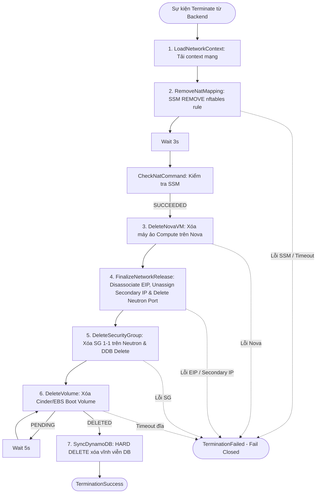

# SPEC-SF-02: Quy Trình Hủy Máy Ảo Step Function (Terminate Pipeline)

> **Phiên bản**: `1.1.0`  
> **Trạng thái**: `APPROVED (CHÍNH THỨC)`  
> **Ngày phê duyệt**: `2026-11-10`  
> **Tài liệu cha**: [SPEC-SF-00: Serverless Scope Guard](SPEC-SF-00-SERVERLESS-SCOPE-GUARD.md)

---

## 1. Tổng Quan Kiến Trúc & Máy Trạng Thái

Máy trạng thái AWS Step Functions `TerminateInstance` thực thi chuỗi dọn dẹp tuần tự toàn diện toàn bộ hạ tầng mạng, nhóm bảo mật, compute, lưu trữ volume và xóa cứng dữ liệu trong DynamoDB khi người dùng gửi yêu cầu hủy máy (`DELETE /api/instances/{id}`).

- **Thời gian timeout tối đa của Step Function**: **`300 giây (5 phút)`**.
- **Tập tin định nghĩa ASL**: `serverless/launch-contract/TerminateInstance.asl.json`.
- **Tập tin Generator ASL**: `serverless/launch-contract/deployment/workflows.py` (`name == "TerminateInstance"`).
- **Loại bỏ hoàn toàn nhánh Legacy**: Toàn bộ máy ảo trong hệ thống bắt buộc 100% tuân thủ chuẩn `linux_nat_v1`. Toàn bộ các State nhánh cũ (`LegacyDeleteNova`, `LegacyDeleteSecurityGroup`, `LegacyDeleteVolume`, `LegacyVolumeDeletionStatus`, `WaitLegacyVolumeDeletion`, `LegacyReleaseEIP`) bị loại bỏ hoàn toàn khỏi ASL.
- **Nguyên tắc an toàn (Fail-Closed Mandate)**: Nếu bất kỳ bước dọn dẹp hạ tầng nào (SSM gỡ NAT, xóa Nova, xóa Volume) gặp lỗi hoặc timeout, Step Function **DỪNG LẠI NGAY LẬP TỨC** và ném lỗi `TerminationFailed`. **TUYỆT ĐỐI KHÔNG TIẾN HÀNH XÓA CỨNG TRONG DYNAMODB** để bảo toàn khả năng đối soát cho kỹ sư.

---

## 2. Thứ Tự Thu Hồi Tuần Tự Bắt Buộc (Strict Sequential Teardown)

Chuỗi dọn dẹp bắt buộc phải thực thi theo đúng thứ tự 7 bước sau:

1. **Bước 1: Gỡ bỏ quy tắc NAT `nftables` (`RemoveNatMapping`)**:
   - Phát lệnh AWS SSM Run Command tới host EC2 `i-056d7f3dd24156234` thực thi lệnh `REMOVE` trên `nftables`.
   - Polling mỗi 3 giây kiểm tra trạng thái lệnh qua `CheckNatCommand`. Lệnh bắt buộc phải đạt `SUCCEEDED` (timeout 60s).
2. **Bước 2: Xóa Nova Compute VM (`DeleteNovaVM`)**:
   - Gọi OpenStack Nova API `DELETE /servers/{id}` xóa máy ảo Compute.
   - Polling xác nhận máy ảo đã hoàn toàn biến mất khỏi Nova (HTTP 404).
   - ⚠️ **Ràng buộc phụ thuộc**: Nova VM bắt buộc phải bị xóa trước khi gỡ card mạng Neutron port, vì nếu VM còn tồn tại thì Neutron sẽ từ chối xóa port đang gán vào máy.
3. **Bước 3: Giải phóng hạ tầng mạng AWS & Neutron (`FinalizeNetworkRelease`)**:
   - Gọi AWS EC2 API `DisassociateAddress` gỡ bỏ liên kết Elastic IP khỏi card mạng `ens6`.
   - Gọi OpenStack Neutron API `DELETE /ports/{port_id}` xóa Neutron port nội bộ.
   - Gọi AWS EC2 API `UnassignPrivateIpAddresses` giải phóng `gateway_private_ip` khỏi ENI `ens6`.
   - Gỡ bỏ các tag sở hữu (`ClaimedBy`, `ClaimedAt`, `NovaId`, `ReservationId`) trên Elastic IP, hoàn trả địa chỉ IP về Warm Pool.
   - Xóa các khóa giữ chỗ trong DynamoDB `XRegion-NetworkReservations` và đánh dấu `XRegion-NetworkMappings` = `DELETED`.
   - ⛔ **RÀNG BUỘC CỐT LÕI**: Card mạng `OPENSTACK_PUBLIC_ENI` (`ens6` / `eni-091eaee3e69e3f42d`) là tài nguyên dùng chung của host vật lý. **TUYỆT ĐỐI CẤM XÓA CARD MẠNG NÀY**.
4. **Bước 4: Xóa Security Group 1-1 (`DeleteSecurityGroup`)**:
   - Gọi Neutron API xóa Security Group 1-1 riêng biệt của máy ảo này trên OpenStack.
   - Gọi DynamoDB API `delete_item` xóa vĩnh viễn bản ghi Security Group trong bảng `XRegion-SecurityGroups`.
5. **Bước 5: Xóa Lưu Trữ Boot Volume (`DeleteVolume`)**:
   - Gọi OpenStack Cinder API `DELETE /volumes/{id}` và xác nhận AWS EBS Volume liên kết đã chuyển sang trạng thái biến mất vật lý (`InvalidVolume.NotFound`).
   - Cập nhật trạng thái bản ghi trong `XRegion-Volumes` sang `DELETED`.
6. **Bước 6: Xóa Cứng Toàn Diện tại `SyncDynamoDB` (Hard Delete)****:
   - Gọi DynamoDB API `delete_item` xóa vĩnh viễn bản ghi máy ảo khỏi bảng `XRegion-Instances`.
   - Gọi DynamoDB API `delete_item` xóa sạch toàn bộ các bản ghi Nova liên quan khỏi bảng `XRegion-Nova` (duyệt qua danh sách `nova_ids`).
   - **Trải nghiệm UI Dashboard**: Máy ảo biến mất hoàn toàn khỏi danh sách (sau giai đoạn hiển thị badge cam `SHUTTING_DOWN`).

---

## 3. Ràng Buộc Cấm Tuyệt Đối (Anti-Speculation Mandate)

> [!WARNING]
> - **TUYỆT ĐỐI CẤM** xóa card mạng `OPENSTACK_PUBLIC_ENI` (`eni-091eaee3e69e3f42d`). Chỉ được gỡ Secondary IP.
> - **TUYỆT ĐỐI CẤM** thực hiện `delete_item` trong DynamoDB nếu bất kỳ bước dọn dẹp nào trước đó bị FAIL (chống tạo tài nguyên mồ côi trên AWS/OpenStack).
> - **TUYỆT ĐỐI CẤM** duy trì hoặc sinh lại các State nhánh Legacy trong `workflows.py` và `TerminateInstance.asl.json`.
> - **TUYỆT ĐỐI CẤM** gỡ Elastic IP trước khi lệnh gỡ rule `nftables` đạt `SUCCEEDED`.
> - **TUYỆT ĐỐI CẤM** để lại trạng thái `TERMINATED` tồn đọng trong database sau khi quy trình hoàn tất thành công.

---

## 4. Lịch Sử Phiên Bản (Changelog)

| Ngày | Phiên Bản | Người Thay Đổi | Nội Dung |
| :--- | :--- | :--- | :--- |
| `2026-11-10` | `1.0.0` | Lead Architect / Product Owner | Ban hành đặc tả Step Function TerminateInstance, chuẩn hóa thứ tự 7 bước dọn dẹp tuần tự, fail-closed và Hard Delete trong DynamoDB. |
| `2026-11-10` | `1.1.0` | Lead Architect / Product Owner | Xác nhận qua xacnhan-skill: Loại bỏ hoàn toàn nhánh Legacy trong workflows.py và ASL, bắt buộc 100% linux_nat_v1; xác nhận xóa Nova trước FinalizeNetworkRelease; timeout 300s; xóa cứng delete_item toàn diện. |
