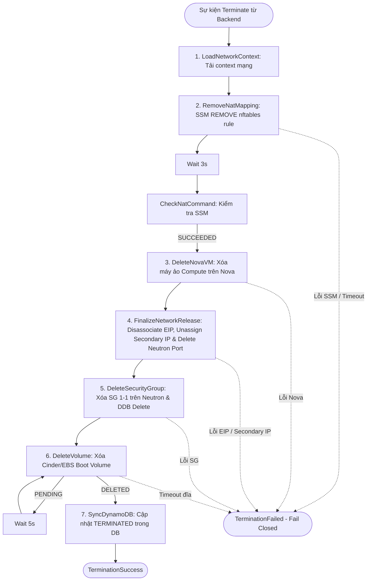

# SPEC-SF-02: Quy Trình Hủy Máy Ảo Step Function (Terminate Pipeline)

> **Phiên bản**: `1.4.0`  
> **Trạng thái**: `APPROVED (CHÍNH THỨC)`  
> **Ngày phê duyệt**: `2026-11-13`  
> **Tài liệu cha**: [SPEC-SF-00: Serverless Scope Guard](SPEC-SF-00-SERVERLESS-SCOPE-GUARD.md)

---

## 1. Tổng Quan Kiến Trúc & Máy Trạng Thái

Máy trạng thái AWS Step Functions `TerminateInstance` thực thi chuỗi dọn dẹp tuần tự toàn diện toàn bộ hạ tầng mạng, nhóm bảo mật, compute, lưu trữ volume và cập nhật đồng bộ trạng thái `TERMINATED` trong DynamoDB khi người dùng gửi yêu cầu hủy máy (`DELETE /api/instances/{id}`).

- **Thời gian timeout tối đa của Step Function**: **`300 giây (5 phút)`**.
- **Tập tin định nghĩa ASL**: `serverless/launch-contract/TerminateInstance.asl.json`.
- **Tập tin Generator ASL**: `serverless/launch-contract/deployment/workflows.py` (`name == "TerminateInstance"`).
- **Loại bỏ hoàn toàn nhánh Legacy**: Toàn bộ máy ảo trong hệ thống bắt buộc 100% tuân thủ chuẩn `linux_nat_v1`. Toàn bộ các State nhánh cũ (`LegacyDeleteNova`, `LegacyDeleteSecurityGroup`, `LegacyDeleteVolume`, `LegacyVolumeDeletionStatus`, `WaitLegacyVolumeDeletion`, `LegacyReleaseEIP`) bị loại bỏ hoàn toàn khỏi ASL.
- **Nguyên tắc an toàn (Fail-Closed Mandate)**: Nếu bất kỳ bước dọn dẹp hạ tầng nào (SSM gỡ NAT, xóa Nova, xóa Volume) gặp lỗi hoặc timeout, Step Function **DỪNG LẠI NGAY LẬP TỨC** và ném lỗi `TerminationFailed`. **TUYỆT ĐỐI KHÔNG CẬP NHẬT TRẠNG THÁI TERMINATED TRONG DYNAMODB** để bảo toàn khả năng đối soát cho kỹ sư.

---

## 2. Thứ Tự Thu Hồi Tuần Tự Bắt Buộc (Strict Sequential Teardown)

Chuỗi dọn dẹp bắt buộc phải thực thi theo đúng thứ tự 7 bước sau:

1. **Bước 1: Gỡ bỏ quy tắc NAT `nftables` (`RemoveNatMapping`)**:
   - Phát lệnh AWS SSM Run Command tới host EC2 `i-056d7f3dd24156234` thực thi lệnh `REMOVE` trên `nftables`.
   - Polling mỗi 3 giây kiểm tra trạng thái lệnh qua `CheckNatCommand`. Lệnh bắt buộc phải đạt `SUCCEEDED` (timeout 60s).
2. **Bước 2: Xóa Nova Compute VM (`DeleteNovaVM`)**:
   - Gọi OpenStack Nova API `DELETE /servers/{id}` xóa máy ảo Compute.
   - Polling xác nhận máy ảo đã hoàn toàn biến mất khỏi Nova (HTTP 404).
   - ⚠️ **Ràng buộc phụ thuộc**: Nova VM bắt buộc phải bị xóa trước khi gỡ card mạng Neutron port, vì nếu VM còn tồn tại thì Neutron sẽ từ chối xóa port đang gán vào máy.
3. **Bước 3: Giải phóng hạ tầng mạng AWS & Neutron (`FinalizeNetworkRelease`)**:
   - Gọi AWS EC2 API `DisassociateAddress` gỡ bỏ liên kết Elastic IP khỏi card mạng `ens6`.
   - Gọi OpenStack Neutron API `DELETE /ports/{port_id}` xóa Neutron port nội bộ.
   - Gọi AWS EC2 API `UnassignPrivateIpAddresses` giải phóng `gateway_private_ip` khỏi ENI `ens6`.
   - Gỡ bỏ các tag sở hữu (`ClaimedBy`, `ClaimedAt`, `NovaId`, `ReservationId`) trên Elastic IP, hoàn trả địa chỉ IP về Warm Pool.
   - Xóa các khóa giữ chỗ trong DynamoDB `XRegion-NetworkReservations` và đánh dấu `XRegion-NetworkMappings` = `DELETED`.
   - ⛔ **RÀNG BUỘC CỐT LÕI**: Card mạng `OPENSTACK_PUBLIC_ENI` (`ens6` / `eni-091eaee3e69e3f42d`) là tài nguyên dùng chung của host vật lý. **TUYỆT ĐỐI CẤM XÓA CARD MẠNG NÀY**.
4. **Bước 4: Xóa Security Group 1-1 (`DeleteSecurityGroup`)**:
   - Gọi Neutron API xóa Security Group 1-1 riêng biệt của máy ảo này trên OpenStack.
   - Gọi DynamoDB API `delete_item` xóa vĩnh viễn bản ghi Security Group trong bảng `XRegion-SecurityGroups`.
5. **Bước 5: Xóa Lưu Trữ Boot Volume (`DeleteVolume`)**:
   - Gọi OpenStack Cinder API `DELETE /volumes/{id}` và xác nhận AWS EBS Volume liên kết đã chuyển sang trạng thái biến mất vật lý (`InvalidVolume.NotFound`).
   - Cập nhật trạng thái bản ghi trong `XRegion-Volumes` sang `DELETED`.
6. **Bước 6: Đồng Bộ Bản Ghi tại `SyncDynamoDB` sang `TERMINATED` (Soft Delete — Global Table)**:
   - Tại một thời điểm, mỗi máy ảo chỉ có **duy nhất 1 Nova VM active (`active_nova_id`) tại `current_region`** (ngoại trừ khoảnh khắc chuyển tiếp ngắn trước khi `MigrateSourceCleanup` xóa xong Nova VM nguồn cũ).
   - Các bảng `XRegion-Instances`, `XRegion-Nova`, `XRegion-Volumes`, `XRegion-SecurityGroups` là **DynamoDB Global Tables (`2019.11.21`)** tự động replicate giữa `ap-southeast-2` và `us-east-1`, nên `TerminateSync` chỉ cần ghi 1 lần tại vùng đang thực thi Step Function:
   - Gọi DynamoDB API `update_item` cập nhật bản ghi máy ảo trong bảng `XRegion-Instances`:
     - `current_status = 'TERMINATED'`
     - `terminated_at = now` (timestamp ms)
     - `active_nova_id = ''`
     - `elastic_ip = 'Chưa gán'`
     - `public_ip = 'Chưa gán'`
     - `migration_lock = false`
     - `REMOVE current_nova_id`
   - Gọi DynamoDB API `update_item` cập nhật bản ghi `XRegion-Nova` của Nova VM đang terminate (`active_nova_id` / `event.nova_id`) sang `status = 'TERMINATED'`, `terminated_at = now` (bỏ qua an toàn nếu các `nova_id` lịch sử trong `nova_ids` đã `TERMINATED` hoặc không còn tồn tại, không để lỗi `ConditionalCheckFailedException` làm fail pipeline).
   - **Trải nghiệm UI Dashboard**: Máy ảo hiển thị trong danh sách với badge xám `TERMINATED` để người dùng và quản trị viên tra cứu lịch sử.

---

## 3. Ràng Buộc Cấm Tuyệt Đối (Anti-Speculation Mandate)

> [!WARNING]
> - **TUYỆT ĐỐI CẤM** xóa card mạng `OPENSTACK_PUBLIC_ENI` (`eni-091eaee3e69e3f42d`). Chỉ được gỡ Secondary IP.
> - **TUYỆT ĐỐI CẤM** thực hiện `update_item` sang `TERMINATED` trong DynamoDB nếu bất kỳ bước dọn dẹp nào trước đó bị FAIL (chống tạo tài nguyên mồ côi trên AWS/OpenStack).
> - **TUYỆT ĐỐI CẤM** duy trì hoặc sinh lại các State nhánh Legacy trong `workflows.py` và `TerminateInstance.asl.json`.
> - **TUYỆT ĐỐI CẤM** gỡ Elastic IP trước khi lệnh gỡ rule `nftables` đạt `SUCCEEDED`.
> - **TUYỆT ĐỐI CẤM** tự ý xóa cứng bản ghi khỏi `XRegion-Instances` hoặc `XRegion-Nova` khi hệ thống quy chuẩn lưu vết lịch sử `TERMINATED`.

---

## 4. Lịch Sử Phiên Bản (Changelog)

| Ngày | Phiên Bản | Người Thay Đổi | Nội Dung |
| :--- | :--- | :--- | :--- |
| `2026-11-10` | `1.0.0` | Lead Architect / Product Owner | Ban hành đặc tả Step Function TerminateInstance, chuẩn hóa thứ tự 7 bước dọn dẹp tuần tự, fail-closed và Hard Delete trong DynamoDB. |
| `2026-11-10` | `1.1.0` | Lead Architect / Product Owner | Xác nhận qua xacnhan-skill: Loại bỏ hoàn toàn nhánh Legacy trong workflows.py và ASL, bắt buộc 100% linux_nat_v1; xác nhận xóa Nova trước FinalizeNetworkRelease; timeout 300s; xóa cứng delete_item toàn diện. |
| `2026-11-11` | `1.2.0` | Chủ dự án (yêu cầu trực tiếp) | Chuyển đổi cơ chế đồng bộ sau khi TerminateInstance từ Xóa cứng (Hard Delete) sang Soft Delete: bước 6 update_item cập nhật current_status = TERMINATED và status = TERMINATED kèm timestamp terminated_at, lưu vết lịch sử trên UI. |
| `2026-11-13` | `1.3.0` | Chủ dự án (`xacnhan-skill`) | Xác nhận qua `xacnhan-skill`: `TerminateSync` (Bước 6) đồng bộ trạng thái `TERMINATED` của `XRegion-Instances` và `XRegion-Nova` (`nova_ids`) sang cả 2 vùng (`ap-southeast-2` và `us-east-1`), khớp cơ chế đọc ưu tiên `XRegion-Instances` / `XRegion-Nova` của `InstanceService.mapToResponse`. |
| `2026-11-13` | `1.4.0` | Chủ dự án (`xacnhan-skill`) | Đính chính theo kiến trúc thực tế qua `xacnhan-skill`: (1) Các bảng DynamoDB là Global Tables (`2019.11.21`) tự replicate nên `TerminateSync` chỉ ghi 1 lần tại vùng thực thi; (2) Mỗi instance chỉ có 1 Nova VM active tại `current_region` (trừ lúc chuyển tiếp chờ `MigrateSourceCleanup`); (3) Cập nhật `XRegion-Nova` cho VM đang terminate và bỏ qua an toàn các `nova_id` lịch sử đã `TERMINATED` hoặc không tồn tại. |
