# SPEC-SF-07: Định Kỳ Sao Lưu & Nhân Bản EBS Snapshot Xuyên Vùng (Scheduled & Cross-Region EBS Snapshot Pipeline)

> **Phiên bản**: `1.1.0`  
> **Trạng thái**: `APPROVED (CHÍNH THỨC)`  
> **Ngày phê duyệt**: `2026-11-12`  
> **Tài liệu cha**: [SPEC-SF-00: Serverless Scope Guard](SPEC-SF-00-SERVERLESS-SCOPE-GUARD.md) & [SPEC-00: Agent Scope Guard](../SPEC-00-AGENT-SCOPE-GUARD.md)

---

## 1. Mục Đích & Kiến Trúc Vận Hành Hai Giai Đoạn

Tài liệu này xác định quy chuẩn nghiệp vụ cho chu trình khép kín:
1. **Giai đoạn 1 (Chụp Snapshot tại Sydney)**: Định kỳ mỗi 30 phút (tại phút **00 và 30**) chụp EBS Snapshot của các máy ảo đang `ACTIVE` trên OpenStack Nova tại Sydney (`ap-southeast-2`).
2. **Giai đoạn 2 (Nhân bản sang Virginia)**: Định kỳ mỗi 30 phút (tại phút **15 và 45**) kiểm tra các snapshot đã hoàn tất (`completed`) tại Sydney và sao chép xuyên vùng (Cross-Region Copy) sang N. Virginia (`us-east-1`), sau đó duy trì chính sách lưu trữ 3 bản gần nhất tại cả hai vùng.

```mermaid
flowchart TD
    subgraph Stage1 ["Giai đoạn 1: Chụp Snapshot tại Sydney (Phút 00, 30)"]
        Cron1[EventBridge Rule: cron 0,30 * * * ? *] --> L1[Lambda: XRegion-ScheduledEbsSnapshot]
        L1 --> Nova[Nova API: Máy ảo ACTIVE]
        Nova --> Cinder[Cinder: Lấy provider_id vol-xxxx]
        Cinder --> Snap1[Tạo Snapshot Sydney]
        Snap1 --> Purge1[FIFO Purge Sydney: Giữ 3 bản gần nhất]
    end

    subgraph Stage2 ["Giai đoạn 2: Sao chép sang Virginia (Phút 15, 45)"]
        Cron2[EventBridge Rule: cron 15,45 * * * ? *] --> L2[Lambda: XRegion-SnapshotCrossRegionCopy]
        L2 --> ScanSyd[Quét Snapshot Sydney completed & ManagedBy=XRegion-ScheduledEbsSnapshot]
        ScanSyd --> CheckCopied{Đã copy sang Virginia chưa?}
        CheckCopied -- Chưa --> CopyToVA[ec2.copy_snapshot sang us-east-1]
        CheckCopied -- Đã có --> Skip[Bỏ qua]
        CopyToVA --> Purge2[FIFO Purge Virginia: Giữ 3 bản gần nhất]
    end
```

---

## 2. Ràng Buộc Nghiệp Vụ Bất Biến (Core Constraints)

> [!IMPORTANT]
> ### NGUYÊN TẮC BẤT BIẾN:
> 1. **Chu kỳ kích hoạt**:
>    - Chụp snapshot tại Sydney: phút **00 và 30** mỗi giờ (`cron(0,30 * * * ? *)`).
>    - Sao chép sang Virginia: phút **15 và 45** mỗi giờ (`cron(15,45 * * * ? *)`), đảm bảo khoảng đệm 15 phút để snapshot tại Sydney kịp chuyển trạng thái sang `completed`.
> 2. **Tiêu chí lọc snapshot sao chép**:
>    - Chỉ sao chép các snapshot tại Sydney có trạng thái `State == 'completed'`.
>    - Có tag `ManagedBy == 'XRegion-ScheduledEbsSnapshot'`.
>    - Chưa từng được sao chép sang Virginia (kiểm tra qua tag `SourceSnapshotId` trên các snapshot tại `us-east-1`).
> 3. **Chính sách lưu giữ (Retention Policy) đồng bộ 3 bản**:
>    - **Tại Sydney (`ap-southeast-2`)**: Giữ chính xác 3 snapshot gần nhất cho mỗi volume.
>    - **Tại Virginia (`us-east-1`)**: Giữ chính xác 3 snapshot gần nhất cho mỗi volume/instance.
>    - Mọi bản snapshot thứ 4 trở đi (cũ nhất) bắt buộc phải bị xóa vĩnh viễn (`DeleteSnapshot`) theo cơ chế FIFO.
> 4. **Bảo toàn dữ liệu & Idempotency**:
>    - Tuyệt đối không sao chép trùng lặp cùng một snapshot nguồn sang Virginia.
>    - Mọi snapshot tại Virginia phải gắn đầy đủ thông tin truy xuất nguồn gốc (`SourceSnapshotId`, `SourceRegion`, `InstanceId`, `VolumeId`).

---

## 3. Quy Chuẩn Đặt Tên & Gắn Thẻ Snapshot (Tagging Standard)

### 3.1. Snapshot tại Sydney (`ap-southeast-2`)
| Key | Value Mẫu | Mục đích |
| :--- | :--- | :--- |
| `Name` | `snapshot-{nova_instance_id_8chars}-{timestamp}` | Tên nhận diện |
| `Project` | `xregion` | Dự án |
| `ManagedBy` | `XRegion-ScheduledEbsSnapshot` | Lambda tạo |
| `InstanceId` | `488ff81a-7516-4e5d-a93d-2c8c3a5672b9` | ID máy ảo Nova |
| `VolumeId` | `vol-026920f7f9c2145d4` | ID volume AWS EBS nguồn |
| `CreatedAt` | `1794465411` | Unix timestamp |

### 3.2. Snapshot tại Virginia (`us-east-1`)
| Key | Value Mẫu | Mục đích |
| :--- | :--- | :--- |
| `Name` | `replica-{nova_instance_id_8chars}-{timestamp}` | Tên nhận diện bản sao |
| `Project` | `xregion` | Dự án |
| `ManagedBy` | `XRegion-SnapshotCrossRegionCopy` | Lambda sao chép |
| `SourceRegion` | `ap-southeast-2` | Vùng nguồn |
| `SourceSnapshotId` | `snap-00ba154d271948c4d` | Khóa chống trùng lặp |
| `InstanceId` | `488ff81a-7516-4e5d-a93d-2c8c3a5672b9` | ID máy ảo Nova sở hữu |
| `VolumeId` | `vol-026920f7f9c2145d4` | ID volume gốc |
| `CreatedAt` | `1794465411` | Unix timestamp của bản nguồn |

---

## 4. Cơ Chế Xoay Vòng Lưu Giữ 3 Bản Tại Virginia (FIFO Retention Purge)

- Sau khi gửi lệnh `copy_snapshot` sang Virginia (`us-east-1`):
  1. Quét toàn bộ snapshot tại `us-east-1` có tag `ManagedBy = XRegion-SnapshotCrossRegionCopy` và lọc theo `InstanceId` hoặc `VolumeId`.
  2. Sắp xếp danh sách snapshot theo thứ tự thời gian tăng dần (`StartTime`).
  3. Nếu tổng số snapshot tại Virginia `len(snapshots) > 3`:
     - Xác định danh sách bản cũ vượt ngưỡng: `excess = snapshots[:len(snapshots) - 3]`.
     - Lặp qua từng bản trong `excess` và gọi `ec2_virginia.delete_snapshot(SnapshotId=...)`.
     - Ghi CloudWatch Logs kết quả xóa FIFO chi tiết.

---

## 5. Quy Chuẩn Đóng Gói & Hạ Tầng

### 5.1. Thành phần Sydney (Stage 1)
- **Lambda**: `XRegion-ScheduledEbsSnapshot` (Runtime: `python3.12`, VPC Sydney).
- **EventBridge**: `XRegion-ScheduledEbsSnapshotRule` (`cron(0,30 * * * ? *)`).

### 5.2. Thành phần Sao chép Xuyên vùng (Stage 2)
- **Lambda**: `XRegion-SnapshotCrossRegionCopy`
  - Vùng triển khai: `ap-southeast-2` (hoặc `us-east-1`, ưu tiên đặt tại `ap-southeast-2` có IAM Role điều phối đa vùng).
  - Runtime: `python3.12`, Memory: `256 MB`, Timeout: `300 giây`.
  - Quyền IAM: Quyền đọc snapshot tại `ap-southeast-2` và quyền `ec2:CopySnapshot`, `ec2:DeleteSnapshot`, `ec2:DescribeSnapshots`, `ec2:CreateTags` tại `us-east-1`.
- **EventBridge Rule**: `XRegion-SnapshotCrossRegionCopyRule`
  - Vùng: `ap-southeast-2`.
  - ScheduleExpression: `cron(15,45 * * * ? *)`.
  - State: `ENABLED`.
  - Target: Lambda `XRegion-SnapshotCrossRegionCopy`.

---

## 6. Lịch Sử Phiên Bản (Changelog)

| Ngày | Phiên Bản | Người Thay Đổi | Nội Dung |
| :--- | :--- | :--- | :--- |
| `2026-11-12` | `1.0.0` | Chủ dự án (xacnhan-skill) | Ban hành đặc tả tạo Lambda định kỳ mỗi 30 phút chụp EBS snapshot cho toàn bộ máy ảo ACTIVE tại Sydney và giữ 3 snapshot gần nhất. |
| `2026-11-12` | `1.1.0` | Chủ dự án (xacnhan-skill) | Mở rộng Giai đoạn 2: Định kỳ mỗi 30 phút (phút 15 và 45) sao chép các snapshot completed sang Virginia (us-east-1) và xoay vòng giữ đúng 3 bản gần nhất theo FIFO. |
