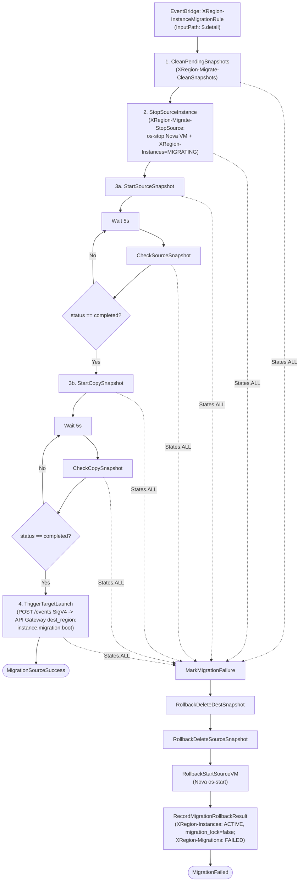

# SPEC-SF-08: Quy Trình Di Trú Máy Ảo Step Function (Migration Pipeline)

> **Phiên bản**: `1.2.0`  
> **Trạng thái**: `APPROVED (CHÍNH THỨC)`  
> **Ngày phê duyệt**: `2026-11-13`  
> **Tài liệu cha**: [SPEC-SF-00: Serverless Scope Guard](SPEC-SF-00-SERVERLESS-SCOPE-GUARD.md) & [SPEC-00: Agent Scope Guard](../SPEC-00-AGENT-SCOPE-GUARD.md)  
> **Tài liệu nghiệp vụ**: [SPEC-03: Chuyển Vùng Xuyên Vùng Trực Tiếp](../SPEC-03-CROSS-REGION-LIVE-MIGRATION.md), [SPEC-08](../SPEC-08-API-GATEWAY-ROUTING.md), [SPEC-SF-09](SPEC-SF-09-MIGRATE-TARGET-BOOT.md)

---

## 1. Mục Đích & Nguyên Tắc Bất Biến

Chuẩn hóa toàn bộ tiến trình di trú máy ảo **hai chiều** (`us-east-1 <-> ap-southeast-2`) tại vùng nguồn thành một Step Function hoàn chỉnh mang tên **`MigrateInstance`**, vận hành theo **4 cơ chế chuẩn của `LaunchInstance` (`SPEC-SF-01`)**:
1. Truyền ngữ cảnh thực thi `"request.$": "$", "execution_arn.$": "$$.Execution.Id"` và dùng `"OutputPath": "$.Payload"`.
2. Chính sách `Retry` chuẩn cho mọi Task Lambda (`Lambda.ServiceException`, `Lambda.AWSLambdaException`, `Lambda.SdkClientException`, `IntervalSeconds: 2`, `MaxAttempts: 2`, `BackoffRate: 2`).
3. **Polling không chặn (`Wait` + `Choice`)** cho chụp và sao chép EBS Snapshot (`Start -> Wait 5s -> Check -> Choice`).
4. **Compensating Rollback từng bước** (`MarkMigrationFailure` -> chuỗi dọn tài nguyên & khôi phục Source VM -> `RecordMigrationRollbackResult` -> `MigrationFailed`).

> [!IMPORTANT]
> ### NGUYÊN TẮC BẤT BIẾN:
> 1. **Mô hình Active-Passive (SPEC-03 §1)**: Sau khi di trú thành công, máy ảo đích trở thành `RUNNING` (Active), máy ảo nguồn chuyển sang `STOPPED` (Passive dự phòng). **TUYỆT ĐỐI CẤM XÓA SOURCE VM**.
> 2. **Di trú 2 chiều & Cấm hardcode vùng**: Mọi Lambda trong `MigrateInstance` bắt buộc đọc động `source_region` và `dest_region` từ payload (hoặc cấu hình đúng OpenStack endpoint của vùng triển khai: Virginia `10.10.10.99`, Sydney `10.20.10.183`).
> 3. **Không boot Nova trong `MigrateInstance`**: Bước cuối của `MigrateInstance` gửi sự kiện `instance.migration.boot` (ký AWS IAM SigV4) tới **API Gateway của `dest_region`** để kích hoạt `MigrateTargetBoot` (`SPEC-SF-09`).
> 4. **Dọn dẹp bản dở trước khi chạy**: Quét và hủy các snapshot đang ở trạng thái `pending` của `volume_id` ở cả `source_region` và `dest_region`.
> 5. **Compensating Rollback từng bước**: Khi bất kỳ bước nào lỗi (`States.ALL`), chuỗi rollback dọn snapshot tạo dở -> `os-start` lại Source VM -> mở khóa `XRegion-Instances` (`current_status = "ACTIVE"`, `migration_lock = false`) -> cập nhật `XRegion-Migrations` (`Key={"instance_id", "migration_id"}`, `status = "FAILED"`).

---

## 2. Kiến Trúc Điều Phối & Sơ Đồ Trạng Thái (Theo Cơ Chế `LaunchInstance`)

- **Trigger EventBridge (tại `source_region`)**: Rule `XRegion-InstanceMigrationRule` (`source = ["xregion.backend.migration", "xregion.backend.instance"]`, `detail-type = ["Migration Lifecycle Event", "instance.migration"]`, **`InputPath: "$.detail"`**).
- **Thời gian timeout tối đa**: `900 giây (15 phút)`.



---

## 3. Chi Tiết Các State & Hợp Đồng Task

| State | Loại | Nhiệm vụ & Hành vi |
| :--- | :--- | :--- |
| `CleanPendingSnapshots` | Task | Quét và xóa các snapshot đang ở trạng thái `pending` của `source_volume_id` tại cả `source_region` và `dest_region`. Hỗ trợ unwrap `event.get("detail", event)`. |
| `StopSourceInstance` | Task | Cập nhật `XRegion-Instances` (`current_status = "MIGRATING"`), gửi lệnh `os-stop` tới Nova tại `source_region` và chờ `SHUTOFF`. |
| `StartSourceSnapshot` | Task | Khởi tạo `CreateSnapshot` trên `source_volume_id` tại `source_region` (trả về `source_snapshot_id`), không block chờ bên trong Lambda. |
| `WaitSourceSnapshot` / `CheckSourceSnapshot` / `ChoiceSourceSnapshot` | Wait / Task / Choice | Polling mỗi `5 giây` kiểm tra `describe_snapshots` tới khi `source_snapshot_id` đạt `completed`. |
| `StartCopySnapshot` | Task | Khởi tạo `CopySnapshot` từ `source_snapshot_id` sang `dest_region` (trả về `dest_snapshot_id`), không block chờ bên trong Lambda. |
| `WaitCopySnapshot` / `CheckCopySnapshot` / `ChoiceCopySnapshot` | Wait / Task / Choice | Polling mỗi `5 giây` kiểm tra `describe_snapshots` tại `dest_region` tới khi `dest_snapshot_id` đạt `completed`. |
| `TriggerTargetLaunch` | Task | Gửi sự kiện `instance.migration.boot` (ký AWS IAM SigV4 `execute-api` đúng vùng đích) tới API Gateway của `dest_region` (`ap-southeast-2`: `oqp7jmg7je`, `us-east-1`: `dawfyj0692`) để kích hoạt `MigrateTargetBoot` (`SPEC-SF-09`). |
| `MigrationSourceSuccess` | Succeed | Hoàn tất pha nguồn (`MigrateInstance`) và bàn giao sang `MigrateTargetBoot` tại vùng đích. |
| `MarkMigrationFailure` | Pass / Task | Ghi nhận lỗi vào `$.error` và chuyển vào chuỗi **Compensating Rollback từng bước**. |
| `RollbackDeleteDestSnapshot` | Task | Nếu đã tạo `dest_snapshot_id` tại `dest_region`, gọi `DeleteSnapshot`. |
| `RollbackDeleteSourceSnapshot` | Task | Nếu đã tạo `source_snapshot_id` tại `source_region`, gọi `DeleteSnapshot`. |
| `RollbackStartSourceVM` | Task | Gửi lệnh `os-start` bật lại `nova_id` tại `source_region`. |
| `RecordMigrationRollbackResult` | Task | Cập nhật `XRegion-Instances` (`current_status = "ACTIVE"`, `migration_lock = false`) và `XRegion-Migrations` (`Key={"instance_id": instance_id, "migration_id": migration_id}`, `status = "FAILED"`). |
| `MigrationFailed` | Fail | Kết thúc luồng rollback sau sự cố. |

---

## 4. Hợp Đồng Dữ Liệu Vào / Ra (Payload Contract)

### 4.1. Payload đầu vào khi kích hoạt Step Function (từ Backend `EventBridgeGatewayClient`):
```json
{
  "migration_id": "mig_1794538000",
  "instance_id": "i-056d7f3d",
  "nova_id": "nova-source-uuid",
  "source_volume_id": "vol-026920f7f9c2145d4",
  "source_region": "us-east-1",
  "dest_region": "ap-southeast-2",
  "phase": "START",
  "status": "IN_PROGRESS",
  "progress_percent": 15,
  "timestamp": 1794538000000
}
```

### 4.2. Dữ liệu chuyển tiếp sang `TriggerTargetLaunch` (`instance.migration.boot`):
```json
{
  "migration_id": "mig_1794538000",
  "instance_id": "i-056d7f3d",
  "source_nova_id": "nova-source-uuid",
  "source_volume_id": "vol-026920f7f9c2145d4",
  "source_region": "us-east-1",
  "dest_region": "ap-southeast-2",
  "source_snapshot_id": "snap-source01",
  "dest_snapshot_id": "snap-dest01",
  "execution_arn": "arn:aws:states:..."
}
```

---

## 5. Ràng Buộc Kiểm Thử & Nghiệm Thu (Verification Constraints)

1. **Happy Path Test (2 chiều)**: Di trú thành công qua chuỗi polling không chặn -> `TriggerTargetLaunch` gửi `instance.migration.boot` thành công tới API Gateway `dest_region`.
2. **Dọn dẹp bản dở (Clean Pending Test)**: Giả lập có snapshot `pending` -> `CleanPendingSnapshots` xóa sạch trước khi `StopSourceInstance` chạy.
3. **Compensating Rollback Test**: Giả lập lỗi ở bất kỳ bước nào -> chuỗi `MarkMigrationFailure` -> `RollbackDeleteDestSnapshot` -> `RollbackDeleteSourceSnapshot` -> `RollbackStartSourceVM` -> `RecordMigrationRollbackResult` khôi phục `ACTIVE` & `migration_lock = false` và đánh dấu `XRegion-Migrations` `FAILED` với đủ khóa `(instance_id, migration_id)`.

---

## 6. Lịch Sử Phiên Bản (Changelog)

| Ngày | Phiên Bản | Người Thay Đổi | Nội Dung |
| :--- | :--- | :--- | :--- |
| `2026-11-12` | `1.0.0` | Chủ dự án (`xacnhan-skill`) | Ban hành đặc tả Step Function MigrateInstance, 5 bước di trú chuẩn hóa, kích hoạt qua API Gateway / EventBridge, và tự động bật lại instance Sydney khi rollback. |
| `2026-11-13` | `1.1.0` | Chủ dự án (`xacnhan-skill`) | Bổ sung `nova_id`, `source_volume_id`, `phase`, `status`, `progress_percent`, `timestamp` vào payload đầu vào chuẩn từ Backend `MigrationService`. |
| `2026-11-13` | `1.2.0` | Chủ dự án (`xacnhan-skill`) | Hỗ trợ di trú 2 chiều (`us-east-1 <-> ap-southeast-2`), bổ sung `InputPath: $.detail`, bỏ `BootTargetInstance`/`SyncDynamoDB`, thay bước cuối bằng `TriggerTargetLaunch` gửi sự kiện tới API Gateway vùng đích (`SPEC-SF-09`), và áp dụng cơ chế `LaunchInstance` (`Wait/Choice` polling không chặn cho snapshot/copy, `Retry/Catch` chuẩn ASL, chuỗi Compensating Rollback từng bước). |
