# SPEC-SF-09: Step Function Boot Nova VM Tại Vùng Đích & Rollback 2 Tầng (MigrateTargetBoot)

> **Phiên bản**: `1.11.0`  
> **Trạng thái**: `APPROVED (CHÍNH THỨC)`  
> **Ngày phê duyệt**: `2026-11-13`  
> **Tài liệu cha**: [SPEC-SF-00: Serverless Scope Guard](SPEC-SF-00-SERVERLESS-SCOPE-GUARD.md)  
> **Liên kết**: [SPEC-02](../SPEC-02-RESOURCE-POOL-CLEANER.md), [SPEC-03](../SPEC-03-CROSS-REGION-LIVE-MIGRATION.md), [SPEC-04](../SPEC-04-NETWORK-NAT-ROUTING.md), [SPEC-08](../SPEC-08-API-GATEWAY-ROUTING.md), [SPEC-SF-01](SPEC-SF-01-LAUNCH-PIPELINE.md), [SPEC-SF-06](SPEC-SF-06-LIFECYCLE-PIPELINE.md), [SPEC-SF-08](SPEC-SF-08-MIGRATION-PIPELINE.md)

---

## 1. Mục Đích & Phạm Vi

Tài liệu này chuẩn hóa máy trạng thái AWS Step Functions **`MigrateTargetBoot`** triển khai tại **cả hai vùng** (`us-east-1` và `ap-southeast-2`), vận hành theo **cùng cơ chế ASL của `LaunchInstance` (`SPEC-SF-01`)** (`reservation_id = execution_arn`, `Retry` 2 lần, `Wait/Choice` polling không chặn, chuỗi Compensating Rollback từng bước) để tiếp nhận sự kiện `instance.migration.boot` từ `MigrateInstance` (`SPEC-SF-08`) qua API Gateway vùng đích:
1. **Bảo toàn dữ liệu đĩa nguồn đúng chuẩn Cinder `aws-ebs-gp3`**: Tạo EBS Volume (`Encrypted=True`) từ `dest_snapshot_id` cùng Availability Zone với `StorageHost` (kích thước `= size_gb`), gắn đủ bộ tag `xregion-cinder-ebs-v1`, đăng ký quản lý vào Cinder (`os-volume_manage`), đặt `bootable=true` & `volume_image_metadata.image_id`, với vòng lặp polling `Wait 5s -> CheckTargetVolume -> ChoiceTargetVolume`.
2. **Cấp phát mạng & EIP không nghẽn pool, Boot Nova VM & Xác minh mạng (`VerifyNetwork`)**:
   - Dùng `reservation_id = execution_arn`, **bắt buộc SSH Keypair (`key_id`) đã tồn tại sẵn tại Nova `dest_region`** (lỗi nếu thiếu).
   - Cấp phát EIP tại `dest_region`: ưu tiên lấy EIP rảnh từ Warm Pool (`XRegion-EIPPoolManager`); **nếu hết EIP rảnh thì tự động gọi `ec2.allocate_address(Domain="vpc")` cấp mới EIP** để không làm nghẽn Migration.
   - Chạy `BootNovaVM` từ Cinder Volume của `dest_snapshot_id`, `CommitNetworkMapping`, `AssignSecurityGroup`, và `ApplyNatMapping` (`WaitNatCommand` -> `CheckNatCommand` -> `ChoiceNatCommand` theo đúng `LaunchInstance` `SPEC-SF-01`, không có bước `VerifyNetwork`).
3. **Bảo toàn 100% Security Group Rules**: Tạo Neutron Security Group 1-1 mới tại `dest_region`, parse chuẩn danh sách `inbound_rules` và `outbound_rules` từ payload (hoặc `XRegion-SecurityGroups` của `source_nova_id`), lưu vào `XRegion-SecurityGroups` và **đồng bộ rule thực tế xuống Neutron SG mới**.
4. **Đồng bộ DynamoDB & Route 53 DNS**: Cập nhật `XRegion-Nova`, `XRegion-SecurityGroups`, `XRegion-Instances` (`current_region = dest_region`, `current_status = RUNNING`, `active_nova_id = target_nova_id`, `public_ip`/`elastic_ip`, `public_dns = "<instance_id>.xregion-iaas.online"`, `migration_lock = false`) và `XRegion-Migrations` (`status = COMPLETED`), đồng thời `UPSERT` Route 53 A record `<instance_id>.xregion-iaas.online` (`TTL = 60s`, Hosted Zone `Z06312743V4JPQHUPYQDW`, fail-open sau 2 lần retry).
5. **Dọn dẹp Nova VM nguồn qua Step Function mới (`TriggerSourceCleanup`)**: Sau khi `SyncDynamoDB` thành công, gửi sự kiện ký AWS IAM SigV4 tới API Gateway `source_region` để kích hoạt Step Function mới **`MigrateSourceCleanup`** terminate Nova VM nguồn cũ và **trả EIP vùng nguồn về lại Warm Pool** (giữ `AllocationId` theo `SPEC-02`, không hủy EIP khỏi AWS account).
6. **Compensating Rollback 2 tầng (chia 2 nhánh rõ ràng theo trạng thái mạng)**:
   - **Tầng 1 (Vùng đích)**: Phân nhánh rõ ràng giữa trường hợp **đã `CommitNetworkMapping`/`APPLY` NAT** (SSM `REMOVE` $\rightarrow$ xóa SG/Nova $\rightarrow$ `FINALIZE` disassociate EIP, xóa port, unassign IP, gỡ tag EIP, xóa `EIP#`/`PRIVATEIP#`/`LEASE#`) và trường hợp **lỗi trước `CommitNetworkMapping`** (bỏ qua SSM `REMOVE`, dọn trực tiếp theo `LEASE#` trong `XRegion-NetworkReservations`: xóa port, unassign IP, gỡ tag EIP trả về pool, xóa `LEASE#`/`EIP#`/`PRIVATEIP#`), sau đó xóa Cinder + EBS Volume và `dest_snapshot_id`.
   - **Tầng 2 (Vùng nguồn — `TriggerSourceRollback`)**: **Giữ nguyên EIP + NAT cũ của Source VM**, mở `migration_lock = false` và gửi API Gateway `source_region` kích hoạt Step Function **`LifecycleInstance` (`SPEC-SF-06`)** với `action = "START"` để bật lại Source VM.

---

## 2. Kiến Trúc Tổng Thể & Sơ Đồ Trạng Thái (Theo Cơ Chế `LaunchInstance`)

- **Trigger EventBridge (Vùng đích)**: Rule `XRegion-MigrateTargetBootRule` lắng nghe `source = "xregion.migration.orchestrator"`, `detail-type = "instance.migration.boot"`, cấu hình `InputPath: "$.detail"`.
- **Thời gian timeout tối đa**: **`600 giây (10 phút)`**.
- **Chính sách `Retry` chuẩn ASL**: Mọi Task Lambda retry 2 lần (`IntervalSeconds: 2`, `BackoffRate: 2`) cho `Lambda.ServiceException`, `Lambda.AWSLambdaException`, `Lambda.SdkClientException`.

```mermaid
flowchart TD
    GW["API Gateway Vùng Đích\n(POST /events - AWS IAM SigV4)"] --> EB["EventBridge Rule:\nXRegion-MigrateTargetBootRule\n(InputPath: $.detail)"]
    EB --> S1

    subgraph SF["Step Function: MigrateTargetBoot (Target Region - Timeout 600s)"]
        S1["1. CreateVolumeFromSnapshot\nTạo EBS Volume (Encrypted=True) từ dest_snapshot_id\n+ os-volume_manage vào Cinder (bootable=true, image_id)"] --> W0["Wait 5s"] --> C0["CheckTargetVolume"] --> CH0{"available?"}
        CH0 -->|No| W0
        CH0 -->|Yes| S2["2. ReserveNetwork\n(reservation_id=execution_arn, kiểm tra keypair sẵn có,\nlấy EIP từ Pool hoặc allocate_address mới nếu Pool cạn)"]
        S2 --> S3["3. BootNovaVM\n(XRegion-MigrateTarget-BootNova:\nboot từ Cinder Volume của snapshot)"]
        S3 --> S4["4. CommitNetworkMapping\n(XRegion-MigrateTarget-Network)"]
        S4 --> S5["5. AssignSecurityGroup\n(Tạo SG 1-1 mới + parse & đồng bộ\n100% inbound_rules & outbound_rules gốc xuống Neutron)"]
        S5 --> S6["6. ApplyNatMapping\n(Gắn EIP + SSM APPLY)"] --> W3["Wait 3s"] --> C3["CheckNatCommand"] --> CH3{"SUCCEEDED?"}
        CH3 -->|No| W3
        CH3 -->|Yes| S6V["6b. VerifyNetwork\n(Ping kiểm tra NAT tối đa 10s)"] --> W4["Wait 3s"] --> C4["CheckVerifyCommand"] --> CH4{"SUCCEEDED?"}
        CH4 -->|No| W4
        CH4 -->|Yes| S7["7. SyncDynamoDB\n(XRegion-Instances RUNNING tại dest_region, migration_lock=false;\nXRegion-Migrations COMPLETED; không gọi Route 53)"]
        S7 --> S8["8. TriggerSourceCleanup\n(Gửi API Gateway source_region kích hoạt\nStep Function mới MigrateSourceCleanup;\ntrả EIP nguồn về Warm Pool)"] --> Done(["MigrateBootSuccess"])

        S1 -.->|States.ALL| MTF["MarkMigrationTargetFailure"]
        C0 -.->|States.ALL| MTF
        S2 -.->|States.ALL| MTF
        S3 -.->|States.ALL| MTF
        S4 -.->|States.ALL| MTF
        S5 -.->|States.ALL| MTF
        S6 -.->|States.ALL| MTF
        C3 -.->|States.ALL| MTF
        S6V -.->|States.ALL| MTF
        C4 -.->|States.ALL| MTF
        S7 -.->|States.ALL| MTF

        MTF --> RB_CHK{"Đã Commit/APPLY\ntrong XRegion-NetworkMappings?"}
        RB_CHK -->|Yes| RB1["RollbackNat (SSM REMOVE + Wait/Check)"] --> RB2["RollbackSecurityGroup"] --> RB3["RollbackDeleteNova"] --> RB4["RollbackReleaseEIP (FINALIZE:\ndisassociate EIP, xóa port/IP,\ngỡ tag EIP, xóa LEASE#/EIP#/PRIVATEIP#)"]
        RB_CHK -->|No| RB3_PRE["RollbackDeleteNova (nếu có)"] --> RB4_PRE["RollbackReleaseLeasePreCommit\n(Bỏ qua SSM REMOVE; dọn trực tiếp LEASE#:\nxóa port, unassign IP, gỡ tag EIP trả về Pool,\nxóa LEASE#/EIP#/PRIVATEIP#)"]
        RB4 --> RB5["RollbackDeleteVolume\n(Xóa cả Cinder + EBS Volume,\nWait 5s / Choice DELETED)"]
        RB4_PRE --> RB5
        RB5 --> RB6["RollbackDeleteDestSnapshot"] --> RB7["TriggerSourceRollback\n(Giữ nguyên EIP + NAT nguồn;\ngửi API Gateway source_region kích hoạt\nStep Function LifecycleInstance action=START)"] --> Fail(["MigrationBootFailed"])
    end
```



---

## 3. Hợp Đồng Dữ Liệu & Chi Tiết Các Bước Thực Thi

### 3.1. Payload Đầu Vào (từ `MigrateInstance` Step 4 gửi tới API Gateway Vùng Đích)
```json
{
  "migration_id": "mig-xxxxxxxx",
  "instance_id": "i-xxxxxxxx",
  "instance_name": "Web-Prod-01",
  "username": "tuanl",
  "flavor": "m1.tiny",
  "image_id": "831dc24b-9d29-4cb6-8154-9de2d0fd268f",
  "key_id": "key-mykey-a1b2c3d4",
  "size_gb": 2,
  "ebs_size_gb": 2,
  "source_region": "us-east-1",
  "dest_region": "ap-southeast-2",
  "source_nova_id": "uuid-nova-source",
  "source_volume_id": "vol-xxxxxxxx",
  "source_snapshot_id": "snap-xxxxxxxx",
  "dest_snapshot_id": "snap-yyyyyyyy",
  "inbound_rules": [
    {
      "protocol": "tcp",
      "fromPort": 22,
      "toPort": 22,
      "cidr": "0.0.0.0/0",
      "description": "SSH"
    }
  ],
  "outbound_rules": [
    {
      "protocol": "all",
      "fromPort": 0,
      "toPort": 65535,
      "cidr": "0.0.0.0/0",
      "description": ""
    }
  ]
}
```
*(Ghi chú: Nếu `inbound_rules` / `outbound_rules` được truyền dưới dạng chuỗi JSON, hệ thống bắt buộc parse về JSON List trước khi lưu vào `XRegion-SecurityGroups` và áp xuống Neutron).*

### 3.2. Chi Tiết Các Bước Thực Thi Tuần Tự

| Bước | Tên State | Hành Động & Ràng Buộc |
| :--- | :--- | :--- |
| **1** | `CreateVolumeFromSnapshot` (`XRegion-MigrateTarget-Volume`) + `WaitTargetVolume` / `CheckTargetVolume` / `ChoiceTargetVolume` | Tạo EBS Volume (`Encrypted=True`, `VolumeType=gp3`) từ `dest_snapshot_id` cùng AZ với `StorageHost` (kích thước `max(1, size_gb)`), gắn đủ tag `xregion-cinder-ebs-v1` (`ManagedBy`, `StorageBackend`, `StorageHostId`, `CinderVolumeId`), đăng ký quản lý vào OpenStack Cinder (`os-volume_manage`, `volume_type=aws-ebs-gp3`), đặt `bootable=true` và `volume_image_metadata.image_id`; polling mỗi `5 giây` tới khi Cinder & EBS Volume đều `available`. |
| **2** | `ReserveNetwork` (`XRegion-MigrateTarget-Network`) | Dùng `reservation_id = execution_arn`, **bắt buộc xác minh SSH Keypair (`key_id`) đã tồn tại sẵn trên Nova `dest_region`** (lỗi nếu thiếu), kiểm tra flavor, cấp phát `guest_private_ip`, `gateway_private_ip` trên `OPENSTACK_PUBLIC_ENI` (`ens6`). Cấp phát EIP theo thứ tự: tìm EIP rảnh trong Warm Pool (`Project=xregion`, không `AssociationId`, không `ClaimedBy`, chưa có `EIP#` trong `XRegion-NetworkReservations`); **nếu hết EIP rảnh thì gọi `ec2.allocate_address(Domain="vpc")` cấp mới EIP** và gắn tag `Project=xregion`, `ManagedBy=XRegion-EIPPoolManager`. Giữ nguyên `cinder_volume_id` / `ebs_volume_id` từ Bước 1. |
| **3** | `BootNovaVM` (`XRegion-MigrateTarget-BootNova`) | Kiểm tra `checked_volume` + `validate_ebs_mapping`, gọi Nova REST API (`POST /servers`) tại `dest_region` khởi tạo máy ảo với: `name = instance_name`, `flavorRef` theo `flavor` (fallback `m1.medium`), `key_name = key_id`, `config_drive = true`, `networks = [{"port": neutron_port_id}]`, `metadata = {"xregion_reservation": execution_arn}`, `block_device_mapping_v2` boot từ `cinder_volume_id` (`source_type=volume`, `destination_type=volume`, `boot_index=0`, `delete_on_termination=False`). Polling mỗi `3 giây` (tối đa `100 giây`) tới khi Nova đạt `ACTIVE`, xác nhận `port.device_id == target_nova_id`. |
| **4** | `CommitNetworkMapping` (`XRegion-MigrateTarget-Network`) | Xác nhận mapping mạng giữa AWS ENI và OpenStack TAP interface tại `dest_region` trong `XRegion-NetworkMappings` và `XRegion-NetworkReservations` với `reservation_id = execution_arn`, cập nhật tag EIP `ClaimedBy = target_nova_id`, `NovaId = target_nova_id`, `ReservationId = execution_arn`. |
| **5** | `AssignSecurityGroup` (`XRegion-MigrateTarget-AssignSecurityGroup`) | Tạo Neutron Security Group 1-1 mới với `name = target_nova_id`, `owner = username` (CẤM hardcode `"system"`), gắn vào port của Nova VM (loại bỏ `default`), parse `inbound_rules` và `outbound_rules` thành List chuẩn, ghi vào `XRegion-SecurityGroups` và **đồng bộ/áp trực tiếp 100% rule xuống Neutron SG mới** tại `dest_region`. |
| **6** | `ApplyNatMapping` -> `WaitNatCommand` -> `CheckNatCommand` -> `ChoiceNatCommand` (`XRegion-MigrateTarget-Network`) | Gắn EIP vào `gateway_private_ip` (`ec2.associate_address`), phát lệnh SSM Run Command `APPLY` thiết lập `nftables` DNAT/SNAT (`Wait 3s -> CheckNatCommand`) tới khi `command_status = SUCCEEDED`, sau đó chuyển thẳng sang `SyncDynamoDB` (theo đúng ASL `LaunchInstance`, bỏ qua `VerifyNetwork`). |
| **7** | `SyncDynamoDB` (`XRegion-MigrateTarget-SyncDynamoDB`) | Đồng bộ sang **cả `dest_region` và `source_region`**:<br>- Ghi bản ghi `XRegion-Nova` mới cho `target_nova_id` (`instance_id`, `instance_name`, `region = dest_region`, `flavor`, `status = ACTIVE`, `volume_id = cinder_volume_id`, `ebs_volume_id = target_volume_id`, `elastic_ip`/`public_ip = target_eip`, `private_ip`, `key_id`, `security_group_id = target_nova_id`).<br>- Ghi bản ghi `XRegion-Volumes` tại `dest_region` cho volume đích (`volume_id = cinder_volume_key`, `cinder_volume_id`, `ebs_volume_id = target_volume_id`, `attached_instance_id = instance_id`, `status = IN_USE`) để `TerminateInstance` (`SPEC-SF-02`) tại vùng đích có thể xóa sạch cả Cinder lẫn EBS volume.<br>- Cập nhật `XRegion-SecurityGroups` cho `target_nova_id` với nguyên văn List `inbound_rules`/`outbound_rules` đã áp.<br>- Cập nhật `XRegion-Instances` (`Key={"instance_id": instance_id}`): `current_region = dest_region`, `requested_region = dest_region`, `current_status = "RUNNING"`, `active_nova_id = target_nova_id`, **append `target_nova_id` vào mảng `nova_ids` (giữ nguyên lịch sử `[source_nova_id, target_nova_id]`)**, `ebs_volume_id = target_volume_id`, `public_ip`/`elastic_ip = target_eip`, `private_ip`, `migration_lock = false`, `last_migration_timestamp = now`. Không gọi Route 53.<br>- Cập nhật `XRegion-Migrations` (`Key={"instance_id": instance_id, "migration_id": migration_id}`): `status = "COMPLETED"`, `copy_progress = 100`, `completed_at = now`. |
| **8** | `TriggerSourceCleanup` | Gửi sự kiện ký AWS IAM SigV4 tới **API Gateway của `source_region`** (`source = "xregion.migration.target"`, `detailType = "instance.migration.cleanup"`) để kích hoạt **Step Function chuyên biệt `MigrateSourceCleanup`** (`TimeoutSeconds = 300s`, `Retry` 2 lần lỗi Lambda, `Catch -> SourceCleanupFailed`): `LoadSourceContext` $\rightarrow$ `RemoveSourceNat` (`Wait 3s`/`CheckSourceNat`) $\rightarrow$ `DeleteSourceNova` $\rightarrow$ `ReleaseSourceNetworkAndEIP` (`FINALIZE`, trả EIP về Warm Pool) $\rightarrow$ `DeleteSourceSecurityGroup` $\rightarrow$ `DeleteSourceVolumeAndSnapshot` (polling xóa sạch Cinder + EBS volume nguồn tránh `VolumeInUse`, xóa `source_snapshot_id`, cập nhật `XRegion-Volumes = DELETED` và `XRegion-Nova[source_nova_id].status = TERMINATED`; không chạm `XRegion-Instances.active_nova_id`). |

---

## 4. Cơ Chế EIP & Compensating Rollback 2 Tầng (`States.ALL`)

### 4.1. Vòng Đời EIP Trong Toàn Bộ Quy Trình Migration
1. **Tại vùng đích (`dest_region`) lúc `ReserveNetwork`**:
   - Ưu tiên lấy EIP rảnh từ Warm Pool (`Project=xregion`, chưa `AssociationId`, chưa `ClaimedBy`, chưa có `EIP#` trong `XRegion-NetworkReservations`).
   - Nếu hết EIP rảnh trong pool: tự động gọi `ec2.allocate_address(Domain="vpc")` tạo EIP mới, gắn tag `Project=xregion`, `ManagedBy=XRegion-EIPPoolManager` rồi thực hiện giao dịch claim `EIP#<AllocationId>` với `ReservationId = execution_arn`.
2. **Tại vùng nguồn (`source_region`) khi Migrate Thành Công (`MigrateSourceCleanup`)**:
   - Disassociate EIP cũ khỏi `OPENSTACK_PUBLIC_ENI`, unassign `gateway_private_ip`, xóa Neutron port, gỡ tag `ClaimedBy`/`NovaId`/`ReservationId`, xóa `EIP#`/`PRIVATEIP#`/`LEASE#` trong `XRegion-NetworkReservations` — **trả EIP về lại Warm Pool `source_region`** (không gọi `ec2.release_address()`, tuân thủ `SPEC-02`).
3. **Tại vùng nguồn (`source_region`) khi Migrate Thất Bại (`TriggerSourceRollback`)**:
   - **Giữ nguyên hoàn toàn EIP + NAT + Neutron port của Source VM**, chỉ mở khóa `migration_lock = false` và gọi `LifecycleInstance` (`action = START`) để Source VM hoạt động lại với đúng EIP cũ.

### 4.2. Chuỗi Bồi Hoàn 2 Tầng Khi `MigrateTargetBoot` Lỗi (`States.ALL`)
1. **`MarkMigrationTargetFailure`**: Ghi nhận lỗi vào `$.error` và rẽ nhánh kiểm tra trạng thái `XRegion-NetworkMappings` / `applied_status`:
2. **Tầng 1 — Dọn dẹp tài nguyên vùng đích (2 nhánh rõ ràng)**:
   - **Nhánh A — Đã `CommitNetworkMapping` / `APPLY` NAT**:
     1. `RollbackNat`: Phát lệnh SSM `REMOVE` trên Gateway Host `dest_region` (`Wait 3s -> CheckNatCommand`).
     2. `RollbackSecurityGroup`: Xóa Neutron SG mới (`DELETE /security-groups/{target_sg_id}`).
     3. `RollbackDeleteNova`: Xóa Nova VM (`DELETE /servers/{target_nova_id}`).
     4. `RollbackReleaseEIP` (`FINALIZE`): Disassociate EIP, xóa Neutron port, unassign `gateway_private_ip` khỏi `eni`, gỡ tag `ClaimedBy`/`NovaId`/`ReservationId` trả EIP về Warm Pool, xóa `EIP#`/`PRIVATEIP#`/`LEASE#` trong `XRegion-NetworkReservations`, cập nhật `XRegion-NetworkMappings = DELETED`.
   - **Nhánh B — Lỗi trước `CommitNetworkMapping` (hoặc chưa `APPLY` NAT)**:
     1. **Bỏ qua SSM `REMOVE`** (vì chưa có bản ghi trong `XRegion-NetworkMappings` và chưa apply `nftables`).
     2. `RollbackDeleteNova`: Xóa Nova VM nếu `target_nova_id` đã kịp được tạo.
     3. `RollbackReleaseLeasePreCommit`: Đọc `LEASE#<reservation_id>` trong `XRegion-NetworkReservations` (nếu đã tạo): xóa Neutron port (nếu có), unassign `gateway_private_ip` khỏi `eni` (nếu có), gỡ tag `ClaimedBy`/`NovaId`/`ReservationId` khỏi EIP trả về Warm Pool, và xóa các bản ghi `LEASE#<reservation_id>`, `EIP#<allocation_id>`, `PRIVATEIP#<eni>#<ip>` khỏi `XRegion-NetworkReservations`.
   - **Bước chung sau Nhánh A/B**:
     5. `RollbackDeleteVolume` (+ `Wait 5s` / `Choice DELETED`): Xóa **cả Cinder Volume (`DELETE /volumes/{cinder_volume_id}`) lẫn EBS Volume (detach + `ec2.delete_volume`)** và dọn bản ghi liên quan (nếu có) trong `XRegion-Volumes`.
     6. `RollbackDeleteDestSnapshot`: Xóa `dest_snapshot_id` tại `dest_region`.
3. **Tầng 2 — `TriggerSourceRollback` (Phục hồi vùng nguồn qua Step Function `LifecycleInstance`)**:
   - Cập nhật `XRegion-Instances` (`current_status = "STARTING"`, `migration_lock = false`) và `XRegion-Migrations` (`Key={"instance_id", "migration_id"}`, `status = "FAILED"`, ghi nhận lỗi).
   - Gửi sự kiện ký AWS IAM SigV4 tới **API Gateway của `source_region`** (`source = "xregion.backend.instance"`, `detailType = "instance.lifecycle"`, `detail = {"instance_id": instance_id, "action": "START", "nova_id": source_nova_id, "region": source_region}`) để kích hoạt **Step Function `LifecycleInstance` (`SPEC-SF-06`)** thực hiện `os-start` bật lại Source VM (giữ nguyên EIP cũ) và đồng bộ `current_status = "RUNNING"`.
4. **`MigrationBootFailed`**: Kết thúc `Fail` sau khi hoàn tất bồi hoàn 2 tầng.

---

## 5. Ràng Buộc Cấm Tuyệt Đối (Anti-Speculation Mandate)

> [!CAUTION]
> - **TUYỆT ĐỐI CẤM** thay đổi nghiệp vụ, trạng thái hoặc payload đầu ra của Step Function `MigrateInstance` (`SPEC-SF-08`). Mọi thay đổi dọn dẹp (`MigrateSourceCleanup`) hoặc phục hồi (`LifecycleInstance`) chỉ được kích hoạt từ `MigrateTargetBoot` sang vùng nguồn.
> - **TUYỆT ĐỐI CẤM** bỏ qua dữ liệu `dest_snapshot_id` để boot từ Warm Pool volume rỗng, hoặc bỏ qua bước tạo/kiểm tra `Encrypted=True` & `os-volume_manage` đúng `size_gb`.
> - **TUYỆT ĐỐI CẤM** tự ý tạo/import mới SSH Keypair trong `MigrateTargetBoot`; keypair bắt buộc phải tồn tại sẵn tại `dest_region` (lỗi nếu thiếu).
> - **TUYỆT ĐỐI CẤM** thêm bước `VerifyNetwork` vào `MigrateTargetBoot` sai lệch với luồng chuẩn `LaunchInstance` (`SPEC-SF-01`).
> - **TUYỆT ĐỐI CẤM** gọi `runtime.release()` đòi xác nhận `applied_status == "DELETING"` khi lỗi xảy ra trước `CommitNetworkMapping` (phải đi theo Nhánh B dọn trực tiếp từ `LEASE#` trong `XRegion-NetworkReservations`).
> - **TUYỆT ĐỐI CẤM** gọi `ec2.release_address()` hủy EIP vùng nguồn khỏi tài khoản AWS trong `MigrateSourceCleanup`; phải trả EIP về lại Warm Pool theo `SPEC-02`.
> - **TUYỆT ĐỐI CẤM** bỏ qua hoặc lưu sai kiểu chuỗi cho `inbound_rules` / `outbound_rules` khi tạo Security Group mới ở vùng đích; phải parse thành List chuẩn, giữ nguyên 100% rule của máy ảo nguồn và đồng bộ xuống Neutron.
> - **TUYỆT ĐỐI CẤM** hardcode `owner = "system"` cho Neutron SG 1-1 mới hoặc hardcode vùng `ap-southeast-2`/`us-east-1` trong code Lambda.
> - **TUYỆT ĐỐI CẤM** để lại tài nguyên mồ côi (Cinder volume, EBS volume, EIP, `LEASE#`, khóa `migration_lock = true`) khi `MigrateTargetBoot` thất bại.
> - **TUYỆT ĐỐI CẤM** tự động xóa Source Nova VM tại `source_region` trước khi `SyncDynamoDB` ở `dest_region` thành công; việc terminate Source Nova VM chỉ được kích hoạt sau `SyncDynamoDB` qua Step Function chuyên biệt `MigrateSourceCleanup`.

---

## 6. Lịch Sử Phiên Bản (Changelog)

| Ngày | Phiên Bản | Người Thay Đổi | Nội Dung |
| :--- | :--- | :--- | :--- |
| `2026-11-13` | `1.0.0` | Chủ dự án (`xacnhan-skill`) | Ban hành đặc tả `MigrateTargetBoot`: quy trình 7 bước boot Nova VM từ `dest_snapshot_id` tại vùng đích, bắt buộc giữ nguyên Security Group rules, và cơ chế Rollback 2 tầng (vùng đích -> vùng nguồn). |
| `2026-11-13` | `1.1.0` | Chủ dự án (`xacnhan-skill`) | Chuẩn hóa theo cơ chế `LaunchInstance` (`SPEC-SF-01`): bổ sung `execution_arn`, `Retry/Catch` chuẩn ASL, vòng lặp `Wait/Choice` polling không chặn cho tạo Volume & `CheckNatCommand`, tái sử dụng các Lambda chuẩn của `LaunchInstance`, và chuỗi Compensating Rollback 2 tầng từng bước. |
| `2026-11-13` | `1.2.0` | Chủ dự án (`xacnhan-skill`) | Tách biệt hoàn toàn bộ Lambda độc lập `XRegion-MigrateTarget-*` (`Volume`, `Network`, `BootNova`, `AssignSecurityGroup`, `SyncDynamoDB`, `TriggerSourceRollback`), chỉ tái sử dụng mẫu thiết kế code/ASL và không dùng chung Lambda với `LaunchInstance` hay `TerminateInstance`. |
| `2026-11-13` | `1.3.0` | Chủ dự án (`xacnhan-skill`) | Thống nhất nghiệp vụ chi tiết qua `xacnhan-skill`: (1) Boot từ EBS/Cinder Volume tạo từ `dest_snapshot_id` đúng `size_gb` (`os-volume_manage`), không dùng Warm Pool 1GB; (2) Rollback Tầng 1 idempotent kể cả khi lỗi trước `CommitNetworkMapping`; (3) Rollback Tầng 2 gửi sự kiện qua API Gateway `source_region` kích hoạt Step Function `LifecycleInstance` (`action=START`) và mở `migration_lock=false`; (4) Parse List `inbound_rules`/`outbound_rules` và đồng bộ thực tế xuống Neutron SG mới tại vùng đích. |
| `2026-11-13` | `1.4.0` | Chủ dự án (`xacnhan-skill`) | Hoàn thiện chi tiết kỹ thuật qua `xacnhan-skill`: (1) Tạo EBS Volume `Encrypted=True` cùng AZ với `StorageHost`, gắn đủ tag `xregion-cinder-ebs-v1` + `os-volume_manage` (`bootable=true`, `image_id` metadata); (2) Bổ sung bước `VerifyNetwork` (timeout 10s theo `SPEC-04`) sau `ApplyNatMapping`; (3) `RollbackDeleteVolume` xóa cả Cinder lẫn EBS Volume và dọn DynamoDB; (4) Tăng `TimeoutSeconds` lên `600s` (10 phút). |
| `2026-11-13` | `1.5.0` | Chủ dự án (`xacnhan-skill`) | Chốt bổ sung qua `xacnhan-skill`: (1) Dùng `reservation_id = execution_arn` chuẩn `SPEC-SF-01`; (2) Bắt buộc `key_id` phải tồn tại sẵn ở `dest_region` (lỗi nếu thiếu); (3) Bỏ qua Route 53 DNS Cutover; (4) Thêm Bước 8 `TriggerSourceCleanup` sau `SyncDynamoDB` gửi API Gateway về `source_region` kích hoạt Step Function mới `MigrateSourceCleanup` để terminate Nova VM nguồn cũ. |
| `2026-11-13` | `1.6.0` | Chủ dự án (`xacnhan-skill`) | Làm rõ cơ chế EIP & Rollback qua `xacnhan-skill`: (1) Cấp phát EIP tại `dest_region` từ Warm Pool trước, nếu hết EIP rảnh thì tự động `ec2.allocate_address()` cấp mới; (2) Chia rõ 2 nhánh Rollback Tầng 1: Nhánh A (đã `CommitNetworkMapping`/`APPLY` NAT $\rightarrow$ SSM `REMOVE` + `FINALIZE`) và Nhánh B (lỗi trước `CommitNetworkMapping` $\rightarrow$ bỏ qua SSM `REMOVE`, dọn trực tiếp theo `LEASE#` trong `XRegion-NetworkReservations`); (3) Quy định rõ EIP nguồn: trả về Warm Pool khi `MigrateSourceCleanup` thành công và giữ nguyên khi `TriggerSourceRollback` thất bại. |
| `2026-11-13` | `1.7.0` | Chủ dự án (`xacnhan-skill`) | Xác nhận quy trình tạo Nova ở vùng đích và đồng bộ DynamoDB qua `xacnhan-skill`: (1) Chuẩn hóa đầy đủ tham số `POST /servers` (`name=instance_name`, `flavorRef` fallback `m1.medium`, `key_name=key_id`, `config_drive=true`, `networks=[{port}]`, `metadata.xregion_reservation=execution_arn`, `block_device_mapping_v2` từ `cinder_volume_id` với `delete_on_termination=False`); (2) `SyncDynamoDB` ghi `XRegion-Nova` mới (`security_group_id=target_nova_id`), cập nhật `active_nova_id=target_nova_id` và append `target_nova_id` vào mảng `nova_ids` trên `XRegion-Instances` (giữ lịch sử); (3) `MigrateSourceCleanup` cập nhật `XRegion-Nova[source_nova_id].status = TERMINATED` ở cả 2 vùng sau khi xóa Nova nguồn. |
| `2026-11-13` | `1.8.0` | Chủ dự án | Bỏ bước `VerifyNetwork` trong `MigrateTargetBoot` để đồng bộ 100% theo cơ chế `LaunchInstance` (`SPEC-SF-01`): `ChoiceNatCommand` (`SUCCEEDED`) chuyển thẳng sang `SyncDynamoDB`. |
| `2026-11-13` | `1.9.0` | Chủ dự án (`xacnhan-skill`) | Đồng bộ với `TerminateInstance` (`SPEC-SF-02 v1.3.0`): `SyncDynamoDB` (Bước 7) ghi bản ghi `XRegion-Volumes` tại `dest_region` (`status = IN_USE`, `attached_instance_id = instance_id`) để `TerminateInstance` ở vùng đích xóa sạch Cinder/EBS volume; `MigrateSourceCleanup` (Bước 8) cập nhật bản ghi `XRegion-Volumes` của volume nguồn sang `DELETED`. |
| `2026-11-13` | `1.10.0` | Chủ dự án (`xacnhan-skill`) | Xác nhận 100% quy trình `MigrateSourceCleanup` qua `xacnhan-skill`: chuẩn hóa `TimeoutSeconds = 300s`, `Retry` 2 lần lỗi Lambda, `Catch -> SourceCleanupFailed`, và polling xác nhận xóa Cinder/EBS volume nguồn + cập nhật `XRegion-Volumes = DELETED`. |
| `2026-11-13` | `1.11.0` | Chủ dự án (`xacnhan-skill`) | Bổ sung cập nhật Route 53 A record `<instance_id>.xregion-iaas.online` (`TTL = 60s`, fail-open sau 2 lần retry) và lưu `public_dns` vào `XRegion-Instances` / `XRegion-Nova` tại `SyncDynamoDB`. |
