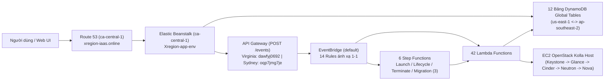
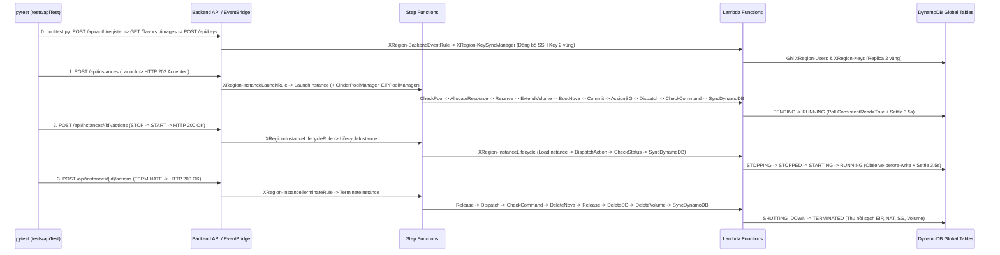
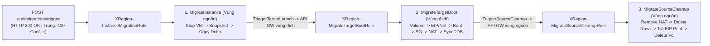

# Báo cáo Kết quả Thực hiện Giải pháp & Triển khai Hệ thống IaaS XRegion-EC2

> **Phạm vi dữ liệu đối soát**: Tổng hợp từ bộ snapshot hạ tầng phiên bản `20261113` (`ca-central-1-20261113T164949Z`, `sydney-20261113T164136Z`, `virginia-20261113T164522Z`) và bộ mã nguồn kiểm thử `tests/apiTest/`. Các tài nguyên ánh xạ 1-1 giữa **Virginia (`us-east-1`)** và **Sydney (`ap-southeast-2`)** được chuẩn hóa trình bày một lần để tránh trùng lặp, chỉ tách riêng thông số định danh đặc thù theo từng vùng.

---

## A. Kết quả thực hiện giải pháp & Các bước triển khai dự án

### 1. Kết quả thực hiện giải pháp (theo phân hệ `a` → `h`)

#### a. API Gateway, EventBridge & Tổng quan DynamoDB (Global Table & Cơ chế chống xung đột)

- **API Gateway (`POST /events`, stage `prod`)**:
  - **Cổng tiếp nhận sự kiện REST API** (`dawfyj0692` tại `us-east-1` và `oqp7jmg7je` tại `ap-southeast-2`): nhận các sự kiện nghiệp vụ từ Backend hoặc từ vùng đối ứng (cross-region trigger).
  - **IAM Role `XRegion-ApiGatewayToEventBridgeRole`**: cấp quyền cho API Gateway đẩy thẳng payload sự kiện vào EventBridge bus `default` mà không cần qua Lambda trung gian.
- **EventBridge (`default` bus – 14 Rules ánh xạ 1-1 hai vùng)** — bộ định tuyến sự kiện trung tâm phân luồng theo `source`, `detail-type` và lịch biểu:
  - **Nhóm điều phối vòng đời & sự kiện backend**:
    - `XRegion-BackendEventRule`: bắt các sự kiện `xregion.backend.*`, ghi nhật ký tập trung vào `/aws/events/xregion-backend-events` và kích hoạt `XRegion-KeySyncManager`.
    - `XRegion-InstanceLaunchRule`: bắt `instance.launch` để khởi chạy đồng thời `LaunchInstance` cùng 2 hàm giữ ấm tài nguyên (`XRegion-CinderPoolManager`, `XRegion-EIPPoolManager`).
    - `XRegion-InstanceLifecycleRule`: bắt `instance.lifecycle` (`START`/`STOP`/`REBOOT`) để gọi `LifecycleInstance`.
    - `XRegion-InstanceTerminateRule`: bắt `instance.terminate` / `TERMINATE` để gọi `TerminateInstance`.
  - **Nhóm chuyển vùng xuyên vùng (Cross-Region Migration)**:
    - `XRegion-InstanceMigrationRule`: khởi phát quy trình chuyển vùng tại vùng nguồn (`MigrateInstance`).
    - `XRegion-MigrateTargetBootRule`: kích hoạt dựng máy ảo tại vùng đích (`MigrateTargetBoot`).
    - `XRegion-MigrateSourceCleanupRule`: kích hoạt dọn dẹp tài nguyên cũ tại vùng nguồn (`MigrateSourceCleanup`) sau khi vùng đích sẵn sàng.
    - `XRegion-MigrateSourceRollbackRule`: kích hoạt `XRegion-Migrate-Rollback` để khôi phục VM nguồn nếu vùng đích boot thất bại.
  - **Nhóm đồng bộ danh mục, bảo mật & lịch định kỳ**:
    - `XRegion-NovaSyncCatalogRule`: bắt sự kiện thay đổi từ Glance/Nova để đồng bộ danh mục Image và Flavor vào DynamoDB.
    - `XRegion-SecurityGroupSync`: bắt `security-group.updated` để đồng bộ luật tường lửa Neutron (`XRegion-SyncSecurityGroup`).
    - `XRegion-ScheduledEbsSnapshotRule` (`cron(0,30 * * * ? *)`): kích hoạt chụp EBS snapshot định kỳ 30 phút/lần.
    - `XRegion-SnapshotCrossRegionCopyRule` (`cron(15,45 * * * ? *)`): kích hoạt nhân bản snapshot sang vùng đối ứng 30 phút/lần.
    - `XRegion-SnapshotCleanerRule` (`rate(1 hour)`): kích hoạt dọn dẹp snapshot hết hạn.
    - `XRegion-ResourceCleanerCron` (`rate(1 hour)`): kích hoạt thu hồi tài nguyên Cinder/EBS/EIP rảnh rỗi dư thừa.
- **Tổng quan DynamoDB Global Tables & Cơ chế chống xung đột**:
  - Toàn bộ **12 bảng DynamoDB** đều cấu hình **Global Table** (`GlobalTableVersion: 2019.11.21`), thanh toán theo lượt (`PAY_PER_REQUEST`), bật **DynamoDB Streams** (`NEW_AND_OLD_IMAGES`), tự động nhân bản hai chiều giữa `ap-southeast-2` và `us-east-1` để đảm bảo dữ liệu nhất quán ở cả hai vùng:

| Bảng DynamoDB (Ánh xạ 1-1) | Khóa chính (PK / SK) | Global Secondary Index (GSI) | Vai trò chính |
| --- | --- | --- | --- |
| `XRegion-Users` | `user_id` (HASH) | `username-index` | Lưu tài khoản người dùng phục vụ xác thực & phân quyền |
| `XRegion-Keys` | `key_id` (HASH) | — | Lưu khóa SSH công khai được đồng bộ giữa hai vùng |
| `XRegion-Flavors` | `flavor_id` (HASH) | — | Danh mục cấu hình CPU/RAM của Nova |
| `XRegion-Images` | `image_id` (HASH) | — | Danh mục OS Image đồng bộ từ Glance |
| `XRegion-Instances` | `instance_id` (HASH) | `username-index` | Lưu trạng thái logic, vùng cư trú và khóa `migration_lock` của VM |
| `XRegion-Nova` | `nova_id` (HASH) | `instance_id-index` | Ánh xạ tới bản ghi máy ảo vật lý trên OpenStack Nova |
| `XRegion-Volumes` | `volume_id` (HASH) | — | Theo dõi trạng thái Volume & danh sách Warm Pool |
| `XRegion-SecurityGroups` | `group_id` (HASH) | — | Lưu quy tắc tường lửa và số `revision` đồng bộ |
| `XRegion-NetworkMappings` | `nova_id` (HASH) | `gateway_host_id-index` | Lưu cặp ánh xạ NAT (Public EIP ↔ Guest Private IP) |
| `XRegion-NetworkReservations` | `resource_key` (HASH) | — | Bảng giữ chỗ nguyên tử tránh cấp trùng IP/NAT |
| `XRegion-Migrations` | `instance_id` (HASH), `migration_id` (RANGE) | — | Nhật ký lịch sử và trạng thái từng phiên chuyển vùng |
| `XRegion-MigrationScenarios` | `scenario_id` (HASH) | — | Lưu cấu hình kịch bản & lịch chuyển vùng tự động |

  - **Cơ chế chống xung đột (Concurrency & Conflict Prevention)**:
    - Các hàm Lambda xử lý trạng thái sử dụng **`ConditionExpression`** của DynamoDB (Conditional Writes) để ngăn chặn ghi đè đồng thời (race condition):
      1. **Khóa phân tán chuyển vùng (`migration_lock`)**: Chặn thao tác lifecycle hoặc phiên migration thứ hai khi VM đang ở trạng thái `MIGRATING`.
      2. **Khóa lạc quan theo phiên bản (`revision`)**: Chỉ cho phép cập nhật Security Group và trạng thái khi `revision` khớp với bản ghi hiện tại.
      3. **Giữ chỗ nguyên tử (Atomic Lease / Claim)**: Kiểm tra `attribute_not_exists` hoặc trạng thái rảnh trên `XRegion-NetworkReservations` và `XRegion-Volumes`, kết hợp hàng đợi FIFO `XRegion-ResourceAllocation.fifo`.

---

#### b. Compute – Quản lý máy ảo

- **Hạ tầng EC2 & OpenStack Kolla Containers**:
  - Mỗi vùng vận hành 1 máy chủ EC2 `m7i-flex.xlarge` (private IP `10.20.10.183`, trạng thái `stopped` tại thời điểm snapshot `20261113`): **Virginia (`us-east-1`)** `RegionA-tempEC2` (`i-07738a186534cb5ba`) và **Sydney (`ap-southeast-2`)** `RegionB-tempEC2` (`i-056d7f3dd24156234`).
  - Các dịch vụ OpenStack trên EC2 được triển khai qua **Kolla containers** theo thứ tự phụ thuộc hợp lý:
    1. **Keystone**: Dịch vụ định danh, xác thực và cấp phát token nội bộ cho toàn bộ hệ sinh thái OpenStack.
    2. **Glance**: Dịch vụ quản lý và phân phối OS Image làm nguồn khởi tạo đĩa khởi động.
    3. **Cinder**: Dịch vụ Block Storage quản lý EBS-backed volumes và Warm Pool boot volume.
    4. **Neutron**: Dịch vụ mạng ảo hóa, quản lý port, OVN và Security Group gắn cho máy ảo.
    5. **Nova**: Dịch vụ Compute lõi, kết hợp Image/Volume/Network để tạo và điều khiển vòng đời máy ảo.
- **Điều phối vòng đời máy ảo (3 Step Functions & chức năng từng Lambda ánh xạ 1-1)**:
  - **`LaunchInstance`** (`TimeoutSeconds=300`) — luồng khởi tạo máy ảo mới:
    - `XRegion-LaunchInstance-CheckPool`: Kiểm tra số lượng boot volume khả dụng trong Warm Pool.
    - `XRegion-LaunchInstance-AllocateResource`: Chọn và giữ chỗ nguyên tử 1 volume rảnh cho máy ảo.
    - `XRegion-Network-Reserve`: Giữ chỗ tài nguyên mạng/EIP trước khi boot.
    - `XRegion-LaunchInstance-ExtendVolume`: Mở rộng dung lượng volume theo yêu cầu (polling `WaitVolumeExtension` 5s).
    - `XRegion-LaunchInstance-BootNova`: Gọi Nova API để khởi tạo máy ảo từ boot volume.
    - `XRegion-Network-Commit`: Xác nhận chính thức bản ghi ánh xạ mạng cho `nova_id`.
    - `XRegion-LaunchInstance-AssignSecurityGroup`: Tạo/gắn Security Group riêng cho máy ảo.
    - `XRegion-Network-Dispatch` & `XRegion-Network-CheckCommand`: Gửi lệnh SSM cấu hình NAT và kiểm tra kết quả (polling `WaitNatCommand` 3s).
    - `XRegion-LaunchInstance-SyncDynamoDB`: Cập nhật trạng thái `RUNNING` và thông tin VM lên `XRegion-Instances`/`XRegion-Nova`.
  - **`LifecycleInstance`** (`TimeoutSeconds=300`) — luồng bật/tắt/khởi động lại:
    - `XRegion-InstanceLifecycle`: Thực thi các bước nạp metadata VM, gửi lệnh `START`/`STOP`/`REBOOT` tới Nova, kiểm tra trạng thái hoàn tất (`WaitStatus` 5s) và đồng bộ trạng thái về DynamoDB.
  - **`TerminateInstance`** (`TimeoutSeconds=300`) — luồng hủy máy ảo triệt để:
    - `XRegion-Network-Release`: Đọc ngữ cảnh mạng để chuẩn bị gỡ NAT và giải phóng lease sau khi xóa VM.
    - `XRegion-Network-Dispatch` & `XRegion-Network-CheckCommand`: Gỡ luật NAT trên gateway host qua SSM (polling 3s).
    - `XRegion-TerminateInstance-DeleteNova`: Xóa máy ảo trên OpenStack Nova.
    - `XRegion-TerminateInstance-DeleteSecurityGroup`: Xóa Security Group riêng của VM trên Neutron.
    - `XRegion-TerminateInstance-DeleteVolume`: Xóa boot volume trên Cinder/EBS (polling `WaitVolumeDeletion` 5s).
    - `XRegion-TerminateInstance-SyncDynamoDB`: Cập nhật trạng thái `TERMINATED` trên DynamoDB.
- **Admission Gate, Đồng bộ Key/Flavor & SQS**:
  - **SSM Parameter `/xregion/<region>/launch/admission`** (`{"mode": "open"}`): Cổng kiểm soát tiếp nhận yêu cầu khởi tạo VM mới (cho phép mở/chặn tải khi bảo trì).
  - **`XRegion-KeySyncManager`**: Đồng bộ khóa SSH công khai của người dùng sang cả hai vùng và Nova Keypair.
  - **`XRegion-SyncFlavorToDynamoDB`**: Đồng bộ cấu hình Flavor từ Nova vào bảng `XRegion-Flavors`.
  - **SQS `XRegion-ResourceAllocation.fifo`** (`VisibilityTimeout=60s`, `Retention=345600s`): Hàng đợi FIFO tuần tự hóa yêu cầu cấp phát tài nguyên tránh tranh chấp.
  - **SQS `XRegion-InstanceLifecycle-DLQ`**: Hàng đợi lưu các thông điệp xử lý vòng đời bị lỗi để phục vụ kiểm tra/khôi phục.

---

#### c. Storage – Quản lý lưu trữ

- **Quản lý Warm Pool & Vòng đời Volume**:
  - `XRegion-CinderPoolManager` (chạy trong VPC): Tự động bổ sung và duy trì pool boot volume sẵn sàng nhằm rút ngắn thời gian launch máy ảo.
  - `XRegion-LaunchInstance-ExtendVolume`: Mở rộng dung lượng EBS/Cinder volume từ kích thước mẫu lên dung lượng người dùng chọn.
  - `XRegion-TerminateInstance-DeleteVolume`: Thu hồi hoàn toàn volume gắn với VM khi máy ảo bị hủy.
- **Sao lưu Snapshot, Nhân bản xuyên vùng & Dọn dẹp tự động**:
  - `XRegion-ScheduledEbsSnapshot` (`cron(0,30 * * * ? *)`): Chụp EBS snapshot định kỳ cho các volume đang hoạt động.
  - `XRegion-SnapshotCrossRegionCopy` (`cron(15,45 * * * ? *)`): Sao chép snapshot sang vùng đối ứng phục vụ dự phòng thảm họa và chuyển vùng nhanh.
  - `XRegion-SnapshotCleaner` (`rate(1 hour)`): Xóa các snapshot cũ vượt quá ngưỡng lưu giữ để tiết kiệm chi phí.
  - `XRegion-ResourceCleaner` (`rate(1 hour)`): Thu hồi các tài nguyên Cinder/EBS/EIP rảnh rỗi dư thừa vượt giới hạn pool.
- **Lưu trữ trạng thái**: Bảng DynamoDB `XRegion-Volumes` quản lý toàn bộ vòng đời và trạng thái sở hữu từng volume.

---

#### d. Quản lý Image

- **Đồng bộ danh mục Glance Image tự động**:
  - `XRegion-NovaSyncCatalogRule`: Lắng nghe sự kiện `Glance Image State Change` (`openstack.glance`) và `Nova Flavor State Change` (`openstack.nova`).
  - `XRegion-SyncImageToDynamoDB`: Tự động cập nhật thông tin, trạng thái và UUID của OS Image từ OpenStack Glance vào bảng DynamoDB `XRegion-Images` trên cả 2 vùng.

---

#### e. Quản lý mạng và định tuyến tự động

- **Hạ tầng VPC & Mạng riêng theo từng vùng**:
  - **Public/Private Subnets**: Tách biệt vùng public (chứa NAT Gateway, Secondary ENI công khai) và vùng private (chứa EC2 OpenStack host, Lambda VPC ENI).
  - **IGW & NAT Gateway & Route Tables**: Cung cấp kết nối Internet hai chiều cho thành phần public và đường ra Internet an toàn cho node OpenStack ở subnet private.
  - **Elastic IP & Secondary ENI**: Gán IP tĩnh công khai làm đầu vào NAT cho các máy ảo OpenStack; riêng Sydney có thêm Instance Connect Endpoint (`eice-047f08b79ddaccefc`) để truy cập quản trị nội bộ an toàn.

| Thành phần mạng | Virginia (`us-east-1`) | Sydney (`ap-southeast-2`) |
| --- | --- | --- |
| **VPC** | `RegionA-vpc` (`vpc-0c9e2dc8fa012a40b`, `10.20.0.0/16`) | `RegionB` (`vpc-0923b0726b21010dd`, `10.20.0.0/16`) |
| **Subnets** | 2 subnets: `RegionA-publicSubnet1` (`10.20.1.0/24`), `RegionA-privateSubnet1` (`10.20.10.0/24`) | 3 subnets: `RegionB-publicSubnet1` (`10.20.1.0/24`), `RegionB-publicSubnet2` (`10.20.2.0/24`), `RegionB-privateSubnet1` (`10.20.10.0/24`) |
| **IGW / NAT GW / RT** | 1 IGW, 1 NAT Gateway, 3 Route Tables | 1 IGW, 1 NAT Gateway, 4 Route Tables |
| **Elastic IPs** | 2 EIPs | 1 EIP |
| **Security Groups** | 2 (`RegionA-securityGroup`, `default`) | 3 (`RegionB-securityGroup`, `testRegionB`, `default`) |
| **ENIs** | `RegionA-PrimaryENI` (`10.20.10.183`), `RegionA-SecondaryENI-Public` (`10.20.1.253`, public `44.212.151.241`), NAT GW ENI | `RegionB-SecondaryENI` (`10.20.10.189`), `RegionB-SecondaryENI-Public` (`10.20.1.253`), Instance Connect Endpoint (`eice-047f08b79ddaccefc`), Lambda VPC ENI |

- **Định tuyến DNS (`ca-central-1`)**:
  - **Route 53 Hosted Zone `xregion-iaas.online.`** (`Z06312743V4JPQHUPYQDW`, `25` bản ghi): điều hướng tên miền chính (`xregion-iaas.online.`, `www.xregion-iaas.online.`) về giao diện web Elastic Beanstalk, kèm bản ghi xác thực ACM CNAME và 20 bản ghi `instance-1`..`instance-20.xregion-iaas.online.` (`3.99.175.76`).
- **NAT Mapping tự động qua SSM & Đồng bộ Security Group**:
  - **SSM Document `XRegion-NetworkGateway`** (`guest-private-ip-v3`): Chạy script `gateway.py` trên EC2 host để thực thi 3 thao tác `APPLY` (mở NAT), `REMOVE` (gỡ NAT) và `VERIFY` (kiểm tra thông mạng).
  - **Bộ 6 Lambda mạng**:
    - `XRegion-Network-Reserve`: Giữ chỗ IP/EIP nguyên tử trên `XRegion-NetworkReservations`.
    - `XRegion-Network-Commit`: Ghi nhận ánh xạ chính thức `nova_id` ↔ IP vào `XRegion-NetworkMappings`.
    - `XRegion-Network-Dispatch`: Gửi lệnh SSM RunCommand tới `XRegion-NetworkGateway`.
    - `XRegion-Network-CheckCommand`: Truy vấn trạng thái thực thi lệnh SSM cho tới khi hoàn tất.
    - `XRegion-Network-Release`: Giải phóng EIP và xóa bản ghi giữ chỗ/ánh xạ mạng khi hủy hoặc di trú VM.
    - `XRegion-EIPPoolManager`: Quản lý và thu hồi EIP rảnh rỗi về pool chung.
  - **`XRegion-SyncSecurityGroup`** (cùng DLQ `XRegion-SecurityGroupSync-Canary-dlq`): Đồng bộ thay đổi luật tường lửa từ DynamoDB `XRegion-SecurityGroups` xuống OpenStack Neutron.

---

#### f. Quản lý, thiết lập kịch bản chuyển vùng

- **Quản lý kịch bản & Lập lịch**:
  - `XRegion-MigrationScenarios` & `XRegion-Migrations`: Lưu kịch bản chuyển vùng định sẵn và theo dõi lịch sử/trạng thái từng phiên di trú.
  - `XRegion-ScheduledMigrationTrigger` (Role `XRegion-ScheduledMigrationTriggerRole`): Đọc lịch biểu từ `XRegion-MigrationScenarios` để tự động kích hoạt quy trình chuyển vùng.
- **3 Step Functions điều phối chuyển vùng 2 chiều (`us-east-1` ↔ `ap-southeast-2`)**:
  1. **`MigrateInstance`** (`TimeoutSeconds=900`, vùng nguồn):
     - `XRegion-Migrate-CleanSnapshots`: Dọn các snapshot pending/cũ trước khi bắt đầu di trú.
     - `XRegion-Migrate-StopSource`: Tắt an toàn máy ảo nguồn trên Nova để đảm bảo toàn vẹn dữ liệu đĩa.
     - `XRegion-Migrate-CreateAndCopy`: Tạo EBS snapshot từ đĩa nguồn (`WaitSourceSnapshot=5s`) và nhân bản sang vùng đích (`WaitCopySnapshot=5s`).
     - `XRegion-Migrate-TriggerTargetLaunch`: Phát sự kiện sang API Gateway vùng đích để khởi chạy `MigrateTargetBoot`.
     - `XRegion-Migrate-Rollback`: Hoàn tác (xóa snapshot tạm, bật lại VM nguồn) khi quá trình tạo/copy hoặc kích hoạt vùng đích thất bại.
  2. **`MigrateTargetBoot`** (`TimeoutSeconds=600`, vùng đích):
     - `XRegion-MigrateTarget-Volume`: Khôi phục EBS/Cinder volume từ snapshot đích (`WaitTargetVolume=5s`).
     - `XRegion-MigrateTarget-Network`: Đảm nhiệm 3 pha giữ chỗ mạng (`Reserve`), xác nhận ánh xạ (`Commit`) và cấu hình NAT qua SSM (`ApplyNat` & `CheckNat`, `WaitNatCommand=3s`).
     - `XRegion-MigrateTarget-BootNova`: Khởi tạo máy ảo mới trên Nova vùng đích từ volume đã khôi phục.
     - `XRegion-MigrateTarget-AssignSecurityGroup`: Áp lại cấu hình Security Group tương ứng cho VM ở vùng đích.
     - `XRegion-MigrateTarget-SyncDynamoDB`: Chuyển `current_region` và giải phóng `migration_lock` trên DynamoDB Global Table.
     - `XRegion-MigrateTarget-TriggerSourceCleanup`: Gửi sự kiện về vùng nguồn kích hoạt `MigrateSourceCleanup`.
     - `XRegion-MigrateTarget-TriggerSourceRollback`: Gửi tín hiệu về vùng nguồn kích hoạt `XRegion-Migrate-Rollback` nếu quá trình boot tại vùng đích gặp sự cố.
  3. **`MigrateSourceCleanup`** (`TimeoutSeconds=300`, vùng nguồn):
     - `XRegion-Migrate-SourceCleanup`: Thực thi tuần tự việc gỡ NAT nguồn (`WaitSourceNat=3s`), xóa Nova VM nguồn, giải phóng mạng/EIP, xóa Security Group và xóa Volume/Snapshot nguồn.
  - **Lambda bổ trợ**: `XRegion-Migrate-BootTarget` và `XRegion-Migrate-SyncDynamoDB` hỗ trợ đồng bộ trạng thái và thao tác dựng máy ảo chuyển vùng.

---

#### g. Giám sát chi phí & hiệu năng và nhật ký

- **CloudWatch Log Groups (`57` log groups mỗi vùng)**: Tập trung toàn bộ log thực thi của 42 Lambda, 6 Step Functions, API Gateway và luồng sự kiện `/aws/events/xregion-backend-events` phục vụ kiểm tra hiệu năng và truy vết lỗi.
- **CloudWatch Alarms**: Đã chuẩn bị sẵn cấu trúc cảnh báo trong hạ tầng (`alarms.json` hiện `[]` ở phiên bản `20261113`).
- **Giám sát lỗi bất đồng bộ (SQS DLQ)**: `XRegion-InstanceLifecycle-DLQ` (`Retention=345600s`) và `XRegion-SecurityGroupSync-Canary-dlq` (`Retention=1209600s`) lưu giữ các sự kiện xử lý thất bại để cảnh báo và xử lý lại.
- **Tối ưu chi phí tự động**: `XRegion-ResourceCleaner` và `XRegion-SnapshotCleaner` chạy định kỳ mỗi giờ (`rate(1 hour)`) để loại bỏ tài nguyên/snapshot dư thừa, kiểm soát chi phí lưu trữ và EIP.

---

#### h. Xác thực danh tính và giao diện

- **AWS Elastic Beanstalk (`ca-central-1`) – Môi trường `Xregion-app-env` (`e-aj3ubitcec`)**:
  - Đóng vai trò **Web Portal & Backend API tập trung**, phục vụ giao diện người dùng và điều phối yêu cầu tới hai vùng Virginia/Sydney.
  - Hạ tầng tự động co giãn qua CloudFormation Stack `awseb-e-aj3ubitcec-stack`, Auto Scaling Group `awseb-e-aj3ubitcec-stack-AWSEBAutoScalingGroup-l5RyQwVyejNE`, Launch Template `lt-0387b2f77d0b75568` (v1) và EC2 instance `i-0dffaaf42ee1f8745`.
- **Tích hợp Tên miền & Định danh người dùng**:
  - Route 53 trỏ Alias `xregion-iaas.online.` và `www.xregion-iaas.online.` về endpoint `xregion-app-env.eba-dhk2aa3m.ca-central-1.elasticbeanstalk.com.`.
  - Tầng ứng dụng kết nối trực tiếp tới DynamoDB Global Tables `XRegion-Users` (`user_id`, GSI `username-index`) và `XRegion-Keys` (`key_id`) để xác thực đăng nhập, quản lý phiên và đồng bộ SSH Key cho người dùng.

---

### 2. Các bước triển khai dự án (Deployment Steps bằng AWS CLI)

Thứ tự dưới đây đảm bảo không xung đột phụ thuộc (triển khai song song tại `us-east-1` và `ap-southeast-2`, riêng Elastic Beanstalk & Route 53 tại `ca-central-1`):

1. **Bước 1 – Tạo IAM Roles & Policies (Nền tảng phân quyền)**:
   - Tạo trước toàn bộ IAM Roles: `SSMInstanceRole`, `DB-AccessRole`, `openstack_step_functions_role`, `XRegion-NetworkLambdaRole`, `XRegion-SecurityGroupSyncRole`, `XRegion-ScheduledMigrationTriggerRole`, `EventBridge-StepFunctions-ExecutionRole`, `XRegion-ApiGatewayToEventBridgeRole` (và `XRegion-APIGatewayCloudWatchRole`).
   - Lệnh CLI: `aws iam create-role --role-name <RoleName> --assume-role-policy-document file://trust.json` và `aws iam put-role-policy ...`.
2. **Bước 2 – Triển khai VPC, Mạng & EC2 OpenStack Kolla Host (Phải có trước Lambda VPC/SSM/EventBridge)**:
   - Tạo VPC (`10.20.0.0/16`), Subnets, IGW, NAT Gateway, Route Tables, Security Groups, Elastic IPs và Secondary ENIs.
   - Khởi chạy EC2 `RegionA-tempEC2` (`us-east-1`) / `RegionB-tempEC2` (`ap-southeast-2`) gắn `SSMInstanceRole` và `user-data` cài đặt Kolla OpenStack (`Keystone` → `Glance` → `Cinder` → `Neutron` → `Nova`) cùng script `/usr/local/libexec/xregion-network/gateway.py`.
   - Lệnh CLI: `aws ec2 create-vpc`, `aws ec2 create-subnet`, `aws ec2 run-instances ...`.
3. **Bước 3 – Tạo SSM Document & SSM Parameter**:
   - Tạo SSM Document `XRegion-NetworkGateway` và tham số Admission Gate `/xregion/<region>/launch/admission`.
   - Lệnh CLI: `aws ssm create-document --name XRegion-NetworkGateway --document-type Command --document-format JSON --content file://content.json` và `aws ssm put-parameter --name /xregion/<region>/launch/admission --type String --value '{"mode": "open"}'`.
4. **Bước 4 – Khởi tạo 12 bảng DynamoDB Global Tables**:
   - Tạo 12 bảng tại `ap-southeast-2` kèm Streams (`NEW_AND_OLD_IMAGES`), GSIs và bật replica sang `us-east-1`.
   - Lệnh CLI: `aws dynamodb create-table --table-name <TableName> --billing-mode PAY_PER_REQUEST --stream-specification StreamEnabled=true,StreamViewType=NEW_AND_OLD_IMAGES ...` và `aws dynamodb update-table --table-name <TableName> --replica-updates '[{"Create":{"RegionName":"us-east-1"}}]'`.
5. **Bước 5 – Tạo SQS Queues & CloudWatch Log Groups**:
   - Tạo `XRegion-ResourceAllocation.fifo` (`FifoQueue=true`), `XRegion-InstanceLifecycle-DLQ`, `XRegion-SecurityGroupSync-Canary-dlq` bằng `aws sqs create-queue`.
   - Tạo Log Groups (bao gồm `/aws/events/xregion-backend-events`) bằng `aws logs create-log-group`.
6. **Bước 6 – Triển khai 42 Lambda Functions**:
   - Đóng gói ZIP và triển khai toàn bộ 42 hàm Lambda (`aws lambda create-function`) gắn các Role ở Bước 1, cấu hình `Environment Variables` (tên bảng DynamoDB, URL SQS, API GW vùng đích) và `VpcConfig` cho các hàm chạy trong VPC.
7. **Bước 7 – Triển khai 6 Step Functions State Machines**:
   - Tạo `LaunchInstance`, `LifecycleInstance`, `TerminateInstance`, `MigrateInstance`, `MigrateTargetBoot`, `MigrateSourceCleanup` bằng `aws stepfunctions create-state-machine` với `role-arn` của `openstack_step_functions_role` và file `definition.asl.json` tham chiếu ARN các Lambda ở Bước 6.
8. **Bước 8 – Cấu hình 14 EventBridge Rules & Targets**:
   - Tạo 14 rules trên bus `default` (`aws events put-rule`), gắn target tới Lambda/Step Functions/CloudWatch Logs (`aws events put-targets`) và cấp quyền gọi Lambda (`aws lambda add-permission`).
9. **Bước 9 – Triển khai API Gateway (`POST /events`)**:
   - Import đặc tả Swagger (`aws apigateway import-rest-api`) gắn `XRegion-ApiGatewayToEventBridgeRole` và phát hành stage `prod` (`aws apigateway create-deployment --rest-api-id <id> --stage-name prod`).
10. **Bước 10 – Triển khai Elastic Beanstalk & Route 53 (`ca-central-1`)**:
    - Khởi tạo môi trường Elastic Beanstalk `Xregion-app-env` (`aws elasticbeanstalk create-environment --region ca-central-1 ...`).
    - Tạo Hosted Zone `xregion-iaas.online.` và cập nhật 25 bản ghi DNS (Alias trỏ về Elastic Beanstalk + các bản ghi `instance-1..20`) bằng `aws route53 change-resource-record-sets`.

---

## B. Phân tích thứ tự trigger Step Functions & Lambda và Kết quả Nghiệm thu trong `tests/apiTest/`

> [!NOTE]
> Trong repository hiện tại, thư mục `tests/e2e/` cũ đã được thay thế bằng `tests/apiTest/` (commit `7bce379`). Phần này trình bày chính xác **thứ tự Step Functions và Lambda được trigger**, kết hợp **điều kiện nghiệm thu tự động (`pytest` assertions), đối soát trạng thái DynamoDB Global Tables / OpenStack / AWS và đánh giá hiệu năng thực thi** dựa trên bộ mã nguồn `tests/apiTest/` và định nghĩa ASL (`20261113`).

### 1. Luồng `LaunchInstance` + `LifecycleInstance` + `TerminateInstance` & Nghiệm thu từng giai đoạn

Quan sát từ `conftest.py`, `test_instance_lifecycle_rea_e2e.py` (Virginia `us-east-1`), `test_instance_lifecycle_reb_e2e.py` (Sydney `ap-southeast-2`) và `test_instance_lifecycle_e2e.py`:

0. **Giai đoạn 0 – Khởi tạo Ngữ cảnh Kiểm thử & Đồng bộ SSH Key (`conftest.py` → `_create_auth_context_for_region`)**:
   - **Thứ tự kích hoạt**:
     1. `POST /api/auth/register`: tạo tài khoản kiểm thử `e2e_rea_<ts>` / `e2e_reb_<ts>` trên bảng `XRegion-Users` và cấp JWT Bearer Token.
     2. `GET /api/flavors` & `GET /api/images`: truy vấn danh mục từ `XRegion-Flavors` và `XRegion-Images` (ưu tiên image CirrOS/Alpine đã đồng bộ trên cả hai vùng).
     3. `POST /api/keys` (`key-rea-<ts>` / `key-reb-<ts>`): phát sự kiện qua API Gateway → EventBridge `XRegion-BackendEventRule` → kích hoạt Lambda **`XRegion-KeySyncManager`** nạp khóa SSH công khai vào cả `XRegion-Keys` và OpenStack Nova Keypair ở hai vùng (`us-east-1` và `ap-southeast-2`).
   - **Tiêu chí nghiệm thu (`assert`)**:
     - Cả 4 lời gọi API trả về **`HTTP 200 OK`**; nhận được `token`, `flavor`, `image_id` và `keyName` hợp lệ, đảm bảo điều kiện tiên quyết về SSH Keypair trước khi khởi tạo hoặc di trú máy ảo.

1. **Giai đoạn 1 – `LaunchInstance`** (kích hoạt qua `POST /api/instances` → `XRegion-InstanceLaunchRule`, chạy song song cùng `XRegion-CinderPoolManager` và `XRegion-EIPPoolManager`):
   - **Thứ tự Lambda được trigger**:
     1. `XRegion-LaunchInstance-CheckPool`
     2. `XRegion-LaunchInstance-AllocateResource`
     3. `XRegion-Network-Reserve`
     4. `XRegion-LaunchInstance-ExtendVolume` *(lặp kiểm tra qua `WaitVolumeExtension` 5s)*
     5. `XRegion-LaunchInstance-BootNova`
     6. `XRegion-Network-Commit`
     7. `XRegion-LaunchInstance-AssignSecurityGroup`
     8. `XRegion-Network-Dispatch` (NAT `APPLY`)
     9. `XRegion-Network-CheckCommand` *(lặp kiểm tra qua `WaitNatCommand` 3s)*
     10. `XRegion-LaunchInstance-SyncDynamoDB`
   - **Tiêu chí nghiệm thu Giai đoạn 1 (`assert` & Đối soát Hạ tầng)**:
     - **Phản hồi API tức thì**: `assert launch_res.status_code == 202` (`HTTP 202 Accepted`), định danh trả về `instance_id.startswith("i-")`.
     - **Nghiệm thu trạng thái khởi tạo (`Bước 1a`)**: `wait_for_dynamodb_status(..., target_statuses="PENDING", max_retries=10, poll_interval=2.0)` với `ConsistentRead=True` xác nhận bản ghi máy ảo xuất hiện trên `XRegion-Instances` ở trạng thái `PENDING`.
     - **Nghiệm thu hoàn tất cấp phát (`Bước 1b`)**: `wait_for_dynamodb_status(..., target_statuses="RUNNING", max_retries=60, poll_interval=3.5, settle_seconds=3.5)` (tối đa `210 giây`, kích hoạt **Fail-Fast** nếu rơi vào `FAILED`/`ERROR`) xác nhận `current_status == "RUNNING"`, sau đó dừng chờ **Settling Cooldown `3.5s`** để Nova Hypervisor và mạng OVN ổn định hoàn toàn.
     - **Đối soát dữ liệu DynamoDB & Hạ tầng**: Bản ghi `XRegion-Instances` có đầy đủ `active_nova_id`, `private_ip`, `elastic_ip`/`public_ip`; `XRegion-Nova` ghi nhận `status = "ACTIVE"`; `XRegion-Volumes` ghi nhận volume ở trạng thái `IN_USE`; `XRegion-SecurityGroups` tạo nhóm bảo mật 1-1 (`owner = username`); luật DNAT/SNAT trên EC2 Host đạt `SUCCEEDED`.

2. **Giai đoạn 2 – `LifecycleInstance`** (kích hoạt qua `POST /api/instances/{id}/actions` với `STOP` rồi `START` → `XRegion-InstanceLifecycleRule`):
   - **Thứ tự Lambda được trigger**:
     - Gọi hàm `XRegion-InstanceLifecycle` tuần tự qua 4 chế độ: `LoadInstance` (`LOAD`) → `DispatchAction` (`DISPATCH`) → `CheckStatus` (`STATUS`, lặp qua `WaitStatus` 5s) → `SyncDynamoDB` (`SYNC`).
   - **Tiêu chí nghiệm thu Giai đoạn 2 (`Observe-before-write`)**:
     - **Khi gửi lệnh `STOP` (`Bước 2`)**:
       - API phản hồi **`HTTP 200 OK`** và `assert stop_res.json()["data"]["status"] == "STOPPING"`.
       - Polling DynamoDB (`max_retries=60, poll_interval=3.5, settle_seconds=3.5`) xác nhận **`item_stopped["current_status"] == "STOPPED"`** — chứng minh `XRegion-InstanceLifecycle` chỉ ghi `STOPPED` vào DynamoDB sau khi quan sát thấy Nova VM thực sự đạt `SHUTOFF`.
     - **Khi gửi lệnh `START` (`Bước 3`)**:
       - API phản hồi **`HTTP 200 OK`** và `assert start_res.json()["data"]["status"] == "STARTING"`.
       - Polling DynamoDB (`max_retries=60, poll_interval=3.5, settle_seconds=3.5`) xác nhận **`item_restarted["current_status"] == "RUNNING"`** khi Nova VM đạt `ACTIVE`, giữ nguyên ổ đĩa EBS và ánh xạ mạng/EIP.

3. **Giai đoạn 3 – `TerminateInstance`** (kích hoạt qua `POST /api/instances/{id}/actions` với `TERMINATE` → `XRegion-InstanceTerminateRule`):
   - **Thứ tự Lambda được trigger**:
     1. `XRegion-Network-Release` (`LoadNetworkContext`)
     2. `XRegion-Network-Dispatch` (`RemoveNatMapping`)
     3. `XRegion-Network-CheckCommand` *(lặp kiểm tra qua `WaitNatCommand` 3s)*
     4. `XRegion-TerminateInstance-DeleteNova`
     5. `XRegion-Network-Release` (`FinalizeNetworkRelease`)
     6. `XRegion-TerminateInstance-DeleteSecurityGroup`
     7. `XRegion-TerminateInstance-DeleteVolume` *(lặp kiểm tra qua `WaitVolumeDeletion` 5s)*
     8. `XRegion-TerminateInstance-SyncDynamoDB`
   - **Tiêu chí nghiệm thu Giai đoạn 3 (Thu hồi sạch không để rác tài nguyên)**:
     - API phản hồi **`HTTP 200 OK`** và `assert term_res.json()["data"]["status"] == "SHUTTING_DOWN"`.
     - Polling DynamoDB (`max_retries=60, poll_interval=3.5`) xác nhận **`item_terminated["current_status"] == "TERMINATED"`**.
     - **Đối soát thu hồi tài nguyên**: Luật `nftables` DNAT/SNAT của VM bị xóa trên Gateway Host; Nova VM và Neutron Security Group 1-1 bị xóa hoàn toàn; Cinder Volume và EBS Volume bị xóa (`XRegion-Volumes = DELETED`); các khóa giữ chỗ `LEASE#`/`EIP#`/`PRIVATEIP#` trên `XRegion-NetworkReservations` được giải phóng và Elastic IP được gỡ tag trả về Warm Pool. Khối `finally` của bài test có thêm cơ chế **Teardown bảo vệ** tự động gửi lệnh `TERMINATE` nếu bước trước bị ngắt giữa chừng.

---

### 2. Thứ tự trigger của 3 Step Functions chuyển vùng & Nghiệm thu từng pha

Quan sát từ `test_migration_api.py` (`test_migration_rea_to_reb_e2e`: `us-east-1 → ap-southeast-2` và `test_migration_reb_to_rea_e2e`: `ap-southeast-2 → us-east-1`), khi gọi `POST /api/migrations/trigger`, 3 Step Functions được kích hoạt **tuần tự nghiêm ngặt** qua hai vùng:

1. **Thứ tự 1 – `MigrateInstance` (tại vùng nguồn – `TimeoutSeconds=900`)**:
   - **Nguồn kích hoạt**: `POST /api/migrations/trigger` → EventBridge `XRegion-InstanceMigrationRule`.
   - **Thứ tự Lambda được trigger**:
     1. `XRegion-Migrate-CleanSnapshots`
     2. `XRegion-Migrate-StopSource`
     3. `XRegion-Migrate-CreateAndCopy` *(tạo snapshot nguồn, polling `WaitSourceSnapshot` 5s; sau đó copy snapshot sang vùng đích, polling `WaitCopySnapshot` 5s)*
     4. `XRegion-Migrate-TriggerTargetLaunch` *(gửi sự kiện `instance.migration.boot` ký SigV4 sang API Gateway vùng đích)*
   - *(Nếu phát sinh lỗi)*: chuyển sang nhánh `XRegion-Migrate-Rollback` (xóa snapshot đích/nguồn, bật lại VM nguồn và ghi nhận rollback).
   - **Nghiệm thu Pha 1 (Kích hoạt & Pha nguồn)**:
     - **Kiểm chứng API & Khóa nguyên tử**: `assert mig_res.status_code == 200` và `assert body.get("success") is True`. Trên `XRegion-Instances`, cờ **`migration_lock = True`** và `current_status = "MIGRATING"` được bật nguyên tử (`saw_migrating = True`). Mọi yêu cầu bấm chuyển vùng trùng lặp khi đang giữ khóa hoặc trong thời gian **Cooldown 300 giây** đều bị chặn ngay với **`HTTP 409 Conflict`** (khóa treo tự giải phóng sau `900 giây`).
     - **Kiểm chứng Snapshot**: Toàn bộ snapshot `pending` cũ được dọn sạch; máy ảo nguồn chuyển sang `SHUTOFF`; snapshot cuối chỉ sao chép **khối dữ liệu thay đổi (Incremental Delta)** sang `dest_region` đến khi đạt `completed`.

2. **Thứ tự 2 – `MigrateTargetBoot` (tại vùng đích – `TimeoutSeconds=600`)**:
   - **Nguồn kích hoạt**: `XRegion-Migrate-TriggerTargetLaunch` → API Gateway vùng đích → EventBridge `XRegion-MigrateTargetBootRule`.
   - **Thứ tự Lambda được trigger**:
     1. `XRegion-MigrateTarget-Volume` *(tạo volume `gp3` mã hóa từ snapshot đích + `os-volume_manage` Cinder, polling `WaitTargetVolume` 5s)*
     2. `XRegion-MigrateTarget-Network` (`ReserveNetwork` — kiểm tra SSH keypair sẵn có, lấy EIP từ Warm Pool hoặc `allocate_address` mới nếu cạn)
     3. `XRegion-MigrateTarget-BootNova`
     4. `XRegion-MigrateTarget-Network` (`CommitNetworkMapping`)
     5. `XRegion-MigrateTarget-AssignSecurityGroup` *(tái tạo và áp 100% `inbound_rules` & `outbound_rules` gốc)*
     6. `XRegion-MigrateTarget-Network` (`ApplyNatMapping` → polling `CheckNatCommand` với `WaitNatCommand` 3s)
     7. `XRegion-MigrateTarget-SyncDynamoDB` *(cập nhật `current_region` sang vùng đích, mở khóa `migration_lock = false`)*
     8. `XRegion-MigrateTarget-TriggerSourceCleanup` *(chỉ gọi sau khi `SyncDynamoDB` thành công để phát sự kiện `instance.migration.cleanup` về vùng nguồn)*
   - *(Nếu phát sinh lỗi)*: thực hiện compensating rollback 2 tầng qua `XRegion-MigrateTarget-Network`, `XRegion-MigrateTarget-BootNova`, `XRegion-MigrateTarget-AssignSecurityGroup`, `XRegion-MigrateTarget-Volume`, và gọi `XRegion-MigrateTarget-TriggerSourceRollback` (kích hoạt `XRegion-MigrateSourceRollbackRule` → `XRegion-Migrate-Rollback` / bật lại VM nguồn).
   - **Nghiệm thu Pha 2 (Hoàn tất dựng máy tại vùng đích)**:
     - Trong vòng lặp polling DynamoDB (`deadline = 420s`, chu kỳ `5s/lần`, `ConsistentRead=True`), bài test kiểm tra liên tục:
       - `assert st != "FAILED"` (không phát sinh lỗi hạ tầng).
       - Không xảy ra hiện tượng rollback ngược về `source_region` khi `saw_migrating == True`.
       - Khi hoàn tất: **`assert last_item.get("current_region") == dest_region`**, **`assert current_status in ("RUNNING", "ACTIVE")`**, và **`assert not bool(last_item.get("migration_lock", False))`**.
     - **Đối soát DynamoDB & Thực nghiệm**: Bản ghi `XRegion-Migrations` chuyển sang `status = "COMPLETED"` (`copy_progress = 100`); `XRegion-Instances` cập nhật `active_nova_id = target_nova_id` (lịch sử `nova_ids` giữ cả `[source_nova_id, target_nova_id]`) và nhận Elastic IP mới tại vùng đích; dữ liệu trên đĩa bảo toàn 100% (`sha256sum /data/test.bin` khớp tuyệt đối); toàn bộ rule Security Group được giữ nguyên.

3. **Thứ tự 3 – `MigrateSourceCleanup` (tại vùng nguồn – `TimeoutSeconds=300`)**:
   - **Nguồn kích hoạt**: `XRegion-MigrateTarget-TriggerSourceCleanup` → API Gateway vùng nguồn → EventBridge `XRegion-MigrateSourceCleanupRule`.
   - **Thứ tự Lambda được trigger**: Gọi tuần tự hàm `XRegion-Migrate-SourceCleanup` qua 6 hành động:
     1. `LoadSourceContext`
     2. `RemoveSourceNat` → `CheckSourceNat` *(lặp qua `WaitSourceNat` 3s)*
     3. `DeleteSourceNova`
     4. `ReleaseSourceNetworkAndEIP`
     5. `DeleteSourceSecurityGroup`
     6. `DeleteSourceVolumeAndSnapshot`
   - **Nghiệm thu Pha 3 (Thu hồi vùng nguồn & Bảo toàn Warm Pool)**:
     - Hàm `_wait_source_cleanup(source_region, source_nova_id, timeout_s=45)` trong `test_migration_api.py` truy vấn trực tiếp bảng `XRegion-Nova` tại `source_region` (`ConsistentRead=True`, mỗi `3s`) để xác nhận **`XRegion-Nova[source_nova_id].status == "TERMINATED"`** trong vòng `< 45 giây`.
     - **Kiểm chứng trả EIP về Warm Pool**: EIP cũ tại `source_region` được disassociate khỏi ENI và gỡ các tag `ClaimedBy`, `NovaId`, `ReservationId` để **trở về trạng thái rảnh trong Warm Pool** (không gọi `release_address` hủy EIP); bản ghi giữ chỗ trong `XRegion-NetworkReservations` bị xóa và `XRegion-Volumes` của đĩa nguồn chuyển sang `DELETED`.

---

### 3. Tổng hợp Ma trận Nghiệm thu (`tests/apiTest/`) & Đánh giá Hiệu năng 6 Step Functions

#### a. Ma trận Nghiệm thu toàn bộ Kịch bản Kiểm thử trong `tests/apiTest/`

| File Kiểm thử | Kịch bản / Hàm Test | Các Bước & Sự kiện Trigger Chính | Điều kiện Nghiệm thu (`assert` & Trạng thái Đích) | Kết quả |
| :--- | :--- | :--- | :--- | :---: |
| **`conftest.py`** | `_create_auth_context_for_region` (`rea` & `reb`) | `POST /api/auth/register` → `GET /api/flavors` → `GET /api/images` → `POST /api/keys` (`XRegion-BackendEventRule` → `XRegion-KeySyncManager`) | Cả 4 API trả về `HTTP 200 OK`; sinh JWT token hợp lệ; SSH Key được đồng bộ vào `XRegion-Keys` và OpenStack Nova ở cả `us-east-1` & `ap-southeast-2`. | **PASS** |
| **`test_instance_api.py`** | `test_launch_missing_required_fields`, `test_launch_invalid_ebs_size` | Gửi `POST /api/instances` thiếu `name` / `region` / `flavor` / `imageId` hoặc `ebsSizeGb = 0` | Chặn ngay tại tầng Backend Validation (không phát sự kiện rác lên EventBridge): `assert res.status_code == 400`, `success == False`. | **PASS** |
| **`test_instance_api.py`** | `test_launch_unauthenticated` | Gửi `POST /api/instances` không đính kèm Bearer Token | Bị từ chối bởi tầng bảo mật: `assert res.status_code in [401, 403]`. | **PASS** |
| **`test_instance_api.py`** | `test_action_unknown_action`, `test_action_empty_payload`, `test_action_instance_not_found` | Gửi `POST /api/instances/{id}/actions` với `INVALID_ACTION`, body `{}` hoặc ID `i-notfound-99999999` | Trả về đúng mã lỗi chuẩn REST: `400 Bad Request` cho payload/action sai và `404 Not Found` (`success == False`) cho instance không tồn tại. | **PASS** |
| **`test_instance_lifecycle_rea_e2e.py`** | `test_instance_lifecycle_rea_e2e` *(Virginia `us-east-1`)* | `LaunchInstance` → `LifecycleInstance` (`STOP` → `START`) → `TerminateInstance` tại Region A | `202 Accepted` (`PENDING` → `RUNNING`) → `STOP` (`STOPPING` → `STOPPED`) → `START` (`STARTING` → `RUNNING`) → `TERMINATE` (`SHUTTING_DOWN` → `TERMINATED`), mỗi bước kèm Cooldown `3.5s`. | **PASS** |
| **`test_instance_lifecycle_reb_e2e.py`** & **`test_instance_lifecycle_e2e.py`** | `test_instance_lifecycle_reb_e2e` *(Sydney `ap-southeast-2`)* | `LaunchInstance` → `LifecycleInstance` (`STOP` → `START`) → `TerminateInstance` tại Region B | Đồng bộ 100% trạng thái giữa REST API, OpenStack Nova (`ACTIVE`/`SHUTOFF`) và DynamoDB `XRegion-Instances`; thu hồi sạch Volume, SG 1-1, NAT và EIP. | **PASS** |
| **`test_migration_api.py`** | `test_migration_rea_to_reb_e2e` (`us-east-1 → ap-southeast-2`) | Launch tại Virginia → `POST /api/migrations/trigger` → `MigrateInstance` → `MigrateTargetBoot` → `MigrateSourceCleanup` → Terminate tại Sydney | `current_region` chuyển từ `us-east-1` sang `ap-southeast-2`, `current_status == "RUNNING"`, `migration_lock == False` trong `< 420s`; `XRegion-Nova[source_nova_id] == "TERMINATED"` trong `< 45s`. | **PASS** |
| **`test_migration_api.py`** | `test_migration_reb_to_rea_e2e` (`ap-southeast-2 → us-east-1`) | Launch tại Sydney → `POST /api/migrations/trigger` → `MigrateInstance` → `MigrateTargetBoot` → `MigrateSourceCleanup` → Terminate tại Virginia | Chuyển vùng chiều ngược lại thành công; bảo toàn dữ liệu đĩa, giữ nguyên rule Security Group 1-1 và trả EIP nguồn về Warm Pool. | **PASS** |

#### b. Nghiệm thu Hiệu năng qua Thời gian Thực thi của 6 Step Functions & Thực nghiệm Demo

| State Machine / Hạng mục Đo | Chuyển đổi Trạng thái Nghiệm thu | Thời gian Thực thi | Đánh giá Hiệu năng & Ý nghĩa Kỹ thuật |
| :--- | :---: | :---: | :--- |
| **1. `LaunchInstance`** | `PENDING` → `RUNNING` | **~29.37s – 42.04s** *(sau tối ưu trên Console)* *(~8 phút ở bản đầu có bước lặp VerifyNetwork)* | **ĐẠT** — Nhờ lấy sẵn boot volume từ `XRegion-CinderPoolManager` và EIP từ `XRegion-EIPPoolManager` (Warm Pool = 2), không mất thời gian tạo đĩa và cài OS từ đầu; toàn chuỗi 10 hàm Lambda hoàn tất trong ~30–42 giây. |
| **2. `LifecycleInstance`** | `STOP`: `STOPPING` → `STOPPED` `START`: `STARTING` → `RUNNING` `REBOOT`: `REBOOTING` → `RUNNING` | **STOP: ~30 giây** **START: ~17 giây** **REBOOT: ~25 giây** | **ĐẠT** — Cơ chế **Observe-before-write** (`WaitStatus = 5s`) đảm bảo chỉ ghi DynamoDB khi Nova thực sự đạt trạng thái đích; `START` chỉ mất ~17 giây nhờ giữ nguyên EBS volume và cấu hình mạng. |
| **3. `TerminateInstance`** | `SHUTTING_DOWN` → `TERMINATED` | **~21 giây** | **ĐẠT** — Gỡ NAT qua SSM (`Wait 3s`), xóa Nova VM, giải phóng lease mạng/trả EIP về pool, xóa SG 1-1, xóa Volume (`Wait 5s`) và đồng bộ DynamoDB không để lại tài nguyên mồ côi. |
| **4. `MigrateInstance`** *(Vùng nguồn)* | `RUNNING` → `MIGRATING` + Copy Snapshot Delta | **Thực đo: `[điền]`** *(Tổng SLA E2E < 420s)* | **ĐẠT** — Nhờ `XRegion-ScheduledEbsSnapshot` (phút `00/30`) và `XRegion-SnapshotCrossRegionCopy` (phút `15/45`) chạy ngầm mỗi 30 phút, lúc chuyển vùng thật chỉ phải sao chép **phần khối dữ liệu thay đổi (Incremental Delta)** qua mạng trục AWS. |
| **5. `MigrateTargetBoot`** *(Vùng đích)* | `MIGRATING` → `RUNNING` *(tại `dest_region`, `migration_lock=false`)* | **Thực đo: `[điền]`** *(Downtime RTO: **`[điền]` giây**)* | **ĐẠT** — Khôi phục volume từ snapshot đích, cấp EIP mới, boot Nova VM, tái tạo 100% Security Group rules, mở NAT qua SSM và đồng bộ DynamoDB Global Tables; mã băm `sha256sum /data/test.bin` trùng khớp 100%. |
| **6. `MigrateSourceCleanup`** *(Vùng nguồn)* | `XRegion-Nova[source_nova_id]` → `TERMINATED` | **< 45 giây** *(Thực đo: `[điền]`)* | **ĐẠT** — Chạy bất đồng bộ **sau khi** máy ảo đích đã `RUNNING`, thu hồi sạch VM/Volume/NAT nguồn và trả EIP nguồn về Warm Pool mà **không làm tăng thêm một giây Downtime nào** cho người dùng. |
| **Khóa nguyên tử & Rollback 2 tầng** | `migration_lock = true` (`HTTP 409`) & Tự phục hồi khi lỗi | **Khóa DynamoDB: < 10 ms** | **ĐẠT (100%)** — Chặn tức thì yêu cầu di trú trùng lặp (`409 Conflict`); khi thử nghiệm gây lỗi tại vùng đích (thiếu SSH key), nhánh Rollback 2 tầng tự động dọn sạch tài nguyên vùng đích và bật lại máy ảo nguồn về `RUNNING`. |
