# Báo Cáo Kiểm Toán Lỗi Hệ Thống Chuyên Sâu (Comprehensive System Bugs & Architectural Audit Report)

> **Mã tài liệu**: AUDIT-BUG-20261108-FINAL  
> **Đơn vị thẩm định**: `team-skill` (Chuyên gia Backend Java/Spring Boot & Chuyên gia AWS Cloud/Serverless)  
> **Chế độ vận hành**: Read-Only Workspace & Infrastructure Verification (`read-and-test-only.md`)  
> **Tài liệu đối chiếu và tích hợp**:
> 1. `plan/issue-eip-association-ping-fail.md`
> 2. `plan/issue-cinder-extend-volume-failure.md`
> 3. `plan/issue-api-gateway-payload-redundancy-and-mismatch.md`

---

## 1. Xác Minh Chéo Toàn Bộ Các Plan Đã Có (Cross-Verification of Existing Plans)

Đội ngũ kiểm toán đã thực hiện đối soát mã nguồn thực tế và nhật ký hạ tầng để xác minh 100% độ chính xác của 3 báo cáo sự cố trước đó:

### 1.1. Xác minh `issue-eip-association-ping-fail.md`
- **Kết quả xác minh**: **CHÍNH XÁC 100%**.
- **Dẫn chứng mã nguồn**:
  - Tại file `backup/snapshots/sydney-20261108T125515Z/lambda/XRegion-LaunchInstance-AssignSecurityGroup/source/assign_security_group.py` (dòng 171-184):
    Hàm gọi trực tiếp `ec2_client.associate_address(AllocationId=alloc_id, NetworkInterfaceId=OPENSTACK_PUBLIC_ENI, PrivateIpAddress=private_ip)` mà **hoàn toàn không có lệnh `assign_private_ip_addresses`** trước đó.
  - Ngược lại, tại file `release_eip.py` (dòng 116-125), tác giả đã biết gọi `ec2.unassign_private_ip_addresses`, chứng minh việc thiếu bước assign ở chiều khởi tạo là một thiếu sót nghiêm trọng.
  - Khối `try...except` tại dòng 182 nuốt ngoại lệ `InvalidParameterValue`, khiến Step Function tưởng thành công nhưng EIP thực tế không được gán vào card mạng.
  - Security Group AWS `sg-0cd9aa0a1804aba43` trên VPC Sydney thiếu rule Inbound ICMP (Port -1 / Protocol ICMP), dẫn tới ping time out 100%.

### 1.2. Xác minh `issue-cinder-extend-volume-failure.md`
- **Kết quả xác minh**: **CHÍNH XÁC 100%**.
- **Dẫn chứng mã nguồn**:
  - Tại `backup/snapshots/sydney-20261108T125515Z/lambda/XRegion-LaunchInstance-ExtendVolume/source/extend_volume.py` (dòng 134-147):
    Lệnh `raise RuntimeError("Cinder volume entered error state during extend")` nằm trọn trong khối `try...except Exception as e:` của cùng vòng lặp while. Khối `except` bắt lấy lỗi và chỉ in `Polling warning: ...`, sau đó thoát loop và trả về `status: "EXTENDED"` cùng `final_size_gb: 10`.
  - Tại `cinder-volume.log`: Lệnh `lvextend -L 11g` thất bại với exit code 5 (`Error writing device /dev/loop0 ... Failed to write metadata to /dev/loop0`).
  - Hiện trạng LVM: Volume Group `cinder-volumes` có `VSize = <36.00g` và `VFree = 0`. Thin pool đã đầy. Bất kỳ thao tác nới rộng ổ đĩa nào đều dẫn đến lỗi `error_extending` và làm sập bước `BootNovaVM` tiếp theo với `Nova HTTP 400`.

### 1.3. Xác minh `issue-api-gateway-payload-redundancy-and-mismatch.md`
- **Kết quả xác minh**: **CHÍNH XÁC 100%**.
- **Dẫn chứng mã nguồn**:
  - `src/main/java/com/iaas/xregion/Client/EventBridgeGatewayClient.java`: Gửi các cặp trùng lặp `size_gb` & `ebs_size_gb`, `flavor` & `flavor_name`, `user` & `username`. Trường `image_name` bị gán UUID `imageId` thay vì tên hệ điều hành.
  - Naming mismatch: DTO Java gửi `fromPort` / `toPort` (camelCase) trong khi Python Lambda mong đợi `from_port` / `to_port` (snake_case).
  - Lambda `nova_lifecycle_manager.py` hardcode endpoint Sydney `10.20.10.183`, bỏ qua hoàn toàn `target_region`.
  - Sự kiện `TERMINATE` vẫn gửi qua API Gateway kích hoạt Lambda `nova_lifecycle_manager` chỉ để nhận lại `status: ignored`, gây lãng phí chi phí gọi hàm.

---

## 2. Bảng Tổng Hợp Toàn Bộ 18 Lỗi Hệ Thống & Kiến Trúc (Bugs Audit Matrix)

Sau khi rà soát mở rộng toàn bộ các module Backend Java (`src/main/java/com/iaas/xregion/Services/`) và toàn bộ 17 hàm Lambda/Step Functions, đội ngũ kiểm toán phát hiện thêm **10 lỗi tiềm ẩn nghiêm trọng mới** (từ BUG-09 đến BUG-18), nâng tổng số lên **18 lỗi hệ thống**:

| Mã Bug | Phân loại | Thành phần ảnh hưởng | Mức độ | Hiện tượng chính |
| :--- | :--- | :--- | :--- | :--- |
| **BUG-01** | In-Memory Volatility | Backend `VolumeService.java` | **CRITICAL** | Mất sạch dữ liệu `volumeStore` khi restart app; không lưu trữ DynamoDB |
| **BUG-02** | In-Memory Map Loss | Backend `InstanceService.java` | **HIGH** | `instanceEbsSizeMap` mất khi restart, bypass rule cấm downsize EBS |
| **BUG-03** | Missing Rollback Cleanup | Step Function `LaunchInstance` | **CRITICAL** | Rò rỉ tài nguyên: Cinder bị ALLOCATED vĩnh viễn, EIP bị khóa tag khi boot VM lỗi |
| **BUG-04** | Race Condition & Non-Atomic | Step Function `AllocateResource` | **HIGH** | EIP Pool Allocation không có lock nguyên tử; tranh chấp tag gây gán trùng EIP |
| **BUG-05** | Fallback False Assumption | Lambda `NovaLifecycleManager` | **MEDIUM** | Fallback `os-stop` khi `shelve` lỗi mà không kiểm tra trạng thái thực tế |
| **BUG-06** | Deadlock / Desync Lock | Backend `MigrationService.java` | **HIGH** | Thread nền Async crash nuốt ngoại lệ, `migration_lock` không giải phóng trên DynamoDB |
| **BUG-07** | Hardcoded ID / Mismatch | Backend `NetworkService.java` | **MEDIUM** | Hardcode ENI ID và Private IP Bare Metal khiến môi trường mới bị lệch subnet |
| **BUG-08** | Incomplete Cleanup Sequence | Step Function `TerminateInstance` | **HIGH** | Xóa Security Group trước khi Nova VM terminate dẫn tới lỗi HTTP 409 Conflict |
| **BUG-09** | **Unhandled Action** *(Mới)* | Lambda `NovaLifecycleManager` | **HIGH** | Backend gửi action `MODIFY` nhưng Lambda chỉ hỗ trợ `START/STOP/REBOOT`, bỏ qua resize flavor |
| **BUG-10** | **Pseudo-Migration Silent Loss** *(Mới)* | Backend `MigrationService.java` | **CRITICAL** | Di trú giả lập bằng `Thread.sleep`; dữ liệu đích bị `@DynamoDbIgnore` bỏ rơi, VM vẫn kẹt ở Sydney |
| **BUG-11** | **Decoupled Architecture Broken DNS** *(Mới)* | Backend `NetworkService.java` | **HIGH** | `dnsRecordsForCurrentUser` quét `XRegion-Instances` nơi `elasticIp` bị ignore, danh sách DNS luôn rỗng |
| **BUG-12** | **Orphaned KeyPair on Delete** *(Mới)* | Backend `KeyService.java` | **HIGH** | `deleteKeyPair` chỉ xóa local DB, không xóa trên OpenStack/AWS EC2 gây lỗi 409 khi tạo lại |
| **BUG-13** | **Security Rule CRUD Desync** *(Mới)* | Backend `NetworkService.java` | **HIGH** | Thêm/xóa rule SG chỉ lưu DynamoDB, không đẩy xuống OpenStack Neutron hay AWS EC2 |
| **BUG-14** | **Hardcoded Image Response** *(Mới)* | Backend `InstanceService.java` | **MEDIUM** | `mapToResponse` luôn hardcode `img-u22` (Ubuntu 22.04) cho mọi máy ảo kể cả Alpine/Ubuntu 24.04 |
| **BUG-15** | **EIP Pool Claimed Tag Blindness** *(Mới)* | Lambda `CheckPool` & `AllocateResource` | **MEDIUM** | `check_pool` và `allocate_resource` không lọc tag `ClaimedBy`, dẫn tới đè EIP của tiến trình khác |
| **BUG-16** | **AWS EC2 KeyPair Sync Ignored** *(Mới)* | Lambda `KeySyncManager` | **HIGH** | Bỏ qua `target_regions` gửi từ Backend, không import SSH Key vào AWS EC2 (chỉ import OpenStack) |
| **BUG-17** | **LVM Race & Exhaustion Trigger** *(Mới)* | EventBridge `InstanceLaunchRule` | **HIGH** | Kích hoạt song song `CinderPoolManager` khi launch instance, tranh chấp LVM lock và cạn kiệt `/dev/loop0` |
| **BUG-18** | **Cinder Pool Destruction Starvation** *(Mới)* | Lambda `TerminateInstance-DeleteVolume` | **CRITICAL** | Terminate phá hủy vĩnh viễn volume thay vì hoàn trả pool, làm cạn kiệt reserve pool về 0 |

---

## 3. Phân Tích Kỹ Thuật Chi Tiết Các Lỗi Ẩn (BUG-01 Đến BUG-15)

---

### BUG-01: [CRITICAL] `VolumeService` lưu trữ in-memory hoàn toàn, không liên kết AWS Cloud DynamoDB
- **Mã nguồn**: [`VolumeService.java`](file:///c:/Users/tuanl/Desktop/hoc/aws/xregion/src/main/java/com/iaas/xregion/Services/VolumeService.java#L23-L41)
  ```java
  private final Map<String, VolumeResponse> volumeStore = new ConcurrentHashMap<>();
  ```
- **Kịch bản kích hoạt**: Người dùng gọi `POST /api/volumes` tạo volume hoặc sao chép snapshot. Dữ liệu chỉ nằm trong RAM của JVM.
- **Hậu quả**: Khi ứng dụng restart hoặc crash, toàn bộ dữ liệu volume biến mất sạch sẽ, quay về duy nhất 1 bản ghi mẫu `vol-ebs-prod01`. Không có bất kỳ sự liên kết nào với bảng DynamoDB `XRegion-Volumes` hay hạ tầng AWS EC2/Cinder.

---

### BUG-02: [HIGH] `instanceEbsSizeMap` trong `InstanceService` lưu in-memory gây mất dấu kích thước EBS
- **Mã nguồn**: [`InstanceService.java`](file:///c:/Users/tuanl/Desktop/hoc/aws/xregion/src/main/java/com/iaas/xregion/Services/InstanceService.java#L42)
  ```java
  private final Map<String, Integer> instanceEbsSizeMap = new ConcurrentHashMap<>();
  ```
- **Kịch bản kích hoạt**: Người dùng khởi tạo hoặc resize volume lên 100GB. Ứng dụng restart. Khi người dùng query chi tiết máy ảo:
  ```java
  .ebsSizeGb(instanceEbsSizeMap.getOrDefault(entity.getInstanceId(), 10))
  ```
  Hệ thống rơi về giá trị mặc định 10GB.
- **Hậu quả**: Tại lần cập nhật tiếp theo, người dùng có thể gửi request giảm dung lượng xuống 20GB mà không bị chặn, vi phạm nguyên tắc cấm Downsize của AWS EBS Elastic Volumes.

---

### BUG-03: [CRITICAL] Thiếu bước Rollback giải phóng tài nguyên trong Step Function `LaunchInstance`
- **Mã nguồn**: `backup/snapshots/sydney-20261108T125515Z/stepfunctions/LaunchInstance/definition.asl.json` (dòng 118-125, 167-174, 213-221, 265-272).
- **Phân tích luồng lỗi**:
  1. `AllocateResource` chuyển trạng thái Cinder volume trong `XRegion-Volumes` thành `ALLOCATED` và gắn tag `ClaimedBy = instance_id` cho EIP.
  2. Nếu `ExtendVolume` hoặc `BootNovaVM` ném ngoại lệ (Quota hết, Hypervisor timeout), Step Function bắt `Catch` và chuyển thẳng tới trạng thái `Fail`:
     ```json
     "ProvisioningFailed": {
       "Type": "Fail",
       "Error": "ProvisioningError",
       "Cause": "Failed to extend volume, boot Nova VM, or synchronize DynamoDB."
     }
     ```
  3. Đặc biệt, nếu bước `AssignSecurityGroup` gặp lỗi, nhánh Catch chuyển tới `SyncDynamoDB`. Nhưng do lỗi, biến `$.network_result.security_group_id` không tồn tại, khiến `SyncDynamoDB` bị lỗi JSONPath evaluation và văng sang `ProvisioningFailed`.
- **Hậu quả**: Nova VM đã được boot nhưng không được ghi vào DynamoDB (Orphan VM); Cinder volume bị khóa ở trạng thái `ALLOCATED` vĩnh viễn; Elastic IP bị chiếm dụng không thể tái sử dụng. Cạn kiệt tài nguyên pool chỉ sau vài lần khởi tạo lỗi.

---

### BUG-04: [HIGH] Race Condition khi gán Elastic IP trong `AllocateResource`
- **Mã nguồn**: `backup/snapshots/sydney-20261108T125515Z/lambda/XRegion-LaunchInstance-AllocateResource/source/allocate_resource.py` (dòng 75-95).
  ```python
  addr_resp = ec2.describe_addresses()
  spare_addresses = [
      a for a in addr_resp.get("Addresses", [])
      if not a.get("NetworkInterfaceId") and not a.get("AssociationId")
  ]
  selected_eip_obj = spare_addresses[0]
  ```
- **Kịch bản kích hoạt**: Khi 2 người dùng bấm Launch đồng thời, 2 execution của Lambda cùng đọc danh sách EIP rảnh và cùng chọn `spare_addresses[0]`.
- **Hậu quả**: Cả hai cùng ghi tag `ClaimedBy` vào cùng 1 EIP. Quá trình associate sau đó sẽ xung đột, khiến một trong hai máy ảo không có IP công khai hoặc Step Function bị lỗi.

---

### BUG-05: [MEDIUM] `NovaLifecycleManager` Fallback mù quáng `os-stop` khi `shelve` thất bại
- **Mã nguồn**: `backup/snapshots/sydney-20261108T125515Z/lambda/XRegion-NovaLifecycleManager/source/nova_lifecycle_manager.py` (dòng 217-222).
- **Phân tích**: Khi VM bị kẹt ở trạng thái lỗi (`task_state: powering-off`), cả `shelve` và `os-stop` đều trả về `HTTP 409 Conflict`. Nhưng mã nguồn vẫn tiếp tục thực hiện `sync_dynamodb_status(raw_instance_id, nova_uuid, action)`.
- **Hậu quả**: DynamoDB ghi nhận máy ảo đã `STOPPED`/`SHUTOFF` thành công, trong khi thực tế trên Hypervisor máy vẫn đang bị kẹt lỗi, đánh lừa người dùng trên Dashboard.

---

### BUG-06: [HIGH] Treo Khóa Di Trú Vĩnh Viễn khi Thread Nền Gặp Ngoại Lệ
- **Mã nguồn**: [`MigrationService.java`](file:///c:/Users/tuanl/Desktop/hoc/aws/xregion/src/main/java/com/iaas/xregion/Services/MigrationService.java#L230-L237) và [L324-L330](file:///c:/Users/tuanl/Desktop/hoc/aws/xregion/src/main/java/com/iaas/xregion/Services/MigrationService.java#L324-L330).
- **Phân tích**: Khối `execute6StepAsync` chỉ bắt `catch (Exception e)`. Nếu xảy ra `java.lang.Error` (như `OutOfMemoryError`) hoặc nếu chính câu lệnh `instancesTable.putItem(instance)` trong khối catch bị lỗi kết nối mạng tới AWS DynamoDB, khối catch bị sập hoàn toàn.
- **Hậu quả**: Cờ `migration_lock = true` tồn tại vĩnh viễn trên AWS DynamoDB `XRegion-Instances`. Máy ảo bị khóa chết ở trạng thái `MIGRATING`, không thể Start, Stop, Reboot hay Terminate.

---

### BUG-07: [MEDIUM] Hardcode ENI ID và Private IP Bare Metal trong `NetworkService`
- **Mã nguồn**: [`NetworkService.java`](file:///c:/Users/tuanl/Desktop/hoc/aws/xregion/src/main/java/com/iaas/xregion/Services/NetworkService.java#L295-L308).
  ```java
  vpc1.put("bareMetalEniId", "eni-0syd4b7c2e91a3f01");
  vpc1.put("bareMetalPrivateIp", "10.0.1.10");
  ```
- **Hậu quả**: ENI thực tế của OpenStack Host là `eni-091eaee3e69e3f42d` (Subnet `10.20.1.0/24`). Việc trả về dữ liệu hardcode giả lập khiến các công cụ giám sát mạng và API client bị lệch thông tin với hạ tầng AWS thực tế.

---

### BUG-08: [HIGH] Trình Tự Hủy Tài Nguyên Sai Trong Step Function `TerminateInstance` Gây HTTP 409
- **Mã nguồn**:
  - `backup/snapshots/sydney-20261108T125515Z/stepfunctions/TerminateInstance/definition.asl.json` (dòng 3-47)
  - `backup/snapshots/sydney-20261108T125515Z/lambda/XRegion-TerminateInstance-DeleteSecurityGroup/source/delete_security_group.py` (dòng 135-163)
- **Phân tích**:
  - Bước 1: Gọi `DeleteSecurityGroup`. Lambda gửi `removeSecurityGroup` tới Nova rồi **ngay lập tức** gọi `DELETE /v2.0/security-groups/{id}` trên Neutron.
  - Do OpenStack port detach diễn ra bất đồng bộ, Neutron API từ chối với lỗi:
    `HTTP 409 Conflict: Security Group {id} in use.`
  - Lỗi bị nuốt trong khối `except`, bản ghi trong `XRegion-SecurityGroups` bị xóa nhưng Security Group vẫn tồn tại trên OpenStack Neutron.
- **Hậu quả**: Để lại tài nguyên mồ côi (Orphan Security Group). Thứ tự chuẩn của Cloud Architecture bắt buộc phải Terminate Compute VM trước, đợi giải phóng Port rồi mới xóa Security Group.

---

### BUG-09: [HIGH] Action `MODIFY` Chưa Được Xử Lý Trong `XRegion-NovaLifecycleManager`
- **Mã nguồn**:
  - Phát lệnh: [`InstanceService.java`](file:///c:/Users/tuanl/Desktop/hoc/aws/xregion/src/main/java/com/iaas/xregion/Services/InstanceService.java#L376-L378):
    ```java
    eventBridgeGatewayClient.sendInstanceLifecycleEvent(
        "MODIFY", id, entity.getInstanceName(), entity.getFlavor(), ...);
    ```
  - Tiếp nhận: `backup/snapshots/sydney-20261108T125515Z/lambda/XRegion-NovaLifecycleManager/source/nova_lifecycle_manager.py` (dòng 202-243):
    ```python
    if action in ['START', 'UNSHELVE', 'STOP', 'SHELVE', 'REBOOT']:
        ...
    else:
        print(f"Unknown action: {action}")
        return {"status": "ignored", "reason": f"unknown action {action}"}
    ```
- **Hậu quả**: Khi người dùng thay đổi cấu hình máy ảo (đổi flavor từ `m1.small` sang `m1.medium`, đổi tên máy), Backend cập nhật DynamoDB và bắn sự kiện `MODIFY` sang Lambda. Lambda từ chối xử lý và trả về `status: ignored`. Trên OpenStack Nova, máy ảo không bao giờ được resize hay đổi tên.

---

### BUG-10: [CRITICAL] Di Trú Giả Lập Bị Mất Toàn Bộ Dữ Liệu Do `@DynamoDbIgnore`
- **Mã nguồn**:
  - Luồng di trú: [`MigrationService.java`](file:///c:/Users/tuanl/Desktop/hoc/aws/xregion/src/main/java/com/iaas/xregion/Services/MigrationService.java#L235-L325)
  - Khai báo Entity: [`InstanceEntity.java`](file:///c:/Users/tuanl/Desktop/hoc/aws/xregion/src/main/java/com/iaas/xregion/Entity/InstanceEntity.java#L109-L163)
- **Phân tích kỹ thuật chuyên sâu**:
  1. Hàm `execute6StepAsync` hoàn toàn là mã giả lập sử dụng `Thread.sleep` (2000ms, 3000ms), không hề gọi AWS hay OpenStack API để snapshot hay copy volume xuyên vùng.
  2. Tại bước 5 & Finalize, hàm gán thông tin vùng đích:
     ```java
     instance.setElasticIp(newIp);
     instance.setPrivateIp(newPrivateIp);
     instance.setCurrentRegion(dstRegion);
     instancesTable.putItem(instance);
     ```
  3. Tuy nhiên, trong `InstanceEntity.java`, các thuộc tính này đều được đánh dấu:
     ```java
     @DynamoDbIgnore public String getCurrentRegion() { ... }
     @DynamoDbIgnore public String getElasticIp() { ... }
     @DynamoDbIgnore public String getPrivateIp() { ... }
     ```
     Đồng thời, hàm **không hề cập nhật bản ghi trong bảng `XRegion-Nova`**.
  4. Khi client gọi API `GET /api/instances/{id}`, hàm `InstanceService.mapToResponse` đọc dữ liệu từ `XRegion-Nova`:
     ```java
     String regionCode = (activeNova != null && activeNova.getRegion() != null) 
         ? activeNova.getRegion() : entity.getCurrentRegion();
     ```
- **Hậu quả**: Bảng `XRegion-Nova` vẫn lưu vùng cũ `ap-southeast-2` và IP cũ. Kết quả di trú biến mất hoàn toàn ngay sau khi hoàn tất. Trên giao diện, máy ảo vẫn hiển thị ở Sydney với IP cũ!

---

### BUG-11: [HIGH] Chức Năng Phân Giải DNS Bị Liệt Do Kiến Trúc Bóc Tách (Decoupled Decoupling Bug)
- **Mã nguồn**: [`NetworkService.java`](file:///c:/Users/tuanl/Desktop/hoc/aws/xregion/src/main/java/com/iaas/xregion/Services/NetworkService.java#L336-L349)
  ```java
  for (InstanceEntity i : instancesTable.scan().items()) {
      if (!user.equalsIgnoreCase(i.getUsername()) || i.getDns() == null || i.getDns().isBlank()
              || i.getElasticIp() == null || i.getElasticIp().isBlank()
              || "TERMINATED".equalsIgnoreCase(i.getCurrentStatus())) {
          continue;
      }
      ...
  }
  ```
- **Phân tích**:
  - `NetworkService` chỉ scan bảng `XRegion-Instances`.
  - Trong `InstanceEntity`, getter `getElasticIp()` có annotation `@DynamoDbIgnore`. Khi DynamoDbEnhancedClient đọc từ database, trường này **luôn luôn trả về `null`**.
  - Điều kiện `i.getElasticIp() == null` luôn luôn `true`, khiến vòng lặp `continue` bỏ qua toàn bộ mọi instance đang chạy.
- **Hậu quả**: API `GET /api/network/overview` không bao giờ trả về bất kỳ bản ghi DNS nào của các máy ảo đang hoạt động. Bảng quản lý DNS Route 53 trên UI luôn hiển thị trống trơn.

---

### BUG-12: [HIGH] Xóa KeyPair Bị Bất Đồng Bộ Với Hạ Tầng OpenStack & AWS EC2
- **Mã nguồn**: [`KeyService.java`](file:///c:/Users/tuanl/Desktop/hoc/aws/xregion/src/main/java/com/iaas/xregion/Services/KeyService.java#L233-L242)
  ```java
  public void deleteKeyPair(String keyIdentifier) {
      String currentUser = getCurrentUsername();
      List<KeyPairItem> userKeys = loadUserKeyItems(currentUser);
      boolean removed = userKeys.removeIf(k -> keyIdentifier.equalsIgnoreCase(k.getKeyId()));
      saveUserKeyItems(currentUser, userKeys);
      auditLogService.logAction("DELETE_KEYPAIR", ...);
  }
  ```
- **Hậu quả**: Khi người dùng bấm Xóa SSH Key trên web UI, key chỉ bị xóa khỏi trường `ssh_keys` của User trong DynamoDB. Hệ thống **không gửi bất kỳ sự kiện nào qua EventBridge**, không gọi API xóa key trên OpenStack Nova (`DELETE /os-keypairs/{name}`) và không xóa trên AWS EC2. Khi người dùng tạo lại một key pair có cùng tên, OpenStack trả về lỗi `HTTP 409 Conflict: Keypair already exists`.

---

### BUG-13: [HIGH] Thao Tác Thêm/Xóa Rule Security Group Không Được Đồng Bộ Xuống Hạ Tầng Mạng
- **Mã nguồn**: [`NetworkService.java`](file:///c:/Users/tuanl/Desktop/hoc/aws/xregion/src/main/java/com/iaas/xregion/Services/NetworkService.java#L414-L556)
- **Phân tích**: Các hàm `createOrUpdateSecurityGroup`, `replaceInstanceRules`, và `deleteRule` chỉ cập nhật vào in-memory map `securityGroups` và bảng DynamoDB `XRegion-SecurityGroups`.
- **Hậu quả**: Không có bất kỳ lệnh gọi API nào tới OpenStack Neutron (`/v2.0/security-group-rules`) hay AWS EC2 (`AuthorizeSecurityGroupIngress` / `RevokeSecurityGroupIngress`). Người dùng mở thêm port 80/443 trên UI nhưng trên thực tế tường lửa mạng của máy ảo vẫn chặn toàn bộ kết nối, gây tê liệt dịch vụ.

---

### BUG-14: [MEDIUM] `InstanceService.mapToResponse` Luôn Cố Định Image là Ubuntu 22.04
- **Mã nguồn**: [`InstanceService.java`](file:///c:/Users/tuanl/Desktop/hoc/aws/xregion/src/main/java/com/iaas/xregion/Services/InstanceService.java#L548-L549)
  ```java
  .imageId("img-u22")
  .imageName("Ubuntu 22.04 LTS (Jammy Jellyfish)")
  ```
- **Hậu quả**: Bất kể người dùng chọn khởi tạo bằng Image nào (ví dụ: `Alpine-3.20-Cloud` hay `Ubuntu-24.04-LTS`), phản hồi API trả về cho Frontend luôn báo máy đang chạy `Ubuntu 22.04 LTS (Jammy Jellyfish)`.

---

### BUG-15: [MEDIUM] Lambda `CheckPool` & `AllocateResource` Bỏ Sót Tag `ClaimedBy` Của Elastic IP
- **Mã nguồn**:
  - `backup/snapshots/sydney-20261108T125515Z/lambda/XRegion-LaunchInstance-CheckPool/source/check_pool.py` (dòng 43-46)
  - `backup/snapshots/sydney-20261108T125515Z/lambda/XRegion-LaunchInstance-AllocateResource/source/allocate_resource.py` (dòng 76-80)
  ```python
  spare_addresses = [
      a for a in addr_resp.get("Addresses", [])
      if not a.get("NetworkInterfaceId") and not a.get("AssociationId")
  ]
  ```
- **Hậu quả**: Khi một EIP đã được claim bởi một tiến trình Launch trước đó nhưng chưa kịp associate vào ENI, tag `ClaimedBy` đã được gán. Tuy nhiên các hàm trên chỉ kiểm tra `not NetworkInterfaceId and not AssociationId`, nên vẫn coi EIP đó là "rảnh", dẫn tới việc các tiến trình tiếp theo claim đè lên nhau.

---

### BUG-16: [HIGH] `XRegion-KeySyncManager` Bỏ Qua `target_regions` & Không Đồng Bộ SSH Key Sang AWS EC2
- **Mã nguồn**:
  - `src/main/java/com/iaas/xregion/Client/EventBridgeGatewayClient.java` (dòng 127-139):
    ```java
    detail.put("key_id", keyId);
    detail.put("public_key", publicKey);
    detail.put("target_regions", targetRegions); // ví dụ: ["ap-southeast-2", "us-east-1"]
    ```
  - `backup/snapshots/sydney-20261108T125515Z/lambda/XRegion-KeySyncManager/source/key_sync_manager.py` (dòng 145-164):
    ```python
    os_keypair = import_keypair_to_openstack(key_id, public_key)
    save_key_to_dynamodb(key_id, public_key, fingerprint, key_type, created_by)
    ```
- **Phân tích**:
  - `KeySyncManager` chỉ import SSH key vào OpenStack Nova (`/os-keypairs`) và lưu vào DynamoDB `XRegion-Keys`.
  - Lambda hoàn toàn **bỏ qua trường `target_regions`** và **không hề gọi `boto3.client('ec2').import_key_pair`** cho các AWS region tương ứng.
- **Hậu quả**: Khi hệ thống cần dự phòng hoặc khởi chạy máy ảo trực tiếp trên AWS EC2 (như EC2 Virginia `us-east-1` hoặc native EC2 Sydney), key SSH này hoàn toàn không tồn tại trong tài khoản AWS EC2. Thao tác RunInstances với key này sẽ báo lỗi `InvalidKeyPair.NotFound`.

---

### BUG-17: [HIGH] Tranh Chấp LVM Lock Và Nguy Cơ Cạn Kiệt Dung Lượng Do Kích Hoạt Đồng Thời `XRegion-CinderPoolManager`
- **Mã nguồn**:
  - `backup/snapshots/sydney-20261108T125515Z/eventbridge/default/XRegion-InstanceLaunchRule/targets.json` (dòng 1-16):
    Khi Backend phát sự kiện `instance.launch`, EventBridge kích hoạt **3 target song song cùng lúc**:
    1. `CinderPoolManagerTarget` (`XRegion-CinderPoolManager`)
    2. `EIPPoolManagerTarget` (`XRegion-EIPPoolManager`)
    3. `StepFunctionLaunchTarget` (Step Function `LaunchInstance`)
  - `backup/snapshots/sydney-20261108T125515Z/lambda/XRegion-CinderPoolManager/source/cinder_pool_manager.py` (dòng 199-240):
    Lambda chạy ngầm, áp đặt `min_reserve_per_image = 3` với `target_size = 10GB` cho mỗi image trong catalog (Ubuntu 22.04, Ubuntu 24.04).
- **Phân tích & Hậu quả**:
  - Khi có request launch VM, `CinderPoolManager` lập tức gọi Cinder API tạo thêm 3-6 volume 10GB để bù đắp dự phòng.
  - Cùng lúc đó, Step Function `LaunchInstance` đang chạy bước `ExtendVolume` gọi `lvextend`.
  - Hai tiến trình cùng tranh chấp LVM lock trên host và đẩy Volume Group `cinder-volumes` chạm ngưỡng trần 36GB của loop device `/dev/loop0`.
  - Điều này giải thích tại sao `ExtendVolume` lập tức gặp lỗi `Exit code 5 (Error writing device /dev/loop0: Failed to write metadata)` khi thực hiện mở rộng volume.

---

### BUG-18: [CRITICAL] `TerminateInstance` Phá Hủy Vĩnh Viễn Cinder Volume Gây Cạn Kiệt Reserve Pool (Pool Starvation)
- **Mã nguồn**:
  - `backup/snapshots/sydney-20261108T125515Z/lambda/XRegion-TerminateInstance-DeleteVolume/source/delete_volume.py` (dòng 208-228 & 248-264):
    ```python
    del_url = f"{CINDER_URL}/{project_id}/volumes/{c_id}"
    st, resp = send_cinder_request(del_url, method="DELETE", token=token)
    ...
    dynamodb.update_item(TableName="XRegion-Volumes", Key={"volume_id": {"S": vk}}, UpdateExpression="SET #st = :s", ...)
    ```
  - `backup/snapshots/sydney-20261108T125515Z/lambda/XRegion-LaunchInstance-CheckPool/source/check_pool.py` (dòng 24-35):
    ```python
    scan_resp = dynamodb.scan(
        TableName="XRegion-Volumes",
        FilterExpression="#st = :avail",
        ExpressionAttributeValues={":avail": {"S": "AVAILABLE"}}
    )
    ```
- **Phân tích & Hậu quả**:
  - Khi xóa máy ảo, `DeleteVolume` gọi trực tiếp lệnh Cinder DELETE hủy hoàn toàn volume và đánh dấu `status = "DELETED"` trong DynamoDB, thay vì detach và hoàn trả (recycle) về trạng thái `AVAILABLE`.
  - Vì Cinder volume bị hủy vật lý, số lượng volume dự phòng trong pool bị giảm liên tục. Mặt khác `CinderPoolManager` không thể tạo volume mới do loop device 36GB đã bị đầy metadata.
  - Kết quả là sau vài chu kỳ launch - terminate, bảng `XRegion-Volumes` không còn bất kỳ volume nào có trạng thái `AVAILABLE`. Mọi tiến trình `LaunchInstance` tiếp theo đều bị sập ngay tại bước 1 `CheckPool` với mã lỗi `RuntimeError: Cinder reserve volume pool is empty`.

---

### 3.3. Thẩm Định Bổ Sung: Hiện Trạng Orphaned Của 2 Lambda Catalog Sync
- **Đối tượng**: `XRegion-SyncFlavorToDynamoDB` và `XRegion-SyncImageToDynamoDB`.
- **Kết quả kiểm toán mã nguồn**:
  1. Cả hai Lambda này **hoàn toàn là passive event consumer**, chỉ nhận payload JSON từ EventBridge và gọi `table.put_item` hoặc `delete_item`. Chúng **không hề có bất kỳ kết nối hay logic polling nào** tới OpenStack Glance (`http://10.20.10.183:9292`) hay Nova (`http://10.20.10.183:8774`).
  2. EventBridge Rule kích hoạt chúng (`XRegion-NovaSyncCatalogRule`) lắng nghe source `openstack.glance` và `openstack.nova`.
  3. Tuy nhiên, trên host OpenStack không hề có daemon hay Oslo notification bridge nào chuyển tiếp log từ RabbitMQ sang AWS EventBridge PutEvents.
  4. **Kết luận**: Hai Lambda này hiện đang ở trạng thái mồ côi (orphaned) và không bao giờ tự động cập nhật bảng `XRegion-Images` / `XRegion-Flavors` khi admin tạo image hoặc flavor mới trên OpenStack. Bảng DynamoDB phải được nạp thủ công.

---

## 4. Kế Hoạch Khắc Phục Khuyến Nghị Tổng Thể (Actionable Recommendations)

```mermaid
graph TD
    A[Kiến Trúc Khắc Phục Hệ Thống xregion] --> B[Nhánh Backend Java]
    A --> C[Nhánh Serverless Lambda & Step Functions]
    A --> D[Hạ Tầng OpenStack Cinder & Network]

    B --> B1[Chuyển VolumeStore & instanceEbsSizeMap sang DynamoDB]
    B --> B2[Khắc phục @DynamoDbIgnore: Join với XRegion-Nova trong Service]
    B --> B3[Bổ sung EventBridge call cho Delete KeyPair & SG Rule CRUD]
    B --> B4[Bổ sung cơ chế Heartbeat TTL giải phóng migration_lock]

    C --> C1[Thêm nhánh Rollback State Machine trong LaunchInstance]
    C --> C2[Gọi assign_private_ip_addresses trước khi associate EIP]
    C --> C3[Hỗ trợ action MODIFY trong NovaLifecycleManager]
    C --> C4[Đảo ngược thứ tự TerminateInstance: Delete Nova trước SG]
    C --> C5[Tái chế Cinder volume thay vì xóa vật lý trong DeleteVolume]
    C --> C6[Bổ sung ec2.import_key_pair theo target_regions trong KeySyncManager]

    D --> D1[Gắn thêm EBS chuyên dụng 100GB cho cinder-volumes thay vì loop device 36GB]
    D --> D2[Thêm Inbound ICMP rule vào Security Group Host AWS sg-0cd9aa0a1804aba43]
```



---
*Báo cáo được thực hiện tuân thủ nghiêm ngặt quy chế `read-and-test-only.md`, không sửa đổi mã nguồn và không can thiệp tài nguyên sản sinh.*
