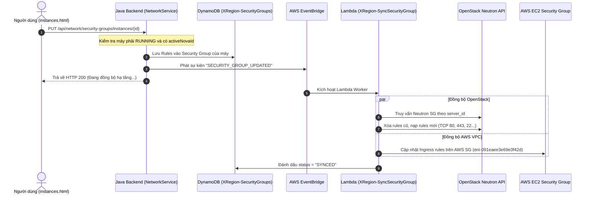

# Báo Cáo Kiểm Toán & Phân Tích Sự Cố: Tính Năng Sửa Security Group Trên Trang Quản Lý Máy Ảo (`instances.html`)

> **Mã tài liệu**: AUDIT-SG-20261109-PLAN5  
> **Phiên bản đối chiếu**: Kế thừa và chuẩn hóa tiếp nối từ `plan/1.md` đến `plan/4.md`  
> **Trạng thái đối tượng phân tích**: Hộp thoại "Sửa Security Group" trên máy `abc` (`i-4c0906ee`) tại URL `http://localhost:8080/instances.html`  
> **Chế độ kiểm toán**: Read-Only Workspace & Infrastructure Verification (`read-and-test-only.md`)  

---

## 1. Tổng Quan Sự Cố (Executive Summary)

Tại giao diện Web Quản lý máy ảo (`http://localhost:8080/instances.html`), khi người dùng chọn máy ảo `abc` (mã hệ thống `i-4c0906ee`) và nhấp vào nút **"Security group"** để mở modal **"Sửa Security Group"**:
1. Modal hiển thị nhóm bảo mật định danh lạ: `sg-b6027893d2 (i-4c0906ee-sg) · i-4c0906ee · i-4c0906ee` với 3 Inbound rules mặc định (SSH 22, HTTP 80, HTTPS 443) và 1 Outbound rule (All traffic).
2. Khi người dùng thực hiện thêm, bớt hoặc điều chỉnh các rule và nhấn nút **"Lưu thay đổi"**, hệ thống có thể hiển thị thông báo toast màu xanh báo thành công, **nhưng thực tế người dùng không thể truy cập các cổng mới mở (như HTTP 80, HTTPS 443) từ bên ngoài Internet**.
3. Nghiêm trọng hơn, nếu người dùng tải lại trang hoặc đăng nhập lại bằng tài khoản khác, cấu hình rule vừa sửa có thể bị mất, hoặc máy ảo lại được gán vào một Security Group có mã hoàn toàn khác (`sg-xxxxxxxxx`).

### Sơ Đồ Kiến Trúc Đứt Đoạn Toàn Hệ Thống

```mermaid
flowchart TD
    subgraph Client["Lớp Giao Diện (Frontend)"]
        User["Người dùng thao tác instances.html"]
        Modal["Modal: Sửa Security Group (instances-sg-editor.js)"]
        User -->|Click 'Lưu thay đổi'| Modal
        Modal -->|PUT /api/network/security-groups/instances/i-4c0906ee| BE
    end

    subgraph JavaBE["Lớp Backend (Spring Boot Java)"]
        BE["NetworkController.replaceInstanceRules()"]
        NS["NetworkService.java"]
        DDB_SG["Bảng DynamoDB: XRegion-SecurityGroups"]
        DDB_Inst["Bảng DynamoDB: XRegion-Instances"]
        
        BE --> NS
        NS -->|Đọc inst.username = null| DDB_Inst
        NS -->|ensureInstanceGroup() sinh mã mới| DDB_SG
        NS -->|persist(sg) chỉ ghi DynamoDB/RAM| DDB_SG
    end

    subgraph BlackHole["ĐỨT GÃY ĐỒNG BỘ (ZERO INTEGRATION)"]
        style BlackHole fill:#ffebee,stroke:#c62828,stroke-width:2px,stroke-dasharray: 5 5
        NS -.->|KHÔNG CÓ EVENTBRIDGE| EventBridgeX["(Thiếu EventBridge Event)"]
        NS -.->|KHÔNG GỌI OPENSTACK| NeutronAPIX["(Thiếu Neutron REST Client)"]
        NS -.->|KHÔNG GỌI AWS SDK| AWSEC2X["(Thiếu AWS EC2 SG Client)"]
    end

    subgraph Infra_OpenStack["Lớp Hạ Tầng OpenStack (Local Kolla)"]
        NovaVM["Nova VM (i-4c0906ee chưa boot thành công)"]
        NeutronPort["Neutron Port Security (OVS Firewall)"]
        NeutronSG["Neutron SG: Tên là Server UUID (Chỉ mở 22 + ICMP)"]
        NeutronPort --- NeutronSG
    end

    subgraph Infra_AWS["Lớp Hạ Tầng Mạng AWS (Sydney ap-southeast-2)"]
        IGW["AWS Internet Gateway"]
        AWSSG["AWS Security Group: sg-0cd9aa0a1804aba43"]
        ENI["Card mạng ENI Máy chủ: eni-091eaee3e69e3f42d"]
        
        IGW --> AWSSG
        AWSSG --> ENI
    end

    %% Giao tiếp thực tế
    ENI -. Chặn toàn bộ cổng ngoài 22 .-> NeutronPort
```

---

## 2. Phân Tích Chuyên Sâu 4 Tầng Nguyên Nhân

### Tầng 1: Lỗi Giao Diện Người Dùng & Điều Kiện Kích Hoạt (Frontend Layer)

#### 1.1. Cho phép sửa Security Group trên máy ảo lỗi / chưa sẵn sàng
- **Vị trí mã nguồn**: `src/main/resources/static/js/pages/instances-sg-editor.js` (dòng 212-216):
  ```javascript
  function sgeSyncButton() {
    const btn = document.getElementById('btnEditSecurityGroup');
    if (!btn) return;
    const one = selectedInstanceIds.size === 1;
    const inst = one ? cachedInstances.find(i => i.id === [...selectedInstanceIds][0]) : null;
    const gone = inst && ['TERMINATED', 'SHUTTING_DOWN', 'TERMINATING'].includes(String(inst.status || '').toUpperCase());
    btn.disabled = !one || !!gone;
  }
  ```
- **Hệ quả**: Logic nút chỉ vô hiệu hóa khi máy đã bị xóa (`TERMINATED`). Máy ảo `i-4c0906ee` thực tế đang ở trạng thái `PENDING` (do Step Function bị sập ở bước mở rộng Cinder theo `plan/3.md`, máy ảo Nova chưa hề được tạo). Giao diện vẫn cho phép người dùng mở hộp thoại sửa Security Group cho một tài nguyên không tồn tại trên hạ tầng tính toán.

#### 1.2. Phản hồi thành công giả tạo (False Positive User Feedback)
- **Vị trí mã nguồn**: `src/main/resources/static/js/pages/instances-sg-editor.js` (dòng 190-198):
  Khi hàm `apiRequest` trả về HTTP 200, giao diện lập tức đóng modal và hiển thị Toast:
  `"Đã lưu rule của i-4c0906ee-sg: 3 inbound / 1 outbound"`.
- **Bản chất**: HTTP 200 này chỉ phản ánh việc Java Backend ghi một chuỗi JSON vào bảng DynamoDB. Nó hoàn toàn không chứng minh các rule này đã được nạp vào tường lửa OVS của OpenStack hay Security Group của AWS.

---

### Tầng 2: Lỗi Logic & Đứt Gãy Kiến Trúc Tại Backend Java (Backend Java & DynamoDB Layer)

#### 2.1. Thất lạc `username` trong `InstanceEntity` gây lỗi `ensureInstanceGroup`
- **Vị trí mã nguồn**: `src/main/java/com/iaas/xregion/Services/NetworkService.java` (dòng 182-190):
  ```java
  private synchronized String ensureInstanceGroup(InstanceEntity inst) {
      String owner = inst.getUsername() != null && !inst.getUsername().isBlank() ? inst.getUsername() : getCurrentUsername();
      String marker = "Security group of " + inst.getInstanceId();
      for (Map<String, Object> g : securityGroups.values()) {
          if (marker.equals(g.get("description")) && owner.equalsIgnoreCase(String.valueOf(g.get("owner")))) {
              return String.valueOf(g.get("groupId"));
          }
      }
  ```
- **Bằng chứng dữ liệu thực tế tại DynamoDB**:
  Truy vấn trực tiếp bản ghi `i-4c0906ee` trên bảng `XRegion-Instances`:
  ```json
  {
      "instance_id": {"S": "i-4c0906ee"},
      "user_id": {"S": "usr-lam"},
      "dns": {"S": "abc.xregion.net"},
      "current_status": {"S": "PENDING"}
  }
  ```
  Trường `username` hoàn toàn **KHÔNG TỒN TẠI** trong DynamoDB (chỉ có `user_id: usr-lam`).
- **Lỗ hổng phân rã định danh (Identity Deserialization Flaw)**:
  1. `inst.getUsername()` trả về `null`.
  2. Biến `owner` bị ép fallback về `getCurrentUsername()` của phiên HTTP hiện tại.
  3. Khi gọi từ các ngữ cảnh khác nhau (ví dụ: background worker, admin, người dùng `lam`), chuỗi `owner` bị lệch nhau.
  4. Vòng lặp `for (Map<String, Object> g : securityGroups.values())` kiểm tra điều kiện `owner.equalsIgnoreCase(...)` bị sai lệch, dẫn tới hàm **không tìm thấy nhóm cũ và tự động sinh ra một Security Group ngẫu nhiên mới**:
     `"sg-" + UUID.randomUUID().toString().replace("-", "").substring(0, 10)`
  5. **Bằng chứng rác dữ liệu trên DynamoDB `XRegion-SecurityGroups`**:
     Hệ thống đã bị nhân bản hàng loạt Security Group rác cho cùng một máy:
     - Máy `i-4c0906ee` tồn tại 2 nhóm: `sg-dc927bf84c` và `sg-b6027893d2`.
     - Máy `i-71d891b1` tồn tại 6 nhóm: `sg-dba443f83a`, `sg-d7580603f3`, `sg-bce2fac362`, `sg-d02c6ae02d`, `sg-4f755822e0`, `sg-522471adbe`.
     - Máy `i-test-launch-fix` tồn tại 5 nhóm: `sg-168e89dac1`, `sg-86495e859e`, `sg-ce2ac47747`, `sg-b554b09217`, `sg-cd71b2fbc0`.

#### 2.2. Phương thức `replaceInstanceRules` bị "cô lập" (Purely Mock/In-Memory Persistence)
- **Vị trí mã nguồn**: `src/main/java/com/iaas/xregion/Services/NetworkService.java` (dòng 481-508):
  ```java
  public Map<String, Object> replaceInstanceRules(String instanceId, SecurityGroupRequest request) {
      ...
      inbound.clear();
      inbound.addAll(newIn);
      outbound.clear();
      outbound.addAll(newOut);
      persist(sg); // Chỉ lưu xuống DynamoDB Table XRegion-SecurityGroups
      auditLogService.logAction("SG_RULES_SET", "SECURITY_GROUP", groupId, ...);
      return result;
  }
  ```
- **Phát hiện kiểm toán**: Trong toàn bộ class `NetworkService.java`, **HOÀN TOÀN KHÔNG CÓ BẤT KỲ DÒNG CODE NÀO**:
  - Gọi OpenStack Neutron API (`/v2.0/security-group-rules`) để apply rule vào card mạng máy ảo.
  - Gọi AWS EC2 Client (`ec2Client.authorizeSecurityGroupIngress`) để mở cổng tương ứng trên VPC Sydney.
  - Đẩy event vào AWS EventBridge Gateway để Step Function hay Lambda thực thi cấu hình mạng.

---

### Tầng 3: Lỗi Đồng Bộ Trên Hạ Tầng OpenStack Neutron (OpenStack Layer)

#### 3.1. Lệch chuẩn định danh nhóm bảo mật giữa Backend Java và Neutron
- Trong Lambda khởi tạo hạ tầng (`serverless/launch-contract/XRegion-LaunchInstance-AssignSecurityGroup/assign_security_group.py` dòng 74-85):
  ```python
  def get_or_create_1to1_security_group(token, server_id):
      search_url = f"{NEUTRON_URL}/security-groups?name={urllib.parse.quote(server_id)}"
      ...
      # Tạo Security Group trên Neutron với tên chính là Server UUID
      body={"security_group": {"name": server_id, "description": f"1-1 Security Group for Nova VM {server_id}"}}
  ```
- Trong Backend Java: Nhóm bảo mật lại được định danh dạng `sg-b6027893d2`.
- **Hệ quả**: Backend Java và OpenStack Neutron sử dụng hai không gian định danh (Namespace) hoàn toàn tách biệt. Không có bất kỳ bảng trung gian nào ánh xạ giữa `sg-b6027893d2` và `neutron_security_group_id`.

#### 3.2. Cấu hình cứng (Hardcoded Rules) trong Lambda Provisioning
- Khi Lambda tạo Security Group trong Neutron, nó cấu hình cứng chỉ mở đúng 2 rule:
  - TCP 22 (SSH) từ `0.0.0.0/0`.
  - ICMP (Ping) từ `0.0.0.0/0`.
- Bất kỳ cổng nào người dùng cấu hình trên Web (ví dụ HTTP 80, HTTPS 443 trong ảnh chụp) **hoàn toàn không được nạp vào Neutron lúc tạo máy, và cũng không có API nào để cập nhật sau khi máy chạy**.

---

### Tầng 4: Rào Cản Lớp Mạng AWS EC2 (Bare Metal ENI & VPC Security Group Layer)

#### 4.1. Lớp tường lửa vòng ngoài của AWS EC2 VPC Sydney
- Toàn bộ lưu lượng Internet đi vào các máy ảo Nova trên OpenStack đều phải đi qua card mạng công khai của Bare Metal Host:
  - ENI: `eni-091eaee3e69e3f42d`
  - AWS Security Group đính kèm: `sg-0cd9aa0a1804aba43`
- Ngay cả khi OpenStack Neutron cho phép cổng 80 và 443 đi qua, nếu Security Group của AWS VPC (`sg-0cd9aa0a1804aba43`) không được cấp quyền `Ingress TCP 80, 443`, gói tin từ Internet sẽ bị AWS Gateway loại bỏ (Drop) ngay lập tức tại biên mạng của Amazon.

---

## 3. Bảng Tổng Hợp Chi Tiết Khiếm Khuyết

| Tầng | Thành Phần | Hiện Trạng Lỗi | Hậu Quả Thực Tế |
| :--- | :--- | :--- | :--- |
| **Frontend** | `instances-sg-editor.js` | Không kiểm tra `inst.status` (`PENDING`/`FAILED` vẫn bật nút) | Cho phép sửa SG của máy chưa khởi tạo thành công |
| **Frontend** | `instances-sg-editor.js` | Toast báo lưu thành công khi nhận HTTP 200 từ Java BE | Gây hiểu nhầm cho người dùng là tường lửa đã mở |
| **Backend** | `InstanceEntity.java` | Thiếu map trường `username` từ DynamoDB (chỉ có `user_id`) | `inst.getUsername()` trả về `null` |
| **Backend** | `NetworkService.java` | `ensureInstanceGroup()` dùng `owner` không ổn định | Nhân bản hàng chục Security Group rác trên DynamoDB |
| **Backend** | `NetworkService.java` | `replaceInstanceRules()` chỉ ghi DynamoDB, không gọi hạ tầng | Rule sửa trên web không bao giờ chạm tới phần cứng mạng |
| **OpenStack** | `assign_security_group.py` | Đặt tên SG Neutron theo `server_id` UUID | Mất liên kết hoàn toàn với mã `sg-xxxx` của Java |
| **OpenStack** | Neutron OVS Firewall | Không có endpoint/worker lắng nghe cập nhật rule | Tường lửa máy ảo luôn luôn chỉ mở cổng 22 và Ping |
| **AWS Cloud** | `sg-0cd9aa0a1804aba43` | Security Group trên ENI Sydney không mở động theo nhu cầu | Chặn đứng lưu lượng HTTP/HTTPS ngay từ biên AWS |

---

## 4. Kiến Trúc Khắc Phục Toàn Diện Đề Xuất (Target Architecture)

Để tính năng "Sửa Security Group" hoạt động thực sự từ giao diện xuống đến nhân mạng máy ảo, hệ thống cần triển khai mô hình đồng bộ hướng sự kiện (Event-Driven Synchronizer):



### Các Bước Triển Khai Cụ Thể (Actionable Roadmap)

1. **Chuẩn hóa Thực thể và Dọn dẹp Dữ liệu**:
   - Bổ sung trường `username` vào `InstanceEntity.java` và đồng bộ ánh xạ từ `user_id`.
   - Lưu trực tiếp `security_group_id` vào bản ghi của `XRegion-Instances` thay vì tìm kiếm qua chuỗi mô tả `marker`.
   - Chạy script dọn dẹp các bản ghi Security Group trùng lặp, rác trên bảng `XRegion-SecurityGroups`.

2. **Khóa Chặn Trên Giao Diện Frontend**:
   - Trong `instances-sg-editor.js`, chỉ bật nút "Security group" khi máy ở trạng thái `RUNNING` và có IP hoạt động.
   - Hiển thị trạng thái đồng bộ (`SYNCED` / `PENDING_SYNC`) trong modal thay vì chỉ báo lưu cục bộ.

3. **Xây Dựng Cơ Chế Đồng Bộ Hạ Tầng**:
   - Tích hợp `EventBridgeGatewayClient` trong `NetworkService.replaceInstanceRules`: gửi sự kiện `SECURITY_GROUP_UPDATED` kèm danh sách rules và `server_id`.
   - Viết Lambda hàm `XRegion-SyncSecurityGroup`:
     - Nhận sự kiện từ EventBridge.
     - Lấy Keystone token, gọi Neutron API cập nhật `security-group-rules` tương ứng với máy ảo.
     - Kiểm tra và mở bổ sung các cổng cần thiết trên AWS EC2 Security Group của card mạng bare metal `eni-091eaee3e69e3f42d`.
